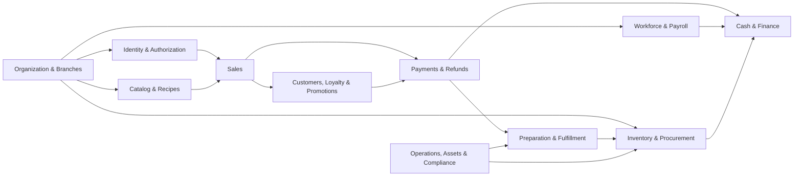
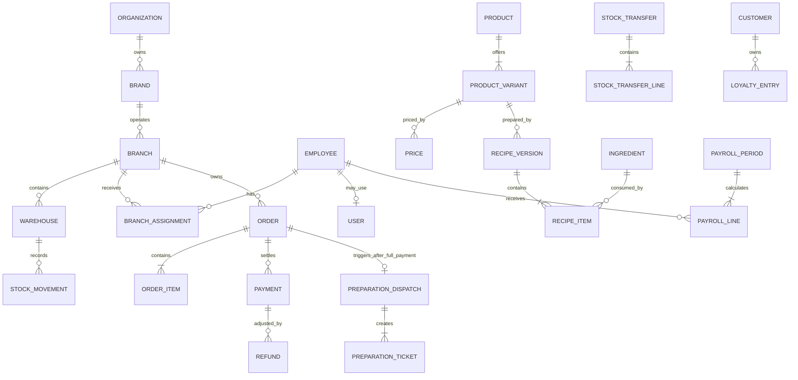

# AFTER FOUR Business Domain Model v1.0

**Status:** Canonical business specification for ERD and Data Dictionary review  
**Date:** 2026-11-14  
**Scope:** Business concepts, rules, lifecycles, ownership, and cross-domain invariants. This document is implementation-independent and creates no database or API contract.

**Payment clarification:** [Canonical Payment Model](after_four_payment_model.md) separates funding truth from attempt activity; it does not change the Owner-confirmed paid-before-preparation rule.

**Owner-decision source:** The [Owner Decision Baseline](after_four_owner_decision_baseline.md) is authoritative for later Owner-confirmed business policy. The [DDD Foundation](after_four_ddd_foundation.md) proposes logical context ownership without authorizing implementation.

## 1. Purpose, sources, and decision provenance

This specification reconciles three sources:

1. the repository and its applicable instructions;
2. the [Architecture Gap Analysis](../research/after_four_architecture_gap_analysis.md);
3. the Owner-workshop outcomes supplied for the original model; and
4. the later [Owner Decision Baseline](after_four_owner_decision_baseline.md).

The repository's earlier workflow, domain-model, backend, and database documents are proposals pending approval. They remain useful engineering input, but this document is canonical where the workshop outcomes differ. In particular, the earlier proposal dispatched order items to preparation before payment. The canonical rule is now that **full successful payment must be persisted before preparation dispatch**.

### 1.1 Provenance labels

| Label | Meaning in this document |
|---|---|
| `OWNER_CONFIRMED` | The Owner explicitly selected or stated the rule. |
| `WORKSHOP_AGREED` | A workshop default was accepted or the supplied workshop outcome directs it as business policy. |
| `TECHNICAL_PROPOSAL` | Engineering recommendation; not an Owner business policy. |
| `OPEN_DECISION` | A genuine unresolved business or operational choice requiring Owner approval. |
| `LEGAL_VALIDATION` | Must be validated against current law, accounting advice, contracts, or an external authority. |

Rules explicitly called Owner-confirmed in the supplied workshop outcomes use `OWNER_CONFIRMED`. Other directive business outcomes use `WORKSHOP_AGREED`. This prevents technical recommendations in older documents from being silently upgraded to business policy.

### 1.2 Product boundary

- `WORKSHOP_AGREED` AFTER FOUR is an internal cafe-chain management system.
- `WORKSHOP_AGREED` The operational model supports Branches under a Brand.
- `OWNER_CONFIRMED` Initial deployment has one Organization and one Brand. The Organization → Brand → Branch hierarchy remains explicit, the schema permits multiple Organizations and Brands, and no permanent single-row constraint is allowed (`ODB-CAT-14`). Maximum Brands per Organization and additional Branch cardinality remain unresolved.
- `WORKSHOP_AGREED` The network has a Central Warehouse and Branch Warehouses.
- `OWNER_CONFIRMED` Customer Profile may be shared across Branches within authorized Brand/Branch scope, while each transaction retains its originating Branch and Purchase History remains Branch-scoped. Cross-Brand access is default-deny (`MVP-CUST-SCOPE`, [`SDP-CUST-06`](after_four_customer_management_owner_decisions.md#sdp-cust-06), `MVP-LOY-SCOPE`; provisional references pending explicit canonical ID allocation and crosswalk).
- `OWNER_CONFIRMED` Active roles are Owner, Branch Manager, and Staff. Regional Manager is reserved and inactive.
- `WORKSHOP_AGREED` SaaS tenant onboarding, subscriptions, and a marketplace are outside MVP scope.
- `OWNER_CONFIRMED` Launch planning assumes one main Branch, four Employees, one POS Device, two to three rotating shifts per Operating Day, a peak of 40–60 Orders/hour, approximately 80% dine-in/20% takeaway, and approximately 70% bank transfer/30% cash. These are planning assumptions, not capacity guarantees, concurrency limits, service objectives, or fixed schema limits (`ODB-PLN-03`–`ODB-PLN-09`).

## 2. Domain glossary

### Organization and access

**Organization**: The legal or operating enterprise that owns Brands.  
_Avoid:_ Tenant, account.

**Brand**: The customer-facing cafe identity operated by the Organization.  
_Avoid:_ Store, company.

**Branch**: A physical cafe location with its own operations, staff access, cash, inventory, and reporting scope.  
_Avoid:_ Floor, warehouse, tenant.

**User**: A sign-in identity that authenticates a person and can be activated or deactivated.  
_Avoid:_ Employee, staff record.

**Employee**: A person with an employment relationship, profile, compensation, assignments, attendance, and payroll history.  
_Avoid:_ User, role.

**Branch Assignment**: An effective-dated work-eligibility relationship between an Employee and a Branch. It may be primary or temporary and grants no authorization capability by itself.

### Sales and fulfillment

**Order**: The commercial record of requested products for one service interaction. It does not represent payment, preparation, printing, or delivery state.

**Order Item**: A historically stable sold configuration containing product, variant, modifier, quantity, and price snapshots.

**Payment**: The settlement aggregate for an Order. Its funding status is separate from the activity/outcome of its Payment Attempts.  
_Avoid:_ Order transaction, checkout state.

**Payment Attempt**: One cash/provider charge attempt with its own method, requested amount, idempotency identity, and authoritative outcome. It does not by itself mean the Order is fully settled.

**Refund**: A new financial record that returns value from an original successful Payment without rewriting it.

**Preparation**: The work required to make paid Order Items. Its lifecycle is separate from Order and Payment.

**Preparation Ticket**: The uniquely identified preparation instruction produced after full successful payment.

**Preparation Dispatch**: The durable, retryable handoff that creates or delivers a Preparation Ticket exactly once after payment succeeds.

**Print Job**: A separately tracked request to print a receipt, preparation ticket, label, or other document. Printing failure never changes payment success.

**Internal Delivery**: A staff-operated handoff of prepared items within a Branch, including upstairs delivery. It is not third-party delivery-to-address.

### Inventory, cash, and workforce

**Warehouse**: A stock-holding location owned by the Organization or a Branch. A cafe stock room is a Branch Warehouse.

**Stock Movement**: The immutable source-of-truth record for every increase, decrease, reservation release, or transfer of stock.

**Stock Transfer**: A controlled movement between Warehouses with separate dispatch and receipt confirmation and an in-transit period.

**Available Stock**: Stock eligible to issue after excluding quarantine and other unavailable quantities. It cannot be negative.

**Cash Session**: The accountable operating period for one physical cash drawer and fund, distinct from an employee work Shift.

**Cash Transaction**: An immutable cash inflow, outflow, count adjustment, or correction within a Cash Session.

**Shift Plan**: The published schedule assigning Employees to Branches, times, and operational roles.

**Attendance Record**: The actual worked-time record, including punches and approved corrections, retaining the actual Branch.

**Payroll Period**: A calendar-month compensation period that moves from draft through review and immutable closure.

## 3. Bounded-context overview

| Bounded context | Owns | Does not own |
|---|---|---|
| Organization & Branches | Organization, Brand, Branch, Warehouse identity | User permissions, stock balances |
| Identity & Authorization | User, role template, capability, effective branch access | Employee compensation or attendance |
| Workforce & Payroll | Employee, availability, shift plan, attendance, leave, overtime, compensation, payroll | Login credentials, cash drawer |
| Catalog & Recipes | Category, Product, Variant, Modifier, prices, availability, RecipeVersion | Historical Order Item values |
| Sales | Order, Order Item, service channel, totals snapshots | Payment and Preparation lifecycles |
| Payments & Refunds | Payment, attempt, settlement, Refund | Provider-specific assumptions, cash counts |
| Preparation & Fulfillment | Preparation Dispatch/Ticket/Item, station routing, remake, Internal Delivery | Payment truth, inventory valuation |
| Inventory & Procurement | Warehouses, lots, stock, movements, transfers, suppliers, purchasing, payables | General-ledger accounting |
| Cash & Finance | Cash Session/Transaction, expenses, budgets, operational financial classification | Payroll calculation, provider settlement truth |
| Customers, Loyalty & Promotions | Customer, consent, loyalty ledger, promotion policy/application | Authentication for employees |
| Operations, Assets & Compliance | Reservations/tables, checklists, assets, maintenance, feedback, food-safety records, devices/printing | Core sales or payment state |

`TECHNICAL_PROPOSAL` These are logical ownership boundaries, not a requirement for microservices or separate databases. The existing modular-monolith proposal remains suitable for later engineering review.

## 4. Core entity catalog and relationships

### 4.1 Organization, identity, and workforce

| Entity | Definition and essential history | Provenance |
|---|---|---|
| Organization | Owns Brands and central operations. Initial deployment has one; schema supports multiple. | `OWNER_CONFIRMED` `ODB-CAT-14` |
| Brand | Belongs to Organization. Initial deployment has one; schema supports multiple. | `OWNER_CONFIRMED` `ODB-CAT-14`; maximum cardinality unresolved |
| Branch | Belongs to Brand; immutable owner of operational records created there. | `WORKSHOP_AGREED` |
| User | Sign-in identity; deactivated rather than deleted when referenced by history. | `WORKSHOP_AGREED` |
| Employee | Employment profile and status, separate from User. | `WORKSHOP_AGREED` |
| Branch Assignment | Effective-dated primary or temporary assignment; history is retained. | `WORKSHOP_AGREED` |
| Role Assignment | Effective-dated role/capability grant scoped to authorized branches. | `WORKSHOP_AGREED` |
| Availability Submission | Employee-declared availability for a planning period. | `WORKSHOP_AGREED` |
| Shift Assignment | Planned Branch, start/end, and one or more operational roles: cashier, barista, server, cleaning. | `WORKSHOP_AGREED` |
| Swap Request | Proposed exchange/reassignment of published shifts with approval history. | `WORKSHOP_AGREED` |
| Attendance Record | Actual Branch and worked time; missing-punch corrections retain original and corrected values. | `WORKSHOP_AGREED` |
| Leave Request | Requested absence with normal/exception handling and decision history. | `WORKSHOP_AGREED` |
| Overtime Request | Branch Manager proposal and Owner decision with reason and affected attendance/payroll period. | `OWNER_CONFIRMED` |
| Compensation Agreement | Monthly, hourly, or per-shift terms with effective-dated history. | Methods: `OWNER_CONFIRMED`; effective dating: `WORKSHOP_AGREED` |
| Payroll Period/Line | Calendar-month draft, calculations, review, closure, employee detail, payment status, and payslip. | `OWNER_CONFIRMED` |

### 4.2 Catalog, sales, and fulfillment

| Entity | Definition and essential history | Provenance |
|---|---|---|
| Category | Flat Brand catalog grouping created Draft. Every Product belongs to one Category. Category follows the confirmed lifecycle matrix, restores Archived→Inactive, and retains separate Deactivate/Archive guards. | `OWNER_CONFIRMED` `ODB-CAT-02`, `ODB-CAT-15`, `ODB-CAT-21`, `ODB-CAT-25`, `ODB-CAT-29`, `ODB-CAT-30`, `ODB-CAT-32`; mechanics proposed |
| Product / Variant | Brand-global Product and persisted Variant identity. Variant is created Draft and follows the confirmed matrix. Active Product requires Active Category and exactly one Active Default independent of visibility. Product restores Archived→Inactive under Owner/explicit-delegate authority. | `OWNER_CONFIRMED` `ODB-CAT-01`, `ODB-CAT-04`, `ODB-CAT-19`–`ODB-CAT-25`, `ODB-CAT-28`–`ODB-CAT-33`; mechanics proposed |
| Modifier Group / Modifier | Allowed choices and required/optional, single/multiple, minimum/maximum selection limits. Price effects remain unresolved. | `OWNER_CONFIRMED` `ODB-CAT-05`; pricing `OPEN_DECISION` |
| Branch Availability | Explicit effective Branch override of the chain availability default for a Variant. | `OWNER_CONFIRMED` `ODB-CAT-06` |
| Price | Immutable effective-dated chain default or explicit Branch override. | `OWNER_CONFIRMED` `ODB-CAT-07`, `ODB-CAT-08` |
| Recipe / RecipeVersion | Versioned preparation definition for a Variant with non-overlapping effective periods. | `WORKSHOP_AGREED` |
| Recipe Item | Ingredient quantity and unit in a RecipeVersion. | `WORKSHOP_AGREED` |
| Order / Order Item | Commercial record and immutable product/option/price snapshots. | `WORKSHOP_AGREED` |
| Payment / Payment Attempt | Settlement target and immutable attempt outcomes. | `WORKSHOP_AGREED` |
| Refund | Adjustment linked to original Payment and Order. | `WORKSHOP_AGREED` |
| Preparation Dispatch/Ticket/Item | Exactly-once paid-order handoff and item-level preparation work. | `OWNER_CONFIRMED` |
| Preparation Deviation | Waste, remake, substitution, quantity deviation, or cancellation after dispatch with actor/reason. | `WORKSHOP_AGREED` |
| Internal Delivery | Assignment, transit, delivery/failure, and destination history within a Branch. | `WORKSHOP_AGREED` |
| Print Job | Independent printing request and outcome linked to its business document. | `WORKSHOP_AGREED` |

### 4.3 Inventory, finance, customer, and operations

| Entity | Definition and essential history | Provenance |
|---|---|---|
| Ingredient / Unit | Stocked material and canonical measurement rules. | `WORKSHOP_AGREED` |
| Warehouse | Central or Branch stock location. | `WORKSHOP_AGREED` |
| Lot | Received batch, expiry, availability class, and traceability. | `WORKSHOP_AGREED` |
| Stock Movement | Immutable quantity and cost-bearing change with source, actor, time, and reversal link. | `WORKSHOP_AGREED` |
| Stock Transfer / Line | Dispatch, in-transit, and receipt lifecycle between Warehouses. | `WORKSHOP_AGREED` |
| Supplier / Purchase Request / Purchase Order | Approved procurement intent and supplier commitment. | `WORKSHOP_AGREED` |
| Goods Receipt | Partial or full receipt, lot/expiry, accepted/quarantined/rejected quantities, and cost. | `WORKSHOP_AGREED` |
| Payable | Supplier amount due and payment status; detailed accounting treatment requires validation. | `WORKSHOP_AGREED`, `LEGAL_VALIDATION` |
| Cash Session / Cash Transaction | Shared-drawer accountability, immutable movements, counts, and corrections. | `WORKSHOP_AGREED` |
| Expense / Budget | Categorized operating cost, approval history, payment source, and budget comparison. | `WORKSHOP_AGREED` |
| Customer / Consent | Phone-associated profile and recorded permission for collection/use. | `WORKSHOP_AGREED`, `LEGAL_VALIDATION` |
| Loyalty Entry | Immutable earn, redeem, expire, reverse, or adjustment entry. | `WORKSHOP_AGREED` |
| Promotion / Application | Eligibility, limits, stacking policy, approval, and historical application snapshot. | `WORKSHOP_AGREED` |
| Reservation / Table Session | Booking and actual visit associated with a physical table without overwriting history. | `WORKSHOP_AGREED` |
| Asset / Maintenance Record | Equipment identity, location, service, failure, and resolution history. | `WORKSHOP_AGREED` |
| Checklist / Completion | Opening, in-shift, or closing tasks and accountable completion. | `WORKSHOP_AGREED` |
| Feedback / Complaint | Customer issue, ownership, action, and resolution. | `WORKSHOP_AGREED` |
| Temperature Record | Food-safety observation linked to Branch/Warehouse/equipment and corrective action. | `WORKSHOP_AGREED`, `LEGAL_VALIDATION` |
| POS Device / Printer | Branch-owned operational endpoint and status. | `WORKSHOP_AGREED` |

### 4.4 Relationship overview

## 5. Identity, authorization, and branch scope

### 5.1 Role definitions

- `WORKSHOP_AGREED` **Owner** has organization-wide business authority, including final payroll close and approvals reserved for the Owner.
- `OWNER_CONFIRMED` **Branch Manager** operates assigned Branches, manages staff and routine exceptions, and cannot gain access merely by selecting another Branch in the UI.
- `WORKSHOP_AGREED` **Staff** performs permitted operational work only within effective Branch Assignments and shift duties.
- `OWNER_CONFIRMED` **Regional Manager** is a reserved, inactive future role. It has no access in MVP; a future activation requires explicit Branch scope and a new Owner decision.
- `TECHNICAL_PROPOSAL` MVP should use these role templates plus a small stable capability set, not a user-configurable RBAC designer.

### 5.2 Role and branch-scope matrix

| Capability area | Owner | Branch Manager | Staff | Future Regional Manager |
|---|---|---|---|---|
| Organization/Brand configuration | Organization-wide | No, unless delegated later | No | No by default |
| Branch operations | All Branches | Assigned Branches | Effective assigned Branches | Explicit regional Branch set |
| Employee scheduling | All | Assigned Branches | View own; submit availability/swap | Regional scope |
| Normal leave | May handle exceptions | Approves assigned-Branch normal leave | Requests own | Regional escalation if later approved |
| Overtime | Final approval | Proposes | Records/request follows policy | `OPEN_DECISION` |
| Payroll | Reviews and closes | Preliminary review | Own payslip only | `OPEN_DECISION` |
| Paid Order cancellation | Approves after Preparation starts | Operates only within assigned scope; no additional approval inferred | May cancel with reason/audit before Preparation starts | Completed-Order outcomes and Refund details remain `OPEN_DECISION` |
| Inventory/procurement | All | Assigned Branches and approved limits | Operational actions by capability | Regional scope if introduced |
| Customer Profile / Purchase History | Policy-governed basic Profile access; no unrestricted cross-Brand visibility | Appropriately scoped basic Profile view; assigned-Branch Purchase History | Assigned-Branch operational need under explicit capability | Regional scope if introduced |
| Loyalty adjustment | Approves | Requests | No direct adjustment | `OPEN_DECISION` |

`WORKSHOP_AGREED` Authorization is enforced server-side on every command and read. Client-selected Branch, Floor, role, or route is never authority. Operational records retain their Branch even if an Employee later transfers. Sensitive actions record actor, effective role/Branch scope, reason, approver when required, and time. Users and Employees with history are deactivated/offboarded rather than deleted.

`OWNER_CONFIRMED` Invitation Delegation is separate from Role Assignment and Branch Assignment; it gives an active Branch Manager only time-limited authority to invite Staff within assigned Branches. Branch Managers have no inferred permissions, cannot self-elevate or approve their own assignments, and receive no implicit Owner account/security, company-wide payroll-policy, final-payroll-close, lifecycle, or recovery authority. Authentication lock is temporary/automated; suspension/reactivation and deactivation are Owner-controlled and preserve employment/business history. See the [Identity Decision Register](after_four_identity_decision_register.md) for the exact policy boundaries; no new entity or physical schema is defined here.

## 6. Workforce and payroll

### 6.1 Workforce workflow

1. `WORKSHOP_AGREED` Onboarding creates the Employee profile, employment status, User if system access is required, primary Branch Assignment, compensation terms, and initial role capabilities.
2. `WORKSHOP_AGREED` Employees submit weekly availability. Branch Managers create shift assignments by Branch, time, and operational role, then publish the Shift Plan.
3. `WORKSHOP_AGREED` A published shift may be changed through a Swap Request or authorized reassignment; the original schedule and decision remain historical.
4. `WORKSHOP_AGREED` Attendance records actual punches, actual Branch, and worked time. Missing punches are corrected through an attributed correction, not silent overwrite.
5. `OWNER_CONFIRMED` A Branch Manager proposes overtime; the Owner approves or rejects it before approved overtime affects payroll.
6. `OWNER_CONFIRMED` A Branch Manager approves normal leave; the Owner handles exceptions. Exact leave categories, balances, notice, and paid/unpaid rules require policy and legal validation.
7. `WORKSHOP_AGREED` Offboarding ends effective assignments and access, preserves historical records, and deactivates the User where applicable.

### 6.2 Compensation and payroll rules

- `OWNER_CONFIRMED` Supported salary methods are monthly, hourly, and per-shift.
- `WORKSHOP_AGREED` Compensation changes are effective-dated and never rewrite a prior period.
- `OWNER_CONFIRMED` Each Payroll Period runs from the first through the last calendar day of a month. The Owner configures its payment date in the following month.
- `OWNER_CONFIRMED` The system calculates a draft from effective compensation, approved attendance, approved overtime, leave, and authorized adjustments.
- `WORKSHOP_AGREED` A Branch Manager performs a preliminary review; `OWNER_CONFIRMED` the Owner reviews the result and closes the period.
- `WORKSHOP_AGREED` A closed Payroll Period is immutable. Corrections are separately attributed adjustment entries in a later correction flow; whether reopening is ever allowed is an `OPEN_DECISION`.
- `WORKSHOP_AGREED` Payroll payment status is tracked independently from calculation/closure.
- `OWNER_CONFIRMED` Each Employee receives a detailed payslip with PDF download.
- `LEGAL_VALIDATION` Statutory payroll fields, deductions, overtime calculation, leave treatment, payslip content, retention, and payment obligations require current Vietnamese legal/accounting validation.

### 6.3 Payroll lifecycle

| State | Meaning | Allowed next states |
|---|---|---|
| Draft | System calculation is incomplete or may be recalculated from approved inputs. | Branch Manager Review |
| Branch Manager Review | Preliminary completeness and exception review. | Draft, Owner Review |
| Owner Review | Owner examines final calculation and exceptions. | Branch Manager Review, Closed |
| Closed | Calculation and evidence are frozen; no silent changes. | Paid, Adjusted |
| Paid | Payment is recorded; closure remains unchanged. | Adjusted |
| Adjusted | One or more separately traceable corrections exist; original close remains intact. | Paid/Adjusted as policy permits |

## 7. Catalog, prices, recipes, and historical snapshots

- `OWNER_CONFIRMED` Product identity is Brand-global. MVP Categories are flat, and a Product moves through Draft, Active, Inactive, and Archived lifecycle states (`ODB-CAT-01`–`ODB-CAT-03`).
- `OWNER_CONFIRMED` Every Product, including Draft, belongs to exactly one Category (`ODB-CAT-15`).
- `OWNER_CONFIRMED` Every sellable selection is a persisted Variant. Every Product has at most one Variant with `is_default = true`; Draft, Inactive, and Archived permit zero or one, while an Active Product must have exactly one and it must be Active (`ODB-CAT-04`, `ODB-CAT-19`, `ODB-CAT-23`, `ODB-CAT-28`, `ODB-CAT-38`). Concurrency enforcement remains `TECHNICAL_PROPOSAL`.
- `OWNER_CONFIRMED` Default designation, Variant lifecycle status, and customer visibility are independent. A hidden Active Variant may be the valid Default; an Inactive or Archived Variant cannot satisfy an Active Product's Default requirement (`ODB-CAT-20`, `ODB-CAT-28`, `ODB-CAT-31`, `ODB-CAT-38`).
- `OWNER_CONFIRMED` Category/Product/Variant codes accept trimmed ASCII Latin letters, digits, hyphen, and underscore and canonicalize to uppercase. Each entity type has its own Brand-scoped namespace. Codes/SKUs remain reserved after Archive and any future Soft Delete (`ODB-CAT-16`, `ODB-CAT-18`, `ODB-CAT-22`, `ODB-CAT-27`, `ODB-CAT-36`). SKU support is deferred from Catalog Core MVP; future normalization remains unresolved (`ODB-CAT-34`).
- `OWNER_CONFIRMED` Archived Product Restore-to-Inactive and its Owner/explicit-delegate authority remain future policy (`ODB-CAT-24`, `ODB-CAT-33`). Initial Catalog Core MVP excludes Product Activate, Deactivate, Archive, and Restore commands/APIs; the full Product lifecycle is not implemented or complete (`ODB-CAT-39`).
- `OWNER_CONFIRMED` A Product may transition to Active only while its assigned Category is Active, and a Category may not transition to Inactive while Active Products remain (`ODB-CAT-29`). A Product stays in its original Category in MVP; no reassignment command/API exists (`ODB-CAT-41`). Technical enforcement remains proposed.
- `OWNER_CONFIRMED` Category and Variant are created Draft and use the exact `ODB-CAT-32` matrix. Variant Archive/Restore changes status only, preserves `is_default` and `customer_visible`, returns Archived→Inactive, and never silently transfers Default designation (`ODB-CAT-40`). Branch availability is independent. Commands, locking, audit, authorization, and concurrency remain technical.
- `OWNER_CONFIRMED` Catalog Core MVP retains Category/Product/Variant via lifecycle/Archive, not Soft Delete, and prohibits Purge for Draft, Active, Inactive, and Archived records. Identifiers remain reserved after Archive or any future Soft Delete (`ODB-CAT-35`–`ODB-CAT-37`, `ODB-DATA-01`). This does not impose Catalog retention mechanics on unrelated entities or authorize future Soft Delete.
- `OWNER_CONFIRMED` Modifier Groups support required/optional and single/multiple selection with minimum and maximum selection limits (`ODB-CAT-05`). Whether Modifier selections affect price is unresolved pending the actual menu and pricing requirements.
- `OWNER_CONFIRMED` Branch Availability may explicitly override the chain default without changing Brand-global Product identity (`ODB-CAT-01`, `ODB-CAT-06`).
- `OWNER_CONFIRMED` Chain-level default Prices support explicit Branch-level overrides. Price versions are immutable and effective-dated (`ODB-CAT-07`, `ODB-CAT-08`).
- `OWNER_CONFIRMED` If authoritative Price changes while an Order is Draft, the revised quote requires review before confirmation. At confirmation, the sold price is locked into the Order Item snapshot; later Catalog or Price changes cannot rewrite it (`ODB-CAT-09`, `ODB-CAT-10`). Snapshot components whose policies remain unresolved are not invented here.
- `WORKSHOP_AGREED` A Recipe has effective-dated RecipeVersions. Each version contains Ingredient quantities and units; effective periods for the same Variant cannot overlap.
- `WORKSHOP_AGREED` Preparation uses the RecipeVersion effective for the sold/prepared item and retains that reference. Later RecipeVersion changes never rewrite historical consumption expectations.
- `WORKSHOP_AGREED` Waste, remake, and preparation deviations are explicit records and create their own Stock Movements where stock is affected.
- `OPEN_DECISION` Tax treatment/inclusion, service charge, rounding, zero/free pricing, Modifier price effects, time-based availability, manual sold-price overrides and approvals, authority to publish Branch Price versions, inventory, and media storage/vendor selection remain unresolved.

## 8. Sales, payment, preparation, printing, and delivery

### 8.1 Separate concepts and service channels

`WORKSHOP_AGREED` Order, Payment, Refund, Preparation, Print Job, and Internal Delivery have independent identities and lifecycles. A status in one context must never stand in for another.

Supported Order channels are `WORKSHOP_AGREED`:

- dine-in, associated with a Table Session when applicable;
- takeaway;
- counter pickup;
- internal delivery within a Branch.

`OWNER_CONFIRMED` Choosing dine-in or takeaway does not require a reason (`ODB-OP-01`).

### 8.2 Order lifecycle

| State | Meaning | Allowed transitions |
|---|---|---|
| Draft | Editable commercial intent; not payable or dispatched. | Confirmed, Cancelled |
| Confirmed | Items/totals are confirmed and awaiting full settlement within the active payment window. | Held, Expired, Cancelled, Closed after independent completion rules |
| Held | An attributed exception has stopped automatic progress. Payment evidence may still be recorded, but preparation cannot be dispatched automatically. | Explicit review/correction path only; no automatic reactivation |
| Expired | The payment window ended before verified settlement. Later success remains financial truth but cannot dispatch or reactivate the Order automatically. | Explicit review/correction path only; no automatic reactivation |
| Cancelled | Commercial intent ended through a recorded reason; existing financial/fulfillment history remains. | Terminal |
| Closed | Required settlement and service obligations are complete under policy. | Terminal; later Refund does not rewrite closure history |

Order views may derive labels such as “awaiting payment” or “service incomplete” from related contexts, but those labels are not Order lifecycle states.

`OWNER_CONFIRMED` A paid Order may be cancelled by Staff with reason and audit before Preparation starts (`ODB-OP-12`). Once Preparation has started, cancellation requires Owner approval (`ODB-OP-13`). A future cancellation command requires an atomic Preparation-state fence so a concurrent start cannot bypass the correct authority. Completed Orders use a separate exception process whose authority and outcomes remain `OPEN_DECISION` (`ODB-OP-14`). Cancellation never erases Payment, Preparation, stock, or audit history.

### 8.3 Payment state dimensions

Payment funding and charge-attempt activity are independent dimensions; they are not one lifecycle.

| Funding status | Meaning | Required behavior |
|---|---|---|
| Unpaid | No successful amount is allocated. | Preparation dispatch prohibited. |
| Partially Paid | Successful amount is below the full payable balance, if partial tender is later allowed. | Do not dispatch. Reserved but unreachable through MVP commands; partial-payment policy is `OPEN_DECISION`. |
| Fully Paid | Successful amount exactly equals the full payable balance. | With idle attempt activity, persist success and create the preparation-dispatch intent exactly once. |
| Partially Refunded | A linked Refund returned part of settled value. | Preserve original success; apply approved revenue/loyalty adjustments. |
| Fully Refunded | Linked successful Refunds returned all successful value. | Preserve original success and all attempts. |

| Attempt activity | Meaning | Required behavior |
|---|---|---|
| Idle | No charge attempt is active or unresolved. | A new exact-balance attempt may be considered only while Unpaid. |
| Processing | A durable charge attempt is initiated/pending. | Do not start another charge or dispatch. |
| Reconciliation Required | An attempt outcome cannot be proven after timeout/interruption. | Query/reconcile authority; do not assume failure/success or blindly retry. |

`WORKSHOP_AGREED` Preparation eligibility requires Fully Paid funding and Idle attempt activity. Refund processing/uncertainty belongs to the independent Refund lifecycle. Every Payment Attempt records method, amount, result, idempotency identity, actor/device context, provider reference when present, safe failure information, and times. Failed and unknown attempts remain historical.

For MVP, `TECHNICAL_PROPOSAL` payment commands accept only the exact unpaid balance. Split/partial allocation is not implemented and remains `OPEN_DECISION`. This exact-balance implementation rule does not erase real excess money already received: `OWNER_CONFIRMED` any overpayment must be evidenced and its excess refunded, and the excess is never revenue (`ODB-OP-11`). The physical excess/refund evidence model and refund method require a separate approved design before implementation.

`OWNER_CONFIRMED` MVP bank transfer uses the Owner's bank QR. A notification speaker announces an amount as an alert only; it is not Payment proof. The cashier manually compares the amount with the pending Order and explicitly confirms it in POS. No automatic bank API matching is approved for MVP (`ODB-OP-07`–`ODB-OP-09`). A mismatch is not confirmed by default; resolution or an appropriate Refund is required, and an exception requires Owner or explicitly authorized approval, reason, and audit (`ODB-OP-10`). Exact exception roles and Refund method remain `OPEN_DECISION`.

`OWNER_CONFIRMED_PLAN` (2026-11-25) identifies two intended First Branch receipt methods: cash received directly from customers and bank transfer to a separate account dedicated to the business. This planning fact does not identify the bank, account holder, account details, QR provider, settlement evidence or reconciliation process; it is not an implemented Payment method or an actual transaction. It does not supersede the historical `ODB-OP-07` direction. For the bounded initial build, `CORE-OD-07` remains controlling: exact-balance cash only, with manual bank excluded until separately governed Branch capability and evidence prerequisites are resolved. A recorded transfer assertion or employee acknowledgement is never successful settlement by itself.

### 8.4 Mandatory paid-before-preparation scenarios

1. `OWNER_CONFIRMED` **An authoritative attempt makes an eligible Payment fully paid:** while the Order is Confirmed and inside its active payment window, persist the attempt result, Fully Paid/Idle aggregate state, and durable Preparation Dispatch intent atomically. Dispatch the paid Order exactly once and prevent duplicate tickets.
2. `OWNER_CONFIRMED` **Payment fails:** preserve the failed attempt and do not dispatch preparation.
3. `OWNER_CONFIRMED` **Payment result is unknown:** do not fabricate success or failure. Reconcile/query provider status before deciding whether a new payment attempt is safe.
4. `OWNER_CONFIRMED` **Payment succeeds but preparation dispatch fails:** preserve successful Payment, keep Preparation Dispatch pending and visible, and retry it without charging again.
5. `WORKSHOP_AGREED` **Refund:** create a Refund linked to the original Payment and Order; never edit/delete the original transaction. Apply explicit revenue and loyalty reversals/adjustments. `OWNER_CONFIRMED` Owner approval is mandatory. Under `WS-REFUND-01`, an otherwise eligible request received while the Owner is unreachable is recorded and acknowledged, retains its eligibility/amount evidence, remains pending and unexecuted, is escalated to the Owner, and is communicated to the customer as pending. Timeout, silence, receipt, acknowledgement and elapsed time never imply approval; no automatic threshold or emergency delegate exists. Eligibility, amount/method/allocation, execution actor, accounting treatment and partial-refund effects remain `OPEN_DECISION`.
6. `OWNER_CONFIRMED` **Payment succeeds after expiration or while held:** preserve the successful attempt and Fully Paid financial truth, open an attributed review/exception case, and create neither Preparation Dispatch nor an automatic Order reactivation.
7. `OWNER_CONFIRMED` **Observed/received amount exceeds the Order target:** do not classify the excess as revenue or weaken the exact-balance Phase 1 settlement invariant. Preserve required evidence and route the excess to a separately designed Refund/exception process; do not dispatch on ambiguous or mismatched evidence.

The current MVP payment-window default is five minutes and is environment-configurable. The duration is an implementation default, not a newly inferred permanent Owner policy.

### 8.5 Preparation lifecycle

| State | Meaning | Notes |
|---|---|---|
| Dispatch Pending | Full Payment is persisted; ticket creation/handoff is not yet confirmed. | Retryable with the same dispatch identity. |
| Queued | A unique Preparation Ticket exists at a station. | Duplicate dispatch must return/locate the same ticket. |
| In Progress | Preparation has started. | Stock consumption follows the approved event policy. |
| Partially Ready | Some ticket items are ready. | Item-level status is authoritative. |
| Ready | All required items are ready for pickup/delivery. | Does not imply printed or delivered. |
| Completed | Prepared work has been handed to the next service stage. | Does not change Payment. |
| Cancelled | Remaining preparation was explicitly cancelled with reason/authority. | Paid value requires refund/compensation handling. |

Preparation Items independently track queued, in-progress, ready, completed, cancelled, and remake quantities. `WORKSHOP_AGREED` Remakes and cancellations after dispatch are new attributed actions; they do not rewrite the original ticket item. `WORKSHOP_AGREED` Preparation station routing is extensible and may initially use one station.

`OWNER_CONFIRMED — DESIRED_PROCESS` for the not-yet-operated First Branch: after every required Item is complete, Staff verify whole-Ticket readiness and the Order enters pending handover under its stable Order/Ticket identity. Staff establish the intended-customer or authorized-recipient relationship before release; the recipient then confirms receipt. The handover record preserves the Order/Ticket reference, responsible actor, recipient/linkage basis, time and available supporting evidence, and handover completes only when approved evidence criteria are satisfied. This selects no evidence class, attester authority, Identity mechanism or positive sufficiency threshold; acknowledgement alone is not custody transfer, and Model A remains fail-closed for unresolved or conflicting evidence.

### 8.6 Printing and internal delivery

- `WORKSHOP_AGREED` Print Job states are pending, printing, printed, failed, and cancelled. Reprinting uses a new attempt linked to the same document and must not repeat payment or preparation dispatch.
- `WORKSHOP_AGREED` Printer failure is independent from Payment success. A paid Order remains paid and recoverable even if every print attempt fails.
- `WORKSHOP_AGREED` Internal Delivery states are pending, assigned, in transit, delivered, failed, and cancelled. It retains destination, actor, attempts, failure reason, and timestamps.
- `WORKSHOP_AGREED` Dine-in table movement and internal delivery destination changes retain history instead of overwriting the original destination.

## 9. Inventory and procurement

### 9.1 Stock rules

- `WORKSHOP_AGREED` Every stock change originates from an immutable Stock Movement. Direct balance editing is forbidden.
- `WORKSHOP_AGREED` Movement reasons include receiving, issue/consumption, transfer dispatch, transfer receipt, stocktake adjustment, waste, remake, internal use, quarantine, rejection, and reversal.
- `WORKSHOP_AGREED` Available Stock cannot be negative. A command that would make it negative is rejected or requires an explicit approved exception policy; no such exception is currently approved.
- `WORKSHOP_AGREED` Lots retain supplier/receipt traceability, received and expiry dates, disposition, and remaining quantities. FEFO selects the earliest-expiring eligible lot first.
- `WORKSHOP_AGREED` Quarantined or rejected goods are not Available Stock and cannot be consumed or transferred as normal stock.

### 9.2 Weighted-average costing

`WORKSHOP_AGREED` Each Warehouse/Ingredient maintains a weighted-average unit cost derived only from cost-bearing Stock Movements. On a qualifying receipt:

`new average cost = (current valued quantity × current average cost + received quantity × receipt unit cost) ÷ new valued quantity`

Issues reduce quantity at the current average cost without changing the average. Reversals preserve a traceable relationship to the original movement. Rounding precision and accounting presentation require `LEGAL_VALIDATION` and engineering specification.

`WORKSHOP_AGREED` When a Branch Warehouse receives an internal transfer, it values the received quantity using the Central Warehouse's current cost associated with that transfer, then recomputes its own weighted average. The exact valuation snapshot event—dispatch or receipt—requires accounting validation and an engineering policy; once assigned, later central cost changes do not rewrite an in-transit or received transfer.

### 9.3 Stock Transfer lifecycle

| State | Meaning | Stock ownership/effect |
|---|---|---|
| Draft | Lines may be prepared; no stock moved. | Source stock unchanged. |
| Approved | Transfer is authorized under configurable policy. | Source stock unchanged or reserved by explicit policy. |
| Dispatched | Source confirms quantities/lots and posts dispatch movements. | Quantity leaves source and becomes in transit. |
| In Transit | Custody is between Warehouses. | Not available at source or destination. |
| Partially Received | Destination confirms some lines/quantities. | Received quantity enters destination valuation; remainder stays in transit. |
| Received | All accepted quantities are confirmed. | Transfer completes; discrepancies remain recorded. |
| Rejected/Exception | Destination rejects or disputes quantity/quality. | Explicit return, quarantine, loss, or adjustment action required. |
| Cancelled | Only undispatched work may cancel directly. | Dispatched stock requires compensating movements. |

Dispatch and receipt are independent confirmations by accountable actors. Receipt never edits the dispatch movement.

### 9.4 Procurement

- `WORKSHOP_AGREED` Purchase Requests express internal need; Purchase Orders represent approved supplier commitments.
- `WORKSHOP_AGREED` Partial receiving creates one or more Goods Receipts against a Purchase Order and retains remaining quantity.
- `WORKSHOP_AGREED` Receiving records accepted, quarantined, and rejected quantities plus lot, expiry, and unit cost; only accepted stock becomes available.
- `WORKSHOP_AGREED` Supplier Payables are linked to purchasing/receiving evidence and payment status.
- `WORKSHOP_AGREED` Approval thresholds are configurable policies, not hard-coded amounts.
- `OPEN_DECISION` Exact thresholds, segregation of requester/approver, price-variance tolerance, three-way matching, and supplier-payment authority remain unresolved.
- `LEGAL_VALIDATION` Invoice evidence, tax treatment, payable accounting, and document retention require professional validation.

## 10. Cash and finance

- `OWNER_CONFIRMED` The counter uses one shared physical cash drawer, while every Cash Transaction retains the individual acting User/Employee (`ODB-CASH-01`).
- `OWNER_CONFIRMED` The shared daily float is 2,000,000 VND per Operating Day and carries across shifts. A new Cash Session may record a new opening count without creating a new float allocation (`ODB-CASH-02`, `ODB-CASH-03`).
- `OWNER_CONFIRMED` The system does not automatically reset or top up the drawer to 2,000,000 VND during the day. The opening shift checks sufficiency and notifies the Owner when short (`ODB-CASH-04`, `ODB-CASH-05`).
- `OWNER_CONFIRMED` The Owner authorizes float top-ups and Staff may request them. Each top-up records amount, source, executor, approver, and time; it is a cash funding movement, not revenue. No fixed top-up frequency limit is approved (`ODB-CASH-08`–`ODB-CASH-11`).
- `OWNER_CONFIRMED` Every shift close counts and verifies cash. Handover preserves individual/session accountability and notifies the Owner about shortages or discrepancies (`ODB-CASH-06`, `ODB-CASH-07`).
- `OWNER_CONFIRMED` Employee Shift Handover requires confirmation by both outgoing and incoming Employees, may remain pending when the incoming Employee is absent, and checks critical ingredients and high-shrinkage items. Under `WS-OPS-01`, recorded custody remains explicit; the Owner assigns a named interim custodian where needed; without a valid custodian, the handover remains pending under controlled hold and custody-changing operations pause. Scheduled shift end does not transfer custody automatically, including to a Branch Manager, and recorded accountability does not require indefinite physical presence or employment. Exact items/evidence, staffing application, Inventory controls and implementation remain unresolved. This policy grants no operation capability and remains distinct from customer custody transfer and Cash Session handover.
- `WORKSHOP_AGREED` Expected Cash is derived from opening fund plus immutable cash inflows/outflows and authorized adjustments. Actual Counted Cash is recorded at close.
- `OWNER_CONFIRMED` A discrepancy requires a reason and Owner notification. No tolerance, automatic acceptance threshold, or additional approval role is approved.
- `WORKSHOP_AGREED` Cash and bank/electronic payment methods are recorded and reconciled separately.
- `WORKSHOP_AGREED` A closed Cash Session is never reopened through direct edits. Corrections use new adjustment Cash Transactions linked to the closed session and an active correction session/process.

### 10.1 Cash Session lifecycle

| State | Meaning | Allowed behavior |
|---|---|---|
| Prepared | Opening fund is proposed but not accepted. | Edit/count before open. |
| Open | Drawer accepts operational Cash Transactions. | Record immutable inflow/outflow. |
| Counting | New ordinary transactions are blocked while actual cash is counted. | Recount with attribution. |
| Discrepancy Review | Expected and actual differ and reason/notification is incomplete. | Record reason; notify/escalate. |
| Closed | Close totals and evidence are immutable. | Adjustment transactions only; no overwrite. |

### 10.2 Financial classification

`WORKSHOP_AGREED` Reports distinguish:

- **Revenue:** earned sales net of approved revenue adjustments;
- **Cash collected:** physical cash movements, which may differ from revenue by timing/method;
- **COGS:** inventory cost recognized under the validated costing policy;
- **Operating expenses:** approved non-COGS business costs.

Expenses have category, Branch/organization scope, amount, date, purpose, recipient, executor, approver, receipt or explanation, payment source, and correction history. Budget comparison does not itself authorize spending.

`OWNER_CONFIRMED` Expense control thresholds are 200,000 VND per Expense and 500,000 VND cumulatively per Operating Day. They are configurable controls, not approval exemptions or employee spending authority. Employees may record and submit an Expense request but may not independently incur or execute it based on those thresholds. Owner approval is mandatory for every Operating Expense; no emergency pre-approval exception exists. Self-approval and splitting Expenses to evade a limit remain forbidden (`ODB-EXP-01`–`ODB-EXP-07`; `EXP-OWNER-DECISION-01`–`03`). The initial Operating Day cutoff is `00:00` local time in each Branch's explicitly configured timezone; future cutoff configuration/effective-time mechanics, detection/review implementation, shift-crossing allocation, and accounting/tax classification remain unresolved or require validation.

## 11. Customers, loyalty, and promotions

- `OWNER_CONFIRMED` Production MVP includes Customer Profile, phone-based lookup, Organization-wide phone admission control, Purchase History, privacy, and controlled anonymization (`MVP-CUST-SCOPE`; provisional reference pending explicit canonical ID allocation and crosswalk).
- `OWNER_CONFIRMED` Under [`SDP-CUST-03` through `SDP-CUST-22` and `SDP-CUST-A2`](after_four_customer_management_owner_decisions.md), a Profile requires a valid Vietnamese domestic mobile at creation; within an Organization, that phone may have at most one current Profile association or unreleased former-phone restriction. Phone remains mutable contact/lookup data rather than permanent identity. Shared/family use does not permit duplicate Profiles or create shared identity. Duplicate conflicts are resolved manually without automatic Profile merge, history/value transfer, or disclosure of another Brand's Customer information.
- `OWNER_CONFIRMED` A Customer Profile may be shared across Branches within authorized Brand/Branch scope. A properly scoped Branch Manager may view basic Profile information, while Purchase History remains Branch-scoped. Basic visibility grants no update, phone-change, privacy, Loyalty, Promotion, cross-Brand, or other capability; knowing a phone or Customer ID grants no authority.
- `OWNER_CONFIRMED`, `LEGAL_VALIDATION` Phone changes and releases are controlled, verified, authorized, and audited operations. Anonymization is controlled and terminal for ordinary Profile operations, never inactivity-triggered; it removes the ordinary phone association, applies purpose-based retention and restricted evidence only where justified, and does not automatically release the former phone, restore identity, or alter downstream domain histories.
- `OWNER_CONFIRMED` Under [`SDP-CUST-01`](after_four_sdp_cust_01_owner_decision.md), Customer anonymization preserves the existing Loyalty balance, ledger, and necessary transaction/audit history but freezes redemption and permits no new Customer-specific Loyalty benefits. The balance is not automatically deleted, transferred, extinguished, reassigned, or restored to redeemable status through a later phone number or Customer Profile. Any exceptional treatment requires separately approved policy and appropriate authority; technical propagation, pseudonymization, legal treatment, concurrency, integration, and context topology remain unresolved.
- `OWNER_CONFIRMED` Under [`SDP-CUST-02`](after_four_sdp_cust_02_owner_decision.md), downstream Loyalty and Promotion records use pseudonymous Customer references rather than direct Customer PII when a documented business relationship must be retained. Loyalty may preserve necessary audit, reconciliation, and historical relationships; Promotions may retain a relationship only for a documented legitimate business requirement. Neither domain automatically receives the original identity or mapping, and direct PII is not retained merely for convenience when a pseudonymous reference is sufficient. This policy does not weaken `SDP-CUST-01`, restore redemption, define the identifier/mapping or re-identification mechanism, approve legal/privacy treatment, or select context topology.
- `OWNER_CONFIRMED` Under `SDP-CUST-19`, Orders may be created and completed without a Customer Profile. Customer association is optional and requires an explicit authorized/validated flow; phone data in payment, delivery, receipt, or transaction context does not infer identity or retroactively associate Order history. Ordering preserves Order provenance.
- `OWNER_CONFIRMED` Under `SDP-CUST-20`, Customer authority is operation-specific, scope-bound, least-privilege, and fail-closed; requester verification and operator authorization are separate. No generic role title, phone, or Customer identifier grants authority, and no cross-Brand/cross-Branch capability is inferred. Exact authority for Profile creation, ordinary Deactivate, Reactivate, anonymization approval, and ordinary undisputed former-phone release remains unresolved.
- `OWNER_CONFIRMED` Under `SDP-CUST-21`, a material held, disputed, investigative, or authorized-manual-decision conflict requires a purpose-limited Customer Review Case. Routine validation and duplicate rejection do not automatically create one, and the case is neither unrestricted identity lookup nor a re-identification mechanism. Its physical workflow and persistence remain unapproved.
- `OWNER_CONFIRMED` Under `SDP-CUST-22`, ordinary Customer operations cannot restore or reconstruct an anonymized identity. Exceptional identity-evidence access/export requires separate authorization and qualified legal/privacy assessment; no exceptional workflow is approved.
- `OWNER_CONFIRMED` [`SDP-SCOPE-01`](after_four_sdp_scope_01_owner_decision.md) deliberately defers broader Organization-wide versus Brand-scoped Customer identity policy and retains the initial one-Organization/one-Brand operating assumption without approving multi-Brand Customer UI/UX or cross-Brand discovery, visibility, Loyalty sharing, Promotion applicability, or benefits. `SDP-CUST-04` resolves only the phone admission-control namespace as Organization-wide. The separate `PRESERVE_OPTION_C_EVOLUTION` technical direction keeps future Organization-wide canonical identity with Brand-specific participation structurally possible, but approves no Option C business policy, context topology, schema, relationship, identifier/mapping, API, authorization, transaction, or failure-handling design.
- `OWNER_CONFIRMED` Basic Loyalty is required in Production MVP with a persistent points ledger; accrual, redemption, and adjustment history; Customer and relevant transaction linkage; authorized manual adjustment; auditability; reconciliation and reversal evidence; and shared-across-Branches Customer/Loyalty scope (`MVP-LOY-SCOPE`; provisional reference pending explicit canonical ID allocation and crosswalk).
- `OWNER_CONFIRMED` Advanced Promotions & Discount Engine is required in Production MVP (`MVP-PROMO-SCOPE`; provisional reference pending explicit canonical ID allocation and crosswalk). This scope confirmation does not approve individual rule types, formulas, eligibility, stacking, priority, Voucher, limit, allocation, authority, or UI policy.
- `PROPOSED_CAPABILITY` Later design assessment covers percentage/fixed discounts; Product/Variant/Category/Order scope; conditional/time-based rules; Voucher/Coupon; stacking/exclusion/priority; eligibility/usage limits; administration/lifecycle; authoritative evaluation; confirmed-Order snapshots; administration audit; and basic Promotion reporting.
- `WORKSHOP_AGREED` Existing logical design proposes that points accrue after successful Payment, cancellation/refund creates linked reversal entries rather than editing earned entries, point-paid value earns no new points, and applied Promotions are snapshotted on the Order. These details are not upgraded to `OWNER_CONFIRMED` by the Production MVP scope decision.
- `UNDECIDED` Exact verification evidence and capability implementation; authority for Profile creation, ordinary Deactivate, Reactivate, anonymization approval, and ordinary undisputed former-phone release; assisted shared-phone handling; optional later association for anonymous Orders; exceptional identity-evidence access/export; exact legal basis, consent, retention periods, legal holds, disposal, and Restricted Identity Evidence treatment; Loyalty formulas, expiry, negative balance, refund allocation, cross-Branch redemption, and manual-adjustment authority; and Promotion ownership/applicability, rule semantics, stacking, priority, eligibility, Voucher behavior, usage limits, time boundaries, allocation, tax/service-charge/rounding interaction, refund/cancellation treatment, and administration/approval authority require future decisions or review.
- `NOT_AUTHORIZED` No Customer, Loyalty, Promotion, Pricing, Order, P1/P2/P3, Package C, Identity Milestone 2B, database, API, or production implementation is authorized by these scope decisions. Final Operational Acceptance and Production Authorization remain `NOT_GRANTED`.

## 12. Other operational domains

| Domain | Canonical scope | Provenance |
|---|---|---|
| Reservations and tables | Reservation identity/status, guest contact/consent, time, Branch, table allocation, arrival/no-show/cancellation, and Table Session history. | `WORKSHOP_AGREED`; detailed policy `OPEN_DECISION` |
| Internal delivery | Branch-internal assignment, pickup, in-transit, delivery/failure, and retry history. | `WORKSHOP_AGREED` |
| Assets and maintenance | Asset ownership/location, preventive schedule, incidents, downtime, work performed, and cost. | `WORKSHOP_AGREED` |
| Operational checklists | Versioned opening, in-shift, and closing templates plus accountable completions/exceptions. | `WORKSHOP_AGREED` |
| Feedback and complaints | Intake, Branch, severity, owner, action, resolution, and privacy-limited customer link. | `WORKSHOP_AGREED`, `LEGAL_VALIDATION` |
| Food safety | Lot/expiry/FEFO, quarantine/rejection, temperature observations, deviations, corrective actions, and retention. | `WORKSHOP_AGREED`, `LEGAL_VALIDATION` |
| Devices and printers | Branch-owned POS device/printer identity, configuration, health, and Print Job attempts. Hardware remains `OPEN_DECISION`. | Mixed |
| Backup and recovery | Recovery objectives, tested restore, operational monitoring, alert ownership, and runbooks. | `TECHNICAL_PROPOSAL`; service levels `OPEN_DECISION` |
| Tax invoice integration | Required fields, numbering, issuance/correction, provider, and retention must follow current authority/provider rules. | `LEGAL_VALIDATION` |

## 13. Approval matrix

| Action | Request/proposal | Review/approval | Rule status |
|---|---|---|---|
| Normal leave | Employee | Branch Manager | `OWNER_CONFIRMED` |
| Leave exception | Employee/Branch Manager | Owner | `OWNER_CONFIRMED` |
| Overtime | Branch Manager proposes | Owner approves | `OWNER_CONFIRMED` |
| Shift swap | Affected Employee(s) | Branch Manager; exact conditions open | `WORKSHOP_AGREED`, `OPEN_DECISION` |
| Payroll draft | System calculates | Branch Manager preliminary review; Owner final review and close | `OWNER_CONFIRMED` |
| Loyalty adjustment | Branch Manager requests | Owner approves | `WORKSHOP_AGREED` |
| Cash discrepancy | Closing actor records reason | Owner notified; no tolerance or automatic acceptance threshold is approved | `OWNER_CONFIRMED` ODB-CASH-07 |
| Float top-up | Staff may request | Owner authorizes; amount/source/executor/approver/time required | `OWNER_CONFIRMED` |
| Paid Order cancellation before Preparation starts | Staff; reason required | No additional approval; audit and atomic Preparation-state fence required | `OWNER_CONFIRMED` |
| Paid Order cancellation after Preparation starts | Staff/authorized requester | Owner approval required | `OWNER_CONFIRMED`; outcomes `OPEN_DECISION` |
| Completed Order exception | Authorized requester | Authority/outcomes unresolved | `OPEN_DECISION` |
| Refund/void outside confirmed cancellation boundary | Authorized requester; exact eligibility remains open | Owner approval is mandatory. If the Owner is unreachable, an otherwise eligible request is recorded/acknowledged, evidence-preserved, pending and unexecuted, escalated to Owner and communicated as pending; execution actor, amount/method and time window remain open | `OWNER_CONFIRMED` approval and `WS-REFUND-01` pending-handling policy; remaining policy `OPEN_DECISION` |
| Branch price override | Authorized requester | Authority/threshold open | `OPEN_DECISION` |
| Stock adjustment/transfer | Authorized warehouse actor | Configurable thresholds; exact policy open | `WORKSHOP_AGREED`, `OPEN_DECISION` |
| Operating Expense | Employee may record and submit a request; no self-approval or threshold-derived execution authority | Owner approval required for every Expense; 200,000 VND each and 500,000 VND per Operating Day remain control thresholds; no emergency pre-approval exception | `OWNER_CONFIRMED`; accounting/control review and technical enforcement remain open |
| Promotion publication | Authorized requester | Approval authority open | `WORKSHOP_AGREED`, `OPEN_DECISION` |

No approver may be inferred solely from a job title where the matrix says open. Sensitive decisions preserve requester, reviewer, approver, decision, reason, policy version, scope, and time. Expense self-approval is forbidden; self-approval for other approval types remains an `OPEN_DECISION` unless another canonical decision says otherwise.

## 14. Business invariants

1. `OWNER_CONFIRMED` Preparation dispatch occurs only after full successful Payment is persisted.
2. `OWNER_CONFIRMED` Unknown Payment is not success or failure; it must be reconciled before retry.
3. `OWNER_CONFIRMED` A successful Payment survives Preparation Dispatch failure and remains recoverable without recharging.
4. `WORKSHOP_AGREED` Printer failure does not alter Payment success or trigger a new charge.
5. `WORKSHOP_AGREED` Payment, Order, Preparation, Printing, and Delivery states are independent.
6. `WORKSHOP_AGREED` Retryable financial, dispatch, stock, loyalty, cash, payroll-close, and printing commands are idempotent within a defined scope.
7. `WORKSHOP_AGREED` Confirmed financial and operational history is corrected by linked reversal/adjustment records, never deletion or silent overwrite.
8. `OWNER_CONFIRMED` Order Items retain sold Price independently of the current Catalog (`ODB-CAT-10`). `WORKSHOP_AGREED` They also retain sold names, options, approved promotion/tax components, and currency; exact unresolved Price components are not implied.
9. `OWNER_CONFIRMED` Price history is immutable and effective-dated (`ODB-CAT-08`). `WORKSHOP_AGREED` RecipeVersion, Branch Assignment, role grant, and Compensation Agreement histories are effective-dated.
10. `WORKSHOP_AGREED` Every operational record has an immutable owning Branch where Branch ownership applies.
11. `WORKSHOP_AGREED` Server authorization uses effective assignments/capabilities and never trusts client-selected scope.
12. `WORKSHOP_AGREED` Every stock balance change has exactly one traceable Stock Movement source; reversal links to the original.
13. `WORKSHOP_AGREED` Transfer dispatch and receipt are distinct confirmations; in-transit stock is available at neither endpoint.
14. `WORKSHOP_AGREED` Available Stock cannot be negative; quarantined/rejected stock is unavailable.
15. `WORKSHOP_AGREED` Weighted-average valuation is updated by qualifying receipts and is not retroactively rewritten.
16. `WORKSHOP_AGREED` Closed Cash Sessions and closed Payroll Periods cannot be directly changed.
17. `WORKSHOP_AGREED` Cash and bank/electronic settlement are separate methods and reconciliation streams.
18. `WORKSHOP_AGREED` Loyalty accrues only on successfully paid eligible value excluding value paid with points; refunds/cancellations create reversals.
19. `WORKSHOP_AGREED` Sensitive actions are auditable with actor, scope, reason, approver where required, and time.
20. `OWNER_CONFIRMED` Overpayment excess is evidenced and refunded; it is not revenue, while implemented Phase 1 settlement remains exact-balance-only.
21. `OWNER_CONFIRMED` The daily float carries across shift Cash Sessions; top-ups are explicit Owner-authorized cash movements and not revenue.
22. `OWNER_CONFIRMED` Operating Expenses obey configurable per-Expense and per-Operating-Day control thresholds, prohibit self-approval and limit evasion by splitting, require Owner approval before incurrence/execution, and have no emergency pre-approval exception.
23. `OWNER_CONFIRMED` Staff may cancel a paid Order before Preparation starts; cancellation after start requires Owner approval, and the stage decision must be race-safe.
24. `OWNER_CONFIRMED` Data affecting business operations, finance, historical records, or audit is retained and is not casually physically deleted. Soft Delete is optional rather than universal; temporary/transient data may be purged only under a separately defined policy (`ODB-DATA-01`). Entity classification, mechanisms, periods, authority, and schedules remain unresolved.

## 15. Domain events and consumers

Events describe committed business facts. Technical job states and retry counters remain outside the business event meaning.

| Domain event | Producer | Business consumers |
|---|---|---|
| `PaymentAttemptSucceeded` | Payments | Payment allocation and reconciliation; never directly Preparation |
| `PaymentFullySettled` | Payments | Preparation Dispatch, loyalty accrual, revenue reporting, receipt printing |
| `PaymentOutcomeUnknown` | Payments | Reconciliation work queue/operator view; never Preparation |
| `PreparationDispatchRequested` | Paid-order coordination | Preparation Ticket creation/handoff |
| `PreparationTicketCreated` | Preparation | Kitchen view; dispatch completion; optional print request |
| `PreparationItemStarted` | Preparation | Recipe-based stock consumption under approved timing |
| `PreparationDeviationRecorded` | Preparation | Inventory waste/remake movements, audit/reporting |
| `RefundSucceeded` | Payments | Revenue adjustment, loyalty reversal, cash/bank reconciliation |
| `TransferDispatched` | Inventory | In-transit stock, destination visibility |
| `TransferReceived` | Inventory | Destination stock/valuation, discrepancy workflow |
| `CashSessionClosed` | Cash | Reconciliation and management reporting |
| `CashTopUpRecorded` | Cash | Cash projection and management reporting; never revenue |
| `ExpenseRecorded` | Cash/Finance | Expense and cash-flow reporting |
| `DailyReportPrepared` | Reporting | Dashboard/report delivery history |
| `PayrollPeriodClosed` | Payroll | Payslip generation and payment tracking |
| `EmployeeBranchAssignmentChanged` | Workforce | Authorization projection and scheduling |

`TECHNICAL_PROPOSAL` Consumers that must not be lost should use a durable post-commit mechanism. The event name records a business fact; queue delivery status, retry count, lease, and worker failure are technical state.

## 16. Idempotency and transaction boundaries

### 16.1 Idempotency requirements

The same intent must not create duplicates when a user, device, provider, printer, or worker retries. Stable idempotency scope is required for:

- Order confirmation and full-payment initiation;
- provider result/webhook application and cash payment confirmation;
- Preparation Dispatch and Preparation Ticket creation;
- Refund creation/application;
- Stock Movement posting, transfer dispatch, and each receipt confirmation;
- Cash Transaction posting and Cash Session close;
- loyalty earn/redeem/reversal/adjustment;
- Payroll Period close and payroll payment recording;
- Print Job request and individual print attempts.

Reusing an idempotency identity with a different business payload is a conflict, not a second command.

### 16.2 Required business transaction boundaries

| Use case | Must commit atomically | External/independent work |
|---|---|---|
| Apply payment result | Attempt outcome, Payment allocation/state, and audit; when the result makes the Order fully settled, also create the durable Preparation Dispatch intent | Provider call occurs outside; dispatch delivery retries after commit |
| Dispatch preparation | Unique dispatch completion and unique Preparation Ticket/Items | Printing is independent |
| Apply refund | Refund outcome, Payment totals, revenue adjustment intent, loyalty reversal intent | External provider call outside transaction |
| Record cash settlement | Cash Transaction, Payment Attempt/settlement, eligible Dispatch/outbox, and audit | No provider call; printing/reporting after commit |
| Cancel paid Order | Locked Order and authoritative Preparation-stage fence, cancellation evidence, required approval and correction intents | External Refund and notifications after commit |
| Record/approve Operating Expense | Employee-submitted Expense request, evidence, per-item and Operating-Day control result, mandatory Owner approval, and audit; no incurrence/execution before approval | Receipt storage/notification after commit |
| Post stock | Stock Movement, lot quantities, available balance, valuation | Notifications after commit |
| Dispatch transfer | Source movements/lots, cost snapshot, in-transit quantities, event | Physical transport |
| Receive transfer | Destination movements/lots/valuation, in-transit reduction, discrepancy | Separate from original dispatch transaction |
| Close Cash Session | Final expected/actual counts, discrepancy/reason state, immutable close evidence | Owner notification after commit |
| Close Payroll Period | Frozen inputs/calculations/lines, Owner decision, audit | Payslip PDF generation and payment tracking after close |

`TECHNICAL_PROPOSAL` Concurrency controls, unique constraints, optimistic versions, lock order, and an outbox are engineering mechanisms to enforce these business boundaries. This specification does not prescribe a database implementation.

## 17. Open decisions and validation register

| Decision required | Why it matters | Required decision/proof | Classification |
|---|---|---|---|
| Payment provider and unknown-result reconciliation | Determines query/webhook behavior, references, timeouts, and recovery UI. | Select provider/methods and document authoritative status/reconciliation contract. | `OPEN_DECISION` |
| Partial/split tender and partial refunds | Changes allocation, dispatch eligibility, refund limits, loyalty, and receipts. | Approve whether allowed and exact allocation/authorization policy. | `OPEN_DECISION` |
| Refund/void details outside confirmed boundaries | Controls fraud, service recovery, and reconciliation. | Preserve mandatory Owner approval and `WS-REFUND-01` pending/no-execution handling; decide eligibility, request/review sufficiency, execution actor, method/allocation, time windows, original-tender behavior and accounting/reconciliation treatment without inventing emergency or implicit authority. | `OPEN_DECISION` except Owner-only approval and confirmed Owner-unavailable handling |
| Completed Order exception and cancellation outcomes | Determines how completed/prepared/paid work is corrected. | Approve closure conditions, completed-order authority, remake/compensation, Refund, stock, and table-release effects. | `OPEN_DECISION` |
| Remaining approval thresholds | Affects procurement, transfers, stock adjustments, price overrides, and promotions. | Approve configurable threshold matrix and segregation rules; Expense control thresholds are already confirmed but grant no approval exemption or spending authority. | `OPEN_DECISION` |
| Price/tax/service-charge rules | Defines authoritative Order totals and reporting. | Approve tax treatment, service charge, rounding, zero/free policy, Modifier effects, and manual override authority. Price scope and immutable effective dating are already confirmed by `ODB-CAT-07` and `ODB-CAT-08`. | `OPEN_DECISION`, `LEGAL_VALIDATION` |
| Loyalty and promotion values | Required before calculation can be deterministic. | Accrual/redemption/expiry rates; promotion types, limits, stacking, and refund allocation. | `OPEN_DECISION` |
| Leave/overtime/payroll details | Required for correct and lawful payroll. | Leave categories/balances, rounding, breaks, overtime rates, deductions, reopening/correction policy. | `OPEN_DECISION`, `LEGAL_VALIDATION` |
| Shift swap policy | Determines schedule accountability. | Eligibility, notice, employee acceptance, Branch Manager decision, and audit requirements. | `OPEN_DECISION` |
| Operating Day and discrepancy handling details | Determines daily Expense aggregation, reporting, and escalation. | Preserve the confirmed initial `00:00` cutoff in each Branch's explicit timezone; define future configuration/enforcement, escalation timing, and correction handling. No discrepancy tolerance is currently approved; do not reopen confirmed float/top-up/Expense limits. | `OPEN_DECISION` |
| Reporting delivery and formulas | Required for Dashboard and daily Telegram operation. | Use the approved Operating Day boundary; decide exact delivery time, recipients, metric formulas, Branch scope, privacy details, and failure escalation. The Dashboard and daily Telegram direction are already confirmed. | `OPEN_DECISION` |
| Reservation/table policy | Affects capacity, deposits, no-shows, table moves/merges/splits. | Approve MVP scope and lifecycle rules. | `OPEN_DECISION` |
| Hardware and printer topology | Determines routing, fallback, monitoring, and on-site support. | Select devices/printers and document branch network/failure procedure. | `OPEN_DECISION` |
| Offline operation beyond safe default | Unsafe offline payment/dispatch can duplicate work or money. | Safe default: never claim payment/dispatch success without authority; approve any additional offline commands/conflict policy. | `OPEN_DECISION` |
| Accounting, tax invoices, payroll, privacy, and food safety | Current obligations cannot be inferred from product design. | Obtain current Vietnamese legal/accounting advice and provider/authority requirements. | `LEGAL_VALIDATION` |
| Backup/recovery service levels | Determines infrastructure cost and operational readiness. | Approve recovery time/data-loss tolerance, monitoring ownership, and drill frequency. | `OPEN_DECISION` |
| Regional Manager scope | Future cross-branch authority must not leak into MVP. | Define region membership and capabilities before enabling the role. | `OPEN_DECISION` |
| Identity security implementation | Owner decisions ID-01 through ID-34 retain the exact confirmed scope in the Identity Decision Register, but implementation evidence and Owner-led assessment are incomplete; independent and legal review are not performed. | Resolve BA-01–BA-08; define delegation races, lock release, Owner-unavailable/recovery procedures, exact password/PIN controls, production infrastructure, session monitoring, and audit retention/privacy rules; execute the [Owner-Led Review Protocol](after_four_identity_owner_led_review_protocol.md) without claiming independent or legal assurance. | `SECURITY_REVIEW_REQUIRED`, `LEGAL_PRIVACY_REVIEW_REQUIRED`, `OPEN_DECISION` |

## 18. Conflicts with current repository material

1. **Preparation sequencing:** Existing proposed workflows create kitchen tickets on order submission and schedule payment later. This conflicts with the `OWNER_CONFIRMED` full-payment-first rule. This v1.0 model supersedes that proposed sequence; the older documents must be revised before ERD/API work.
2. **Organization scope:** Earlier proposals optimize for one cafe location and lack Organization/Brand/Branch ownership. Initial deployment has one Organization, one Brand, and the planned Main Branch; the schema retains Organization → Brand → Branch meaning and supports multiple Organizations and Brands without singleton constraints (`ODB-CAT-14`).
3. **Role vocabulary:** Earlier proposals use Owner/Manager, Cashier/Service, and Barista role templates. Canonical active authorization roles are Owner, Branch Manager, and Staff; Regional Manager is reserved/inactive, while cashier, barista, server, and cleaning are operational shift duties/capabilities rather than identity roles.
4. **Prototype behavior:** Current POS and delivery state is local fixture/UI state. Payment “success,” table selection, delivery status, and client subtotal are not business records and do not satisfy any lifecycle or invariant here.
5. **Domain breadth:** Payroll, attendance, cash sessions, weighted-average costing, staged transfers, procurement, customers/loyalty, promotions, expenses, and approvals are absent or only partially proposed in earlier material.

These conflicts require documentation and design reconciliation, not a rewrite of working visual components.

## 19. Next review gate

The next task is an **ERD and Data Dictionary review before Rails implementation**. That review should:

1. map every canonical entity and relationship to candidate records without turning UI types into persistence models;
2. prove Branch ownership and effective-date rules for every applicable entity;
3. trace every invariant to constraints, application policies, transaction boundaries, idempotency, and tests;
4. resolve or explicitly defer each open decision that blocks the first paid-order vertical slice;
5. update the earlier workflow/domain/database proposals and record only genuinely durable engineering choices as ADRs.

No Rails model, migration, controller, API, frontend change, or database schema is authorized by this document.
