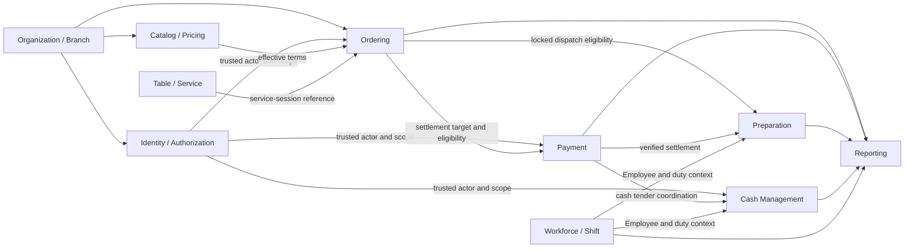

# AFTER FOUR — DDD Foundation

**Status:** Layered DDD is `OWNER_CONFIRMED`; context topology and detailed patterns remain `DOCUMENTED_PROPOSAL`
**Date:** 2026-11-14; Layered DDD decision recorded 2026-11-15
**Scope:** Layered DDD, Bounded Context vocabulary, ownership, dependencies, transactions, events, idempotency, and recovery

The Owner-confirmed project-wide Layered DDD decision is recorded as `ODB-ARCH-01` in the [Owner Decision Baseline](after_four_owner_decision_baseline.md#project-wide-architecture) and accepted in [ADR-0011](adr/0011-project-wide-layered-ddd.md). The Bounded Context names, candidate aggregates and detailed coordination patterns below retain their stated proposal status unless another canonical decision approves them. This document does not require a Rails engine per context or authorize implementation.

## Owner-confirmed Layered DDD baseline

All AFTER FOUR source code created or modified from 2026-11-15 onward follows four logical layers within its owning Bounded Context:

| Layer | Responsibility | Dependency rule |
|---|---|---|
| Domain | Entities, Value Objects, Aggregates, invariants, business behavior and genuinely needed Domain Services | Framework-independent; depends on no outer layer. |
| Application | Use Cases, Commands, Queries, orchestration and transaction coordination | Depends on Domain and only the contracts required by real use cases; it does not own core domain rules. |
| Infrastructure | Active Record persistence records, PostgreSQL enforcement, persistence projection/mapping and external adapters | May depend on Domain and contracts it implements; framework dependencies do not enter Domain. |
| Presentation | HTTP/request adaptation, presentation validation, controllers, serializers and response DTOs | Depends on Application for business workflows and never exposes or directly manipulates persistence records as public contracts. |

```text
Presentation ──> Application ──> Domain
                       │
                       └──> required contracts
Infrastructure ──> Domain and implemented contracts
Domain ──> no outer layer
```

The [Owner Decision Baseline](after_four_owner_decision_baseline.md) is authoritative for Owner-confirmed decisions and governance rules. The [Business Domain Model](after_four_business_domain_model.md) is canonical for business concepts, business rules, lifecycles, and the complete proposed logical context inventory. [ADR-0011](adr/0011-project-wide-layered-ddd.md) accepts the project-wide four-layer architecture and inward dependency direction. This foundation provides the accepted Layered DDD guidance and selected, non-exhaustive proposed context and dependency analysis; it does not replace the Business Domain Model's complete proposed inventory or approve final context topology.

Each Bounded Context owns its behavior and data responsibilities according to the applicable approved policy and proposed boundaries in those sources. Cross-context work uses an explicitly approved integration contract when a real interaction requires one; it does not directly manipulate another context's Infrastructure records. This decision does not mandate Clean Architecture, generic repositories, speculative ports/mappers, empty layer classes, Rails engines or separate services.

For example, Organization owns Organization/Brand/Branch behavior, Catalog owns Catalog behavior, Ordering owns Order behavior, and Payment owns Payment/settlement behavior within the selected analysis below. These examples neither enumerate every proposed context nor rename or approve a context.

### Forward adoption and maturity

- New code follows Layered DDD.
- Modified code follows it within the authorized scope.
- Existing code is assessed when relevant but is refactored only under explicit authorization.
- Architecture compliance does not enlarge a feature, fix or integration task into repository-wide cleanup.

| Scope | Status | Evidence and boundary |
|---|---|---|
| A1 Organization/Brand/Branch reference foundation | `IMPLEMENTED` | Pure entities and namespaced persistence records are verified at the paths below. This status is limited to A1. |
| Existing Ordering, Payment and Preparation Phase 1 code | `NOT_YET_MIGRATED` | It predates `ODB-ARCH-01`; this decision grants no refactor authority and makes no functional-conformance claim. |
| Platform and all other existing or future contexts | `UNVERIFIED` | No project-wide Layered DDD conformance assessment is recorded. Absent implementation is not conformance evidence. |
| Existing frontend source | `UNVERIFIED` | The forward rule applies when frontend source is changed, but no retrospective frontend Layered DDD assessment or refactor is authorized. |

### A1 first applied example

Verified Domain paths:

- `backend/app/domains/organization/domain/entities/organization.rb`
- `backend/app/domains/organization/domain/entities/brand.rb`
- `backend/app/domains/organization/domain/entities/branch.rb`

These classes are framework-independent, do not inherit from Active Record, and represent only the approved A1 identity, names, parent identifiers, relationships and Branch timezone value. They do not claim lifecycle or other unimplemented behavior.

Verified Infrastructure paths:

- `backend/app/domains/organization/infrastructure/persistence/organization_record.rb`
- `backend/app/domains/organization/infrastructure/persistence/brand_record.rb`
- `backend/app/domains/organization/infrastructure/persistence/branch_record.rb`

The records own table mapping, persistence associations, database-aligned validations, optimistic locking, restrictive dependent deletion and the implemented `to_domain` projection. A1 has no domain-to-persistence write mapping because no provisioning or administration use case is authorized. It has no Application or Presentation implementation because it exposes no authorized workflow or HTTP surface; empty classes would not improve conformance.

The completed A1 implementation report records: 2 pure Domain examples and 50 focused persistence/database examples with no failures; 143 full-suite examples with no failures; 99 RuboCop files with no offenses; zero Brakeman warnings; no Bundler Audit vulnerabilities; passing Zeitwerk eager load and `bin/ci`; passing `git diff --check`; and unchanged A1 migration and `structure.sql` hashes. These figures are recorded implementation evidence, not a verification rerun in this documentation-only task and not production-readiness evidence.

## 1. Vocabulary and ADR boundary

The following proposed context vocabulary is non-exhaustive and limited to contexts selected for analysis in this foundation. It is not the complete proposed context inventory or an Owner-approved final Bounded Context list. The [Business Domain Model §3](after_four_business_domain_model.md#3-bounded-context-overview) remains the canonical source for the complete proposed logical context inventory.

- Ordering
- Payment
- Preparation
- Catalog/Pricing
- Table/Service
- Cash Management
- Workforce/Shift
- Reporting
- Identity/Authorization

[ADR-0001](adr/0001-rails-modular-monolith.md) and [ADR-0005](adr/0005-backend-repository-structure.md) use `Sales` and `Billing`, while implemented Phase 1 namespaces use `Orders`, `Payments`, and `Preparation`. The discrepancy is real; this document does not silently resolve or rename it. The separate [ADR amendment proposal](adr/proposals/0001-0005-context-vocabulary-amendment-proposal.md) awaits explicit Owner approval. Until then, the Accepted ADR text and current namespaces remain unchanged.

These are logical ownership boundaries inside one Rails application and one PostgreSQL database. Active Record remains the Infrastructure persistence mechanism. Do not add a generic repository, command bus, microservice, or engine without demonstrated need.

## 2. Context map

This context map is a scoped architectural analysis of the selected contexts and relationships below, not an exhaustive map of every proposed context. It does not supersede the Business Domain Model's complete proposed context inventory and does not approve final context boundaries or topology.



The arrows express allowed information/dependency direction, not unrestricted model access. Authorization remains an application-boundary concern even when contexts share a database.

## 3. Context ownership

### 3.1 Ordering

- **Responsibility:** commercial intent, service channel, Order Items, sold snapshots, authoritative total, and Order lifecycle.
- **Authoritative state:** Order and future Order Item records.
- **Aggregate root:** Order.
- **Important entities/value objects:** Order Item; Money; Service Channel; Sold Item Snapshot; Payment Window.
- **Invariants:** only Draft Orders are commercially editable; confirmation freezes sold terms; client totals are never authority; Held/Expired Orders cannot automatically dispatch; stage-specific cancellation preserves history.
- **Commands:** create Draft, add/change/remove Draft items, price/reprice, confirm, hold, expire, request/execute authorized cancellation.
- **Transaction boundary:** confirmation commits frozen sold snapshots, authoritative total, deadline, and audit.
- **Idempotency:** Branch-scoped Draft creation identity/fingerprint; confirmation/cancellation command identity; optimistic version for mutable Draft state.
- **Allowed dependencies:** Catalog/Pricing for current terms; Table/Service by stable reference; Identity/Authorization for trusted actor/scope; Payment/Preparation through narrow coordination interfaces.
- **Forbidden dependencies:** frontend subtotal as authority; Payment/Preparation state copied into Order status; direct mutation of confirmed sold snapshots.
- **Failure owner:** Ordering owns commercial retry/conflict outcome; it does not reinterpret provider or Kitchen failure.
- **Current state:** Phase 1 has Order create/confirm/hold/expire. Order Items and server pricing are absent.

### 3.2 Catalog/Pricing

- **Responsibility:** Product, Variant, Modifier, Branch availability, effective Price, and pricing inputs.
- **Authoritative state:** Brand-global catalog identity and effective chain/Branch sellability and pricing policy (`ODB-CAT-01`, `ODB-CAT-06`, `ODB-CAT-07`).
- **Candidate roots:** Product/Variant and effective Price policy; exact aggregate shape is deferred.
- **Owner-confirmed MVP shape:** initial deployment has one Organization/Brand while the schema permits multiples; Categories are flat; every Product belongs to exactly one Category; Product lifecycle is Draft/Active/Inactive/Archived; every sellable selection is a persisted Variant; Modifier Groups express optional/required and single/multiple cardinality through minimum/maximum limits (`ODB-CAT-02`–`ODB-CAT-05`, `ODB-CAT-14`, `ODB-CAT-15`).
- **Owner-confirmed identifiers and completeness:** Category/Product/Variant codes are canonical uppercase ASCII and use separate Brand-scoped namespaces. Codes/SKUs remain reserved after Archive and any future Soft Delete. SKU is optional/Brand-unique when supported but deferred from Catalog Core MVP; future normalization is unresolved (`ODB-CAT-16`–`ODB-CAT-18`, `ODB-CAT-22`, `ODB-CAT-27`, `ODB-CAT-34`, `ODB-CAT-36`). Every Product has at most one Variant with `is_default = true`; Draft, Inactive, and Archived permit zero or one, while Active requires exactly one and it must be Active. Visibility remains independent (`ODB-CAT-20`, `ODB-CAT-23`, `ODB-CAT-28`, `ODB-CAT-31`, `ODB-CAT-38`).
- **Owner-confirmed lifecycle and retention:** Category and Variant are created Draft and share the explicit matrix in `ODB-CAT-32`; both restore Archived→Inactive and require separate activation. Variant Archive/Restore changes status only and preserves `is_default` and `customer_visible` (`ODB-CAT-40`). Product lifecycle commands, including Restore, are excluded from initial Catalog Core MVP (`ODB-CAT-39`), and Product Category reassignment is unsupported (`ODB-CAT-41`). Catalog Core MVP uses lifecycle/Archive retention, no Soft Delete, and no physical Purge in any lifecycle state (`ODB-CAT-21`, `ODB-CAT-24`, `ODB-CAT-25`, `ODB-CAT-29`–`ODB-CAT-33`, `ODB-CAT-35`–`ODB-CAT-41`). Branch availability remains independent.
- **Owner-confirmed Package C authority boundary:** Category and Variant lifecycle authority belongs to Organization/Brand Owners and explicitly delegated personnel (`C0-CAT-01`, `C0-CAT-02`). Delegation is capability-specific and Brand-scoped (`C0-CAT-03`); role/capability assignment, delegation administration, self-approval prohibition, and effective/expiry/revocation behavior are governed by `C0-R01`–`C0-R04`. Deactivate, Archive, and Restore require a reason (`C0-CAT-04`) validated to the confirmed maximum of 500 characters (`C0-R06`). Archive and Restore require step-up MFA (`C0-CAT-05`); cross-Brand access is default-deny (`C0-CAT-06`). Default Variant switching remains outside Package C (`C0-CAT-08`).
- **Owner-confirmed Package C trust boundary:** Package C requires a trusted server-side AuthorizationContext and fails closed on missing, invalid, expired, or revoked identity/delegation (`C0-R09`). Required lifecycle audit is Brand-scoped, append-only, and atomic with the mutation (`C0-R07`); audit failure rolls back the mutation (`C0-CAT-07`). Runtime and migration database authority remain separate, runtime destructive/schema privileges are restricted, and an operation-specific database boundary is required without selecting stored procedures (`C0-R10`).
- **Invariants:** effective Price versions are immutable and do not overlap for the same scope; an explicit Branch availability/Price override takes precedence over the chain default; unavailable products cannot be confirmed; later catalog changes never rewrite sold snapshots (`ODB-CAT-06`–`ODB-CAT-08`, `ODB-CAT-10`).
- **Future contract:** client supplies identifiers/choices; server resolves Branch availability and effective terms and calculates the authoritative quote. If authoritative Price changes while an Order is Draft, the revised quote requires review before confirmation. Confirmation gives Ordering immutable sold-price snapshots (`ODB-CAT-09`, `ODB-CAT-10`).
- **Allowed dependencies:** Organization/Branch scope.
- **Forbidden dependencies:** Order/Payment mutation; accepting a client-calculated total as truth.
- **Unresolved/future scope:** tax inclusion/treatment, service charge, rounding, zero/free pricing, Modifier price effects, time-based availability, manual sold-price overrides/approval, Catalog publication authority, Product lifecycle policy and commands beyond the initial exclusion, any future Product reassignment capability, future SKU normalization/support, future Soft Delete mechanics if separately authorized, identifier reuse after hypothetical physical Draft deletion, delegated-authority representation/enforcement, inventory, and media storage/vendor selection. MFA freshness/assurance/session details, audit retention/legal hold/read/export governance, and advanced retry/idempotency policy are explicitly deferred (`C0-R05`, `C0-R08`, `C0-R11`).
- **Current state:** Package B schema/integrity infrastructure exists. Trusted authorization, Brand-scoped lifecycle audit, operational role evidence, and Package C Application/Domain operations are not implemented or authorized.

The [Catalog/Pricing Discovery and Decision Closure](after_four_catalog_pricing_discovery.md) traces these constraints to the canonical [Owner Decision Baseline §5](after_four_owner_decision_baseline.md#5-catalogpricing-mvp). They do not approve the proposed aggregate shape, API, schema, or a change to Phase 1 Payment creation timing.

`TECHNICAL_PROPOSAL`: delegated-authority representation, trusted context integration, the exact operation-specific database boundary, exact Rails use cases, and the still-deferred Package C controls remain candidate mechanisms only. The confirmed `C0-*` policy boundaries do not authorize P1, P2, P3, Package C, Identity Milestone 2B, or public interfaces.

### 3.3 Payment

- **Responsibility:** settlement target, funding truth, Payment Attempts, reconciliation, Refund outcomes, and financial exception evidence.
- **Authoritative state:** Payment aggregate and its immutable Attempt evidence.
- **Aggregate root:** Payment. Payment Attempt is aggregate evidence/entity. Refund and Payment Review Case may require independent lifecycle boundaries when their policies are approved.
- **Invariants:** Payment and Attempt states remain distinct; pending/unknown/failed/unverified activity cannot dispatch; Phase 1 accepts exact target only; unknown blocks blind retry; late success remains financial truth without automatic dispatch.
- **Commands:** initiate/apply/reconcile Attempt outcome, confirm verified cash/manual transfer, request/execute approved Refund, record exception evidence.
- **Transaction boundary:** applying verified outcome updates Attempt and Payment; if eligible, it atomically coordinates the unique Preparation Dispatch intent, Outbox Event, and Audit Event.
- **Idempotency:** Payment-scoped Attempt key, provider event/reference identity, Refund command identity.
- **Allowed dependencies:** locked Ordering eligibility; Preparation dispatch-intent interface; Cash transaction interface for cash tender.
- **Forbidden dependencies:** Kitchen Ticket lifecycle; direct Reporting writes; changing terminal Attempt evidence.
- **Failure owner:** Payment owns unknown/reconciliation and financial exception state; it does not fail because delivery/printing fails.
- **Current state:** exact-balance cash/manual-bank confirmation and late-success review are implemented. Provider reconciliation, Refund, mismatch resolution, and excess evidence are not.

### 3.4 Preparation

- **Responsibility:** durable paid-order handoff, Tickets, Preparation Items, station work, deviations, and delivery recovery.
- **Authoritative state:** Preparation Dispatch and future Ticket/Item records.
- **Aggregate roots:** Preparation Dispatch; future Preparation Ticket where station/item invariants require it.
- **Invariants:** no work without an eligible Dispatch; one logical Dispatch per Order; retries reuse identity; Ticket replay cannot duplicate work; Preparation failure cannot alter Payment.
- **Commands:** request/retry Dispatch, consume Outbox delivery, create/locate Ticket, start/ready/complete/cancel/remake work.
- **Idempotency:** unique Order Dispatch, event key, consumer/delivery attempt identity, Ticket/station sequence.
- **Allowed dependencies:** immutable sold snapshots and verified dispatch intent.
- **Forbidden dependencies:** starting work from client-visible payment success; charging again during retry.
- **Failure owner:** Preparation owns delivery retry/operator recovery and Ticket state.
- **Current state:** pending Dispatch and Outbox requeue exist. Publisher, consumer, Ticket/Item and delivery-attempt writer are deferred.

### 3.5 Table/Service

- **Responsibility:** physical Table allocation, actual visit/session history, and service-location changes.
- **Authoritative state:** Table Session and assignment history; Reservation remains an independent lifecycle.
- **Candidate roots:** Table Session and Reservation.
- **Invariants:** a physical Table and a visit are different concepts; moves preserve history; Order references do not overwrite Table Session history.
- **Allowed dependencies:** Organization/Branch; Ordering by stable session reference.
- **Forbidden dependencies:** using Table UI status as Order, Payment, or authorization truth.
- **Unresolved:** move/merge/split, deposits, no-shows, exact Order/check cardinality, and release rules.
- **Current state:** frontend fixture and logical documentation only.

### 3.6 Cash Management

- **Responsibility:** shared drawer ledger, daily float, Cash Sessions, Cash Transactions, top-ups, counts, handover, discrepancies, and operating Expenses.
- **Authoritative state:** immutable Cash Transactions and accountable session/expense evidence.
- **Candidate roots:** Cash Session; Expense may be an independent root within the context.
- **Important value objects:** Money; Operating Day; configurable Expense Control Thresholds.
- **Invariants:** one shared drawer; 2,000,000 VND daily float carries across shifts; a new opening count is not a new float allocation; no automatic mid-day reset/top-up; top-ups are not revenue; Operating Expenses use 200,000/500,000 VND control thresholds, require prior Owner approval, permit no emergency pre-approval exception, prohibit self-approval, and prohibit splitting to evade thresholds.
- **Commands:** prepare/open/count/close/handover Session; request/authorize/post top-up; record/request/approve/execute Expense; append correction.
- **Transaction boundary:** verified cash settlement and its Cash Transaction commit with Payment settlement and eligible Dispatch intent; close commits count/variance/evidence; an Operating Expense request records per-item and cumulative control results and mandatory Owner approval evidence before any separately authorized incurrence/execution.
- **Idempotency:** session open/close, Cash Transaction, top-up, and Expense command identities.
- **Allowed dependencies:** Payment reference for cash tender; Workforce/Identity actor context; Reporting as downstream projection.
- **Forbidden dependencies:** treating top-up as revenue; silently editing closed evidence; allowing Payment to own drawer state.
- **Failure owner:** Cash Management owns drawer/session reconciliation and handover recovery.
- **Current state:** logical design only. The initial Operating Day cutoff is `00:00` local time in each Branch's explicit timezone; future cutoff configuration/enforcement and the discrepancy correction flow remain unresolved. No discrepancy tolerance is approved.

### 3.7 Workforce/Shift

- **Responsibility:** Employee history, shift planning, attendance, rotation, duties, and payroll inputs.
- **Authoritative state:** Employee, Shift, Attendance, and effective employment records.
- **Candidate roots:** Employee, Shift Plan, Payroll Period according to their independent lifecycles.
- **Invariants:** User is not Employee; duties are not identity roles; actual Branch and corrections remain historical.
- **Allowed dependencies:** Identity by optional User link; Organization/Branch; Reporting as downstream consumer.
- **Forbidden dependencies:** deriving capabilities solely from a shift duty.
- **Current state:** logical documentation only. Launch staffing and shift counts are planning assumptions, not schema limits.

### 3.8 Reporting

- **Responsibility:** read models/projections, period comparisons, report history, and delivery operations.
- **Authoritative state:** report generation/delivery evidence only; source business facts remain authoritative in their contexts.
- **Aggregate shape:** no transactional business aggregate is required for revenue/payment/cash truth. A Report Run/Delivery record may own generation and retry state.
- **Invariants:** revenue is distinct from cash movement; top-ups are not revenue; report projections never rewrite source records; Telegram messages exclude sensitive data.
- **Synchronous/asynchronous boundary:** business transactions emit committed facts/outbox intents; projection and Telegram delivery run after commit and retry idempotently.
- **Idempotency:** report scope + period + version; delivery destination identity without exposing sensitive recipient data.
- **Failure owner:** Reporting owns generation/delivery retry and operator visibility, never source reconciliation.
- **Current state:** Owner Dashboard and daily Telegram are approved directions but unimplemented. Reporting follows the approved Branch-local Operating Day boundary; delivery time, recipients, formulas, Branch scope, privacy, and escalation remain unresolved.

### 3.9 Identity/Authorization

- **Responsibility:** User, credentials, Sessions, Role/Branch Assignments, capabilities, and trusted request context.
- **Authoritative state:** authenticated User and effective server-derived scope.
- **Invariants:** ID-01 through ID-34; client role/Branch/device values are not authority; business contexts decide business approval rules within authorized capabilities.
- **Allowed dependencies:** Organization/Branch and approved business capability catalog.
- **Forbidden dependencies:** inventing refund, cash, Expense, or cancellation authority from a role title; treating actor UUID validation as authentication.
- **Current state:** not implemented. ADR-0006 remains Proposed and Milestone 2B remains unauthorized.

## 4. Critical coordination boundaries

### 4.1 Payment–Preparation

Proposed application seam: one authorization-aware use case applies an authoritative Payment outcome and coordinates narrow interfaces owned by Ordering, Payment, and Preparation. It must preserve:

1. lock Order then Payment;
2. sample authoritative decision time after both locks;
3. apply Attempt outcome and exact-balance Payment state once;
4. recheck locked Order status and deadline;
5. for an eligible Order, atomically insert the unique pending Preparation Dispatch, Outbox Event, and Audit Event;
6. for Held/Expired or deadline-equal/late success, persist financial truth and review evidence without Dispatch;
7. commit before external delivery;
8. retry the same Dispatch/Outbox identity without charging again.

Do not replace this local atomic boundary with an uncoordinated asynchronous event chain. The Outbox carries post-commit delivery; it does not decide whether Dispatch may exist.

### 4.2 Payment–Cash

Future cash settlement uses one local PostgreSQL transaction without merging aggregates:

1. lock the relevant Order and Payment in the Phase 1 order;
2. lock the open Cash Session/ledger scope in a documented deterministic position;
3. verify actor, Branch, session, exact-balance, currency, and command identity;
4. append the immutable Cash Transaction;
5. apply Payment Attempt/settlement;
6. create eligible Dispatch/Outbox and audit evidence;
7. commit all or none.

The exact ledger fields, lock sequence extension, cash-change handling, and correction policy require later design. Bank/electronic settlement never creates a drawer Cash Transaction merely because it affects revenue.

### 4.3 Cancellation–Preparation fence

Stage-based authority requires an atomic state fence. A future cancellation command must lock or otherwise serialize against Preparation start, decide whether work has started under authoritative server state, then apply Staff-before-start or Owner-after-start authority. It must create explicit Refund/compensation/deviation intents rather than erase history. Completed-order exceptions remain unresolved.

## 5. Domain events, integration events, and Outbox

- A **domain event** names a committed business fact such as `PaymentFullySettled`, `CashTopUpRecorded`, or `OrderCancelled`.
- An **integration event** is a versioned, allowlisted representation delivered to another context/adapter.
- An **Outbox Event** is technical delivery state; it is not the business fact or aggregate root.
- An **Audit Event** is accountable evidence; it is not a substitute for a domain event.

External provider, printer, KDS, notification, and Telegram I/O occur outside open business transactions. Consumers require stable event keys, schema versioning, idempotent application, bounded retry, safe failure evidence, and operator recovery.

## 6. Phase 1 guarantees

The following implemented constraints are mandatory inputs to later design:

- Order → Payment lock ordering;
- authoritative time sampled after locks;
- deadline equality follows the late-success path;
- Held/Expired late success never automatically dispatches;
- terminal Payment Attempt evidence protection;
- exact-target aggregate integrity for implemented Phase 1 settlement;
- Branch-scoped Draft idempotency and request fingerprinting;
- one Preparation Dispatch per Order;
- retry without recharge or new Dispatch/Outbox identity;
- semantic retry replay validation;
- Outbox/Audit rollback with the business transaction;
- database-level Audit Event update/delete protection, without claiming protection from a production database owner/superuser;
- public mutation routes remain disabled;
- TrustedActor UUID validation is not authentication or Branch authorization.

## 7. Implementation sequencing boundary

This foundation recommends later incremental slices, but authorizes none:

1. server-authoritative Catalog/Pricing and Order Item snapshots after business pricing decisions;
2. Preparation publisher/consumer and Ticket lifecycle while preserving Dispatch identity;
3. Cash Management and atomic cash-settlement ledger after Operating Day and remaining cash details;
4. stage-aware cancellation/Refund orchestration after remaining compensation decisions;
5. Reporting projections and Telegram delivery after schedule/recipient/formula/privacy decisions;
6. Identity only under a separately authorized Milestone 2B.

