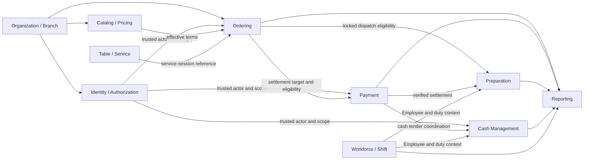

# AFTER FOUR — DDD Foundation

**Status:** `DOCUMENTED_PROPOSAL` for architecture alignment  
**Date:** 2026-11-14  
**Scope:** Bounded-context vocabulary, ownership, dependencies, transactions, events, idempotency, and recovery

This document proposes pragmatic Domain-Driven Design boundaries for the existing Rails modular monolith. It does not create Owner business decisions, require a Rails engine per context, authorize implementation, or alter Accepted ADRs. Owner-confirmed policy comes from the [Owner Decision Baseline](after_four_owner_decision_baseline.md).

## 1. Vocabulary and ADR boundary

Proposed canonical context vocabulary:

- Ordering
- Payment
- Preparation
- Catalog/Pricing
- Table/Service
- Cash Management
- Workforce/Shift
- Reporting
- Identity/Authorization

[ADR-0001](adr/0001-rails-modular-monolith.md) and [ADR-0005](adr/0005-backend-repository-structure.md) use `Sales` and `Billing`, while implemented Phase 1 namespaces use `Orders`, `Payments`, and `Preparation`. The discrepancy is real; this document does not silently resolve or rename it. The separate [ADR amendment proposal](adr/proposals/0001-0005-context-vocabulary-amendment-proposal.md) awaits explicit Owner approval. Until then, the Accepted ADR text and current namespaces remain unchanged.

These are logical ownership boundaries inside one Rails application and one PostgreSQL database. Active Record remains the persistence mechanism. Do not add a generic repository, command bus, microservice, or engine without demonstrated need.

## 2. Context map

The arrows express allowed information/dependency direction, not unrestricted model access. Authorization remains an application-boundary concern even when contexts share a database.

## 3. Context ownership

### 3.1 Ordering

- **Responsibility:** commercial intent, service channel, Order Items, sold snapshots, authoritative total, and Order lifecycle.
- **Authoritative state:** Order and future Order Item records.
- **Aggregate root:** Order.
- **Important entities/value objects:** Order Item; Money; Service Channel; Sold Item Snapshot; Payment Window.
- **Invariants:** only Draft Orders are commercially editable; confirmation freezes sold terms; client totals are never authority; Held/Expired Orders cannot automatically dispatch; stage-specific cancellation preserves history.
- **Commands:** create Draft, add/change/remove Draft items, price/reprice, confirm, hold, expire, request/execute authorized cancellation.
- **Transaction boundary:** confirmation commits frozen sold snapshots, authoritative total, deadline, and audit.
- **Idempotency:** Branch-scoped Draft creation identity/fingerprint; confirmation/cancellation command identity; optimistic version for mutable Draft state.
- **Allowed dependencies:** Catalog/Pricing for current terms; Table/Service by stable reference; Identity/Authorization for trusted actor/scope; Payment/Preparation through narrow coordination interfaces.
- **Forbidden dependencies:** frontend subtotal as authority; Payment/Preparation state copied into Order status; direct mutation of confirmed sold snapshots.
- **Failure owner:** Ordering owns commercial retry/conflict outcome; it does not reinterpret provider or Kitchen failure.
- **Current state:** Phase 1 has Order create/confirm/hold/expire. Order Items and server pricing are absent.

### 3.2 Catalog/Pricing

- **Responsibility:** Product, Variant, Modifier, Branch availability, effective Price, and pricing inputs.
- **Authoritative state:** catalog identity and effective sellability/pricing policy.
- **Candidate roots:** Product/Variant and effective Price policy; exact aggregate shape is deferred.
- **Invariants:** effective periods do not overlap for the same scope; unavailable products cannot be confirmed; later catalog changes never rewrite sold snapshots.
- **Future contract:** client supplies identifiers/choices; server resolves Branch availability and effective terms, calculates the authoritative total, and gives Ordering immutable snapshots at confirmation.
- **Allowed dependencies:** Organization/Branch scope.
- **Forbidden dependencies:** Order/Payment mutation; accepting a client-calculated total as truth.
- **Unresolved:** tax, service charge, rounding, modifier pricing, override authority, and Branch-price policy.
- **Current state:** canonical logical design only; implementation is not authorized by this milestone.

### 3.3 Payment

- **Responsibility:** settlement target, funding truth, Payment Attempts, reconciliation, Refund outcomes, and financial exception evidence.
- **Authoritative state:** Payment aggregate and its immutable Attempt evidence.
- **Aggregate root:** Payment. Payment Attempt is aggregate evidence/entity. Refund and Payment Review Case may require independent lifecycle boundaries when their policies are approved.
- **Invariants:** Payment and Attempt states remain distinct; pending/unknown/failed/unverified activity cannot dispatch; Phase 1 accepts exact target only; unknown blocks blind retry; late success remains financial truth without automatic dispatch.
- **Commands:** initiate/apply/reconcile Attempt outcome, confirm verified cash/manual transfer, request/execute approved Refund, record exception evidence.
- **Transaction boundary:** applying verified outcome updates Attempt and Payment; if eligible, it atomically coordinates the unique Preparation Dispatch intent, Outbox Event, and Audit Event.
- **Idempotency:** Payment-scoped Attempt key, provider event/reference identity, Refund command identity.
- **Allowed dependencies:** locked Ordering eligibility; Preparation dispatch-intent interface; Cash transaction interface for cash tender.
- **Forbidden dependencies:** Kitchen Ticket lifecycle; direct Reporting writes; changing terminal Attempt evidence.
- **Failure owner:** Payment owns unknown/reconciliation and financial exception state; it does not fail because delivery/printing fails.
- **Current state:** exact-balance cash/manual-bank confirmation and late-success review are implemented. Provider reconciliation, Refund, mismatch resolution, and excess evidence are not.

### 3.4 Preparation

- **Responsibility:** durable paid-order handoff, Tickets, Preparation Items, station work, deviations, and delivery recovery.
- **Authoritative state:** Preparation Dispatch and future Ticket/Item records.
- **Aggregate roots:** Preparation Dispatch; future Preparation Ticket where station/item invariants require it.
- **Invariants:** no work without an eligible Dispatch; one logical Dispatch per Order; retries reuse identity; Ticket replay cannot duplicate work; Preparation failure cannot alter Payment.
- **Commands:** request/retry Dispatch, consume Outbox delivery, create/locate Ticket, start/ready/complete/cancel/remake work.
- **Idempotency:** unique Order Dispatch, event key, consumer/delivery attempt identity, Ticket/station sequence.
- **Allowed dependencies:** immutable sold snapshots and verified dispatch intent.
- **Forbidden dependencies:** starting work from client-visible payment success; charging again during retry.
- **Failure owner:** Preparation owns delivery retry/operator recovery and Ticket state.
- **Current state:** pending Dispatch and Outbox requeue exist. Publisher, consumer, Ticket/Item and delivery-attempt writer are deferred.

### 3.5 Table/Service

- **Responsibility:** physical Table allocation, actual visit/session history, and service-location changes.
- **Authoritative state:** Table Session and assignment history; Reservation remains an independent lifecycle.
- **Candidate roots:** Table Session and Reservation.
- **Invariants:** a physical Table and a visit are different concepts; moves preserve history; Order references do not overwrite Table Session history.
- **Allowed dependencies:** Organization/Branch; Ordering by stable session reference.
- **Forbidden dependencies:** using Table UI status as Order, Payment, or authorization truth.
- **Unresolved:** move/merge/split, deposits, no-shows, exact Order/check cardinality, and release rules.
- **Current state:** frontend fixture and logical documentation only.

### 3.6 Cash Management

- **Responsibility:** shared drawer ledger, daily float, Cash Sessions, Cash Transactions, top-ups, counts, handover, discrepancies, and operating Expenses.
- **Authoritative state:** immutable Cash Transactions and accountable session/expense evidence.
- **Candidate roots:** Cash Session; Expense may be an independent root within the context.
- **Important value objects:** Money; Operating Day; configurable Expense Delegation Limits.
- **Invariants:** one shared drawer; 2,000,000 VND daily float carries across shifts; a new opening count is not a new float allocation; no automatic mid-day reset/top-up; top-ups are not revenue; delegated Expenses obey 200,000/500,000 VND limits, no self-approval, and no splitting to evade limits.
- **Commands:** prepare/open/count/close/handover Session; request/authorize/post top-up; record/request/approve/execute Expense; append correction.
- **Transaction boundary:** verified cash settlement and its Cash Transaction commit with Payment settlement and eligible Dispatch intent; close commits count/variance/evidence; delegated Expense enforces per-item and cumulative limits atomically.
- **Idempotency:** session open/close, Cash Transaction, top-up, and Expense command identities.
- **Allowed dependencies:** Payment reference for cash tender; Workforce/Identity actor context; Reporting as downstream projection.
- **Forbidden dependencies:** treating top-up as revenue; silently editing closed evidence; allowing Payment to own drawer state.
- **Failure owner:** Cash Management owns drawer/session reconciliation and handover recovery.
- **Current state:** logical design only. Operating Day boundary and discrepancy correction flow remain unresolved; no discrepancy tolerance is approved.

### 3.7 Workforce/Shift

- **Responsibility:** Employee history, shift planning, attendance, rotation, duties, and payroll inputs.
- **Authoritative state:** Employee, Shift, Attendance, and effective employment records.
- **Candidate roots:** Employee, Shift Plan, Payroll Period according to their independent lifecycles.
- **Invariants:** User is not Employee; duties are not identity roles; actual Branch and corrections remain historical.
- **Allowed dependencies:** Identity by optional User link; Organization/Branch; Reporting as downstream consumer.
- **Forbidden dependencies:** deriving capabilities solely from a shift duty.
- **Current state:** logical documentation only. Launch staffing and shift counts are planning assumptions, not schema limits.

### 3.8 Reporting

- **Responsibility:** read models/projections, period comparisons, report history, and delivery operations.
- **Authoritative state:** report generation/delivery evidence only; source business facts remain authoritative in their contexts.
- **Aggregate shape:** no transactional business aggregate is required for revenue/payment/cash truth. A Report Run/Delivery record may own generation and retry state.
- **Invariants:** revenue is distinct from cash movement; top-ups are not revenue; report projections never rewrite source records; Telegram messages exclude sensitive data.
- **Synchronous/asynchronous boundary:** business transactions emit committed facts/outbox intents; projection and Telegram delivery run after commit and retry idempotently.
- **Idempotency:** report scope + period + version; delivery destination identity without exposing sensitive recipient data.
- **Failure owner:** Reporting owns generation/delivery retry and operator visibility, never source reconciliation.
- **Current state:** Owner Dashboard and daily Telegram are approved directions but unimplemented. Time, recipients, Operating Day cutoff, formulas, Branch scope, privacy, and escalation remain unresolved.

### 3.9 Identity/Authorization

- **Responsibility:** User, credentials, Sessions, Role/Branch Assignments, capabilities, and trusted request context.
- **Authoritative state:** authenticated User and effective server-derived scope.
- **Invariants:** ID-01 through ID-34; client role/Branch/device values are not authority; business contexts decide business approval rules within authorized capabilities.
- **Allowed dependencies:** Organization/Branch and approved business capability catalog.
- **Forbidden dependencies:** inventing refund, cash, Expense, or cancellation authority from a role title; treating actor UUID validation as authentication.
- **Current state:** not implemented. ADR-0006 remains Proposed and Milestone 2B remains unauthorized.

## 4. Critical coordination boundaries

### 4.1 Payment–Preparation

Proposed application seam: one authorization-aware use case applies an authoritative Payment outcome and coordinates narrow interfaces owned by Ordering, Payment, and Preparation. It must preserve:

1. lock Order then Payment;
2. sample authoritative decision time after both locks;
3. apply Attempt outcome and exact-balance Payment state once;
4. recheck locked Order status and deadline;
5. for an eligible Order, atomically insert the unique pending Preparation Dispatch, Outbox Event, and Audit Event;
6. for Held/Expired or deadline-equal/late success, persist financial truth and review evidence without Dispatch;
7. commit before external delivery;
8. retry the same Dispatch/Outbox identity without charging again.

Do not replace this local atomic boundary with an uncoordinated asynchronous event chain. The Outbox carries post-commit delivery; it does not decide whether Dispatch may exist.

### 4.2 Payment–Cash

Future cash settlement uses one local PostgreSQL transaction without merging aggregates:

1. lock the relevant Order and Payment in the Phase 1 order;
2. lock the open Cash Session/ledger scope in a documented deterministic position;
3. verify actor, Branch, session, exact-balance, currency, and command identity;
4. append the immutable Cash Transaction;
5. apply Payment Attempt/settlement;
6. create eligible Dispatch/Outbox and audit evidence;
7. commit all or none.

The exact ledger fields, lock sequence extension, cash-change handling, and correction policy require later design. Bank/electronic settlement never creates a drawer Cash Transaction merely because it affects revenue.

### 4.3 Cancellation–Preparation fence

Stage-based authority requires an atomic state fence. A future cancellation command must lock or otherwise serialize against Preparation start, decide whether work has started under authoritative server state, then apply Staff-before-start or Owner-after-start authority. It must create explicit Refund/compensation/deviation intents rather than erase history. Completed-order exceptions remain unresolved.

## 5. Domain events, integration events, and Outbox

- A **domain event** names a committed business fact such as `PaymentFullySettled`, `CashTopUpRecorded`, or `OrderCancelled`.
- An **integration event** is a versioned, allowlisted representation delivered to another context/adapter.
- An **Outbox Event** is technical delivery state; it is not the business fact or aggregate root.
- An **Audit Event** is accountable evidence; it is not a substitute for a domain event.

External provider, printer, KDS, notification, and Telegram I/O occur outside open business transactions. Consumers require stable event keys, schema versioning, idempotent application, bounded retry, safe failure evidence, and operator recovery.

## 6. Phase 1 guarantees

The following implemented constraints are mandatory inputs to later design:

- Order → Payment lock ordering;
- authoritative time sampled after locks;
- deadline equality follows the late-success path;
- Held/Expired late success never automatically dispatches;
- terminal Payment Attempt evidence protection;
- exact-target aggregate integrity for implemented Phase 1 settlement;
- Branch-scoped Draft idempotency and request fingerprinting;
- one Preparation Dispatch per Order;
- retry without recharge or new Dispatch/Outbox identity;
- semantic retry replay validation;
- Outbox/Audit rollback with the business transaction;
- database-level Audit Event update/delete protection, without claiming protection from a production database owner/superuser;
- public mutation routes remain disabled;
- TrustedActor UUID validation is not authentication or Branch authorization.

## 7. Implementation sequencing boundary

This foundation recommends later incremental slices, but authorizes none:

1. server-authoritative Catalog/Pricing and Order Item snapshots after business pricing decisions;
2. Preparation publisher/consumer and Ticket lifecycle while preserving Dispatch identity;
3. Cash Management and atomic cash-settlement ledger after Operating Day and remaining cash details;
4. stage-aware cancellation/Refund orchestration after remaining compensation decisions;
5. Reporting projections and Telegram delivery after schedule/recipient/formula/privacy decisions;
6. Identity only under a separately authorized Milestone 2B.

