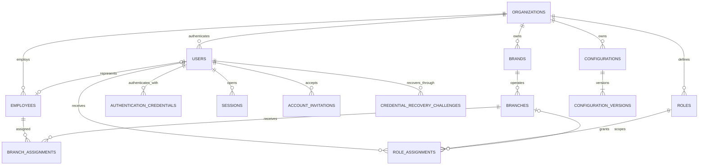
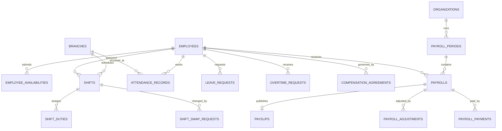
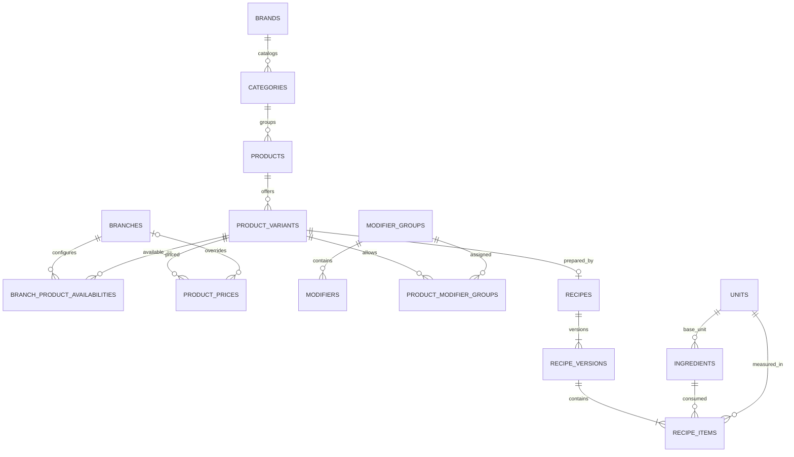
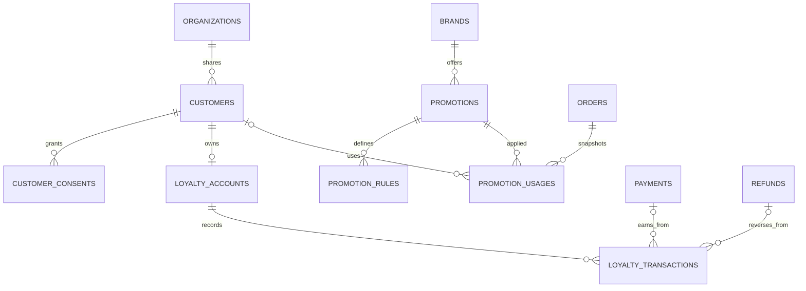
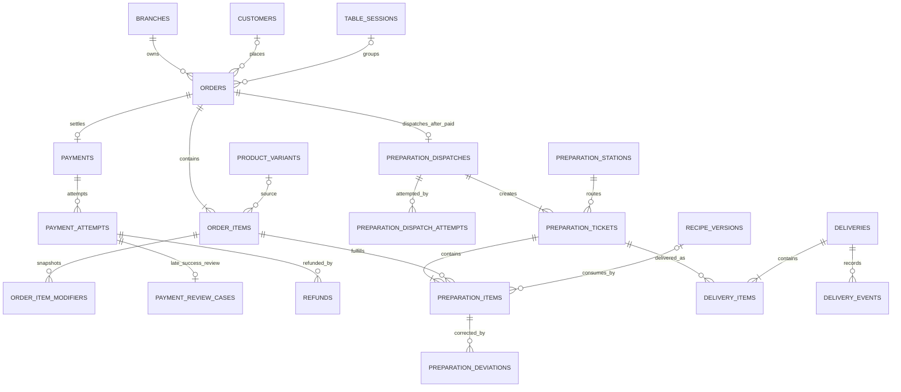
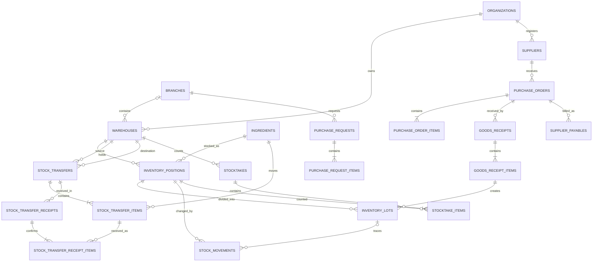
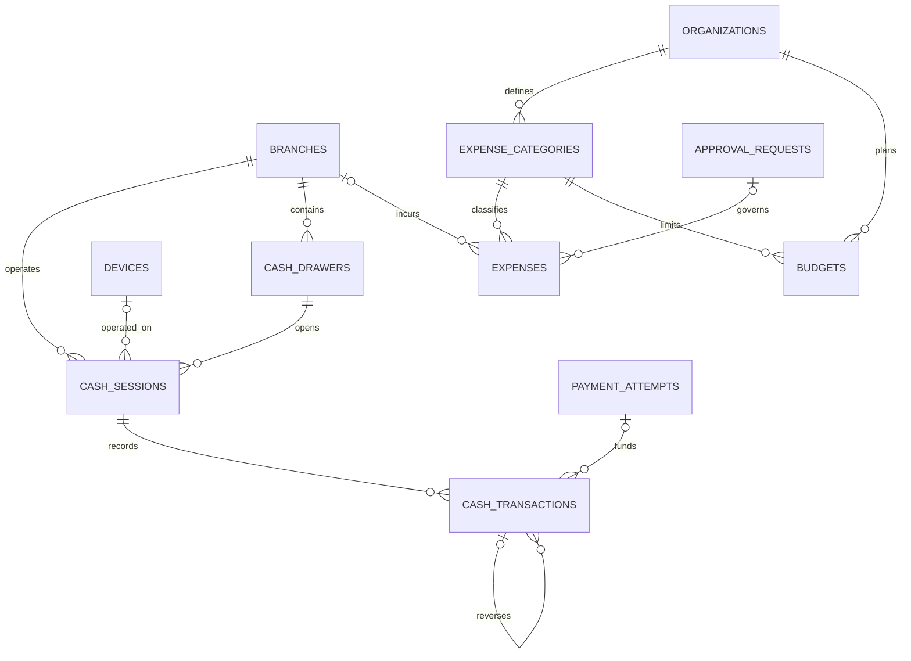
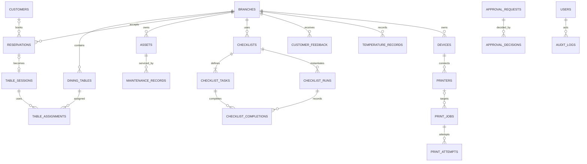

# AFTER FOUR Logical ERD v1.0

**Status:** Proposed logical data model for review; no schema or migration is authorized  
**Date:** 2026-11-14  
**Canonical source:** [Business Domain Model v1.0](after_four_business_domain_model.md)  
**Companion documents:** [Owner Decision Baseline](after_four_owner_decision_baseline.md) · [DDD Foundation](after_four_ddd_foundation.md) · [Data Dictionary](after_four_data_dictionary.md) · [Data Integrity Rules](after_four_data_integrity_rules.md) · [Payment Model](after_four_payment_model.md) · [UUID ADR](adr/0004-uuid-primary-keys.md)

## 1. Modeling stance and provenance

This ERD maps the canonical business model into logical records and relationships. It is PostgreSQL-compatible but independent of Rails, physical table partitioning, deployment topology, and migration order.

Provenance follows the canonical model:

- `OWNER_CONFIRMED`: explicit Owner business decision;
- `WORKSHOP_AGREED`: accepted workshop policy;
- `TECHNICAL_PROPOSAL`: engineering recommendation for review;
- `OPEN_DECISION`: unresolved Owner/operational policy;
- `LEGAL_VALIDATION`: requires current legal, accounting, contractual, or authority validation.

`TECHNICAL_PROPOSAL` All primary keys are shown as opaque identifiers. [ADR-0004](adr/0004-uuid-primary-keys.md) accepts UUID primary keys for the physical design. Status values are logical vocabularies, not a direction to create PostgreSQL enum types.

## 2. Entity inclusion and deliberate exclusions

### 2.1 Added seams required by the canonical model

The requested entity list is expanded only where a canonical invariant needs an explicit record:

| Added entity | Why it is required | Provenance |
|---|---|---|
| `role_assignments` | Effective role and Branch scope cannot live safely on `users`. | `WORKSHOP_AGREED` |
| `employee_availabilities`, `shift_swap_requests`, `compensation_agreements` | Weekly planning, swaps, and effective-dated pay require history. | `WORKSHOP_AGREED` |
| `shift_duties`, `payroll_payments` | Operational duties differ from authorization roles; payroll payment history differs from calculation/closure. | `WORKSHOP_AGREED` |
| `modifier_groups`, `product_modifier_groups`, `branch_product_availabilities` | Modifier cardinality and explicit Branch sellability overrides are first-class rules. | `OWNER_CONFIRMED` `ODB-CAT-05`, `ODB-CAT-06`; exact table shape proposed |
| `preparation_dispatches`, `preparation_dispatch_attempts` | Dispatch proves the paid-order handoff. Attempt history is reserved for a future delivery worker and remains separate from business dispatch state. The physical attempt table/model exist, but no Phase 1 command writes them; current Retry Dispatch only requeues Outbox and appends Audit evidence. | Business rule `OWNER_CONFIRMED`; attempt record `TECHNICAL_PROPOSAL` |
| `preparation_deviations` | Remake, waste, and post-dispatch cancellation cannot overwrite ticket items. | `WORKSHOP_AGREED` |
| `deliveries`, `delivery_items`, `delivery_events` | Internal delivery has an independent lifecycle and history. | `WORKSHOP_AGREED` |
| `inventory_positions` | Concurrency-safe cached quantity and weighted-average cost need one lockable Warehouse/Ingredient row; movements remain authoritative. | `TECHNICAL_PROPOSAL` |
| `stock_transfer_receipts`, `stock_transfer_receipt_items` | Partial independent receipt confirmations need actor/time/evidence instead of an overwritten received total. | `WORKSHOP_AGREED` |
| Procurement line tables and `supplier_payables` | Partial ordering/receiving and payables cannot be represented by headers alone. | `WORKSHOP_AGREED`; accounting `LEGAL_VALIDATION` |
| `table_sessions`, `table_assignments` | A visit and table movement history must not be stored on a physical table. | `WORKSHOP_AGREED` |
| `checklist_runs` | A reusable Checklist template must be separated from one scheduled execution. | `TECHNICAL_PROPOSAL` |
| `customer_consents`, `print_attempts`, `temperature_records` | Consent evidence, print retries, and food-safety history are canonical requirements. | Mixed |
| `cash_drawers` | “One open Cash Session” needs a physical drawer identity distinct from Device and Branch. | `WORKSHOP_AGREED` |
| `preparation_stations` | Extensible ticket routing requires a stable preparation destination. | `WORKSHOP_AGREED` |
| `idempotency_records`, `outbox_events`, `payment_provider_events` | Cross-system retries and post-commit delivery require durable technical evidence. | `TECHNICAL_PROPOSAL` |

### 2.2 Merged or excluded concepts

| Concept | Decision | Reason |
|---|---|---|
| `PriceHistory` | Represented by effective-dated `product_prices`; history is the row set, not a second entity. | Avoid a mutable “current price” plus duplicate history source. |
| `LoyaltyTransaction` | Named `loyalty_transactions`; it is the authoritative point ledger. | Matches requested term and canonical ledger rule. |
| `Payroll` and payroll line | One `payrolls` record per Employee/Payroll Period; no separate generic line table. | The payroll record is already the employee calculation/line. |
| Generic “configuration history” | `configurations` + immutable/effective `configuration_versions`. | Separates stable key/scope from versioned values. |
| Generic status-event table for every aggregate | Not proposed globally. | Important aggregates have domain-specific history or immutable ledgers; a universal event table would weaken semantics. |
| Soft-delete concern on every table | Excluded. | Master data deactivates/archives; confirmed transactions remain and are reversed/adjusted. |
| Customer-authentication account | Excluded from MVP. | Guest checkout and phone/consent profile do not imply customer login. |
| SaaS tenant/subscription/marketplace tables | Excluded. | Explicitly outside MVP. |

## 3. Ownership and data isolation

### 3.1 Scope rules

`WORKSHOP_AGREED` Scope is explicit and minimal; not every record repeats every ancestor key.

| Scope | Entities directly carrying the scope | Derivable scope examples |
|---|---|---|
| Organization-owned | `organizations`; chain Users/Employees, roles, customers, suppliers, configuration when organization-scoped | Brand derives Organization; Branch derives Brand/Organization |
| Brand-owned | `brands`, categories, products, variants, modifiers, recipes, promotions, brand configuration | Order catalog sources derive Brand, but Order retains Branch directly |
| Branch-owned | Branch assignments, shifts, attendance, orders, preparation, delivery, cash, expenses, reservations, tables, assets, checklists/runs, feedback, devices/printers | Order Items derive Branch from Order; Cash Transactions from Cash Session |
| Warehouse-owned | Inventory positions/lots, stock movements, stocktake, transfer endpoints, goods receipts | Warehouse has exactly one Organization and may have one Branch |
| Shared chain-wide | Customer identity, loyalty account/ledger, Supplier identity, central configuration | Access to shared data is still filtered by authorized Branch and purpose |

### 3.2 Direct scope-reference policy

- `TECHNICAL_PROPOSAL` A child table should normally rely on its parent FK rather than duplicate `organization_id`, `brand_id`, or `branch_id`.
- `WORKSHOP_AGREED` Root operational records carry immutable `branch_id`: Order, Preparation Dispatch/Ticket, Delivery, Shift, Attendance, Cash Session, Expense, Reservation/Table Session, Asset, Checklist Run, Customer Feedback, Device, Printer.
- `TECHNICAL_PROPOSAL` High-risk cross-context records may repeat a scope key only when it enables a composite FK or constraint proving same-scope membership. Such denormalization must be documented, not incidental.
- `WORKSHOP_AGREED` Branch movement or Employee transfer never rewrites historical `branch_id`.
- `OWNER_CONFIRMED` Confirmed Orders retain sold Price even when Product/Price records later change (`ODB-CAT-10`). `WORKSHOP_AGREED` Other Recipe/Employee and descriptive snapshots are likewise historical.

## 4. Organization and identity ERD

### Key relationship decisions

- `OWNER_CONFIRMED` Initial deployment has one Organization and one Brand, while the schema permits multiple rows of each and has no permanent single-row constraint (`ODB-CAT-14`). The depicted Organization-to-Brand and Brand-to-Branch relationship shapes remain the current logical design; `ODB-CAT-14` does not approve a maximum Brands-per-Organization or additional Branch cardinality.
- `WORKSHOP_AGREED` User and Employee are optional one-to-one: an Employee may not need system access; a User must not automatically become an Employee.
- `WORKSHOP_AGREED` Branch Assignment records employment/work assignment. Role Assignment records authorization. Neither substitutes for the other.
- `OWNER_CONFIRMED` Invitation Delegation is a separate domain concept from both assignments. It permits only an active Branch Manager to invite Staff within assigned Branches, for at most 90 days; it grants no role, work eligibility, assignment approval, onward delegation, or self-renewal. This decision does not add a table or field to this ERD.
- `WORKSHOP_AGREED` A Branch Assignment has an effective interval and type (`primary`, `temporary`). Overlapping primary assignments are forbidden; temporary overlap rules are policy-driven.
- `OWNER_CONFIRMED` Active roles are Owner, Branch Manager, and Staff; Regional Manager is reserved/inactive. `TECHNICAL_PROPOSAL` Owner uses Organization scope while Branch Manager/Staff use Branch scope. Any future Regional Manager activation should add an explicit region model rather than encode arrays in one row.
- `TECHNICAL_PROPOSAL` Authentication Credential, Session, Account Invitation, and Credential Recovery Challenge are logical security records only; they are not approved tables or migrations. Raw passwords, PINs, session/invitation/recovery secrets, and MFA material are never persisted in recoverable form. See [Identity & Branch Authorization](after_four_identity_authorization.md).
- `TECHNICAL_PROPOSAL` For non-Owner Branch operations, authorization requires the intersection of an effective Role Assignment and the linked Employee's effective Branch Assignment. A Shift or selected Branch does not create standing access.
- `OWNER_CONFIRMED` Every Role Assignment and Employee Branch Assignment change requires Owner approval.
- `OWNER_CONFIRMED` Authentication lock is a temporary automated control; suspension/reactivation and deactivation are Owner-controlled. Deactivation preserves Employee, audit, and business history and has no automatic return.
- `TECHNICAL_PROPOSAL` Configuration has exactly one scope owner—Organization, Brand, or Branch—and immutable/effective versions.

## 5. HR and payroll ERD

### Key relationship decisions

- `WORKSHOP_AGREED` Shift is a planned Employee work assignment, not a Cash Session.
- `WORKSHOP_AGREED` Attendance retains actual `branch_id` even when the planned Shift or Branch Assignment changes.
- `OWNER_CONFIRMED` Overtime Request stores proposer and Owner decision separately.
- `OWNER_CONFIRMED` Payroll Period is organization-wide calendar month; one Payroll per Employee/Period is the frozen employee calculation.
- `WORKSHOP_AGREED` Closed Payroll data is immutable; Payroll Adjustment is additive and linked to the original Payroll.
- `OWNER_CONFIRMED` Payslip is a versioned/generated artifact of a closed Payroll; storage location/checksum are technical metadata, not calculation authority.

## 6. Product and recipe ERD

### Key relationship decisions

- `OWNER_CONFIRMED` Products are Brand-global, MVP Categories are flat, and every Product belongs to its original Category in every lifecycle state. Product Category reassignment has no MVP command/API and any future capability needs a separate Owner Decision and scope approval (`ODB-CAT-01`–`ODB-CAT-03`, `ODB-CAT-15`, `ODB-CAT-41`). The relationship never creates a separate Branch Product identity; proposed database immutability is not implemented.
- `OWNER_CONFIRMED` Every sellable selection is a persisted Variant. Every Product has at most one Variant with `is_default = true`; Draft, Inactive, and Archived Products may have zero or one, while an Active Product requires exactly one Active designated Variant (`ODB-CAT-04`, `ODB-CAT-19`, `ODB-CAT-23`, `ODB-CAT-28`, `ODB-CAT-38`). Cross-row enforcement and activation locking remain `TECHNICAL_PROPOSAL`.
- `OWNER_CONFIRMED` Default designation, Variant lifecycle status, and customer visibility are independent. The valid Default for an Active Product must be Active; a hidden Active Variant may qualify, while an Inactive or Archived Variant cannot satisfy the Active Product requirement (`ODB-CAT-20`, `ODB-CAT-28`, `ODB-CAT-31`, `ODB-CAT-38`). Exact fields, unique indexes, and transactional Default switching remain `TECHNICAL_PROPOSAL`.
- `OWNER_CONFIRMED` Product activation requires its assigned Category to be Active, and Category Deactivation is blocked while any Active Products remain assigned (`ODB-CAT-29`). Product lifecycle commands are excluded from the initial MVP (`ODB-CAT-39`) and Product reassignment is unsupported (`ODB-CAT-41`). These are separate from Category Archive and Branch availability; technical enforcement remains proposed.
- `OWNER_CONFIRMED` Category/Product/Variant codes are canonical uppercase ASCII in separate Brand-scoped namespaces and remain reserved after Archive or any future Soft Delete (`ODB-CAT-16`, `ODB-CAT-18`, `ODB-CAT-22`, `ODB-CAT-27`, `ODB-CAT-36`). SKU is optional/Brand-unique when supported, but support is deferred from MVP and future normalization remains unresolved (`ODB-CAT-17`, `ODB-CAT-34`).
- `OWNER_CONFIRMED` Category and Variant are created Draft, share the exact matrix in `ODB-CAT-32`, and Restore Archived→Inactive before separate activation (`ODB-CAT-30`–`ODB-CAT-32`). Variant Archive/Restore preserves `is_default` and `customer_visible`, changes status only, and never silently transfers Default designation (`ODB-CAT-40`). Archived Product Restore remains future policy but its command/API is excluded from initial MVP (`ODB-CAT-24`, `ODB-CAT-33`, `ODB-CAT-39`). Physical enforcement remains `TECHNICAL_PROPOSAL`.
- `OWNER_CONFIRMED` Catalog Core MVP uses lifecycle/Archive retention, not Soft Delete, and prohibits physical Purge of Draft, Active, Inactive, or Archived Category/Product/Variant records (`ODB-CAT-35`–`ODB-CAT-37`, `ODB-DATA-01`). Future Soft Delete/Purge requires separate authorization; reuse after hypothetical physical Draft deletion is not inferred.
- `OWNER_CONFIRMED` Modifier Group minimum/maximum limits express required/optional and single/multiple choice (`ODB-CAT-05`). Modifier price effects remain unresolved.
- `OWNER_CONFIRMED` Chain default and explicit Branch override Prices share `product_prices`; a nullable `branch_id` distinguishes default from override. Price versions are immutable, effective-dated, and may not overlap for the same Variant/Branch scope (`ODB-CAT-07`, `ODB-CAT-08`).
- `OWNER_CONFIRMED` Branch availability is an effective-dated explicit override separate from Price; absence of an effective Branch row inherits the chain default (`ODB-CAT-06`).
- `OWNER_CONFIRMED` A changed authoritative Price requires Draft quote review before confirmation, and confirmation locks the sold Price into the Order Item snapshot (`ODB-CAT-09`, `ODB-CAT-10`).
- `WORKSHOP_AGREED` RecipeVersion effective intervals may not overlap for one Recipe.
- `WORKSHOP_AGREED` Historical Preparation Items retain the RecipeVersion used.
- `TECHNICAL_PROPOSAL` Modifier assignment is at Variant scope for v1. Product-wide assignment can be expressed by assigning all current Variants; adding polymorphic scope now would weaken FKs.

The table/column shapes remain logical proposals rather than implementation authorization. Tax/service charge, rounding, zero/free pricing, Modifier price effects, time-based availability, manual price overrides, inventory, and media storage remain unresolved.

## 7. Customer and loyalty ERD

### Key relationship decisions

- `WORKSHOP_AGREED` Customer identity and Loyalty Account are Organization-shared; Orders retain Branch and control purchase-history visibility.
- `LEGAL_VALIDATION` Phone lookup requires consent and privacy/retention controls. Normalized phone uniqueness scope requires validation.
- `WORKSHOP_AGREED` Loyalty Transactions are append-only signed point entries; the account balance is derived or safely cached.
- `WORKSHOP_AGREED` Promotion Usage snapshots the applied rule/benefit so later Promotion changes do not change an Order.
- `OPEN_DECISION` Promotion stacking, usage limits, and loyalty/refund allocation require accepted policy before constraints can be finalized.

## 8. Order, payment, and preparation ERD

### Paid-before-preparation constraint chain

Terminology: `PAYMENT_ATTEMPTS` is the canonical logical entity and maps to the implemented `PaymentAttempt`/`payment_attempts`. Older historical ERDs used `PAYMENT_TRANSACTIONS`; that label is a superseded proposal name, not a second entity or a physical Phase 1 table.

1. `WORKSHOP_AGREED` Payment has independent `funding_status` and `attempt_activity` axes as defined by the [Payment Model](after_four_payment_model.md); a Payment Attempt outcome is not aggregate settlement.
2. `OWNER_CONFIRMED` Only `funding_status=fully_paid` with `attempt_activity=idle`, successful amount equal to target, and an Order still Confirmed before its payment deadline may create the unique Preparation Dispatch.
3. `TECHNICAL_PROPOSAL` The transaction that makes an eligible Payment fully settled also inserts `preparation_dispatches` with a unique `order_id` and idempotency key.
4. `OWNER_CONFIRMED` If ticket creation fails, the successful Payment and pending dispatch remain. Retrying dispatch returns/creates the same logical tickets without a new charge.
5. `TECHNICAL_PROPOSAL` `preparation_tickets.preparation_dispatch_id` and a unique dispatch/station/batch key prevent duplicate work.
6. `OWNER_CONFIRMED` A successful late notification for a Held/Expired Order preserves settlement and creates a Payment Review Case, but never Dispatch or automatic Order reactivation.
7. `OWNER_CONFIRMED` Money received above the target requires evidence and excess Refund and is not revenue. No new entity is selected here: the excess/refund evidence model, allocation, and method require a separate logical/physical design, while implemented Phase 1 remains exact-balance-only.

### Financial and historical decisions

- `WORKSHOP_AGREED` Order, Payment, Preparation, Delivery, and Print states remain separate.
- `WORKSHOP_AGREED` Order Item and Modifier snapshot fields are required even while nullable source FKs remain for traceability.
- `WORKSHOP_AGREED` Refund references an original successful Payment Attempt and never edits it.
- `TECHNICAL_PROPOSAL` One Payment is the settlement aggregate per Order and contains many Payment Attempts. MVP accepts only an exact-balance attempt. `OPEN_DECISION` Partial/split checks and item allocation may require a future `payment_allocations` entity; it is not included until allocation semantics are approved.
- `TECHNICAL_PROPOSAL` Provider webhook/event uniqueness is recorded in `payment_provider_events`; raw sensitive payload storage is not assumed.
- `OWNER_CONFIRMED` MVP bank transfer uses the Owner's bank QR, but a speaker amount alert is not Payment proof. Cashier confirmation is manual; no automatic bank API matching is approved. Mismatch/excess evidence cannot silently become a successful exact-balance allocation.

## 9. Inventory and purchasing ERD

### Key relationship decisions

- `WORKSHOP_AGREED` Stock Movements are authoritative; Inventory Position is a lockable cache and must equal movement history.
- `WORKSHOP_AGREED` Every accepted receipt/issue/transfer/stocktake/waste/internal-use action posts a movement; direct quantity edits are forbidden.
- `WORKSHOP_AGREED` Transfer dispatch and each receipt are separate transactions. Dispatched quantity moves to in transit and is unavailable at both endpoints until received.
- `WORKSHOP_AGREED` Transfer Items retain dispatched/received/rejected quantities, lot/cost snapshot, and discrepancy.
- `WORKSHOP_AGREED` Weighted-average cost is updated atomically with the destination movement/position. Exact central-cost snapshot timing is `LEGAL_VALIDATION` plus engineering policy.
- `WORKSHOP_AGREED` Goods Receipt supports partial Purchase Order receipt and accepted/quarantined/rejected quantities.
- `OPEN_DECISION` Purchase approval thresholds, matching, and Supplier Payable accounting remain unresolved.

## 10. Cash and finance ERD

### Key relationship decisions

- `OWNER_CONFIRMED` One physical shared drawer has sequential Cash Sessions. The 2,000,000 VND float belongs to the Operating Day and carries across shifts; a later Session opening count does not create another float allocation.
- `WORKSHOP_AGREED` Cash Transaction actor is individual even though the drawer is shared.
- `WORKSHOP_AGREED` Closed Cash Session totals are immutable; corrections are new Cash Transactions with reversal/adjustment links.
- `WORKSHOP_AGREED` Cash settlement and bank/electronic settlement are distinct Payment Attempt methods.
- `OWNER_CONFIRMED` Float top-ups are Owner-authorized explicit Cash movements with amount, source, executor, approver, and time; Staff may request them, they are not revenue, and no fixed frequency limit is approved.
- `OWNER_CONFIRMED` Delegated Expenses are limited to 200,000 VND each and 500,000 VND cumulatively per Operating Day. Exceeding either requires Owner approval; self-approval and splitting to evade limits are prohibited; limits are configurable.
- `OWNER_CONFIRMED` The initial operating model has one shared drawer. `TECHNICAL_PROPOSAL` A Device may identify its counter/register; hardware selection and any future multi-drawer expansion require a later decision and do not weaken the initial shared-drawer rule.
- `LEGAL_VALIDATION` Expense, budget, COGS, and payable classifications are operational data here, not a substitute for professional accounting design.

## 11. Service, operations, governance, and integrations

### Governance decisions

- `WORKSHOP_AGREED` Reservation and Table Session are separate; a reservation may never arrive, and a walk-in session may have no reservation.
- `WORKSHOP_AGREED` Table Assignment preserves moves/combinations rather than overwriting a single table ID.
- `TECHNICAL_PROPOSAL` Checklist template/task and Checklist Run/Completion are separated so editing a template cannot rewrite past completions.
- `WORKSHOP_AGREED` Print Job and Print Attempt are independent from Payment and Preparation. Reprint never repeats either business action.
- `TECHNICAL_PROPOSAL` Approval Request/Decision and Audit Log use typed logical targets (`subject_type`, `subject_id`). They supplement, but never own, domain state. This weak FK boundary is accepted only for cross-domain evidence; domain records retain explicit actor/decision FKs where critical.
- `LEGAL_VALIDATION` Feedback, consent, temperature, payroll, financial, and audit retention periods remain unapproved.

## 12. Cross-context references and circular-dependency control

| Reference | Direction | Rule |
|---|---|---|
| Order → Product Variant | Ordering → Catalog/Pricing | Nullable source FK plus immutable snapshot; Catalog/Pricing never depends on Order. |
| Preparation Item → RecipeVersion | Preparation → Catalog | Retains exact effective version; Recipe does not depend on Preparation. |
| Stock Movement → preparation/receipt/transfer source | Inventory → source context | Use explicit nullable FKs for core sources where practical; do not make source depend on Inventory. |
| Loyalty Transaction → Payment/Refund | Loyalty → Payment | Payment does not synchronously depend on loyalty balance to preserve settlement truth. |
| Cash Transaction → Payment Attempt | Cash Management → Payment | Cash settlement and its ledger entry may share one named local transaction; neither aggregate owns the other. |
| Reporting projection → committed facts | Reporting → source contexts | Reporting reads committed facts/events and never rewrites Order, Payment, Preparation, Cash, Expense, or Workforce state. |
| Audit/Approval → domain subject | Governance → all | Evidence reference only; domain aggregate still owns its lifecycle. |
| Print Job → business document | Printing → all | Printing is downstream and never changes document truth. |

`TECHNICAL_PROPOSAL` Cross-context callbacks in both directions are prohibited. Use named application transactions for same-commit invariants and durable post-commit events for downstream effects.

## 13. Cardinality and uniqueness summary

| Rule | Constraint direction | Provenance |
|---|---|---|
| One Brand code per Organization; one Branch code per Brand | Unique `(organization_id, code)` and `(brand_id, code)` | `TECHNICAL_PROPOSAL` |
| Canonical Category/Product/Variant code within Brand | Separate unique `(brand_id, canonical_code)` per entity table, including archived rows | `OWNER_CONFIRMED` separate entity-type namespaces plus trim/ASCII/uppercase/scope/non-reuse (`ODB-CAT-16`, `ODB-CAT-18`, `ODB-CAT-22`, `ODB-CAT-27`); physical index names/mechanism remain `TECHNICAL_PROPOSAL` |
| Optional Variant SKU within Brand | No SKU input/index in MVP; future Brand uniqueness mechanism deferred | Scope/non-reuse `OWNER_CONFIRMED` (`ODB-CAT-17`, `ODB-CAT-18`, `ODB-CAT-36`); MVP deferral `ODB-CAT-34`; future normalization/mechanism unresolved |
| At most one designated Default per Product; exactly one Active Default for an Active Product | Proposed partial unique index on `(product_id) WHERE is_default` plus proposed cross-row enforcement requiring status Active for the Active Product's designated Default; visibility excluded | Requirements `OWNER_CONFIRMED` (`ODB-CAT-23`, `ODB-CAT-28`, `ODB-CAT-38`); mechanism and concurrency `TECHNICAL_PROPOSAL` |
| Active Product belongs to Active Category; Category cannot deactivate with Active Products | Proposed cross-row transaction/database enforcement and Category-first serialization | Requirements `OWNER_CONFIRMED` (`ODB-CAT-29`); mechanism, locking, migration, and concurrency proof `TECHNICAL_PROPOSAL` |
| At most one User per Employee and Employee per User | Unique nullable `employees.user_id` | `WORKSHOP_AGREED` |
| At most one active primary Branch Assignment per Employee | Effective-range exclusion/transaction validation | `WORKSHOP_AGREED` |
| One role key per Organization | Unique `(organization_id, key)` | `TECHNICAL_PROPOSAL` |
| One Payroll per Employee/Period | Unique `(payroll_period_id, employee_id)` | `OWNER_CONFIRMED` |
| Non-overlapping effective Price scopes | Exclusion constraints or serialized validation | `OWNER_CONFIRMED` consequence of immutable effective-dated versions (`ODB-CAT-08`) |
| Non-overlapping effective RecipeVersion scopes | Exclusion constraints or serialized validation | `WORKSHOP_AGREED` |
| One Order number per Branch/business namespace | Unique `(branch_id, order_number)` | `TECHNICAL_PROPOSAL`; namespace `OPEN_DECISION` |
| One Preparation Dispatch per Order | Unique `order_id`; unique `(scope, idempotency_key)` | `OWNER_CONFIRMED` |
| Provider event/reference applied once | Unique provider/event and successful provider reference | `TECHNICAL_PROPOSAL` |
| Cumulative successful refund ≤ refundable amount | Locked transaction + checks | `WORKSHOP_AGREED`; partial policy `OPEN_DECISION` |
| One Inventory Position per Warehouse/Ingredient | Unique `(warehouse_id, ingredient_id)` | `TECHNICAL_PROPOSAL` |
| One Stocktake Item per Position/Stocktake | Unique `(stocktake_id, inventory_position_id)` | `TECHNICAL_PROPOSAL` |
| At most one open Cash Session for the initial shared drawer | Partial unique index scoped to the shared drawer; future multi-drawer topology requires separate design | `OWNER_CONFIRMED`; mechanism `TECHNICAL_PROPOSAL` |
| One Loyalty Account per Customer | Unique `customer_id` | `WORKSHOP_AGREED` |
| Retryable command identity used once per scope/payload | Unique `(scope, idempotency_key)` plus fingerprint | `WORKSHOP_AGREED`, mechanism `TECHNICAL_PROPOSAL` |

## 14. Consistency review

### 14.1 Missing entities resolved

The logical model covers all canonical entities, including items omitted from the minimum prompt list: Preparation Dispatch, Internal Delivery, effective compensation, consent, inventory position, Supplier Payable, Budget, Table Session/Assignment, Checklist Run, Print Attempt, and Temperature Record.

### 14.2 Unnecessary entities avoided

- No separate mutable “current price” or “current recipe” table exists; effective versions are authoritative.
- No general-purpose workflow engine, event-sourced write model, SaaS tenant, customer login, or universal soft-delete table is proposed.
- No `payment_allocations` table is added until split/partial allocation semantics are approved.
- No Regional Manager/Region tables are added before that future role's scope is approved.

### 14.3 Ambiguities and risks

| Finding | Risk | Required response |
|---|---|---|
| Partial/split tender is open | Payment allocation and preparation eligibility may change. | Approve before Payment API/state-machine finalization. |
| Cancellation outcomes remain partly open | Staff-before-start and Owner-after-start authority is confirmed, but completed-order, Refund, stock, and compensation behavior may diverge. | Design an atomic Preparation-stage fence and approve remaining outcomes. |
| Excess/refund evidence has no selected physical model | Money received above target could be lost or misclassified as revenue. | Design evidence/allocation/Refund records without weakening exact-balance Phase 1. |
| Cash drawer physical scope is open | “One open session” uniqueness cannot be finalized. | Confirm device/register/drawer topology. |
| Operating Day boundary is open | Daily float, Expense accumulation, and reports can disagree at cutoff. | Confirm timezone/cutoff without changing approved amounts. |
| Transfer cost snapshot timing needs validation | Central and Branch valuation can disagree. | Accounting review plus one stable snapshot rule. |
| Generic approval/audit targets lack hard FKs | Orphaned evidence is possible if domain deletion were allowed. | Prohibit transaction deletion; application validation; retention tests. |
| Customer phone uniqueness/consent rules need validation | Duplicate identity or privacy breach. | Legal/privacy validation and merge policy. |
| Configuration JSON can hide unstable schema | Critical policy could bypass typed constraints. | Keep core business facts in typed tables; allow configuration only for approved policy values. |
| Downstream loyalty/printing/dispatch can fail | Committed money could lack downstream effects. | Durable outbox, idempotent consumers, operator recovery views. |

### 14.4 Conflicts with the canonical model

No business policy was intentionally changed. Two technical qualifications remain explicit:

1. the ERD defers `payment_allocations` because partial/split semantics are an `OPEN_DECISION`;
2. the ERD proposes generic target references for cross-domain Audit/Approval evidence, while critical domain decisions also retain explicit actors and state.

The earlier repository proposals that dispatched preparation on Order submission remain superseded. This ERD places the unique Preparation Dispatch after full Payment settlement.

### 14.5 Historical-data and concurrency review

| Area | Historical risk | Concurrency risk | Control |
|---|---|---|---|
| Catalog → Order | Current names/prices could rewrite old sales | Price changes race Order confirmation | Immutable Order snapshots; resolve/lock effective price during confirmation |
| Recipe → Preparation | Later recipes could alter consumption history | Recipe publication races ticket creation | Preparation Item retains exact RecipeVersion; non-overlapping versions |
| Payment → Preparation | Charge can succeed without a recoverable ticket | Replayed provider result or competing clients can double-dispatch | Provider uniqueness; locked Payment; unique Order dispatch inserted with settlement |
| Refund | Original success could be overwritten | Concurrent refunds can exceed refundable amount | Append-only Refunds; lock Payment/Transaction; recompute cumulative success |
| Inventory | Balance/cost cache can drift from ledger | Concurrent receipt/issue can lose quantity or average cost | Movement + Position/Lot update under stable row locks; reconciliation |
| Transfer | Receipt could erase dispatch evidence | Partial receipts can over-receive the same in-transit quantity | Independent Receipt rows; cumulative validation under Transfer/Position locks |
| Employee/Payroll | New assignments/pay rates could rewrite old payroll context | Close can race attendance/overtime correction | Effective histories; frozen calculation snapshot; lock Period/Payrolls on close |
| Cash | Closed count could be edited | New cash movement can race closing count | Immutable close; Session lock/counting state; adjustment-only correction |
| Configuration | JSON replacement can hide prior policy | Two publications can overlap | Immutable Configuration Versions; effective-range exclusion/serialized publish |

## 15. Review gate and next phase

Before physical schema or Rails work:

1. review the companion Data Dictionary field-by-field;
2. accept the database/application split in the Data Integrity Rules;
3. resolve payment allocation, refund/cancellation, drawer topology, approval thresholds, and legal/accounting validation blockers;
4. run an **API Contract and State Machine review** against the accepted model;
5. only then begin the Rails/PostgreSQL foundation.

