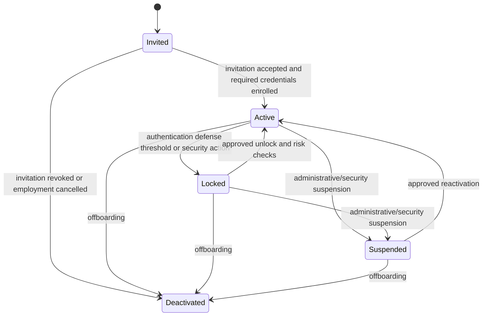

# AFTER FOUR Identity & Branch Authorization v1.0

**Status:** Owner policies confirmed; bounded authentication foundation implemented; production and business-authorization prerequisites remain open

**Date:** 2026-11-14; implementation note updated 2026-11-26

**Scope:** Identity, authentication, sessions, authorization, Branch scope, and security audit only. The 2026-11-26 Security & Trust Foundation task authorizes only the bounded implementation recorded in §7; Milestone 2B and production use remain unauthorized.
**Related:** [ADR-0006](adr/0006-authentication-session-topology.md) · [Decision Register](after_four_identity_decision_register.md) · [Threat Model](after_four_security_threat_model.md) · [ERD](after_four_erd.md) · [Data Dictionary](after_four_data_dictionary.md) · [API Contract](after_four_api_contract.md)

## 1. Audit result: facts before proposals

### 1.1 Verified implementation facts

- Rails 8.1.4.1 is an API-only application under `backend/`. It has health/readiness endpoints and a structured JSON error foundation, but no identity endpoints, models, migrations, policy objects, or audit persistence.
- API-only middleware currently omits cookies and sessions. CORS exists only as a commented template; `rack-cors` is not active. No CSRF/authentication configuration exists.
- Production forces and assumes TLS. Logs are tagged with request ID, use a structured formatter, and filter password-, email-, phone-, authorization-, cookie-, CSRF-, secret-, token-, OTP-, and payment-sensitive parameter names.
- The frontend is a local prototype with no authentication state or API client. No executable deployment topology establishes same-origin or cross-origin operation.
- RSpec is the sole backend testing framework. PostgreSQL 18, UUID keys, UTC persistence, `/api/v1`, and `structure.sql` are accepted foundations.

### 1.2 Approved domain facts

- Organization owns Brand and Branch. MVP has one Brand and multiple Branches.
- User is a sign-in identity. Employee is an employment record. Their optional one-to-one link must not be collapsed.
- Branch Assignment is effective-dated employment/work eligibility (`primary` or `temporary`). Role Assignment is effective-dated authorization. Both histories are retained.
- Owner is Organization-scoped. Branch Manager and Staff access is Branch-scoped. Historical transactions and attendance retain their actual Branch.
- Server authorization is authoritative; client-supplied Branch, role, and visibility are not.

### 1.3 Contradictions and gaps found

1. Milestone 2A found a role-vocabulary conflict. ID-10 now resolves the active roles as Owner/Branch Manager/Staff; Regional Manager remains reserved and inactive. Older canonical `Manager` references are renamed accordingly.
2. `users.status` previously defaulted to `active`. ID-08 confirms invitation-only creation, so implementation must not bypass invitation acceptance. ID-15 now separates authentication lock, suspension, reactivation, and deactivation and assigns administrative lifecycle authority to the Owner; physical states and transitions remain technical design.
3. Branch Assignment is sometimes described as “branch access,” but the ERD correctly calls it work assignment. Authorization must require the appropriate Role Assignment too.
4. The API previously described direct User creation. Invitation-only policy is now confirmed, but invitation acceptance, suspension/reactivation, lock/unlock, credential reset, and MFA implementation contracts still require design/security review.
5. Server sessions are proposed in architecture documents but no Session entity is present in the logical ERD/dictionary and no middleware implements them.
6. Audit fields cover sensitive actions, but unauthenticated failures need a safe subject hint and event outcome without fabricating an actor or storing a raw login identifier.
7. ID-17 approves the one-origin production policy, but the deployment ADR and authentication ADR remain Proposed because exact infrastructure and security controls are unselected or unreviewed.

## 2. Identity and employment model

### 2.1 Separation of concerns

| Concept | Owns | Does not own |
|---|---|---|
| User | Login identifier, lifecycle, authenticators, sessions, MFA, role grants | Employment dates, compensation, attendance |
| Employee | Employee code, employment lifecycle, contact/work profile, Branch Assignments | Credentials, sessions, permissions |
| Role Assignment | Authorization template and effective scope | Permission to work a shift by itself |
| Branch Assignment | Employee eligibility to work at a Branch for an interval | Capabilities by itself |
| Invitation Delegation | Time-limited authority for an active Branch Manager to invite Staff to assigned Branches | A Role Assignment, Branch Assignment, onward delegation, or assignment approval |
| Shift/Attendance | Planned and actual Branch execution | Standing access after the shift/assignment ends |

An Employee can exist without a User. A service/support User may exist without an Employee only if explicitly justified and tightly scoped. Shared employee credentials are forbidden.

### 2.2 Proposed User lifecycle

This state machine remains a `TECHNICAL_PROPOSAL`, not approved schema. ID-07 confirms rate limiting/progressive delay and forbids permanent lock solely because of failed attempts. ID-15 confirms that authentication lock is temporary and automated, suspension/reactivation are Owner-controlled, reactivation requires explicit Owner authorization and audit, and deactivation is Owner-controlled with no automatic return. `locked` must not silently change employment status; `suspended` is an administrative access state; `deactivated` preserves history and requires explicit Owner rehire/reactivation for return. All non-active states reject new sessions. Suspension and deactivation revoke all sessions immediately. Lock-release conditions, atomic enforcement, and the separate Owner-unavailable escalation procedure require security/operational review; no Branch Manager receives implicit Owner power.

### 2.3 Identifier policy

- `OWNER_CONFIRMED` Username is the unique login identifier. The technical proposal scopes normalized uniqueness to Organization and preserves the entered form separately; normalization/change rules require security review.
- `OWNER_CONFIRMED` Email is contact and recovery information, never a login identifier. Collection, verification, change, and recovery-channel protection require security/privacy review; never imply verification from string format.
- Identifier change requires recent authentication or an authorized administrator, conflict checks, audit, notification to the prior contact where available, and session rotation. It never changes the UUID User identity or historical actor links.
- Public login and recovery responses are generic regardless of identifier existence or account state.

### 2.4 Credential lifecycle and password policy

- Proposed states per authenticator: pending enrollment, active, locked, superseded/revoked. Store only salted adaptive digests for passwords/PINs and one-way verifiers for random recovery/session tokens.
- Prefer Argon2id for a new password implementation. Select the maintained gem and benchmark parameters in Milestone 2B; record algorithm and parameters so successful login can rehash when policy changes.
- Proposed password policy follows current NIST guidance: minimum 15 characters when password is the sole factor, permit at least 64 characters, allow spaces and password managers/paste, no arbitrary composition rule, no routine periodic change, and reject common/compromised choices. Bound input size before hashing to prevent resource exhaustion.
- Force credential change only after compromise, recovery, or authorized reset. Administrative reset issues a short-lived one-time recovery verifier; administrators never choose or see the final password.
- Recovery tokens are single-use, short-lived, rate-limited, stored only as digests, and invalidated after use. Successful recovery revokes all sessions and authenticators selected by policy, records an audit event, and notifies the User through an approved channel.

### 2.5 POS PIN boundary

`OWNER_CONFIRMED` Every POS employee has an individual 6–8 digit PIN; four-digit and shared store PINs are forbidden. A PIN may authenticate or reauthenticate one employee only on an enrolled POS device associated with a Branch for which the Employee has an effective assignment. It cannot independently create a general-purpose application Session, replace MFA, satisfy step-up, recover an account, authorize Owner/security administration or role/assignment changes, bypass normal Session/authorization controls, or enable cross-Branch action. The server evaluates the full policy after PIN verification; knowing a PIN is never a Branch grant.

PINs need not be globally unique values. Masked entry, a separate adaptive digest, constant-time library verification, distributed account+device+source controls, progressive delay, temporary Authentication Lock, and alternate-route coverage are required policy. Exact thresholds, schedules, lock duration/release, enrolled-device binding, trusted-source derivation, hashing dependency/parameters, PIN-pepper operations, and recovery remain `TECHNICAL_PROPOSAL` and require executed security evidence. Audit success/failure without the PIN.

### 2.6 Offboarding

One audited offboarding command should, atomically where possible: end future/current Role Assignments, end Branch Assignments as of the approved time, deactivate the User, revoke sessions and pending recovery/invitation tokens, disable PIN/MFA authenticators, and retain Employee/User/audit/history records. Ending employment must not erase prior actor, Branch, shift, order, cash, or approval evidence. Failures are visible and retryable; access removal fails closed.

## 3. Authorization model

### 3.1 Fixed roles plus capabilities

Use RBAC for understandable templates and explicit capability codes for policy checks. Capabilities are code-owned and reviewable, not arbitrary per-User toggles. Example capability families are identity administration, staff scheduling, catalog administration, POS operation, payment/refund, cash, inventory, reporting, and audit review; examples do not create permissions. Every ordinary and sensitive capability must be explicitly enumerated and remain governed by its domain decisions.

| Evaluated role | Proposed scope | Status |
|---|---|---|
| Owner | Organization-wide, including all current Branches; sensitive identity actions require approved MFA/step-up controls. | `OWNER_CONFIRMED`; exact capability and step-up matrix requires review |
| Regional Manager | No active access. If introduced later, only Branches linked through an explicit effective region membership. | Reserved and inactive; enabling it requires a future Owner decision |
| Branch Manager | Only explicitly assigned Branches, with both effective Role and Employee Branch Assignments. MFA is mandatory; sensitive capabilities also require step-up. | `OWNER_CONFIRMED`; exact ordinary/sensitive capability enumeration and controls require review |
| Staff | Only explicitly assigned Branches, with both effective Role and Employee Branch Assignments. | Existing role approved; capability matrix proposed |

Do not create Region tables or encode Branch arrays while Regional Manager is inactive. Do not add per-User permissions, negative grants, nested groups, or a policy expression language in MVP. `OWNER_CONFIRMED` Every Role Assignment and Employee Branch Assignment change requires Owner approval. A Branch Manager cannot elevate or assign themself, approve their own Role Assignment or Branch Assignment changes, access unassigned Branches, perform Owner-only account/security administration, set company-wide payroll policy, or perform final payroll close.

### 3.2 Invitation delegation boundary

`OWNER_CONFIRMED` Invitation Delegation is separate from Role Assignment. Only an active Branch Manager may receive it, only to invite Staff to that manager's assigned Branches, and for no more than 90 days. A delegate cannot approve Role Assignment or Branch Assignment changes, delegate onward, or renew their own delegation. The Owner may revoke it at any time; revocation also invalidates every outstanding unused invitation created under it. The representation, revalidation, race handling, and enforcement evidence remain technical/security-review work; this policy does not authorize a new entity, field, endpoint, or migration.

### 3.3 Authorization calculation

For every protected request:

1. Authenticate an unexpired, unrevoked Session and load the current User; deny unless lifecycle is active.
2. Resolve Organization solely from the trusted Session/User.
3. Scope the resource query to that Organization and authorized Branch set before lookup.
4. Resolve effective Role Assignments at server time and map fixed role templates to capabilities.
5. For Branch operations, require the target Branch in both the role scope and linked Employee's effective Branch Assignment, except for the explicitly approved Owner Organization scope.
6. Validate the resource's persisted Branch/Organization; do not authorize from a request body/header copy.
7. Apply command-specific ownership, segregation, step-up, and approval rules.
8. Deny by default and emit safe audit evidence for sensitive success or denial.

Unknown or out-of-scope resource identifiers return the same `404 resource_not_found`; a known, already-visible Branch with insufficient capability may return `403`. Collections are pre-scoped and never filtered after serialization.

### 3.4 Working Branch and history

Primary and temporary Branch Assignments establish eligible work scope. A scheduled Shift must be at an eligible Branch. At operation time, the server resolves an explicit working Branch from the session/device/request route and revalidates it; the frontend's selected Branch is only a target. Actual Shift/Attendance does not create standing permission.

Every Branch-owned business record stores immutable `branch_id` at creation. Changing assignments, role grants, selected Branch, or organizational structure never rewrites historical Branch context. Audit records capture the effective Branch and role/capability used at event time.

## 4. Session and browser security

### 4.1 Recommended topology

Use the server-session design in ADR-0006. A Session record contains a public lookup ID plus the digest of an independently random secret (or one digest with an indexed safe lookup design), User, optional enrolled Device, creation/authentication/last-seen/idle-expiry/absolute-expiry/revocation timestamps, revocation reason, authentication method/assurance, and safe client summaries. Never persist the raw cookie value.

`OWNER_CONFIRMED` Production uses one HTTPS origin, with the frontend and `/api/v1` behind one managed edge and the Rails origin private. CORS is absent by default, trusted proxies are explicit, Host Authorization remains enabled/configured, and health responses expose no sensitive infrastructure detail. Hosting, domain, DNS, edge vendor, exact proxy chain, network/private connectivity, operational ownership, and health monitoring remain unselected. Use `Secure`, `HttpOnly`, host-only `SameSite=Lax`, `Path=/`; prefer a `__Host-` name. Rails CSRF verification and origin checking cover every unsafe request. A future cross-origin design requires a superseding approved decision and security review.

`OWNER_CONFIRMED` Back-office sessions have a 30-minute idle timeout and a 12-hour absolute lifetime. A POS session locks after 2 minutes without activity and requires individual reauthentication. A User may have multiple device sessions; MVP has no numeric cap. Provide session visibility, new-device notifications where appropriate, anomaly detection/revocation, and Owner-controlled all-session revocation. Revisit a numeric cap only if operational or security-incident evidence justifies one. Enforce timeouts on the server, rotate on authentication and security-sensitive changes, and record sessions independently. Exact individual-session self-revocation, safe device/time/location summaries, notifications, detection signals, and privacy treatment remain technical/security-review work. IP/User-Agent changes are detection signals, not sole authorization factors.

### 4.2 MFA, reauthentication, and recovery

`OWNER_CONFIRMED` MFA is mandatory for the Owner and every Branch Manager; sensitive capabilities require step-up authentication. The exact capability enumeration, factor method, enrollment, verification, replacement, and recovery require security review. Prefer phishing-resistant factors where devices allow; TOTP is only a possible technical fallback after review, and SMS is not the proposed default. Encrypt any recoverable factor seed with managed keys, hash recovery codes individually, and never log either.

Require recent password/MFA reauthentication for Owner-level identity administration, credential/MFA changes, recovery completion, and similarly sensitive actions. PIN cannot satisfy this step-up. Recovery cannot bypass account scope, separation-of-duty, or audit requirements.

`OWNER_CONFIRMED` Owner recovery establishes at least two independent factors in advance, prefers passkeys/hardware security keys where appropriate, includes separately stored offline recovery material, and requires two independent proofs plus dual control. A Branch Manager cannot independently recover the Owner account. Exact proof/assurance, custodians, storage/rotation, delay/escalation, provider or implementation, monitoring/audit, and the Owner-unavailable emergency runbook remain `SECURITY_REVIEW_REQUIRED`; no provider is selected.

## 5. Proposed schema versus approved schema

| Logical record/change | Purpose | Status |
|---|---|---|
| Existing User, Employee, Branch Assignment, Role, Role Assignment | Core identity/employment/authorization separation | Approved logical concepts |
| Expanded User lifecycle values and normalized identifier columns | Invitation, lock, suspension, stable uniqueness | Invitation and username policy `OWNER_CONFIRMED`; physical fields/transitions `TECHNICAL_PROPOSAL` |
| Authentication Credential | Separate password/PIN digest and lifecycle metadata | `TECHNICAL_PROPOSAL`, security review required |
| Session | Server-side token verifier, expiry, revocation, assurance, optional Device | `TECHNICAL_PROPOSAL`, security review required |
| Account Invitation | One-time invite verifier and acceptance/revocation history | Invitation-only authority `OWNER_CONFIRMED`; record/control design `TECHNICAL_PROPOSAL` |
| Credential Recovery Challenge | One-time recovery verifier and use/expiry history | Employee recovery authority and Owner recovery policy `OWNER_CONFIRMED`; physical design `SECURITY_REVIEW_REQUIRED` |
| MFA Factor and recovery codes | Privileged authentication | MFA scope `OWNER_CONFIRMED`; method/design `SECURITY_REVIEW_REQUIRED` |
| Region/Regional Manager scope | Cross-Branch management | Reserved and inactive; no implementation authorized |

The ERD/dictionary show these as proposed logical records only. They are not approved physical table or migration specifications.

## 6. Audit event design

`OWNER_CONFIRMED` Audit policy covers Security, Account lifecycle, Authorization and assignment, Financial, HR/payroll, and Operational event classes. Audit read access requires explicit authorization; a User cannot modify or delete audit records of their own actions. Controlled holds, exports, and anonymization must preserve integrity and accountability. Proposed event fields are: immutable event UUID; Organization; optional Branch; action code; outcome (`succeeded`, `failed`, `denied`); occurred time; actor User when authenticated; target User/Employee/session/assignment identifiers when applicable; effective role/capability; request/correlation ID; reason code; safe before/after summaries; safe source/device/session lookup references; and schema version.

Required event families include login success/failure, logout, session expiry/revocation, invitation, credential enrollment/change/reset, MFA enrollment/removal/recovery, lock/unlock, suspension/reactivation/deactivation, identifier change, role/capability-template change, Role Assignment change, Branch Assignment change, recovery attempts, rate-limit/security denials, and sensitive Owner actions.

For an unauthenticated failure, `actor_user_id` remains null. A keyed digest or coarse classification of the attempted identifier may support correlation; raw identifiers, network addresses beyond approved retention, and secret material do not belong in general metadata. Never store passwords, PINs, raw session/recovery/CSRF tokens, MFA seeds/codes, cookie/authorization headers, or unrestricted request bodies. Audit writes for sensitive state changes occur in the same transaction; direct update/delete is denied to the application role. No numeric retention period is approved. Database privileges and integrity evidence require security review; durations, payroll/customer visibility, pre-employment/offboarding treatment, recovery evidence, holds/exports, and anonymization timing require legal/privacy review.

## 7. Implemented Security & Trust Foundation slice (2026-11-26)

The authorized slice implements a backend authentication foundation without granting a business capability:

- Devise 5.0.4 supplies `database_authenticatable`, `recoverable`, `lockable`, and `timeoutable` credential primitives on the namespaced Identity Infrastructure record. Public registration, `rememberable`, public recovery endpoints, PIN, MFA, invitations, and Owner recovery are not implemented.
- `users` records are Organization-scoped, default to `invited`, use username rather than email for login, and retain the separate active/suspended/deactivated lifecycle values. The database enforces normalized username uniqueness per Organization. Bcrypt is the Devise-supported implemented digest; this does not approve or replace the separately gated Argon2 production candidate.
- `authentication_sessions` store a public UUID lookup plus SHA-256 verifiers for independently random session and CSRF secrets. Raw secrets are never persisted. The browser receives a host-only, `HttpOnly`, `SameSite=Lax`, `Path=/` cookie; production uses a `Secure` `__Host-` name. Unsafe authentication requests require the configured exact browser origin, and logout additionally requires the session-bound CSRF token.
- Back-office sessions enforce the confirmed 30-minute idle and 12-hour absolute limits server-side. Authentication creates a new session rather than adopting caller state; logout, expiry, suspension/deactivation checks, and credential changes invalidate access. Password reset primitives enforce expiry and single use, but no public recovery/delivery workflow exists because its authority and evidence remain unresolved.
- Presentation derives an `AuthenticatedActor` from the verified server session and delegates to Identity Application use cases. Client `actor_id`, role, Organization, or Branch assertions never populate the actor. Domain/Application code remains independent of Rails, Devise, Active Record, cookies, and sessions.
- The only positive authorization rule is an active actor reading their own session in the same Organization. Unknown actions, another User, another Organization, and every Branch-scoped request deny by default. Role Assignment and Employee Branch Assignment persistence is absent, so no Ordering, Payment, Preparation, Catalog, Cash, reporting, or other business authority is granted.
- Existing expiration jobs remain explicit system execution with no fabricated human identity. This slice introduces no general-purpose system account and no authentication-related background job.

### 7.1 Explicit remaining controls and prerequisites

- Exact distributed rate limiting, progressive delay, lock thresholds/release policy, breached-password screening, MFA, invitation acceptance, recovery proof/delivery, notifications, session inventory/revoke-all, and Owner-unavailable handling remain review items. Non-test processes fail boot unless lock threshold and duration are explicitly configured; local Compose values are development evidence only, not production approval.
- The existing Branch-scoped `audit_events` shape cannot safely represent Organization-only or unauthenticated authentication events. Authentication audit persistence, safe attempted-subject correlation, event integrity, reader/retention policy, and legal/privacy review therefore remain open rather than forcing false Branch evidence.
- Local development and test continue to use the PostgreSQL superuser as migration, owner, and runtime principal. Production runtime/schema-owner separation, exact grants, credential custody, and negative privilege tests remain a deployment prerequisite; no production role or credential was changed.
- Same-origin production routing, trusted proxies, Host Authorization, TLS termination, production secret custody, mail delivery, and qualified security/legal/privacy review remain unverified. No production identity data may be created from this implementation record alone.

## 8. Milestone 2B sequence after approval

1. Resolve the remaining technical, operational, security, and legal/privacy review items and complete the [Identity Security Review Checklist](after_four_identity_security_review_checklist.md); update ADR-0006 before coding.
2. Add failing RSpec policy/request/model tests for lifecycle, session revocation, default denial, IDOR, Branch intersection, and redaction.
3. Add minimal identity migrations in dependency order: Users/Employees, Branch Assignments, fixed Roles/Role Assignments, credentials, Sessions, invitation/recovery records selected by policy, Audit Logs. Do not add Region/MFA records unless approved for the slice.
4. Implement User lifecycle and offboarding transaction; keep Employee lifecycle separate.
5. Implement password login, opaque session issuance/rotation/revocation/expiry, cookie/CSRF middleware, rate limiting, and generic errors.
6. Implement authorization context and explicit policies with Organization/Branch-scoped queries; seed fixed role templates and capabilities.
7. Implement invitation, employee recovery, PIN, and MFA only after their technical controls pass security review; do not implement Owner recovery until its exact reviewed procedure is approved.
8. Add audit immutability/redaction, operational cleanup, monitoring, and incident/recovery runbooks.
9. Run the full RSpec, RuboCop, Brakeman, dependency audit, migration-from-empty, and frontend checks. Perform a focused security review before any production identity is created.

Stop after design approval review. No step above is authorized by this document alone.

## 9. External security basis

- [Rails Security Guide](https://guides.rubyonrails.org/security.html)
- [OWASP Authentication Cheat Sheet](https://cheatsheetseries.owasp.org/cheatsheets/Authentication_Cheat_Sheet.html)
- [OWASP Session Management Cheat Sheet](https://cheatsheetseries.owasp.org/cheatsheets/Session_Management_Cheat_Sheet.html)
- [OWASP Password Storage Cheat Sheet](https://cheatsheetseries.owasp.org/cheatsheets/Password_Storage_Cheat_Sheet.html)
- [NIST SP 800-63B-4 Authenticators](https://pages.nist.gov/800-63-4/sp800-63b/authenticators/)
