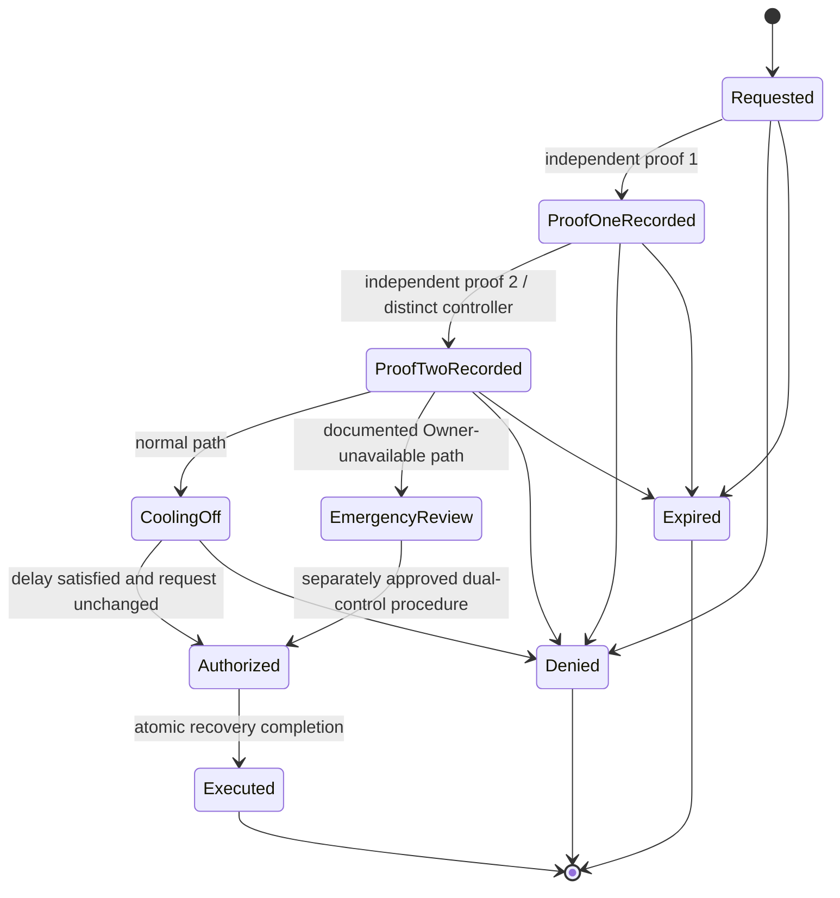
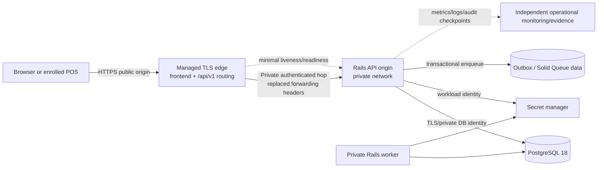

# AFTER FOUR Identity Technical Design

**Status:** Consolidated technical design; IDs 29–34 confirm scoped Argon2 validation/admission direction while production, implementation, security, legal/privacy, and deployment approvals remain outstanding  
**Date:** 2026-11-14  
**Scope:** Implementation-ready design inputs for future review; no implementation or schema authorization  
**Authority:** ADR-0006 remains Proposed. Milestone 2B remains unauthorized.  
**Related:** [Owner-Led Review Protocol](after_four_identity_owner_led_review_protocol.md) · [Decision Register](after_four_identity_decision_register.md) · [ADR-0006](adr/0006-authentication-session-topology.md) · [Identity & Branch Authorization](after_four_identity_authorization.md) · [Password/PIN Control Specification](after_four_identity_password_pin_control_specification.md) · [Threat Model](after_four_security_threat_model.md) · [Review Package](after_four_identity_security_review_package.md) · [Review Results](after_four_identity_security_review_results.md)

## 1. Purpose, status, and decision discipline

This document closes design ambiguity by selecting concrete technical proposals or identifying an explicit approval gate. It does not convert a proposal into Owner policy, professional approval, a physical schema, an API contract, or authorization to code.

The following labels are normative in this document:

- `OWNER_CONFIRMED`: exact policy in the [Identity Decision Register](after_four_identity_decision_register.md).
- `WORKSHOP_AGREED`: existing canonical domain boundary.
- `TECHNICAL_PROPOSAL`: selected implementation design for review; not approved.
- `SECURITY_REVIEW_REQUIRED`: a named qualified reviewer must examine the actual design and later executed evidence.
- `LEGAL_PRIVACY_REVIEW_REQUIRED`: qualified current advice is required; no requirement or duration is inferred here.
- `OWNER_DECISION_REQUIRED`: an operating choice is not covered by the twenty-eight confirmed policies or the six scoped technical/validation directions in IDs 29–34.
- `BLOCKED_BY_DOMAIN_POLICY`: the business authority, threshold, or workflow is still open; implementation must default-deny.

The canonical checklist remains four `OPEN`, six `BLOCKED`, zero `IN_REVIEW`, and zero `ACCEPTED`. The fifteen records under [security-reviews](security-reviews/) remain not started because no reviewer or evidence was supplied.

ID-20 changes review governance, not the technical proposals. “Required reviewer” fields below describe the expertise and independence originally recommended. Under the current Owner-led approach, the Owner performs the technical/security assessment using the [Owner-Led Review Protocol](after_four_identity_owner_led_review_protocol.md), records the self-review limitation, and may accept explicit residual technical risk. Independent verification and legal review remain not performed; legal/privacy gates cannot be closed by Owner risk acceptance.

## 2. Module and interface design

Security behavior belongs behind a small set of deep module interfaces. Controllers parse requests and serialize results; they do not calculate scope, compare secrets, update retry counters, or coordinate lifecycle writes.

| Module | External interface | Behavior hidden by the implementation | Test surface |
|---|---|---|---|
| Authorization | `decide(context:, action:, resource:) -> Decision` | Active lifecycle, assurance/step-up, fixed capability template, Role Assignment, Employee Branch Assignment, immutable resource scope, self-approval, delegation, default denial | Decision result and safe reason code across role/Branch/action matrix |
| Credentials | `verify(kind:, user:, presented_secret:) -> VerificationResult` and authorized enrollment/change commands | Normalization, algorithm/parameter version, pepper/key version, constant-time verification, rehash, failure recording, secret redaction | Success/failure/upgrade outcome; persisted digest metadata; no raw secret |
| Sessions | `authenticate(raw_token:, request_context:) -> AuthContext`, `issue`, `rotate`, and `revoke` | Token parsing/verifier lookup, expiry, POS lock, assurance, current scope loading, last-seen policy, anomaly signals, cookie instructions | Issued/rejected context, rotation/revocation, exact time and concurrency outcomes |
| Authentication Defense | `evaluate(attempt_context:) -> DefenseDecision` and `record(outcome:)` | Multi-key distributed counters, progressive delay, temporary lock, generic response contract, trusted source handling | Permit/delay/deny decision and counter behavior through a PostgreSQL adapter and deterministic test adapter |
| Identity Lifecycle | `execute(command:, actor:, idempotency_key:) -> LifecycleResult` | Row locking, state guards, assignment/delegation/invitation/session/credential changes, audit atomicity, retry result | Observable aggregate state and audit outcome for each command/race |
| Audit Append | `append(event:)` inside the caller transaction | Taxonomy validation, redaction, immutable serialization, row hash, request/actor/target attribution | Committed event or whole transaction rollback; direct mutation denied |
| Audit Read/Export | `query(actor:, purpose:, scope:)` and separately approved export command | Reader authorization, self-investigation rule, minimization, hold/export evidence | Authorized minimized results and denied attempts; disabled until policy review |

External adapters exist only where behavior genuinely varies: the authentication-defense module has PostgreSQL and deterministic test adapters; WebAuthn/TOTP implementations, notification delivery, a future edge, and an independent audit-checkpoint sink sit at external seams. Internal classes are not exposed merely to make unit tests convenient. The module interface is the primary test surface.

## 3. Authorization and capability design

### 3.1 Major decision TD-AUTH-01

| Attribute | Design record |
|---|---|
| Requirement | ID-09, ID-10, ID-13, and ID-14 require fixed roles, explicit capabilities, Owner-approved assignment changes, assigned-Branch Branch Managers, separate Invitation Delegation, and default denial. |
| Proposed design | Code-owned versioned capability catalog plus fixed role templates. Every protected action names one capability. Authorization intersects capability, effective Role Assignment, effective Employee Branch Assignment, persisted resource scope, lifecycle, assurance, delegation, and command-specific approval rules. |
| Alternatives | Role-name checks are rejected; database row-level security alone is insufficient; arbitrary per-User grants/policy language are out of scope; a third-party policy engine is unnecessary until policy complexity proves otherwise. |
| Threats addressed | Vertical escalation, cross-Branch IDOR, self-approval, stale assignments, client-asserted role/Branch, delegation abuse, capability drift. |
| Failure modes | Missing catalog entry, stale cache, ambiguous scope, role/capability mismatch, future assignment race, unsafe existence disclosure. All fail closed. |
| Test requirements | Complete role/action/Branch matrix; unassigned/expired/temporary Branches; self-approval; guessed UUID; list/detail/mutation/export; concurrent assignment change; stale session; delegation expiry/revocation. |
| Operational implications | Catalog changes require reviewed release, matrix diff, policy tests, and audit event; no runtime permission editor. |
| Required reviewer | Security specialist for authorization/IDOR/step-up; Owner for any capability not already supported by canonical policy; legal/privacy reviewer for staff/customer/payroll/audit visibility. |
| Approval status | `TECHNICAL_PROPOSAL`, `SECURITY_REVIEW_REQUIRED`; several domain rows remain `BLOCKED_BY_DOMAIN_POLICY`. |

### 3.2 Capability-state legend

| State | Meaning |
|---|---|
| `ENABLED` | Canonical policy supports the capability for the role, subject to all stated guards. |
| `CONDITIONAL` | Canonical policy supports the activity only with listed assignment, duty, delegation, approval, threshold, purpose, or review conditions. No condition may be inferred. |
| `OWNER_ONLY` | Server requires an active Organization-scoped Owner grant plus approved step-up; Branch Manager/Staff are explicitly denied. |
| `BLOCKED` | Business/security/legal policy is incomplete. No role receives the capability until a later approved decision synchronizes canonical documents and tests. |
| `SELF_ONLY` | Target identity must equal the authenticated User/linked Employee and no broader record is exposed. |

### 3.3 Complete MVP capability matrix

This matrix is exhaustive for capabilities evidenced by the canonical Business Domain Model. A business action not listed here is denied. “Operational work” is never a wildcard; a later domain capability must be explicitly added before use.

| Capability code | Owner | Branch Manager | Staff | Required guards and provenance |
|---|---|---|---|---|
| `organization.configure` | `OWNER_ONLY` | Deny | Deny | Organization-wide Owner authority; configuration remains versioned/audited. |
| `branch.operation.perform` | `ENABLED` all Branches | `CONDITIONAL` assigned Branch | `CONDITIONAL` assigned Branch and permitted shift duty | Canonical Branch operations boundary; command must also name a domain capability, so this umbrella code cannot authorize a write alone. |
| `schedule.manage` | `ENABLED` all Branches | `ENABLED` assigned Branch | Deny | Canonical scheduling matrix. |
| `schedule.read_self` | `ENABLED` | `ENABLED` assigned Branch | `SELF_ONLY` | Staff sees only own schedule unless another approved capability exists. |
| `availability.submit_self` | `ENABLED` | `SELF_ONLY` | `SELF_ONLY` | Employee-owned submission; no cross-employee mutation. |
| `shift_swap.submit_self` | `ENABLED` | `SELF_ONLY` | `SELF_ONLY` | Final decision workflow remains subject to scheduling policy. |
| `leave.request_self` | `ENABLED` | `SELF_ONLY` | `SELF_ONLY` | Own request only. |
| `leave.normal.decide` | `ENABLED` | `ENABLED` assigned Branch | Deny | Branch Manager normal-leave approval is canonical; exception routes to Owner. |
| `leave.exception.decide` | `OWNER_ONLY` | Deny | Deny | Owner handles exceptions. Exact categories remain domain/legal work. |
| `overtime.propose` | `ENABLED` | `ENABLED` assigned Branch | Deny | Branch Manager proposes; proposal never affects payroll before Owner decision. |
| `overtime.decide` | `OWNER_ONLY` | Deny | Deny | Owner final approval. |
| `payroll.preliminary_review` | `ENABLED` | `CONDITIONAL` assigned-Branch employees and minimized fields | Deny | Canonical preliminary review; field visibility requires legal/privacy review. |
| `payroll.close` | `OWNER_ONLY` | Deny | Deny | ID-13 explicitly forbids Branch Manager final close. |
| `payslip.read_self` | `ENABLED` | `SELF_ONLY` | `SELF_ONLY` | Self-only, subject to delivery/privacy design. |
| `inventory.operate` | `ENABLED` | `BLOCKED` pending explicit action list/limits | `BLOCKED` pending duty/action policy | Existing matrix supports assigned-Branch operations in principle, but approved limits/action list are unresolved; writes remain disabled until enumerated. |
| `procurement.operate` | `ENABLED` | `BLOCKED` pending limits/approval routes | Deny unless future policy says otherwise | Thresholds/approval routes remain open. |
| `customer.history.read_operational` | `CONDITIONAL` legitimate purpose | `BLOCKED` pending minimized field/purpose policy | `BLOCKED` pending minimized field/duty policy | Legal/privacy visibility is unresolved; no operational response exposes customer history yet. |
| `loyalty.adjust.request` | `ENABLED` | `ENABLED` assigned Branch | Deny | Request only; no direct adjustment. |
| `loyalty.adjust.approve` | `OWNER_ONLY` | Deny | Deny | Canonical Owner approval. |
| `refund_void.execute` | `BLOCKED` | `BLOCKED` | `BLOCKED` | Roles, thresholds, timing, and self-approval are open. Owner being “permitted subject to policy” is not executable policy. |
| `cash.adjust` | `BLOCKED` | `BLOCKED` | `BLOCKED` | Cash discrepancy/expense thresholds and authority remain open. Ordinary POS tender recording is a separate future domain capability. |
| `catalog.change` | `BLOCKED` | `BLOCKED` | `BLOCKED` | No approved identity-role matrix exists for catalog mutation. |
| `audit.read` | `BLOCKED` | `BLOCKED` | `BLOCKED` | ID-18 requires explicit reader authorization; eligible readers/self-investigation/fields remain unresolved. |
| `audit.export` | `BLOCKED` | `BLOCKED` | `BLOCKED` | Export recipients, purpose, approval, expiry, and legal rules remain unresolved. |
| `identity.invitation.create_staff` | `ENABLED` | `CONDITIONAL` active Invitation Delegation and assigned Branch | Deny | ID-08/ID-14; Branch Manager cannot invite Owner/Branch Manager or themself. |
| `identity.delegation.manage` | `OWNER_ONLY` | Deny | Deny | Owner grants/revokes; no onward delegation or self-renewal. |
| `identity.role_assignment.manage` | `OWNER_ONLY` | Deny | Deny | ID-09; every create/change/end requires Owner approval and step-up. |
| `identity.branch_assignment.manage` | `OWNER_ONLY` | Deny | Deny | ID-09; distinct from Role Assignment. |
| `identity.account.suspend` | `OWNER_ONLY` | Deny | Deny | ID-15; Owner-unavailable procedure is separate and unresolved. |
| `identity.account.reactivate` | `OWNER_ONLY` | Deny | Deny | Explicit Owner authorization, step-up, reason, audit. |
| `identity.account.deactivate` | `OWNER_ONLY` | Deny | Deny | No automatic return; preserve history. |
| `identity.employee_recovery.manage` | `OWNER_ONLY` | Deny | Deny | ID-06; exact employee recovery controls require review. |
| `identity.owner_recovery.execute` | `BLOCKED` dual-control protocol only | Deny | Deny | Not an ordinary Owner capability; requires ID-16 protocol and reviewer approval. |
| `identity.session.read_self` | `SELF_ONLY` | `SELF_ONLY` | `SELF_ONLY` | Technical proposal implementing ID-19 visibility; safe summaries only. |
| `identity.session.revoke_self` | `SELF_ONLY` | `SELF_ONLY` | `SELF_ONLY` | Technical proposal; raw token never exposed. |
| `identity.session.revoke_all_for_user` | `OWNER_ONLY` | Deny | Deny | ID-05/ID-19; target may also use self all-session revocation only after explicit review. |

### 3.4 Owner-only list and explicit denials

The following are never granted by the Branch Manager or Staff role templates: Organization configuration; Role Assignment or Branch Assignment create/change/end; delegation grant/renew/revoke; suspension/reactivation/deactivation; employee recovery administration; company-wide payroll policy; final payroll close; overtime final decision; leave exceptions; loyalty adjustment approval; Owner security/MFA/recovery administration; cross-Branch access; audit read/export unless a future explicit reader decision is recorded.

Branch Managers are additionally denied self-elevation, self-assignment, approval of their own assignment changes, invitation of Owner/Branch Manager/self, onward delegation, delegation self-renewal, and use of expired/revoked delegation. Staff are denied all identity administration, assignment approval, delegation, payroll review/close, other-employee records without an explicit future capability, and actions outside assigned Branch/duty.

The Staff template contains only: self schedule read, self availability submission, self shift-swap submission, self leave request, self payslip read, self Session visibility/revocation as a technical proposal, and explicitly enumerated operational actions tied to effective Branch Assignment and shift duty. The umbrella `branch.operation.perform` guard is never sufficient by itself. Inventory, procurement, customer history, refund/void, cash adjustment, catalog change, audit, identity administration, and any unlisted action remain denied until a later approved domain capability exists.

### 3.5 Assigned-Branch enforcement algorithm

For every Branch resource or command, the Authorization module:

1. loads the active User and current Session from trusted server state;
2. derives Organization from the User, never from the request;
3. resolves effective Role Assignments at database/server time;
4. resolves the linked Employee's effective Branch Assignments independently;
5. derives allowed Branches as role scope intersected with Employee Branch scope, except the explicit Organization-scoped Owner rule;
6. scopes the resource query before lookup and verifies persisted Organization/Branch ancestry;
7. verifies the exact capability, duty/purpose/threshold/approval, step-up, self-target, and delegation guards;
8. returns a structured allow/deny decision and appends safe audit evidence for sensitive results.

Out-of-scope and nonexistent identifiers share `404 resource_not_found` where existence is sensitive. A known Branch already visible to the caller may return `403 branch_scope_violation`. Assignment/capability changes invalidate authorization caches immediately; a Session never snapshots lasting scope.

Required scenarios include Branch ID substitution, nested-resource mismatch, list/export leakage, expired/temporary assignment, Branch Manager with Role but no Branch Assignment, Employee assignment without Role, delegated invitation after manager transfer, simultaneous assignment revocation/request, and self-approval through alternate endpoints.

## 4. Cryptographic and secret design

### 4.1 Major decision TD-CRYPTO-01

| Attribute | Design record |
|---|---|
| Requirement | SEC-03/SEC-04, IDs 21–34, and checklist records AF-SEC-001/002 require bounded POS-only PIN scope, 6–8 digit PINs, online attack protection, adaptive salted password/PIN protection, NFC password normalization, versioning, safe credential replacement, evidence before production selection, container-scoped hashing admission, transparent resource budgeting, explicit versioned parallelism, bounded overload behavior, and production revalidation. |
| Proposed design | Prefer Argon2id with encoded per-credential parameters and unique 128-bit salts, subject to ID-24 and ID-29–ID-34 evidence gates. P64-4 (`m_cost: 16`, `t_cost: 3`, `p_cost: 4`, encoding 64 MiB) is the Owner-confirmed preferred password candidate for production-parity validation, not a production profile. HashingAdmission protects the container-wide budget across its Puma workers, permits only bounded deadline-limited waiting, and returns a generic capacity-unavailable outcome; no Adapter or number is approved. A PIN profile remains unapproved. A PIN pepper remains proposed under the separate lifecycle required by ID-27; password peppering is not mandatory for MVP under ID-26. |
| Alternatives | bcrypt is the compatibility fallback but is not memory-hard and has input-length concerns; scrypt is acceptable when Argon2id is unavailable; PBKDF2 is reserved for an external compliance requirement. Fast SHA-2 alone is forbidden for passwords/PINs. |
| Threats addressed | Offline cracking, low-entropy PIN database attack, rainbow tables, oversized-input denial, weak-hash persistence, comparison timing, raw-secret leakage. |
| Failure modes | Native dependency incompatibility, excess memory/CPU under concurrency, pepper/key loss, stale parameters, malformed encoded digest, upgrade race. Authentication fails closed on verifier/configuration error. |
| Test requirements | Production-like calibration/load; exact input bounds; known vectors/library round trip; malformed digest; old-parameter rehash; concurrent rehash; pepper-version rotation; storage/log inspection; timing-safe token comparisons. |
| Operational implications | A production dependency and integration require separate approval despite the isolated compatibility evidence; parameters are versioned configuration with a minimum floor; pepper/key versions live in secret management. IDs 30–34 require measured Rails baseline, runtime reserve, safety headroom, CPU/memory/latency/topology constraints, explicit `p_cost`, bounded overload, and revalidation before production use and material change. |
| Required reviewer | Independent password-storage/security specialist; operations reviewer for capacity; Owner only if UX/business policy changes. |
| Approval status | IDs 21–28 are `OWNER_CONFIRMED` policy boundaries. IDs 29–34 are `OWNER_CONFIRMED` only for the P64-4 production-parity candidate and the stated admission, budget-method, parallelism-validation, overload, and revalidation directions. No production password/PIN profile, `p_cost`, numeric budget/limit, dependency integration, implementation, residual risk, or production use is approved. All findings and executed-evidence gates remain open. |

Primary guidance: [OWASP Password Storage Cheat Sheet](https://cheatsheetseries.owasp.org/cheatsheets/Password_Storage_Cheat_Sheet.html), [RFC 9106](https://www.rfc-editor.org/rfc/rfc9106.html), and [NIST SP 800-63B-4](https://pages.nist.gov/800-63-4/sp800-63b/authenticators/). P64-4 is approved only as the preferred production-parity validation candidate; no production parameter is approved.

### 4.2 Alternative comparison

| Alternative | Security characteristics | Operational cost | Dependency maintenance | Migration implications |
|---|---|---|---|---|
| Argon2id — preferred | Memory-hard; tunable memory/time/parallelism; current primary recommendation in repository guidance | Highest per-verification memory; must benchmark concurrency and denial resistance | Requires a maintained Ruby/native binding compatible with Ruby 3.4.12 and deployment images | Store algorithm/parameters per credential; rehash on successful verification; fallback/reset path if binding becomes unavailable |
| bcrypt — compatibility fallback | Mature adaptive CPU-hard design, but not memory-hard and commonly truncates/limits long byte inputs depending on implementation | Lower memory, familiar Rails integration, predictable deployment | Rails ecosystem support is mature; native extension still requires compatibility/security tracking | Existing Rails integrations are simpler; migration to Argon2id later still needs per-row algorithm/version and login-time rehash |
| scrypt — secondary fallback | Memory-hard and acceptable where Argon2id is unavailable | Tunable but can impose substantial memory; parameters are less familiar operationally | Requires separate maintained binding and compatibility validation | Same multi-algorithm verification/rehash strategy; no benefit over working Argon2id without a concrete constraint |
| PBKDF2 — compliance-only fallback | Widely standardized but CPU-hard rather than memory-hard | High iteration counts consume CPU; easier library availability | Often available through platform cryptography, but configuration and compliance evidence must be maintained | Use only for documented external requirement; retain algorithm/version and migrate through successful-login rehash |

No alternative is selected merely because it is already familiar. Dependency health, native build support, benchmark evidence, incident response, and parameter portability must be reviewed before selection.

### 4.3 Password specification

- Apply Unicode NFC consistently before password length validation and hashing across enrollment, login, reset, and migration, as required by ID-25. Accept at least 64 Unicode characters and retain the candidate 1,024 UTF-8 byte pre-hash maximum until length/request limits receive evidence and approval. Never silently truncate or change normalization after first persistence without an explicit migration.
- Candidate policy follows current canonical proposal: minimum 15 characters when password is the sole factor, no composition or periodic-rotation rule, allow spaces/paste/password managers, and reject common/compromised/context-specific values through a privacy-reviewed blocklist.
- Persist the library's encoded Argon2 string plus explicit `algorithm`, `parameter_version`, and timestamps. Never persist plaintext, reversible encryption, or application-supplied salts.
- On successful verification, compare stored parameters with current policy. Rehash inside a short credential-locking transaction; concurrent successful logins may discover the row already upgraded and must not fail.
- A password pepper is not mandatory for MVP. The no-pepper design leaves database-only offline resistance dependent on Argon2id, salts, password strength, and work factors; this trade-off is not a residual-risk acceptance. A later pepper must have separately reviewed availability, rotation, compromise, and reset behavior and must not reuse a PIN pepper.
- Password reset consumes a one-time high-entropy recovery verifier under lock, replaces the digest, marks the old credential superseded, invalidates affected recovery material, revokes relevant Sessions under the ID-28 matrix, and appends audit in one lifecycle transaction. The exact matrix remains unresolved and must prevent stale credentials or recovery artifacts from surviving partial failure.

### 4.4 Individual POS PIN specification

- ID-22 fixes the permitted format at 6–8 ASCII decimal digits, preserving leading zeros; four-digit PINs are forbidden. Exact choice within the range and UX remain subject to evidence. A PIN is a centrally verified, narrowly scoped POS authentication/reauthentication secret, not an MFA factor or a sufficient control without ID-23 protections.
- Normalize only validated ASCII digits. Compute `HMAC-SHA-256(pin_pepper_version, "after-four:pin:v1\0" || pin)` and feed the 32-byte result to Argon2id with a unique salt. Store digest metadata and pepper version, never the HMAC result.
- Start calibration at OWASP's Argon2id floor (`19 MiB`, `t=2`, `p=1`) and raise cost as POS latency/capacity allows. Short-secret security still depends primarily on device/Branch controls and distributed throttling.
- Under ID-21, PIN verification is allowed only to authenticate or reauthenticate an employee on an enrolled POS device, with an active User and effective Role/Employee Branch scope. It cannot independently create a general-purpose application Session or satisfy back-office login, MFA, step-up, recovery, role/assignment, Owner administration, or any authorization bypass.
- Under ID-23, every PIN route requires distributed account/device/source defenses, progressive delay, temporary Authentication Lock, and alternate-route coverage. Numeric thresholds, delay/lock schedules, device binding, trusted-source derivation, and capacity remain unapproved candidates.
- Under ID-27, planned PIN-pepper rotation may keep a previous key only for a bounded reviewed migration window. Confirmed compromise is a different procedure: emergency cutoff, affected credential reset, relevant Session revocation, audit, and monitoring are required. Loss/unavailability forces the approved fail-closed/reset procedure, never database recovery. Provider and custody remain unselected.

### 4.5 Random secrets and constant-time handling

| Secret | Candidate entropy and representation | Persisted form |
|---|---|---|
| Session selector | 128 random bits, base64url | Selector/lookup value may persist; it is not authentication proof |
| Session secret | 256 random bits, base64url | SHA-256 verifier digest only |
| Invitation/recovery token | 256 random bits, base64url | SHA-256 digest plus purpose/expiry/use/revocation metadata |
| CSRF secret/token | 256 random bits; masked/derived per approved Rails design | Server-side session secret or verifier; never ordinary logs |
| Recovery code | At least 128 random bits per single-use code, human-readable encoding with checksum if selected | Individual salted hash/verifier only |
| Idempotency key | Client random value under API contract | Key plus request fingerprint; not an authenticator |

Generate secrets with the operating system CSPRNG. Compare fixed-length verifier bytes using a maintained constant-time primitive such as `ActiveSupport::SecurityUtils.secure_compare` after validating encoding/length. Password/PIN comparison is delegated entirely to the maintained hasher. Do not write custom cryptography. Unknown-account login performs a calibrated dummy verification so the public contract does not reveal whether a digest was loaded; rate limiting remains mandatory.

## 5. Authentication, MFA, step-up, and recovery

### 5.1 Major decision TD-AUTHN-01

| Attribute | Design record |
|---|---|
| Requirement | IDs 02, 06, 07, 11, 13, 15, and 16 require username login, privileged MFA, progressive defense, separate lifecycle states, employee recovery authority, and dual-control Owner recovery. |
| Proposed design | Password-first back-office login; PIN-based employee authentication/reauthentication only within an enrolled POS context under IDs 21–23; WebAuthn passkeys/security keys as preferred MFA; TOTP only as reviewed fallback; session-bound step-up; employee recovery controlled by Owner; separate dual-control Owner recovery state machine. PIN proof cannot independently create a general-purpose Session. |
| Alternatives | External IdP remains viable but unselected; password+TOTP only is simpler but less phishing-resistant; SMS is not the default; security questions/KBA are rejected; email-only Owner recovery is rejected. |
| Threats addressed | Credential stuffing, phishing/replay, MFA downgrade, factor replacement takeover, recovery social engineering, Owner lockout, session assurance confusion. |
| Failure modes | Lost factors, clock drift, WebAuthn browser/device incompatibility, duplicate ceremony, notification failure, custodian unavailability/collusion, partial recovery revocation. All recovery completion fails closed. |
| Test requirements | Generic login outcomes, factor enrollment/replay/replacement, step-up freshness, Branch/capability denial after MFA, recovery dual control, lost/expired proof, concurrent ceremonies, session/factor revocation, notification/audit failure. |
| Operational implications | Support needs factor inventory/revocation without reading secrets, approved notifications, recovery custodians, offline custody, drills, and incident escalation. |
| Required reviewer | External identity-security specialist for MFA/Owner recovery; legal/privacy reviewer for proof/custodian evidence; Owner for custodians, emergency timing, and any external provider. |
| Approval status | `TECHNICAL_PROPOSAL`, `SECURITY_REVIEW_REQUIRED`, `LEGAL_PRIVACY_REVIEW_REQUIRED`; custodian/proof/delay/provider choices unresolved. |

### 5.2 Login flow

1. Accept normalized username and password over HTTPS; email is never accepted as login.
2. Derive only trusted source information from the approved proxy chain. Evaluate account/source/device/global rate-limit keys before expensive verification.
3. Load Organization-scoped normalized username or use the dummy digest. Return the same public `invalid_credentials` contract for unknown, inactive, locked, or wrong-password outcomes where status disclosure is unsafe.
4. Verify the password through the Credentials module. Record safe failure category, defense counters, and audit without raw identifier/secret.
5. If User is Owner or Branch Manager, create a short-lived pre-authentication transaction identifier, not a full Session, and require an enrolled MFA factor. Staff may proceed if no command-specific step-up is required.
6. After all required factors succeed, atomically rotate any pre-auth state, issue the opaque Session, reset only approved defense counters, record `login.succeeded`, and return safe session/User context plus CSRF bootstrap material.
7. Reevaluate lifecycle, Role Assignment, and Branch Assignment on every protected request; login success does not freeze authorization scope.

### 5.3 MFA enrollment and verification

- Preferred factor: WebAuthn discoverable/passkey or hardware security-key credential with origin/RP ID, challenge, credential ID, public key, sign counter/backup flags where available, and attestation policy reviewed separately. No vendor is selected.
- Fallback candidate: TOTP only after specialist approval. Encrypt seed using envelope encryption with versioned key from secret management; accept a small reviewed clock window; prevent code replay; never log seed/code.
- Initial Owner bootstrap requires a documented ceremony and at least two independent factors before ordinary Owner use. A new Branch Manager role does not become usable until MFA enrollment succeeds.
- Enrollment requires recent password proof and, when any factor already exists, a current approved factor. Factor add/remove/replacement rotates Sessions as defined below, notifies through an approved channel, and appends audit.
- Recovery codes are individually generated, shown once, stored only as verifiers, single-use, and rotated after recovery. Their count/format and whether they are acceptable for Owner proof require specialist approval.

### 5.4 Step-up design

The Session records authentication methods, assurance, and `mfa_verified_at`. Candidate freshness is five minutes for sensitive capabilities; the value is configurable, never client-supplied, and requires specialist approval. Highest-impact commands—role/Branch assignment changes, lifecycle changes, factor/recovery changes, delegation management, payroll close, and future audit export—also bind a one-time action challenge to Session, action code, target, and request fingerprint. PIN cannot satisfy step-up.

Changing a target, body fingerprint, Session, or action invalidates the challenge. A successful step-up raises assurance only for the current Session and bounded interval; it never grants a capability or Branch.

### 5.5 Employee MFA/password recovery

The Owner initiates employee recovery after approved identity proof. The server issues a one-time purpose-bound recovery token, returns generic public responses, revokes or marks affected factors according to reviewed procedure, and notifies the User. Completion sets a new password/factor without revealing it to the Owner, consumes the token under lock, revokes all Sessions, rotates recovery material, and audits actor/target/outcome. Exact proof, notification, expiry, and factor-reset combinations remain `SECURITY_REVIEW_REQUIRED`.

### 5.6 Owner recovery protocol

Protocol requirements:

1. Before loss, enroll at least two independent factors and issue separately stored offline recovery material.
2. The Owner must name at least two eligible custodians/roles and backups through a future Owner decision; a Branch Manager cannot independently recover Owner and a database operator alone is insufficient.
3. Each proof has independent type/channel/custodian attribution. One person or proof cannot satisfy both slots. Knowledge-based questions are forbidden.
4. Candidate normal cooling-off is 24 hours; emergency bypass requires the separately reviewed Owner-unavailable procedure and still uses dual control. Both values/actors remain `OWNER_DECISION_REQUIRED` and `SECURITY_REVIEW_REQUIRED`.
5. Every state change is immutable/audited and notifies all registered recovery contacts. Any changed request restarts approval/delay.
6. Execution locks the request and Owner User, consumes proof material, revokes every Session and old factor, rotates offline material, requires new MFA enrollment, and emits the audit event in the same transaction/fail-closed workflow.
7. Manual database editing is not a recovery path. If notification/audit/session/factor revocation cannot meet the reviewed completion contract, recovery does not activate access.

## 6. Session and browser security

### 6.1 Major decision TD-SESSION-01

| Attribute | Design record |
|---|---|
| Requirement | IDs 03–05, 15, 17, and 19 plus ADR-0006 require opaque revocable sessions, exact expiries/POS lock, multi-device visibility, lifecycle revocation, same-origin cookies, and no numeric cap. |
| Proposed design | Server Session selected by random public selector and authenticated by independent 256-bit secret verifier; host-only `__Host-` cookie; Rails synchronizer CSRF token plus strict Origin/Host checks; database-authoritative expiry/revocation; session-bound assurance and device summary. |
| Alternatives | Browser bearer tokens/JWTs and authorization-bearing CookieStore are rejected by ADR-0006; a cross-origin token architecture requires a superseding review. |
| Threats addressed | Theft/fixation, CSRF, stale privilege, copied token replay, unattended POS, invisible session accumulation, logout/revocation race, cache leakage. |
| Failure modes | Database unavailable, rotation collision, stale last-seen write, proxy/origin error, concurrent revoke/use, notification failure, cleanup deleting active rows. Authentication fails closed when Session state cannot be verified. |
| Test requirements | Cookie/browser matrix, all unsafe verbs, origin/Host/CORS, fixation/rotation, exact time edges, multi-device inventory, single/all/lifecycle revocation, independent-connection races, cache headers, token/log absence. |
| Operational implications | Indexed lookup and cleanup; server clock monitoring; session/anomaly metrics; notification channel; incident mass revocation; privacy-reviewed summaries. |
| Required reviewer | Web/application security specialist; deployment reviewer for real edge; legal/privacy reviewer for device/network metadata. |
| Approval status | `TECHNICAL_PROPOSAL`, `SECURITY_REVIEW_REQUIRED`, `LEGAL_PRIVACY_REVIEW_REQUIRED` for summaries/notifications. |

### 6.2 Token and cookie lifecycle

- Cookie value format: `v1.<base64url selector>.<base64url secret>`. Reject unexpected version, segment count, alphabet, or length before lookup.
- Store selector, SHA-256 secret verifier, User, optional Device, authentication methods/assurance, `authenticated_at`, `mfa_verified_at`, `last_seen_at`, `idle_expires_at`, `absolute_expires_at`, `pos_locked_at`, revocation fields, safe client summary, and timestamps. This is a logical specification, not an approved migration.
- Cookie candidate: `__Host-after_four_session`; `Secure`; `HttpOnly`; host-only (no `Domain`); `Path=/`; `SameSite=Lax`; cookie expiry never exceeds server absolute expiry. Production never weakens flags; development uses a clearly separate non-production name/configuration.
- Rotate selector/secret after login, recovery, password/PIN change, MFA enrollment/removal/replacement, privilege-sensitive role change, suspected compromise, and explicit reauthentication where fixation risk warrants it. Old token is revoked atomically with new issuance.
- Logout revokes current Session. Owner all-session, lifecycle suspension/deactivation, recovery, and compromise revoke all target Sessions under User lock. Self individual-session revocation is a technical proposal.

### 6.3 Expiration and POS lock

- Back office: idle expiry is `last_meaningful_activity_at + 30 minutes`; absolute expiry is `authenticated_at + 12 hours`. Absolute expiry never slides.
- Meaningful activity is an authenticated foreground request, not health checks, polling, notification refresh, failed CSRF, or rejected authorization. Last-seen writes are rate-limited (candidate once per minute) and monotonic.
- POS: after two minutes without approved operator activity, mark the Session/operator context locked. Read-only lock screen may render safe Branch/device state; every operational command requires the individual PIN/approved proof and current assignment revalidation.
- POS reauthentication unlocks only the existing User/Branch context, rotates the operator authentication proof, and does not raise MFA assurance or restore revoked scope.
- Expired, revoked, suspended, deactivated, or unverifiable Sessions return the generic authentication contract and never refresh themselves.

### 6.4 CSRF, Origin, and response handling

Use a Rails-compatible synchronizer token tied to the server Session. Login/session bootstrap returns a masked token to JavaScript; every unsafe request sends it in `X-CSRF-Token`. The server verifies token, exact HTTPS Origin against the configured public origin, approved Host, current Session, and content type before mutation. Missing/foreign Origin policy for non-browser clients must be separately authenticated and reviewed; it is not a bypass.

No state-changing GET, wildcard credentialed CORS, token in URL/local storage, or raw cookie/token logging is allowed. Authenticated/sensitive responses use `Cache-Control: no-store`; logout/rotation responses clear or replace the cookie deterministically.

### 6.5 Concurrent-session visibility and anomaly monitoring

There is no numeric cap. The self inventory exposes Session ID (not selector/secret), approximate created/last-active time, device label/type, authentication method, and coarse source/location only after privacy approval. New-device notification is best-effort and cannot roll back a valid login, but notification failure is monitored.

Candidate anomaly signals are excessive new Sessions, impossible/implausible concurrency, rapid source/device changes, revoked-token reuse, and multiple failed step-ups. Signals trigger risk events, alert/revocation workflow, or step-up; IP/User-Agent alone never proves identity or causes irreversible action. Thresholds and retained metadata remain `SECURITY_REVIEW_REQUIRED` and `LEGAL_PRIVACY_REVIEW_REQUIRED`.

## 7. Distributed authentication-abuse protection

### 7.1 Major decision TD-DEFENSE-01

| Attribute | Design record |
|---|---|
| Requirement | IDs 07, 22, and 23 plus checklist AF-SEC-002/006/007 require distributed rate limiting, progressive delay, temporary Authentication Lock, alternate-route coverage, generic public behavior, no permanent failure-only lock, and trusted source derivation. |
| Proposed design | Layered defense: optional coarse edge limits plus authoritative PostgreSQL atomic counters/buckets keyed by normalized-account digest, trusted source prefix, enrolled device, recovery target, and global route. Progressive delay/temporary lock is configuration, not hard-coded policy. |
| Alternatives | Process memory is rejected as non-distributed; edge-only is rejected because source rotation/account attacks bypass it; Redis is deferred because no current requirement justifies a new dependency; PostgreSQL may be revisited if measured load threatens the primary. |
| Threats addressed | Stuffing, PIN guessing, account enumeration, source rotation, alternate-route bypass, attacker lockout, spoofed forwarding headers, limiter reset race. |
| Failure modes | Limiter DB error, clock skew, counter contention, NAT collateral damage, stale proxy trust, key cardinality/resource exhaustion. Sensitive authentication fails closed if the authoritative limiter cannot decide. |
| Test requirements | Exact threshold/window/delay, distributed processes, atomic increments, source/account/device rotation, IPv4/IPv6 prefix, unknown/inactive equivalence, alternate endpoints, backend outage, retry headers, monitoring. |
| Operational implications | Bucket retention/cleanup, indexes, capacity/latency alerts, emergency configuration rollback, privacy-minimized keyed identifiers, real-proxy validation. |
| Required reviewer | Application-security specialist; database/operations reviewer; deployment reviewer for trusted source; privacy reviewer for source/device metadata. |
| Approval status | `TECHNICAL_PROPOSAL`, `SECURITY_REVIEW_REQUIRED`; numeric values are review candidates. |

### 7.2 Keys and candidate launch configuration

Never store a raw attempted username in limiter keys. Normalize under the approved username rule, then calculate a versioned HMAC digest with a rate-limit key. Derive source only after the explicit trusted proxy chain; otherwise classify it as untrusted/unknown rather than accepting `X-Forwarded-For`.

| Flow/key | Candidate threshold and behavior | Status |
|---|---|---|
| Password per account | Delays after 5 failures in 15 minutes; temporary 15-minute authentication lock at 10 | Review candidate, not approved |
| Password per trusted source prefix | 30 attempts per 5 minutes, then `Retry-After` | Review candidate; NAT/load testing required |
| Password per enrolled device | 10 failures per 15 minutes | Review candidate |
| PIN per account + device | Delays from third failure; temporary 5-minute lock at 5 failures | Review candidate; POS usability/DoS testing required |
| MFA per pre-auth Session/factor | 5 failures per 5 minutes; invalidate ceremony on threshold | Review candidate; factor-specific rules may be stricter |
| Recovery per account | 3 starts per 24 hours | Review candidate; response remains generic |
| Recovery per trusted source | 10 starts per 24 hours | Review candidate; privacy/NAT review required |
| Global route safety valve | Capacity-derived alert/throttle, never sole account defense | Operations benchmark required |

Progressive delay candidate is exponential with jitter, capped at 30 seconds, calculated server-side and returned as a generic `429 rate_limited` with `Retry-After`. Threshold expiry automatically releases authentication lock; Owner action is not required for a failure-only lock. Successful login resets only the account's consecutive-failure sequence after audit; it does not erase source/global abuse evidence.

### 7.3 Enumeration and outage behavior

Known, unknown, locked, suspended, deactivated, and wrong-secret cases use equivalent public status/body and comparable work, including dummy hashing where applicable. Internal audit reason codes differ but never expose the submitted secret/raw identifier. Recovery start returns the same semantic response whether the identifier exists.

If the authoritative limiter cannot read/update atomically:

- new login, PIN verification, MFA verification, recovery, invitation acceptance, and step-up fail closed with generic `503 dependency_unavailable` or the approved generic authentication response;
- no Session or recovery proof is issued;
- existing authenticated low-risk requests may continue only if their Session/authorization database checks succeed;
- sensitive commands requiring step-up fail closed;
- edge limits remain defense in depth and never convert failure into permit;
- emit high-severity operational telemetry without the raw identifier.

## 8. Account lifecycle and transaction design

### 8.1 Major decision TD-LIFECYCLE-01

| Attribute | Design record |
|---|---|
| Requirement | IDs 08, 09, 14, 15, and 19 require invitation-only access, separate delegation/assignments, Owner authority, explicit lifecycle, all-session revocation, audit, and history retention. |
| Proposed design | One Identity Lifecycle module executes idempotent commands under deterministic row locks. Business state and required audit commit together; post-commit notification uses outbox. Access-removal commands fail closed and are safely retryable. |
| Alternatives | Controller orchestration and eventual access revocation are rejected; deleting/recreating User is rejected; one generic assignment/delegation record is rejected. |
| Threats addressed | Double acceptance, stale delegation, self-approval, overlapping assignments, partial offboarding, unauthorized reactivation, revocation race, missing audit. |
| Failure modes | Deadlock, notification/outbox failure, concurrent acceptance/revocation, clock edge, partial external delivery. Database state remains authoritative; retries return original outcome. |
| Test requirements | Every state guard, idempotency replay/conflict, independent-connection races, lock order, rollback/audit atomicity, outbox failure, future assignments, history preservation, cross-Organization/Branch denial. |
| Operational implications | Stable command IDs, observable failures, retry/runbook, deadlock metrics, clock discipline, no direct status edits, repair commands separately authorized/audited. |
| Required reviewer | Application/database security reviewer; Owner for unresolved operating procedures; legal/privacy/HR reviewer for candidate/offboarding/rehire records. |
| Approval status | `TECHNICAL_PROPOSAL`, `SECURITY_REVIEW_REQUIRED`; physical records/migrations remain unauthorized. |

### 8.2 Shared transaction rules

- Every command accepts an idempotency key and request fingerprint; same key/same fingerprint returns original result, same key/different fingerprint conflicts.
- Lock rows in stable order: Organization/target User, Delegation, Invitation, Role Assignments sorted by UUID, Branch Assignments sorted by UUID, Sessions sorted by UUID, then supporting credentials/factors. Use only locks required by the command.
- Evaluate server time once per transaction. Effective intervals use half-open `[from, to)` semantics.
- Required Audit Event is inserted in the same database transaction. Notification/monitoring work is an outbox event committed with state and safe to retry.
- No command trusts actor/Organization/Branch/role/approval from request payload. Direct persistence callbacks are not the security interface.

### 8.3 Invitation and delegation

**Create invitation:** Owner, or active Branch Manager with active `invite_staff` Delegation, calls the lifecycle command. Lock Delegation; revalidate delegate User/MFA, Role Assignment, Employee Branch Assignment, allowed Branch, effective interval, target Staff role, and no self-invite. Candidate invitation expiry is `min(issued_at + 72 hours, delegation.expires_at)`; 72 hours is a review candidate. Store token digest only. Proposed Role/Branch details create no assignment. Commit invitation, audit, and notification outbox together.

**Accept invitation:** lock Invitation then Delegation/target identities. Verify single-use token, purpose, expiry/revocation, target proof, and current delegation/Branch validity. Record `accepted_at`, establish or link invited User/Employee and enrolled credential through the future approved schema, but keep access non-active until required Owner-approved Role and Branch Assignments exist. Acceptance cannot approve its own assignments.

**Expire/revoke:** expiry is derived at read/use time even before cleanup. Owner revocation locks Delegation and bulk-revokes every unused invitation created under it in the same transaction. Manager suspension/deactivation, lost qualifying assignment, or expiry makes delegation unusable immediately; a reconciliation job may materialize revocation later but cannot reopen acceptance.

### 8.4 Role Assignment and Employee Branch Assignment

Assignments remain separate effective-dated records. Only an active Owner with fresh step-up may create/change/end either. A combined onboarding command may coordinate both, but creates two records and validates each invariant independently. Lock target User/Employee and affected intervals; prevent Organization mismatch, forbidden role/scope, overlap, retroactive history rewrite, self-approval through alternate actor, and Regional Manager activation. Commit approval evidence, assignment histories, Session rotation/revocation where privilege changes, audit, and outbox together.

Privilege reduction invalidates effective authorization immediately and revokes/rotates Sessions according to the reviewed risk matrix. Privilege increase never bypasses required MFA enrollment or step-up.

### 8.5 Suspension, reactivation, deactivation, and rehire

**Suspend:** Owner step-up command locks User, changes access state, revokes all Sessions and active recovery/pre-auth ceremonies, makes Delegation unusable and revokes its unused invitations, and records audit. Whether Role/Branch Assignments remain effective but unusable is the proposed default and requires Owner/security review.

**Reactivate:** distinct Owner step-up command with reason. Revalidate employment, credentials/factors, assignments/effective dates, and risk remediation; never restore expired/revoked grants. Create audit and notification outbox. No direct state edit.

**Deactivate:** Owner step-up command locks User/Employee, ends current/future Role and Branch Assignments at approved effective time, revokes Sessions, credentials/factors as policy requires, recovery challenges, Delegations and unused invitations, and preserves User/Employee/audit/business history. Access removal commits atomically; if any required local write fails, the transaction rolls back and the old User remains immediately suspended/fail-closed through a separately recorded emergency guard.

**Rehire:** explicit Owner command references preserved Employee/User history, performs identity conflict review, creates new effective assignments/credentials as required, and activates only after approved onboarding and MFA conditions. It never clears prior audit or mutates historical actor links.

### 8.6 Concurrency and partial-failure matrix

| Race/failure | Required result |
|---|---|
| Invitation acceptance vs revocation/expiry | One lock winner; acceptance succeeds only if all guards valid at commit; otherwise token remains unusable. |
| Delegation revocation vs invitation creation | Both lock Delegation; no new invitation can commit after revocation. |
| Assignment grant vs self/Owner approval change | Actor authorization and target invariants rechecked under lock; stale approval fails. |
| Session issuance vs suspension/deactivation | User lock serializes; no Session commits after non-active state. |
| Sensitive command vs privilege/Branch revocation | Authorization and resource mutation share lock/version strategy; revoked scope cannot commit a later command. |
| Audit insert failure | Sensitive state transaction rolls back. |
| Notification/outbox delivery failure | State remains committed and safe; outbox retries; alert after retry threshold. |
| Offboarding local write failure | Roll back and maintain fail-closed suspension/emergency guard; retry is idempotent and observable. |
| Duplicate lifecycle command | Same fingerprint returns original result; changed fingerprint conflicts. |

## 9. Audit design

### 9.1 Major decision TD-AUDIT-01

| Attribute | Design record |
|---|---|
| Requirement | IDs 12 and 18 require six event classes, explicit readers, append-only integrity, no self-tampering, controlled holds/exports/anonymization, and accountability without invented retention. |
| Proposed design | Immutable structured event row committed with sensitive state; database role can insert but not update/delete/general-read; deterministic event hash and periodic signed/HMAC checkpoint to an independent sink; separate default-disabled read/export module; configuration-driven retention with no default duration. |
| Alternatives | Mutable application logs and database-only administrator trust are insufficient; a single global hash chain is rejected because it creates contention; event sourcing is unnecessary; third-party SIEM is optional and unselected. |
| Threats addressed | Evidence deletion/edit, missing event, secret/PII leakage, self-investigation, unauthorized export, premature cleanup, hold bypass, privileged database tampering. |
| Failure modes | Audit insert failure, checkpoint gap, secret-manager loss, outbox/sink outage, hash-order ambiguity, retention misconfiguration. Sensitive state rolls back on required event failure; checkpoint issues alert and preserve rows. |
| Test requirements | Taxonomy/required fields, transaction rollback, DB privilege denial, redaction corpus, reader/self-scope, export/hold/anonymization, deterministic hash/checkpoint, sink retry, backup/restore/reconciliation, concurrent events. |
| Operational implications | Separate DB roles, key rotation, checkpoint/reconciliation jobs, monitored gaps, controlled reader/export workflow, retention/hold configuration review, backup evidence. |
| Required reviewer | Database/application-security specialist; legal/privacy reviewer for readers/retention/holds/exports/anonymization; Owner for operational reader/authority choices within legal bounds. |
| Approval status | `TECHNICAL_PROPOSAL`, `SECURITY_REVIEW_REQUIRED`, `LEGAL_PRIVACY_REVIEW_REQUIRED`; audit read/export remains `BLOCKED`. |

### 9.2 Event taxonomy and envelope

| Class | Required event families |
|---|---|
| Security | Login/PIN/MFA/recovery success/failure, limiter/lock, suspicious/revoked-token use, CSRF/origin/Host denial, factor/session changes |
| Account lifecycle | Invitation, activation, lock release, suspension/reactivation/deactivation/rehire, recovery completion |
| Authorization and assignment | Capability/Branch denial, Role Assignment, Branch Assignment, delegation grant/use/revoke/expire, role-template/catalog release |
| Financial | Payment/refund/cash/expense/approval events when those domains authorize them |
| HR/payroll | Leave/overtime/payroll review/close/correction and sensitive reads when policy requires |
| Operational | Inventory/procurement/customer/loyalty/configuration and other privileged business actions under domain policy |

Each event contains immutable UUID, schema version, class/action, outcome, occurred-at UTC, Organization, optional Branch, actor User when authenticated, actor type for system/external processes, target type/ID, effective role/capability, Session lookup reference (not secret), request/correlation ID, idempotency/command reference, reason code, safe before/after summary, source/device classification allowed by privacy policy, and previous/checkpoint hash metadata. An unauthenticated failure has null actor; it never fabricates a User.

### 9.3 Append-only and integrity model

- Application write role receives INSERT only on audit rows and no UPDATE/DELETE/TRUNCATE/general SELECT. Audit read uses a separate role reached only through the authorized read module.
- Database triggers may reject UPDATE/DELETE as defense in depth, but privileges are primary. Migration/operations roles are break-glass, time-bound, externally audited, and not used by Rails runtime.
- Canonical event bytes use a documented stable serialization and SHA-256 row hash. Partition/batch checkpoints calculate a deterministic Merkle root or ordered aggregate and HMAC/sign it with a versioned integrity key outside the database.
- Checkpoints are sent through an `AuditCheckpointSink` interface to an independent operational evidence store; production adapter/vendor remains unselected, while an in-memory adapter supports tests. Gaps/retries are monitored.
- Hash/checkpoint integrity is tamper-evidence, not authorization. It does not permit deletion or substitute for backups/database access control.

### 9.4 Reader, redaction, retention, hold, and export boundaries

`audit.read` and `audit.export` stay disabled until AF-PRIV-001/004/005 and Owner decisions name eligible readers, purposes, field scopes, self-investigation rules, hold/export authorities, and recipients. Every read/export is itself audited outside the evidence it could affect when necessary.

Redaction rejects passwords, PINs, raw Session/invitation/recovery/CSRF tokens, MFA seeds/codes, cookie/authorization headers, unrestricted request bodies, provider secrets, and unnecessary contact/customer/payroll fields. Metadata uses explicit allowlists per action/schema version, not recursive “remove known bad keys.”

Retention configuration is class/version/scope based and has no numeric default. If no legally reviewed policy is active, cleanup fails closed and deletes nothing. A hold identifies authorized scope, reason, creator, start/release approval, and affected policy version; cleanup and anonymization recheck active holds under lock. Export requires approved purpose, minimized fields, recipient, encryption, expiry/destruction evidence, and immutable audit. Exact rules remain `LEGAL_PRIVACY_REVIEW_REQUIRED`.

## 10. Vendor-neutral production deployment design

### 10.1 Major decision TD-DEPLOY-01

| Attribute | Design record |
|---|---|
| Requirement | ID-17 requires one HTTPS origin, one managed edge, private Rails origin, no default CORS, explicit trusted proxies, configured Host Authorization, safe health output, secrets, isolation, and monitoring. |
| Proposed design | Public DNS points only to managed TLS edge. Edge serves frontend and proxies `/api/v1` and minimal health paths to private Rails. Rails/worker reach private PostgreSQL and secret manager; no public origin/database/worker administration. Exact hops and CIDRs are configuration inventory. |
| Alternatives | Separate cross-origin frontend/API is rejected absent a superseding decision; public Rails origin and broad proxy trust are rejected; vendor-specific topology is deferred. |
| Threats addressed | TLS downgrade, direct-origin bypass, forwarded-header/source spoofing, Host attack, broad CORS, secret exposure, database exposure, health information leak, unmonitored certificate/proxy drift. |
| Failure modes | Edge/origin outage, certificate expiry, DNS error, stale proxy CIDR, secret-manager failure, database isolation error, inconsistent rolling configuration, false readiness. Fail closed for authentication/security dependencies. |
| Test requirements | Real-path TLS/HSTS/Host/source/header/CORS/CSRF; direct-origin denial; network reachability; secret rotation; health information; rolling CIDR/certificate change; monitoring/alert/rollback; backup/restore separately. |
| Operational implications | Named DNS/TLS/proxy/secrets/monitoring owners, certificate/CIDR automation, production-parity staging, change audit, incident access, capacity and dependency dashboards. |
| Required reviewer | External infrastructure/application-security specialist; operations owner; Owner approval for provider/domain/topology choices; privacy reviewer for provider/data transfer. |
| Approval status | `TECHNICAL_PROPOSAL`, `SECURITY_REVIEW_REQUIRED`, `OWNER_DECISION_REQUIRED`, `LEGAL_PRIVACY_REVIEW_REQUIRED`; no vendor selected. |

### 10.2 Topology

### 10.3 Trust and network requirements

- Only the edge is publicly reachable. Security groups/firewalls permit Rails ingress only from the documented edge/private load-balancer identities and ports. PostgreSQL accepts only Rails/worker database identities. Administrative access is separate, time-bound, strongly authenticated, and audited.
- Edge removes incoming `Forwarded`/`X-Forwarded-*` values and writes the canonical scheme, host, port, and client chain. Rails trusts only exact proxy addresses/CIDRs in hop order; untrusted headers do not affect source, HTTPS, rate limits, or audit.
- Host Authorization allowlists the exact production host(s); `force_ssl`/`assume_ssl`, HSTS, TLS policy, certificate renewal, and redirect behavior are tested through the actual path. CORS middleware is absent unless a future approved cross-origin design exists.
- `/up` or equivalent liveness proves only process responsiveness. Readiness verifies required database connectivity with bounded timeout but returns only generic ready/not-ready status and correlation ID—never hostnames, versions, credentials, topology, SQL, queue depth, or stack trace.
- Secrets are injected at runtime through workload identity, never source or baked image. Maintain versioned keys for PIN pepper, rate-limit HMAC, TOTP encryption if approved, audit integrity, Rails credentials/session derivation, and external adapters. Rotation procedure declares overlap and forced-revocation consequences.

### 10.4 Monitoring requirements

Monitor edge/Rails/database availability and latency, TLS/certificate expiry, Host/origin/CSRF denials, source-header anomalies, rate-limit decisions, credential/MFA/recovery failures, Session issuance/revocation, lifecycle command failures, audit insert/checkpoint gaps, outbox backlog, secret rotation, and direct-origin attempts. Alerts use safe aggregates and request IDs, never raw secrets or unrestricted personal data. Exact retention and provider/export behavior await legal/privacy review.

## 11. Logical persistence requirements

This section is an implementation input, not a canonical schema change or migration approval.

| Logical record | Minimum proposed state | Critical constraints |
|---|---|---|
| Authentication Credential | User, kind, digest, algorithm/parameter/pepper version, status, changed/superseded/locked timestamps | One current credential per User/kind; raw secret absent; change via credential/lifecycle module only |
| MFA Factor | User, kind, public credential or encrypted seed reference, status, enrolled/verified/revoked timestamps, safe device label | Secret encryption/verifier only; factor uniqueness; no raw recovery code; method pending review |
| Session | Selector, verifier, User/Device, assurance/methods, expiry/last-seen/POS-lock/revocation, safe summary | Unique selector; server expiry; no raw token; indexed active/revoked lookups; no numeric cap |
| Invitation Delegation | Owner grantor, Branch Manager delegate, allowed Branches, purpose, effective interval, status/reason/revocation | Maximum 90 days; no self-renew/onward delegation; qualifying assignment/lifecycle checked on every use |
| Account Invitation | Target/contact reference, role Staff, Branch proposal, creator/delegation, token digest, expiry/accept/revoke | Single use; expiry no later than delegation; unused invites revoked with delegation |
| Recovery Challenge | User, purpose, verifier/proof references, state, independent controllers, expiry, use/revoke | Single completion; raw proof/token absent; Owner protocol distinct |
| Rate-limit Bucket | Versioned keyed digest, dimension/route, window/counter or theoretical-arrival time, lock/delay expiry | Atomic update; no raw username; bounded cleanup; server time |
| Audit Event | Immutable envelope/taxonomy, safe metadata, row hash | Insert-only runtime; required event commits with state |
| Audit Checkpoint | Partition/range, root/hash, key version, sink/outbox state | Deterministic range; retryable independent publication |
| Legal Hold / Retention Configuration | Policy/class/scope/version and hold authority/status | Disabled without reviewed policy; no default duration; reader/authority unresolved |

## 12. Traceability and unresolved approval register

| Design | Owner/domain trace | Review records | Remaining explicit decisions |
|---|---|---|---|
| Capability catalog and Branch intersection | ID-09, ID-10, ID-13, ID-14; Business Domain Model §5 | AF-SEC-003, AF-SEC-008, AF-SEC-010 | Inventory/procurement limits/actions; refund/void, cash, catalog, audit-reader/export policy; payroll/customer fields |
| Password/PIN design | ID-01, ID-04, ID-07, ID-11, ID-21–ID-34 | AF-SEC-001, AF-SEC-002, AF-SEC-006; AF-OWNER-001; AF-OWNER-001C.2/C.3/D | Production dependency/integration; production-parity P64 lane comparison; Rails/resource/SLO/topology inputs; numeric admission and overload configuration; separate production and PIN profiles; exact PIN online controls/device binding; blocklist source/limits/privacy; PIN pepper provider/custody/procedures; credential-change/reset matrix; executed implementation evidence |
| MFA/step-up | ID-02, ID-13, ID-16 | AF-SEC-003, AF-SEC-009 | Factor/fallback, attestation, freshness, recovery codes, notifications, key custody |
| Owner recovery | ID-06, ID-16 | AF-SEC-009, AF-PRIV-003 | Proofs/assurance, named custodians, 24-hour candidate delay/emergency procedure, provider, drills, evidence retention |
| Session/browser | ID-03, ID-04, ID-05, ID-17, ID-19 | AF-SEC-004, AF-SEC-005 | Middleware details, CSRF bootstrap contract, self-revocation, summaries/privacy, anomaly thresholds |
| Authentication defense | ID-07, ID-11, ID-15, ID-17 | AF-SEC-002, AF-SEC-006, AF-SEC-007 | Numeric candidate approval, PostgreSQL capacity, proxy-derived source, outage response validation |
| Lifecycle transactions | ID-08, ID-09, ID-14, ID-15, ID-19 | AF-SEC-010, AF-PRIV-002 | Invitation 72-hour candidate, suspension assignment handling, lock release, Owner-unavailable procedure, rehire/notice rules |
| Audit | ID-12, ID-18 | AF-SEC-008, AF-PRIV-001/003/004/005 | Readers/self-investigation, metadata, checkpoint sink/key, retention, holds, exports, anonymization, provider transfer |
| Deployment | ID-17 | AF-SEC-004, AF-SEC-007 | Provider/domain/DNS/edge, exact hops/CIDRs, private/admin connectivity, secret/monitoring owners, health exposure |

### 12.1 Unresolved review blockers

- [AF-OWNER-001](security-reviews/owner-led/af-owner-001-password-pin-security.md) has started for password/PIN security and records findings and missing evidence. It is not complete; no remediation/retest or residual-risk acceptance exists. No professional or legal/privacy review occurred.
- AF-OWNER-001C.2 demonstrates `argon2` 2.3.3 compatibility only on its recorded Ruby 3.4.12 aarch64 Linux and arm64 macOS environments, and C.3 supplies isolated constrained-container capacity evidence. Production dependency/integration approval, target-production architecture evidence, Rails/Puma production-parity benchmarking, and numeric resource/admission approval do not exist.
- No capability test suite, identity implementation, physical schema, browser harness, multi-process limiter/race environment, production-parity topology, recovery/offboarding drill, database privilege evidence, or audit checkpoint sink exists.
- AF-PRIV-001 through AF-PRIV-005 remain `NOT_STARTED`; therefore payroll/customer visibility, candidate/offboarding handling, recovery evidence, retention/holds, exports, anonymization, and provider/data-transfer constraints are unresolved.
- Hosting/authentication/MFA/notification/monitoring vendors and exact deployment facts remain unselected.
- P64-4 is the Owner-confirmed preferred password candidate for production-parity validation under ID-29. Other numeric technical candidates remain review inputs, and no number is an accepted production profile, security limit, queue/deadline, or resource budget.

## 13. Required review and test sequence

1. Owner/domain review confirms that the capability matrix grants no authority beyond canonical policy and explicitly resolves or leaves blocked each conditional row.
2. Owner reviews TD-CRYPTO-01, TD-AUTHN-01, TD-SESSION-01, TD-DEFENSE-01, TD-LIFECYCLE-01, TD-AUDIT-01, and TD-DEPLOY-01 under ID-20; Owner-led records may move to `OWNER_REVIEW_IN_PROGRESS` only with actual scope/date/baseline/evidence activity and must remain labeled non-independent.
3. Legal/privacy specialists answer AF-PRIV-001 through AF-PRIV-005 before reader, retention, recovery-evidence, export, anonymization, or provider-transfer choices are finalized.
4. If and only if separately authorized, future implementation begins with failing RSpec tests at the module interfaces, real PostgreSQL for persistence/concurrency, and external adapters only at actual seams. Existing [Testing Standards](../development/after_four_testing_standards.md) apply.
5. Future evidence includes full RSpec, RuboCop, Brakeman, Bundler Audit, dependency compatibility, production-like hashing/load, browser cookie/CSRF, multi-process race/limiter, real proxy/TLS/Host, failure injection, database privilege/backup/integrity, and controlled recovery/offboarding drills.
6. Findings are remediated and retested; checklist status changes link immutable evidence. ADR-0006 remains Proposed until every acceptance gate is satisfied.

## 14. Completion boundary

This document closes the design phase by making proposed interfaces, algorithms, flows, guards, failure behavior, tests, operations, and reviewer competencies explicit. IDs 29–34 confirm only the scoped Argon2 candidate-validation and resource/admission directions recorded above. This document does not complete Owner-led assessment, independent review, legal/privacy review, remaining Owner decisions, production parameter/dependency approval, physical schema/API approval, deployment selection, or implementation authorization. No application code, migration, dependency, frontend, review status, or ADR status is changed. Milestone 2B remains unauthorized.
