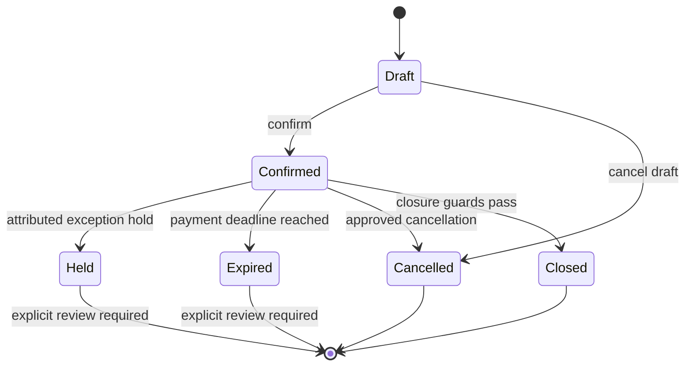
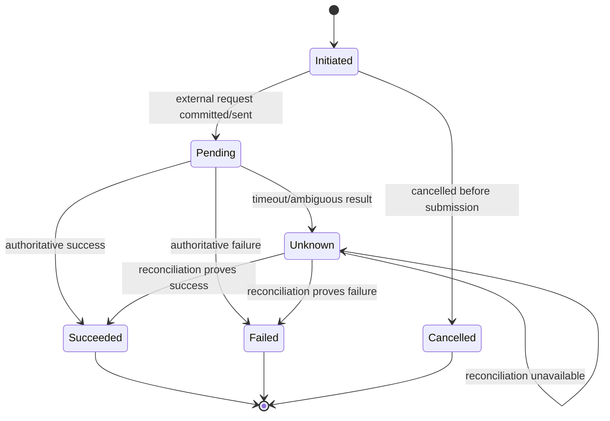
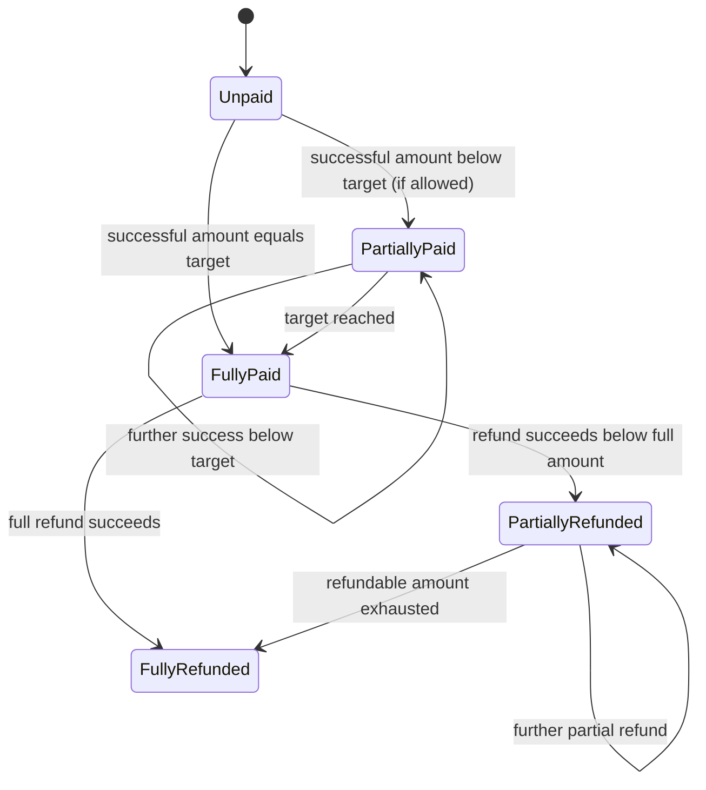
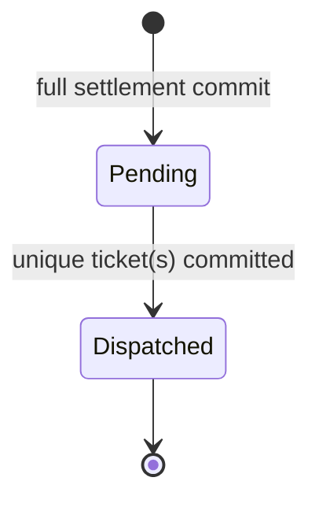
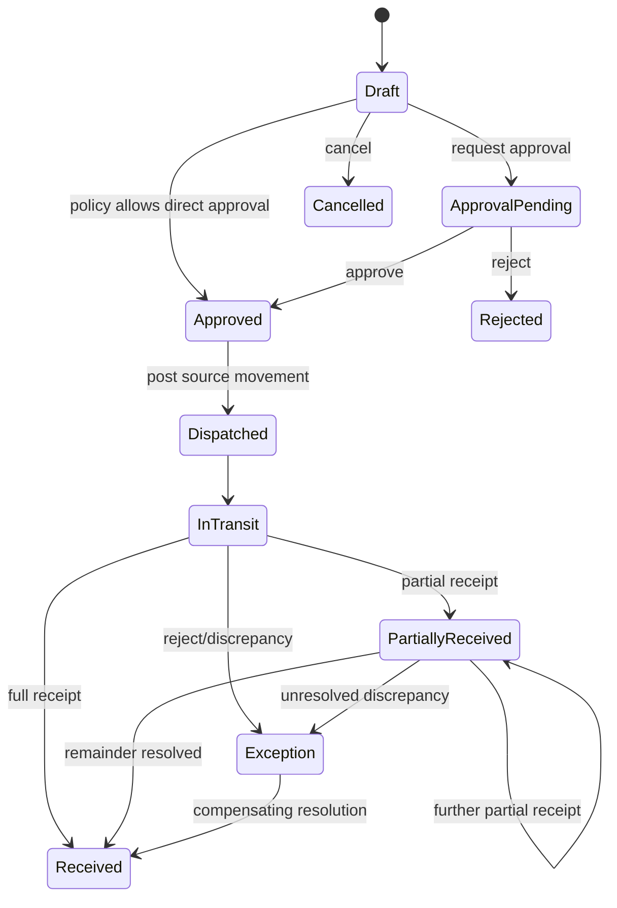
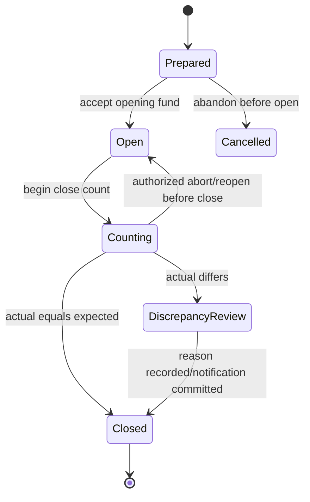
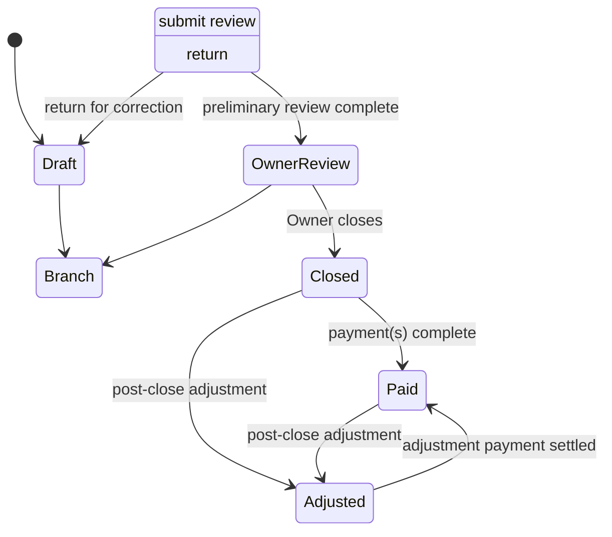
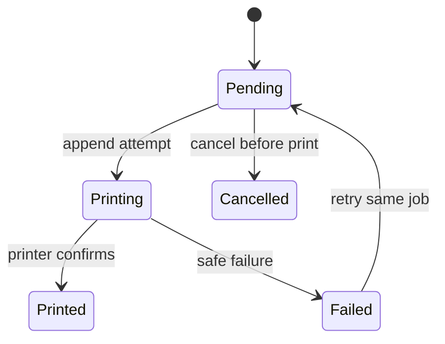

# AFTER FOUR Business State Machines v1.0

**Status:** Canonical transition specification for review; no implementation is authorized  
**Date:** 2026-11-14  
**Sources:** [Business Domain Model](after_four_business_domain_model.md) · [ERD](after_four_erd.md) · [Data Dictionary](after_four_data_dictionary.md) · [Integrity Rules](after_four_data_integrity_rules.md) · [API Contract](after_four_api_contract.md) · [Payment Model](after_four_payment_model.md)

Owner-confirmed policy is sourced from the [Owner Decision Baseline](after_four_owner_decision_baseline.md). The [DDD Foundation](after_four_ddd_foundation.md) proposes context ownership and coordination boundaries.

## 1. State-machine rules

- Business state belongs to exactly one bounded context. Payment does not set Order/Preparation state; Print failure does not set Payment state.
- Named commands request transitions. Clients never submit an arbitrary target status.
- Guards run against authoritative server state under the documented transaction/lock.
- Replaying the same command identity returns the original result. A different payload with the same key is a conflict.
- Confirmed history is reversed, refunded, adjusted, cancelled, or superseded; never deleted or silently rewritten.
- Technical attempt/queue state is separate from business state.
- All forbidden transitions return `409 invalid_state_transition`, with safe current/allowed state metadata.

Labels retain canonical provenance. State names and mechanical guards are `TECHNICAL_PROPOSAL` unless explicitly marked.

## 2. Core concepts and independent axes

| Concept | Owns | Does not own |
|---|---|---|
| Order | Commercial intent: Draft, Confirmed, Cancelled, Closed | Money, kitchen progress, printing, delivery |
| Payment Settlement | Successful/refunded value for one Order | Provider attempt transport and preparation |
| Payment Attempt | One cash/provider attempt and authoritative outcome | Whole-Order settlement or preparation |
| Preparation Dispatch | Durable paid-Order handoff identity | Charge state or printer state |
| Dispatch Attempt | Technical attempt to deliver/create ticket | Business payment truth |
| Preparation Ticket/Item | Making and handoff work | Payment/refund truth |

**Payment Attempt** is the canonical term throughout this specification and maps to the Phase 1 `PaymentAttempt` model/`payment_attempts` table. Historical documents may say Payment Transaction for an older logical proposal; that is not a second implemented state machine or physical table.

### 2.1 Payment has two state axes

A single status cannot represent “partially paid and one later attempt is unknown.” The Payment response therefore exposes:

- `funding_status`: `unpaid`, `partially_paid`, `fully_paid`, `partially_refunded`, `fully_refunded`;
- `attempt_activity`: `idle`, `processing`, `reconciliation_required`.

`WORKSHOP_AGREED` Preparation eligibility requires `funding_status=fully_paid` and `attempt_activity=idle`. `OPEN_DECISION` Partial/split policy remains unresolved; the accepted MVP command policy is exact-balance-only, so `partially_paid` is representable but unreachable through production commands.

| `funding_status` | `idle` | `processing` | `reconciliation_required` |
|---|---|---|---|
| `unpaid` | Valid | Valid | Valid |
| `partially_paid` | Valid; MVP-command unreachable | Valid; MVP-command unreachable | Valid; MVP-command unreachable |
| `fully_paid` | Valid | Invalid | Invalid |
| `partially_refunded` | Valid | Invalid | Invalid |
| `fully_refunded` | Valid | Invalid | Invalid |

The Data Dictionary and API now store/expose both axes. PostgreSQL checks the row-local combination; locked application transactions derive the values from authoritative attempts and Refunds as specified by the [Payment Model](after_four_payment_model.md).

### 2.2 Proposed User access lifecycle

The approved domain distinction is User versus Employee and the preservation of deactivated history. The expanded access states below are `TECHNICAL_PROPOSAL` and require the [Identity Decision Register](after_four_identity_decision_register.md); they are not approved schema values.

```text
Invited -> Active -> Locked -> Active
                   -> Suspended -> Active
Invited/Active/Locked/Suspended -> Deactivated
```

Only Active may create or use an authenticated session. Authentication lock is a temporary automated defense condition and never changes employment. Suspension/reactivation and deactivation are Owner-controlled; reactivation requires explicit Owner authorization and audit, while deactivation has no automatic return. Suspension and deactivation revoke all sessions and preserve Employee, audit, and business history. Lock release and the Owner-unavailable escalation procedure require security/operational review. See [Identity & Branch Authorization](after_four_identity_authorization.md) for guards and offboarding effects.

`OWNER_CONFIRMED` Accounts enter through invitation only. Repeated authentication failures use rate limiting and progressive delay and cannot, by themselves, cause a permanent lock. Re-employment requires explicit Owner rehire/reactivation; no Branch Manager receives implicit lifecycle authority.

`OWNER_CONFIRMED` Back-office sessions expire after 30 minutes idle or 12 hours absolute. POS sessions lock after 2 minutes idle and require individual reauthentication. Multiple device sessions are allowed with no numeric MVP cap; visibility, appropriate new-device notification, anomaly detection/revocation, and Owner all-session revocation are required. A cap is reconsidered only with operational or incident evidence. These are Session guards, not Employee lifecycle transitions.

### 2.3 Product lifecycle and Price history

The Product lifecycle values are `Draft`, `Active`, `Inactive`, and `Archived` (`OWNER_CONFIRMED`, `ODB-CAT-03`). Archived Product restoration to Inactive and separate reactivation remain confirmed future policy (`ODB-CAT-24`, `ODB-CAT-33`), and Product activation requires an Active assigned Category (`ODB-CAT-29`). The initial Catalog Core MVP excludes every Product Activate, Deactivate, Archive, and Restore command/API (`ODB-CAT-39`); the transition sketch below is therefore policy context, not an implemented or authorized command matrix. Other Product transitions and authorization rules remain unresolved for a future separately approved scope.

```text
Draft -> Active <-> Inactive -> Archived
Draft -----------------------> Archived -> Inactive
```

Only policy-eligible Active Products and persisted Variants can be selected for a sale. Every Product has at most one Variant with `is_default = true`; Draft, Inactive, and Archived Products may have zero or one, while an Active Product must have exactly one and that Variant must be Active (`ODB-CAT-04`, `ODB-CAT-19`, `ODB-CAT-23`, `ODB-CAT-28`, `ODB-CAT-38`). Default designation, lifecycle status, and visibility remain independent; hidden Active is valid while Inactive/Archived cannot satisfy the Active Product requirement (`ODB-CAT-20`, `ODB-CAT-28`, `ODB-CAT-31`, `ODB-CAT-38`). Restoration to Inactive does not make a Product sellable. Default uniqueness and concurrency enforcement remain `TECHNICAL_PROPOSAL`. Price does not use an editable “current” lifecycle: each published Price Version is immutable and effective-dated, and a correction creates another version (`ODB-CAT-08`).

Category and Variant are created Draft and share this `OWNER_CONFIRMED` matrix (`ODB-CAT-30`–`ODB-CAT-32`):

```text
Draft -> Active <-> Inactive -> Archived
Draft -----------------------> Archived -> Inactive
```

Draft→Inactive and Archived→Active are prohibited directly. Draft/Active/Inactive→Archived are allowed subject only to applicable existing guards; Archived→Inactive occurs through validated Restore, followed by separate activation if desired. Variant Archive and Restore change lifecycle status only: both preserve `is_default` and `customer_visible`, Restore returns Archived→Inactive, and reactivation is separate; Default designation is never silently transferred or modified (`ODB-CAT-40`). Category Deactivation is blocked while Active Products remain assigned (`ODB-CAT-29`); Category Archive has its separate Active-Product guard (`ODB-CAT-25`); Variant lifecycle cannot invalidate the Active Product Default requirement (`ODB-CAT-25`, `ODB-CAT-28`, `ODB-CAT-38`). A Product remains in its original Category in the initial MVP and no reassignment command/API exists (`ODB-CAT-41`). Branch availability remains independent, while command, audit, authorization, locking, and concurrency mechanics remain technical.

## 3. Mandatory payment-to-preparation flow

```mermaid
sequenceDiagram
  actor Staff
  participant API
  participant DB
  participant Provider
  participant Dispatch
  participant Preparation

  Staff->>API: POST payment-attempts (Idempotency-Key)
  API->>DB: commit pending attempt
  API->>Provider: initiate/query outside DB transaction
  alt verified failure
    Provider-->>API: failed
    API->>DB: record failed outcome
  else unknown/timeout
    Provider--xAPI: no authoritative result
    API->>DB: mark reconciliation required
  else verified success completing full settlement
    Provider-->>API: success/reference
    API->>DB: atomically record outcome + full settlement + unique pending dispatch + outbox
    DB-->>API: committed paid order
    API-->>Staff: paid; dispatch pending
    Dispatch->>DB: claim same unique dispatch
    alt ticket creation succeeds
      Dispatch->>DB: create unique ticket/items; mark dispatched
      Dispatch-->>Preparation: ticket available
    else delivery/worker fails (deferred design)
      Dispatch->>DB: append failed dispatch attempt; business dispatch stays pending
    end
  end
```

The worker/ticket portion of this diagram is a target `TECHNICAL_PROPOSAL`, not implemented Phase 1 behavior. Phase 1 stops after committing the pending Dispatch and Outbox Event. `Preparation::RetryDispatch` requeues that same Outbox Event and appends an Audit Event; it does not create a `PreparationDispatchAttempt`. Delivery execution and attempt-outcome recording remain deferred.

`OWNER_CONFIRMED` Full successful settlement precedes Preparation Dispatch. Timeout/client success screens/provider initiation never prove success.

## 4. Order state machine



| From → To | Command | Guards | Side effects / audit | Idempotency |
|---|---|---|---|---|
| — → Draft | Create Order | Active Branch; authorized channel/table/customer | OrderCreated | Required; Branch/create scope |
| Draft → Draft | Add/update/remove item; pricing; customer/promotion | Expected version; persisted available Variant; server pricing; Modifier cardinality/policy | New quote/totals/version; snapshots not final; if authoritative Price changed, mark revised quote as requiring review (`ODB-CAT-09`) | Required for creates/removals/applications; version for patch |
| Draft → Confirmed | Confirm | Nonempty; price/availability revalidated; valid modifiers; any revised authoritative quote reviewed | Atomically freeze sold Price and other approved snapshots; OrderConfirmed (`ODB-CAT-10`) | Required; one confirmation intent |
| Confirmed → Held | Hold | Authorized trusted actor; reason; unpaid | Hold timestamp/reason/audit; block automatic dispatch | Required |
| Confirmed → Expired | Expire pending payment | Payment remains unpaid at or after configured deadline | Expiration timestamp/system audit; block automatic dispatch | Deterministic boundary; repeated scans no-op |
| Draft → Cancelled | Cancel draft | Authorized; no successful Payment | Reason/audit | Required |
| Confirmed → Cancelled before Preparation starts | Staff cancellation | Reason/audit; authoritative Preparation state proves work has not started under an atomic race fence | Preserve all history; create required Refund/correction intents | Required; authority `OWNER_CONFIRMED`; outcomes may remain open |
| Confirmed → Cancelled after Preparation starts | Owner-approved cancellation | Owner approval; reason/audit; authoritative Preparation state | Preserve prepared work; create deviation and required Refund/stock/compensation intents | Required; authority `OWNER_CONFIRMED`; outcomes remain open |
| Confirmed → Closed | Close | Approved fulfillment/settlement conditions | OrderClosed | Required; closure rule `OPEN_DECISION` |

Forbidden: editing items after Confirmed; changing Order to “paid” or “in preparation”; deleting confirmed/held/expired/cancelled/closed Orders; closing because Payment alone succeeded; dispatching or automatically reactivating Held/Expired Orders after late settlement.

Completed Orders do not use either ordinary cancellation transition. They require a separate exception process whose authority and outcomes remain `OPEN_DECISION`.

## 5. Order Item state machine

States: `draft`, `confirmed`, `partially_cancelled`, `cancelled`.

| Transition | Guard / effect |
|---|---|
| new → draft | Parent Order Draft; snapshot preview may change on repricing. |
| draft → confirmed | Parent confirmation atomically freezes product/variant/modifier/price snapshots. |
| draft → removed | Draft-only removal; removal is not persisted as a sale correction unless audit policy requires. |
| confirmed → partially_cancelled | Approved quantity cancellation; create correction/deviation/refund/stock effects as applicable. |
| confirmed/partially_cancelled → cancelled | Approved remaining quantity cancellation. |

Forbidden: quantity/price snapshot overwrite after confirmation; cancelled quantity above ordered; using Preparation status as Order Item status.

## 6. Payment Attempt state machine



| Transition | Preconditions | Side effects / audit | Retry rule |
|---|---|---|---|
| — → Initiated | Confirmed payable Order; requested amount policy; unique user intent | Persist Attempt before provider call | Same key returns same Attempt |
| Initiated → Pending | Provider/cash workflow accepted | Safe provider reference if known | Provider call not repeated blindly |
| Pending → Succeeded | Verified cash record or signed/queried provider authority | Allocate success under Payment lock; maybe full settlement | Provider reference/event unique |
| Pending → Failed | Authoritative decline/failure | Preserve safe failure code | New attempt may use new key |
| Pending → Unknown | No authoritative outcome | Set reconciliation required; audit uncertainty | New charge forbidden until safe assessment |
| Unknown → Succeeded/Failed | Signed event or authoritative query | Apply once; clear reconciliation block if no other unknown | Reconciliation command idempotent |

Forbidden: client/browser assertion → Succeeded; timeout → Failed; retrying Unknown with a new charge before authoritative assessment; editing terminal outcome.

`OWNER_CONFIRMED` MVP bank transfer uses the Owner's bank QR. A notification speaker is an amount alert only and never an authoritative outcome. The cashier compares the amount with the pending Order and explicitly confirms it; no automatic bank API matching is approved. A mismatch or excess does not enter `Succeeded` by default and requires resolution or an appropriate Refund; any exception approval is reasoned and audited.

The transition into `Succeeded`, `Failed`, or `Cancelled` is allowed from the documented non-terminal predecessor. Once the stored state is terminal, Payment identity, status, amounts, method, currency, idempotency identity, confirming actor/time, and failure evidence cannot be rewritten through ordinary Rails or direct SQL application paths.

## 7. Payment Settlement state machine

### 7.1 Funding axis



Every transition through `PartiallyPaid` is reserved for a future approved partial/split policy and is unreachable through MVP production commands.

### 7.2 Attempt-activity axis

`idle → processing → idle` for authoritative success/failure; `processing → reconciliation_required`; `reconciliation_required → idle` only after all blocking unknown attempts are resolved.

| Transition/condition | Guards | Side effects |
|---|---|---|
| Unpaid/Partial → Fully Paid | Recomputed amount allocated to settlement equals target; currency consistent; no unresolved excess/unknown activity | Record settlement truth. Insert the unique pending Preparation Dispatch and outbox in the same local commit only when the locked Order is still Confirmed and authoritative post-lock decision time is strictly before its deadline; Held/Expired/equality-or-late cases create review evidence and no Dispatch. |
| Fully Paid → Partially/Fully Refunded | Successful approved Refund(s); cumulative ≤ refundable | Revenue/loyalty/cash intents; original Payment remains |
| Unpaid/Partially Paid + unknown attempt | Attempt activity becomes reconciliation required | New charge and Dispatch prohibited until authoritative reconciliation; Fully Paid cannot coexist with unresolved charge activity in MVP |

Forbidden: direct client-set settlement; Fully Paid before authoritative transactions sum to target; dispatch from Unpaid/Partial; successful amount decrease to represent refund.

Money observed or received above the target does not create a new funding state in the implemented aggregate. `OWNER_CONFIRMED` the excess is evidenced and refunded and is not revenue. The future evidence/refund model is unresolved; Phase 1 exact-balance constraints remain unchanged.

## 8. Preparation Dispatch and attempt state machines

### 8.1 Business Dispatch



### 8.2 Technical Dispatch Attempt

`TECHNICAL_PROPOSAL` target lifecycle: `started → succeeded` or `started → failed`. A future delivery worker would append a new attempt number without creating a new Dispatch.

Implemented Phase 1 has reserved `preparation_dispatch_attempts` schema/model scaffolding but no command that creates these records. Retry Dispatch is not a delivery-attempt transition: it resets the existing Outbox Event to pending and appends an Audit Event for the retry request.

| Transition | Guard | Side effects / audit | Idempotency |
|---|---|---|---|
| — → Pending | Payment funding Fully Paid; unique Order dispatch absent | DispatchRequested/outbox | UQ Order and scoped key |
| Pending → Pending, attempt failed (`TECHNICAL_PROPOSAL`) | Future worker/delivery/ticket transaction fails | Append safe failure attempt; operator visibility | Same Dispatch; retry key per attempt |
| Pending → Dispatched (`TECHNICAL_PROPOSAL`) | Future worker creates/locates unique tickets/items atomically | DispatchCompleted, ticket available | Unique Dispatch/station/sequence; replay returns tickets |

Forbidden: Pending creation without full settlement; new Payment attempt to repair Dispatch; duplicate ticket on retry; reverting Dispatched to Pending.

## 9. Preparation Ticket and Item

### Ticket states

`queued → in_progress → partially_ready → ready → completed`; `queued/in_progress/partially_ready → cancelled` only under approved cancellation policy.

### Item states

`queued → in_progress → ready → completed`; partial quantities may derive `partially_ready`; explicit cancellation tracks cancelled quantity. Remake creates a Preparation Deviation and new linked work; it never changes completed history back to queued.

| Command | Guards | Effects |
|---|---|---|
| Start item | Ticket queued/in progress; positive remaining quantity | Started quantity/time; recipe-based stock event under approved timing |
| Ready confirmation | Started quantity sufficient | Ready quantity/time; Ticket derived state |
| Complete item/ticket | Required ready quantities | Completed quantity/time; delivery/pickup work may be created |
| Remake | Authorized reason/quantity | Deviation, stock waste/remake effects, new work |
| Cancel | Approved policy; remaining quantity | Deviation/cancellation and refund/stock coordination |

Forbidden: any Preparation work without Dispatch; quantities above requested; ticket completion with incomplete required items; print success as preparation completion.

### Customer custody-transfer desired process

`OWNER_CONFIRMED — DESIRED_PROCESS` for the not-yet-operated First Branch: whole-Ticket readiness precedes `pending_handover`; the stable Order/Ticket identity is retained; Staff establish the intended-customer or authorized-recipient relationship before release; the recipient confirms receipt; and the record preserves Order/Ticket reference, responsible actor, linkage basis, time and available supporting evidence. Transition to `transferred` occurs only when approved evidence criteria are satisfied. Otherwise Model A retains `transfer_evidence_unresolved` as nonterminal and fail-closed within the same attempt. No acknowledgement, authentication, transport result or absence of refusal is sufficient by itself; evidence classes, attester authority, positive threshold, conflict disposition and physical capture remain unresolved.

## 10. Refund state machine

States: `requested`, `approval_required`, `approved`, `processing`, `unknown`, `succeeded`, `failed`, `rejected`, `cancelled`.

| Transition | Guard / side effect |
|---|---|
| — → Requested | Original successful transaction, positive amount, reason, idempotency. |
| Requested → Approval Required | Every Refund requires Owner approval; no provider call yet. If Owner is unreachable, retain this pending state under `WS-REFUND-01`. |
| Approval Required → Approved/Rejected | Owner decision; audit actor/policy/reason. Timeout, silence, receipt, acknowledgement or elapsed time is never a decision. |
| Approved → Processing | Persist intent before provider call. |
| Processing → Succeeded/Failed/Unknown | Apply authoritative outcome; Unknown blocks blind retry. |
| Unknown → Succeeded/Failed | Reconciliation only. |
| Succeeded → terminal | Update Payment refunded totals; revenue/loyalty/cash correction intents. |

`OWNER_CONFIRMED` Under `WS-REFUND-01`, an otherwise eligible request received while the Owner is unreachable is recorded and acknowledged, keeps its eligibility/amount evidence, remains pending and unexecuted, is notified/escalated to Owner, and is communicated to the customer as pending. No automatic threshold or delegated emergency approver exists. Approval and execution remain distinct.

Forbidden: cumulative successful amount above refundable; editing original charge; provider call before required Owner approval; interpreting timeout, silence, receipt, acknowledgement or elapsed time as approval or failure. Exact eligibility, amount/allocation, method, execution actor and accounting treatment remain `OPEN_DECISION`.

## 11. Stock Transfer state machine



Dispatch and each Receipt are independent idempotent transactions. Guards: approved authority, sufficient source stock, distinct Warehouses, cumulative receipt ≤ dispatched remainder. Dispatched cancellation requires compensating movements. Cost snapshot timing is `LEGAL_VALIDATION`/policy.

## 12. Purchase Order and Goods Receipt

### Purchase Order

`draft → approval_pending → approved → sent → partially_received → received → closed`; `draft/approval_pending/approved → cancelled`; `approval_pending → rejected`.

Guards: active Supplier, positive lines, currency consistency, configurable approval. Sending requires approval. Receipt state derives from posted Goods Receipt quantities; it is not manually patched.

### Goods Receipt

`draft → posted`; `draft → cancelled`; `posted → corrected` only through linked reversal/correction receipt, never in-place edit.

Posting atomically creates Lots, Stock Movements, Inventory updates, and weighted-average recalculation for accepted quantities. Quarantine/rejected quantities remain unavailable. Physical supplier documents are evidence, not transaction authority.

## 12. Employee Shift Handover policy boundary

`OWNER_CONFIRMED` Under `WS-OPS-01`, recorded custody remains explicit while an Employee Shift Handover is pending. The Owner may assign a named interim custodian where needed. If no valid custodian is available, the handover remains pending under controlled hold and custody-changing operations pause. Shift end does not transfer custody automatically to a Branch Manager or another role, and recorded accountability does not require the outgoing Employee to remain physically present or employed indefinitely. Employee Shift Handover is not CORE-02 customer custody transfer or Cash Session handover and grants no Cash, Expense, Refund, Inventory or other capability. The exact lifecycle representation, evidence, staffing application and enforcement remain unresolved.

## 13. Cash Session state machine



Guards: one active session per physical Drawer; matching currency; no ordinary Cash Transaction unless Open. Closing stores immutable expected/actual/variance. Post-close correction is a new adjustment Cash Transaction, not a state reversal.

`OWNER_CONFIRMED` One shared drawer uses a 2,000,000 VND float per Operating Day, carried across shifts. A later shift may open a new Cash Session with an accountable opening count, but that does not allocate another daily float. There is no automatic mid-day reset/top-up. Staff may request a top-up; Owner authorization and amount/source/executor/approver/time evidence are required, and the top-up is not revenue. No fixed top-up frequency limit or discrepancy tolerance is approved.

## 14. Payroll state machine



`OWNER_CONFIRMED` Only Owner closes. Guards: calendar-month identity, approved inputs, calculation snapshot, Branch Manager review as accepted workflow. Closing is idempotent and freezes Period/Payrolls. PDF generation/payment tracking are downstream. Reopening remains `OPEN_DECISION`; silent recalculation is forbidden.

## 15. Leave Request state machine

States: `draft → submitted → approved/rejected`; `draft/submitted → cancelled` by requester where policy allows.

- Normal leave: Branch Manager decision (`OWNER_CONFIRMED`).
- Exception: Owner decision (`OWNER_CONFIRMED`).
- Guards: Employee/Branch scope, valid dates, no closed-payroll mutation, leave policy/balance when approved.
- Exact leave types, notice, balances, and payroll effect are `OPEN_DECISION`/`LEGAL_VALIDATION`.

## 16. Overtime Request state machine

States: `proposed → approved/rejected`; `proposed → cancelled` before decision.

- Branch Manager proposes; Owner approves/rejects (`OWNER_CONFIRMED`).
- Positive minutes, Employee/Branch/Attendance context, reason, and open payroll input window are required.
- Approved overtime becomes payroll input; changing it later requires a new correction/adjustment path.

## 17. Approval Request state machine

`draft → pending → approved/rejected`; `pending → expired/cancelled`; terminal decisions are immutable.

Guards: typed subject exists; policy/version and requester scope; approver capability; self-approval rule; not expired. Approval does not itself perform the subject command unless one named transaction explicitly coordinates both. Subject lifecycle remains authoritative.

For Operating Expenses, `OWNER_CONFIRMED` self-approval and splitting to evade limits are forbidden. The 200,000 VND per-Expense and 500,000 VND cumulative per-Operating-Day values remain configurable control thresholds, not approval exemptions. Employees may record and submit requests, but every Expense requires Owner approval before incurrence or execution; no emergency pre-approval exception exists. The initial Operating Day cutoff is `00:00` local time in each Branch's explicit timezone, while physical configuration, shift-crossing allocation, and enforcement remain unresolved.

## 18. Print Job state machine



Each retry appends Print Attempt. Job idempotency deduplicates the document request; attempt identity deduplicates printer delivery where possible. Printed/Failed never changes Payment, Preparation, or Order state.

## 19. Reservation state machine

States: `requested → confirmed → seated → completed`; `requested/confirmed → cancelled`; `confirmed → no_show`; `requested → rejected`.

Guards: Branch/time/party size, consented contact use, capacity/table policy. Seating may open a Table Session; a walk-in Table Session may have no Reservation. Deposits, overbooking, table moves/merges/splits are `OPEN_DECISION`.

## 19A. Customer Profile and phone-association semantic states

The [WP-T1 Customer Technical Design](after_four_customer_technical_design.md) defines logical state meanings only; no persisted enum, command, transaction, or implementation is approved.

```text
Customer Profile: Active <-> Inactive
Customer Profile: Active/Inactive -> Anonymized
Customer Profile: Anonymized -/-> ordinary Active/Inactive restoration

Phone admission: Unclaimed -> Current Association
Phone admission: Current Association -> Former-phone Restriction
Phone admission: Former-phone Restriction -> Unclaimed
```

The last transition represents only documented authorized release semantics. The ordinary undisputed release operation remains excluded from Candidate E because its approving authority is unresolved. Controlled phone change is complete-or-confirmed-preserve: success replaces the current association and restricts the old phone; a confirmed-not-applied failure preserves the prior current association. An unknown execution result proves neither and requires reconciliation without a partial accepted outcome. Anonymization completion removes the ordinary current association, keeps the former phone restricted, and cannot claim completion until all approved cross-context outcomes are evidenced.

`SDP-CUST-18` shared/family-phone and `SDP-CUST-19` anonymous-Order policies remain approved context outside this Candidate E state contract.

## 20. Customer Feedback state machine

States: `open → triaged → in_progress → resolved → closed`; `resolved/closed → reopened` with reason.

Guards: Branch scope, privacy-limited Customer/Order access, assigned owner for in-progress, resolution required for resolved. Severity escalation and response-time policy are not yet approved. Every reopen/resolution is audited.

## 21. Transition audit and event catalog

| Transition family | Required event/audit evidence |
|---|---|
| Order confirmation/cancellation/close | actor, Branch, before/after version, reason where sensitive |
| Payment attempt/result/reconciliation | intent key, provider event/reference, safe result, actor/device/request |
| Full settlement/dispatch | atomic `PaymentFullySettled`, `PreparationDispatchRequested`; unique Order identity |
| Phase 1 Dispatch retry request | Reset existing Outbox Event to pending; append `preparation.dispatch_retry_requested` Audit Event; no Dispatch Attempt record |
| Future dispatch attempt/ticket creation (`TECHNICAL_PROPOSAL`) | Append attempt outcome; `PreparationTicketCreated` once |
| Refund | request, approval policy/decision, provider result, revenue/loyalty/cash effects |
| Preparation deviation | actor, quantity, reason, original item, stock effect |
| Stock transfer/receipt | actors at source/destination, lots/cost, quantity, discrepancies |
| Cash close/adjustment | expected/actual/variance, reason, notification, linked correction |
| Payroll review/close/adjustment/payment | reviewer/Owner, frozen inputs, reason, artifact/payment references |
| Leave/overtime/approval | requester/proposer, approver, policy version, decision/reason |

## 22. Consistency findings and open decisions

### Missing/ambiguous data requirements

1. Payment uses accepted funding and attempt-activity axes; implementations must not reintroduce an aggregate `status` alias.
2. Payment allocation data remains absent until split/check policy is approved; MVP is exact-balance-only.
3. Staff-before-start and Owner-after-start cancellation authority is confirmed, but completed-order, Refund, stock, remake, compensation, and table-release outcomes remain open.
4. Expense thresholds/no-self-approval and Owner-only Refund approval are confirmed. `WS-REFUND-01` fixes the Owner-unavailable request disposition as pending/no execution; purchase/transfer and remaining Refund eligibility, method, execution and accounting transitions still need policy.
5. The initial one-shared-drawer rule is confirmed; Cash Session uniqueness representation and any future multi-drawer expansion still require physical design.
6. Transfer valuation needs an accepted cost snapshot event.
7. Tax invoice and statutory payroll states remain `LEGAL_VALIDATION`.
8. Overpayment requires evidence and excess Refund, but its physical record/lifecycle and Refund method remain unresolved; exact-balance Phase 1 stays unchanged.
9. Dashboard and daily Telegram reporting are confirmed directions; reporting follows the approved Branch-local Operating Day boundary, while exact delivery time, recipients, formulas, Branch scope, privacy, and escalation remain unresolved.

### Forbidden cross-context shortcuts

- Order must not gain `paid`, `preparing`, `printed`, or `delivered` states.
- Payment must not become failed because Dispatch/Print fails.
- Preparation must not start because the client displayed success.
- Stock must not be directly edited because a cancellation/refund occurred.
- Payroll close must not be undone by editing Attendance.
- Approval status must not substitute for execution of the approved domain command.

No canonical business decision was changed. The state representation exposes one data-dictionary ambiguity and carries unresolved policies forward.

## 23. Review gate

The next phase is **Rails/PostgreSQL foundation planning and implementation readiness review**. Before feature code, accept state names/guards/error mappings and write transition tables as request/domain/database test specifications.

