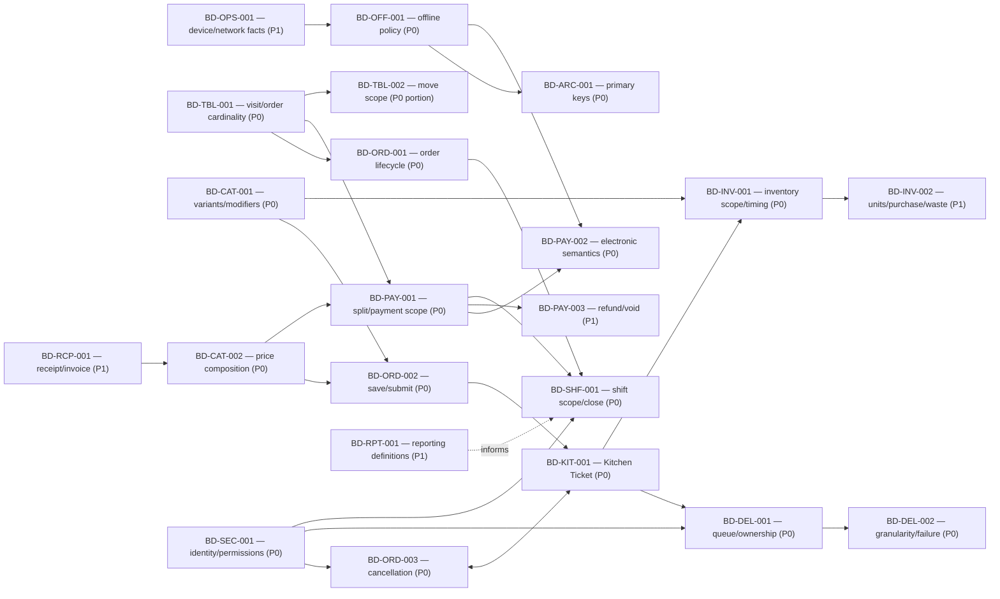

# Phase 3.6.1 — Owner Business Decisions Workshop

> **HISTORICAL / SUPERSEDED_FOR_IMPLEMENTATION.** This was a workshop-preparation snapshot, not the current decision register. Use the canonical [Owner Decision Baseline](../architecture/after_four_owner_decision_baseline.md) and [Identity Decision Register](../architecture/after_four_identity_decision_register.md). Later Owner decisions answer a subset of the questions that this document described as pending; unresolved details remain explicit in the baseline. The statement below that no `GLOSSARY.md` exists is historical and is not current repository guidance. Original workshop text is preserved.

## 1. Document status

**Purpose:** workshop preparation only. This document records questions and existing recommendations; it does not record owner approval.

**Decision status at preparation time:** all P0 decisions below are **Pending**.

Source documents:

- [Prototype Architecture Review](../research/phase-3.5.1-prototype-architecture-review.md)
- [Business Workflows](../design/phase-3.5.2-business-workflows.md)
- [Logical Domain Model](../design/phase-3.5.3-domain-model.md)
- [Backend Architecture Proposal](../design/phase-3.5.4-backend-architecture.md)
- [PostgreSQL Logical Database Design](../design/phase-3.5.5-database-design.md)
- [Business Decisions Register](phase-3.5-business-decisions-register.md)
- [Prototype-to-Production Roadmap](phase-3.5-production-roadmap.md)

There is currently no `GLOSSARY.md`. Proposed terms such as `TableSession`, `KitchenTicket`, `Delivery` and `PaymentTransaction` remain unapproved until the owner resolves the corresponding decisions.

## 2. Workshop objectives

The workshop converts open design questions into explicit business requirements before backend implementation begins. Database relationships, lifecycle constraints and historical records are expensive to reverse once production data exists; the owner must therefore decide how AFTER FOUR actually operates before technical recommendations become implementation.

### Business decision versus technical recommendation

- A **business decision** describes required cafe behavior: for example, whether guests can split a bill, when the bar starts preparation, or who may refund a payment.
- A **technical recommendation** suggests how software could support approved behavior: for example, `TableSession`, optimistic locking, UUIDs or a Rails modular monolith.
- Recommendations in Phase 3.5 are not approved requirements. The workshop may accept, alter, reject or defer them.

### What must be resolved early

Resolve early when a decision changes database cardinality, immutable financial history, lifecycle boundaries or the identity/security model:

- table visit, order and bill cardinality;
- draft/save/submit and cancellation semantics;
- product/price snapshots;
- Kitchen Ticket and Delivery granularity;
- payment methods and allocation;
- shift scope and staff identity;
- offline scope and primary-key strategy.

### What can be postponed

- P1 items may be scheduled before production if they do not block the selected vertical slice.
- P2 items can be deferred while preserving relevant timestamps and clean API boundaries.
- `BD-TBL-002` is specifically P0 for **move table**, but P1 for **combine/split table**.
- `BD-INV-001` may be explicitly deferred if ingredient inventory is not part of the first production release.

## 3. Confirmed business context

### Confirmed facts

- AFTER FOUR is a cafe with two floors and approximately 70–100 customers at capacity.
- Drinks for floor 2 are transported using an elevator.
- The owner works full-time at the cafe.
- Initial staffing is approximately three employees.
- A responsive frontend POS prototype exists, but its table/order/payment/delivery data and transitions are local demonstration behavior.
- No Rails backend, production database schema or production authentication exists.

### Existing technical recommendations — not approved business requirements

- React frontend with a proposed Rails API and PostgreSQL backend.
- A modular monolith rather than microservices for the initial scale.
- Separate Order, Kitchen Ticket, Delivery and Payment lifecycles.
- A `TableSession` to represent one customer visit independently of a physical table.
- Immutable order-line product and price snapshots.
- Individual staff identity, idempotent commands and concurrency protection.
- No Redis, Sidekiq or WebSocket until a confirmed need justifies them.

### Unconfirmed assumptions

- The first production release serves one cafe location.
- A single store/register-wide shift may be sufficient.
- One active Order per TableSession may be sufficient.
- Kitchen work may be created per submission batch.
- Service staff may own upstairs delivery handoff.
- VND is the only launch currency.
- Online-required operation with visible degraded state may be acceptable.

### Questions requiring owner confirmation

- What represents one visit, order and bill?
- When is an order saved, confirmed and sent to preparation?
- How are additional items, cancellation and staff mistakes handled?
- How are floor-2 batches created, claimed, delivered and retried?
- Which payment methods, split behaviors, fees and tax rules apply?
- How do staff identify themselves, and who may perform sensitive actions?
- What happens at shift close with active work?
- What devices, printers and network conditions exist on site?
- Is ingredient-level inventory required in the first release?

## 4. P0 decision overview

The register contains **17 P0 entries**. `BD-TBL-002` has mixed priority: move-table scope is P0; combine/split scope is P1.

| Decision | Title | Domain | Current status | Why it matters | Dependent decisions/work |
|---|---|---|---|---|---|
| `BD-TBL-001` | Table session and order cardinality | Table / Order | Pending | Defines visit/order/check relationships | `BD-ORD-001`, `BD-PAY-001`, table/payment schema |
| `BD-TBL-002` | Move, combine and split table scope | Table | Pending; move P0, combine/split P1 | Determines table history and reassignment | `BD-TBL-001`, Delivery destination, TableSession schema |
| `BD-ORD-001` | Order lifecycle and close rule | Order | Pending | Separates commercial, fulfillment and payment completion | `BD-ORD-002`, `BD-ORD-003`, `BD-SHF-001` |
| `BD-ORD-002` | Save and submit semantics | Order / Kitchen | Pending | Defines durability and preparation trigger | `BD-KIT-001`, `BD-OFF-001`, order APIs |
| `BD-ORD-003` | Cancellation and correction rules | Order | Pending | Protects history, revenue and prepared work | `BD-KIT-001`, `BD-SEC-001`, `BD-INV-001`, refund policy |
| `BD-CAT-001` | Product variants, size and modifiers | Catalog | Pending | Defines sellable configuration and snapshots | `BD-CAT-002`, recipes, OrderItem model |
| `BD-CAT-002` | Price composition | Catalog / Order | Pending | Defines authoritative totals and history | `BD-PAY-001`, reports, P1 invoice requirements |
| `BD-KIT-001` | Kitchen ticket lifecycle and routing | Kitchen | Pending | Defines preparation batches and status tracking | `BD-ORD-002`, `BD-DEL-001`, `BD-INV-001` |
| `BD-DEL-001` | Delivery queue entry and ownership | Upstairs Delivery | Pending | Defines handoff trigger and responsible staff | `BD-KIT-001`, `BD-DEL-002`, `BD-SEC-001` |
| `BD-DEL-002` | Delivery granularity and failure flow | Upstairs Delivery | Pending | Determines partial batches and retry history | `BD-DEL-001`, DeliveryItem schema |
| `BD-PAY-001` | Payment methods, partial and split tender | Payment | Pending | Determines transaction/allocation model | `BD-TBL-001`, `BD-CAT-002`, `BD-SHF-001` |
| `BD-PAY-002` | Electronic provider and failure semantics | Payment | Pending | Determines verification, retry and reconciliation | `BD-PAY-001`, `BD-OFF-001`, P1 refund/receipt work |
| `BD-SHF-001` | Shift scope and open/close preconditions | Shift | Pending | Defines operating/cash accountability period | `BD-SEC-001`, active Order close behavior, reports |
| `BD-SEC-001` | Authentication and minimum permissions | Staff / Security | Pending | Provides individual accountability | All sensitive cancellation/payment/shift/inventory operations |
| `BD-INV-001` | Inventory launch scope and deduction timing | Inventory | Pending | Determines whether recipes/stock are launch scope | `BD-CAT-001`, `BD-KIT-001`, P1 inventory details |
| `BD-OFF-001` | Offline operating policy | Cross-cutting | Pending | Changes persistence, retry and conflict scope | `BD-ORD-002`, `BD-PAY-002`, `BD-ARC-001`, device study |
| `BD-ARC-001` | Primary key strategy | Architecture / Database | Pending technical approval | Must be chosen before migrations | `BD-OFF-001`, database foundation |

## 5. Recommended workshop plan

Seventeen P0 decisions are too interdependent for a rushed questionnaire. Use two focused sessions, with the owner encouraged to describe current practice before selecting an option.

### Session 1 — Service flow and fulfillment

1. Group A — TableSession and Order.
2. Group B — Order lifecycle.
3. Group C — Kitchen Ticket.
4. Group D — Upstairs Delivery.
5. Group H — decide whether inventory is in launch scope.

### Session 2 — Money, accountability and operating environment

1. Group E — Payment.
2. Group I — tax, service fees and accounting.
3. Group F — Staff and Shift.
4. Group G — offline and hardware.
5. Review conflicts, deferrals and follow-up owners.

For every scenario, record what staff do **today**, what should happen in the first release, and what may be deferred.

## 6. Discussion groups

### Group A — TableSession and Order

**P0 decisions:** `BD-TBL-001`; move-table portion of `BD-TBL-002`. `BD-PAY-001` is discussed jointly where separate bills affect order cardinality.

Scenario: A group orders at table T1-04. Ten minutes later they move upstairs to T2-03, order two more drinks, then ask to pay separately. After payment they leave, but staff have not yet reset the table.

Ask:

- Does one visit continue after the table move?
- Can T1-04 be offered immediately, or only after a reset confirmation?
- Is “pay separately” a split of one bill, multiple orders, or multiple payment transactions?
- Is the second drink round part of the same order?
- Which table/floor should historical sales and delivery reports show?
- Is table combine/split truly launch-critical, or can it remain P1?

### Group B — Order lifecycle

**P0 decisions:** `BD-ORD-001`, `BD-ORD-002`, `BD-ORD-003`.

Use three distinct verbs during discussion:

- **Save:** make a draft durable without asking the bar to prepare it.
- **Confirm:** staff/customer agrees that the current contents are intended.
- **Send to preparation:** create actionable Kitchen work.

Scenario: Staff enters two Lattes, saves the order, then the guest changes one Latte to Peach Tea before the bar starts. Later, after preparation begins, the guest cancels the Peach Tea and asks for a Cappuccino.

Ask when price is locked, what may be edited directly, who approves cancellation, what the bar sees and what history remains.

### Group C — Kitchen Ticket

**P0 decisions:** `BD-KIT-001`, with `BD-ORD-002` and `BD-ORD-003` decided together.

Scenario: T2-05 orders two drinks at 14:00. The bar starts them. At 14:10 the table adds three more drinks. One item in the first batch must be remade.

Ask:

- Is there one ticket for the full Order or one ticket per submitted round?
- Is readiness tracked per ticket, per item, or both?
- Does a remake create a new work item/event?
- How is cancellation highlighted after preparation starts?
- Does launch require a preparation screen, a kitchen printer, or both? Printer need is an operational input associated with P1 `BD-OPS-001`, not a new P0 decision.
- How are urgent items identified, and who may mark them urgent?

### Group D — Upstairs Delivery

**P0 decisions:** `BD-DEL-001`, `BD-DEL-002`.

Compare two scenarios:

- Floor 1: ready drinks can be handed directly to nearby service staff or guest.
- Floor 2: two drinks are ready, a third is delayed, and the elevator trip has a cost.

Ask whether to wait for the whole order or send partial trips, who creates/claims work, who confirms receipt, how staff distinguish “ready at bar” from “already upstairs”, and what happens if the table moved or cannot be found.

### Group E — Payment

**P0 decisions:** `BD-PAY-001`, `BD-PAY-002`; discuss `BD-CAT-002` for payable totals. Refund/void policy is existing P1 `BD-PAY-003` and must not be silently promoted.

Scenario: A table owes 420,000 VND. Two guests want separate bills; one pays cash and one uses QR. The QR confirmation is delayed, staff taps confirm twice, and later the owner discovers an incorrect amount.

Ask:

- Which methods are required at launch: cash, manual bank transfer, static QR, provider-verified QR, or another method?
- Is separation by equal amount, chosen amount, selected items, or separate Orders?
- Are mixed tender and partial payment required?
- What observable evidence makes an electronic payment successful?
- What may staff do while provider/network status is unknown?
- Who may correct, void or refund, and is that required at launch or P1?

No gateway or bank provider is assumed.

### Group F — Staff and Shift

**P0 decisions:** `BD-SEC-001`, `BD-SHF-001`; cancellation authority in `BD-ORD-003` is discussed jointly.

Scenario: The owner, one cashier/service employee and one barista share a busy shift. The cashier enters the wrong item, the barista marks a remake, and the shift reaches closing time with one upstairs order and one pending transfer.

Ask:

- Does each person use an individual PIN, username/password or another identity method?
- Is owner a distinct role, and which actions require owner re-authentication?
- Who opens/closes a shift, cancels submitted items, overrides prices, records refunds and adjusts stock?
- Is a shift store-wide, register-wide or per staff member?
- Does active work block close, or can an authorized owner carry it into the next shift?

### Group G — Offline and hardware

**P0 decisions:** `BD-OFF-001`, `BD-ARC-001`. Device/printer topology is existing P1 `BD-OPS-001`, but its facts are required to answer offline scope responsibly.

Ask:

- How reliable are internet, local Wi-Fi and power at the actual counter/bar/elevator areas?
- During outage, must staff only view cached active work, save drafts, submit orders, or accept payments?
- Which actions must never appear successful without server/provider confirmation?
- Which devices and browsers will be used at counter, bar and upstairs?
- Are receipt printer, kitchen printer, cash drawer or barcode scanner required?
- If offline-created records are required, can the system use client-generated UUIDs; otherwise is Rails-default bigint acceptable?

Do not choose offline synchronization or UUIDs before the operational need is known.

### Group H — Inventory

**P0 decision:** `BD-INV-001`. Unit/purchase/waste/negative-stock details remain P1 `BD-INV-002`.

Ask:

- Is ingredient inventory required in the first production release, or is a product catalog sufficient?
- Which ingredients and recipes are accurate enough to maintain?
- Should expected consumption post when an order is submitted, preparation starts, or an item completes?
- Who records receipts, waste and adjustments?
- Is real-time stock blocking needed, or is warning/reporting enough?

If inventory is deferred, record an explicit accepted deferral and protect catalog/order snapshot design so inventory can be added later.

### Group I — Tax, service fees and accounting

**P0 decision:** `BD-CAT-002`. Related existing P1 decisions are `BD-RCP-001` and `BD-RPT-001`.

Ask:

- Are listed prices final, tax-inclusive, tax-exclusive or subject to service fee?
- Are discounts, promotions or manual price overrides required at launch?
- Which price components must appear on receipts and reports?
- Are printed receipts, electronic invoices or accounting-software exports required?
- Which answers require confirmation from an accountant, invoice provider or relevant professional?

Do not invent tax rates, invoice rules or legal obligations. Unverified professional questions become named follow-up actions, not workshop guesses.

## 7. Detailed P0 decision sheets

Use the following sheets during the workshop. Write the owner's words before translating them into a proposed system rule.

### BD-TBL-001 — Table session and order cardinality

- **Business domain:** Table / Order.
- **Current situation:** The prototype lets a user select a table and build an order, but the states are independent. The register has not established whether a visit owns one Order, many Orders or separate checks.
- **Why this matters:** It fixes core cardinality for tables, orders, additional rounds, separate bills, kitchen batching and reports.
- **Exact owner question:** During one customer visit at one or more tables, how many active Orders/checks may exist, and what does staff see as the single source of truth for that visit?
- **Option A — One Order per visit, multiple submission rounds.** Advantage: simplest table view and kitchen history. Disadvantage: separate bills need payment/check allocation.
- **Option B — Multiple Orders per visit/table.** Advantage: naturally separates groups or payers. Disadvantage: fragments table totals and may confuse staff during additional rounds.
- **Option C — One Order with explicit check/bill groups.** Advantage: preserves one visit while supporting itemized split. Disadvantage: largest initial UI and domain scope.
- **Existing architecture recommendation:** One active Order per proposed `TableSession`, with multiple submission rounds and a future seam for check allocation.
- **AFTER FOUR example:** Four guests at T1-04 order together, later move to T2-03 and two guests request separate payment. Decide whether staff still sees one Order.
- **Consequence of postponing:** Foreign keys, payment allocation, Kitchen Ticket creation and POS workflow cannot be finalized safely.
- **Related decisions/dependencies:** Must precede or be decided with `BD-ORD-001`, `BD-PAY-001`; affects `BD-TBL-002`.
- **Missing information:** Frequency and exact meaning of separate bills in current operation.
- **Owner answer:** ________________________________________________
- **Confirmation status:** Pending.

### BD-TBL-002 — Move, combine and split table scope

- **Business domain:** Table.
- **Current situation:** Move-table support is P0; combine/split scope is P1. The prototype changes floor context but does not persist assignments or move orders.
- **Why this matters:** Moving a visit must preserve order, delivery destination and history without making two tables appear occupied incorrectly.
- **Exact owner question:** At launch, must staff move an active visit to another table, and what precisely happens to the old/new table, order and floor-2 delivery destination?
- **Option A — Move only.** Advantage: covers common relocation with manageable history. Disadvantage: combined groups and split seating stay manual.
- **Option B — Move plus combine tables.** Advantage: supports large groups. Disadvantage: one visit may own several table assignments and availability becomes more complex.
- **Option C — Move, combine and split sessions/items.** Advantage: maximum operational flexibility. Disadvantage: high complexity across Orders, bills and audit history.
- **Existing architecture recommendation:** Implement time-bounded table-assignment history for move; defer combine/split unless real frequency justifies it.
- **AFTER FOUR example:** T1-02 moves to T2-06 after ordering. The next guest should not use T1-02 until the owner-defined release/reset condition is satisfied.
- **Consequence of postponing:** TableSession/assignment schema and delivery destination semantics remain unstable.
- **Related decisions/dependencies:** Requires `BD-TBL-001`; should be checked against `BD-DEL-001` and `BD-ORD-001`.
- **Missing information:** Frequency of combine/split and whether table cleaning/reset is a tracked step.
- **Owner answer:** ________________________________________________
- **Confirmation status:** Pending. Move scope remains P0; combine/split remains P1 unless the register is explicitly revised later.

### BD-ORD-001 — Order lifecycle and close rule

- **Business domain:** Order.
- **Current situation:** Phase 3.5 proposes separate Order, fulfillment and payment lifecycles; no state vocabulary or close condition is approved.
- **Why this matters:** A single “completed” flag cannot safely explain whether preparation, delivery and payment are each finished.
- **Exact owner question:** Which business events change an Order from draft through closed/cancelled, and what fulfillment/payment conditions are required before it may close?
- **Option A — Close only when fully fulfilled and fully paid.** Advantage: strongest consistency and easiest exception discovery. Disadvantage: unusual carryover/manual cases may block closure.
- **Option B — Allow authorized close with unresolved work.** Advantage: handles exceptions and shift handoff. Disadvantage: requires explicit reason, ownership and reporting.
- **Option C — One coarse Order status controls everything.** Advantage: superficially simple. Disadvantage: hides kitchen, delivery and payment differences and is not recommended.
- **Existing architecture recommendation:** Keep commercial Order, fulfillment and Payment lifecycles separate; use an explicit closure policy.
- **AFTER FOUR example:** T2-04 has paid, but one drink is still waiting downstairs. Decide whether the Order may close and whether the table may be released.
- **Consequence of postponing:** APIs, status constraints, reports, shift closure and recovery behavior cannot be specified.
- **Related decisions/dependencies:** Decide with `BD-ORD-002`, `BD-KIT-001`, `BD-PAY-001`, `BD-SHF-001`.
- **Missing information:** Whether AFTER FOUR currently accepts payment before all items are delivered and how exceptions are recorded.
- **Owner answer:** ________________________________________________
- **Confirmation status:** Pending.

### BD-ORD-002 — Save and submit semantics

- **Business domain:** Order / Kitchen.
- **Current situation:** The prototype keeps an Order only in browser memory. “Save”, “confirm” and “send to preparation” have no production meaning yet.
- **Why this matters:** This decision defines data-loss risk, price lock, Kitchen Ticket creation, additional rounds and offline expectations.
- **Exact owner question:** At what event is an Order first stored, when is its price/content confirmed, and which explicit action sends which items to preparation?
- **Option A — Persist drafts continuously, submit explicitly.** Advantage: strong recovery and clear preparation boundary. Disadvantage: more version/conflict handling.
- **Option B — Persist only on submit.** Advantage: simpler backend. Disadvantage: work can be lost before submission and offline recovery is weaker.
- **Option C — Save and send are one action.** Advantage: fastest UI for simple service. Disadvantage: staff cannot safely park/review a draft and mistakes reach the bar immediately.
- **Existing architecture recommendation:** Persist a draft, revalidate price/availability, then submit a named batch to Kitchen.
- **AFTER FOUR example:** Cashier enters three drinks for T2-01, pauses to answer another guest, then confirms only after checking the order.
- **Consequence of postponing:** Core Order API, Kitchen Ticket boundary and recovery model remain undefined.
- **Related decisions/dependencies:** Must precede `BD-KIT-001`; decide with `BD-OFF-001`, `BD-CAT-002`, `BD-ORD-003`.
- **Missing information:** Expected staff behavior when interrupted and whether unsubmitted drafts should survive device refresh/sign-out.
- **Owner answer:** ________________________________________________
- **Confirmation status:** Pending.

### BD-ORD-003 — Cancellation and correction rules

- **Business domain:** Order.
- **Current situation:** The prototype can remove local lines freely. No distinction exists between draft, submitted, prepared, paid or delivered item cancellation.
- **Why this matters:** Corrections affect revenue, kitchen work, stock, payment/refund and staff accountability.
- **Exact owner question:** Who may change/cancel an item or full Order at each stage, which reasons are required, and what happens to already prepared or paid work?
- **Option A — Stage-based rules and authorization.** Advantage: preserves control and accurate history. Disadvantage: adds prompts/manager approval during busy service.
- **Option B — Broad staff cancellation with mandatory reason.** Advantage: faster operation. Disadvantage: higher revenue/audit risk.
- **Option C — Owner-only after submission.** Advantage: strongest control. Disadvantage: creates bottlenecks because the owner must intervene frequently.
- **Existing architecture recommendation:** Draft edits are direct; submitted changes are recorded; prepared/paid changes require elevated permission and compensating action.
- **AFTER FOUR example:** A guest changes Latte to Peach Tea after the Latte has started. Decide whether it is charged, discarded, remade, refunded or owner-approved.
- **Consequence of postponing:** Historical records and inventory/payment corrections cannot be designed reliably.
- **Related decisions/dependencies:** `BD-ORD-002`, `BD-KIT-001`, `BD-SEC-001`, `BD-INV-001`; refund details remain P1 `BD-PAY-003`.
- **Missing information:** Current mistake/cancellation frequency, who absorbs prepared-item cost and which reason codes are useful.
- **Owner answer:** ________________________________________________
- **Confirmation status:** Pending.

### BD-CAT-001 — Product variants, size and modifiers

- **Business domain:** Catalog.
- **Current situation:** The prototype uses flat demo products and prices. The real menu, sizes, toppings and recipes are not documented.
- **Why this matters:** Sellable configuration determines OrderItem snapshots, price calculation, Kitchen display and recipe mapping.
- **Exact owner question:** Which real launch products have sizes, variants, required choices, optional toppings or other modifiers, and which combinations must staff select?
- **Option A — Flat products only.** Advantage: quickest catalog/order implementation. Disadvantage: duplicates products or cannot represent real choices.
- **Option B — Product plus variants (for example size).** Advantage: clear SKUs/prices/recipes. Disadvantage: does not cover optional toppings without additional structure.
- **Option C — Variants plus constrained modifier groups.** Advantage: accurately models configurable drinks. Disadvantage: requires selection, pricing, kitchen and recipe rules.
- **Existing architecture recommendation:** Use a default variant where no size exists and model only modifier rules present in the owner-supplied menu.
- **AFTER FOUR example:** Confirm whether Latte has sizes, milk options or paid add-ons, and whether the bar needs those choices printed/displayed separately.
- **Consequence of postponing:** Catalog, OrderItem and recipe schemas may need costly redesign after production data exists.
- **Related decisions/dependencies:** Decide with `BD-CAT-002`; affects `BD-INV-001` and Kitchen display under `BD-KIT-001`.
- **Missing information:** Approved menu, actual prices, size/topping combinations and recipe ownership.
- **Owner answer:** ________________________________________________
- **Confirmation status:** Pending.

### BD-CAT-002 — Price composition

- **Business domain:** Catalog / Order.
- **Current situation:** Prototype totals use only illustrative base prices. Tax, service fee, discounts, promotions, overrides and scheduled prices are unconfirmed.
- **Why this matters:** Authoritative totals, OrderItem history, Payment balance, receipts and reports all depend on the exact price formula.
- **Exact owner question:** What components can change the customer payable amount at launch, who may apply them, and are displayed menu prices already final?
- **Option A — Final listed price only.** Advantage: simplest calculation and receipt. Disadvantage: cannot represent required fees/tax/discounts if they apply.
- **Option B — Explicit fixed components (approved tax/fee/discount types).** Advantage: transparent history and reporting. Disadvantage: needs calculation order, permissions and accounting confirmation.
- **Option C — General promotion/override engine.** Advantage: maximum flexibility. Disadvantage: excessive initial complexity without confirmed campaigns.
- **Existing architecture recommendation:** Server calculates named components and snapshots every applied amount; do not infer rules from the prototype subtotal.
- **AFTER FOUR example:** A Latte is listed at 58,000 VND. Determine whether 58,000 is final, whether a service fee is added, and whether staff may discount it.
- **Consequence of postponing:** Order totals, Payment and historical reports cannot be trusted or finalized.
- **Related decisions/dependencies:** Must be decided with `BD-PAY-001`; informed by P1 `BD-RCP-001` and `BD-RPT-001`.
- **Missing information:** Accountant/provider guidance, price display policy, approved discount/promotion needs and price-override authority.
- **Owner answer:** ________________________________________________
- **Confirmation status:** Pending.

### BD-KIT-001 — Kitchen ticket lifecycle and routing

- **Business domain:** Kitchen.
- **Current situation:** No production preparation screen/ticket exists. Phase 3.5 recommends ticket batches separate from the commercial Order.
- **Why this matters:** Staff need an unambiguous queue for first orders, additional rounds, readiness, cancellation and remakes.
- **Exact owner question:** When is a Kitchen Ticket created, how are additional rounds grouped/routed, and is readiness/cancellation tracked per ticket, per item or both?
- **Option A — One ticket per Order.** Advantage: simple concept. Disadvantage: later additions and multiple preparation rounds mutate an active ticket ambiguously.
- **Option B — One ticket per submitted batch.** Advantage: preserves each request time and additions. Disadvantage: an Order appears across several tickets.
- **Option C — Ticket per batch and preparation station.** Advantage: future routing flexibility. Disadvantage: more grouping/coordination than one current bar may need.
- **Existing architecture recommendation:** Ticket per submitted batch and station, starting with one active station; item-level references preserve granular readiness.
- **AFTER FOUR example:** T2-05 orders at 14:00 and adds three drinks at 14:10 while the first batch is in progress.
- **Consequence of postponing:** Order submission, Delivery creation, preparation UI/printing and duplicate prevention remain undefined.
- **Related decisions/dependencies:** Requires `BD-ORD-002`; decide with `BD-ORD-003`, `BD-DEL-001`, `BD-INV-001`.
- **Missing information:** Actual bar roles, whether individual readiness matters, urgency rules and screen/printer placement (P1 `BD-OPS-001`).
- **Owner answer:** ________________________________________________
- **Confirmation status:** Pending.

### BD-DEL-001 — Delivery queue entry and ownership

- **Business domain:** Upstairs Delivery.
- **Current situation:** The isolated prototype has local statuses and manual selection only. It is not connected to Orders, Kitchen or navigation.
- **Why this matters:** Floor-2 drinks can be lost, duplicated or delayed unless queue entry and staff responsibility are explicit.
- **Exact owner question:** Which ready work enters Upstairs Delivery, is it created automatically or manually, who claims it, and who confirms completion?
- **Option A — Automatic on eligible item/ticket readiness.** Advantage: difficult to forget and traceable. Disadvantage: readiness and destination data must be accurate.
- **Option B — Manual creation by bar staff.** Advantage: human controls batching. Disadvantage: work can be omitted or duplicated.
- **Option C — Manual creation by service staff.** Advantage: service controls elevator trips. Disadvantage: requires them to monitor Kitchen readiness separately.
- **Existing architecture recommendation:** Automatically create ready floor-2 work after commit; service staff claim it; choose final navigation placement after observing the handoff.
- **AFTER FOUR example:** T2-03 has two ready drinks and one delayed drink; determine who sees and owns the pending upstairs trip.
- **Consequence of postponing:** Kitchen/Delivery integration, staff permissions and operational screens cannot be finalized.
- **Related decisions/dependencies:** Requires `BD-KIT-001`; decide with `BD-DEL-002`, `BD-SEC-001`, and table moves under `BD-TBL-002`.
- **Missing information:** Current handoff owner, elevator-trip practice, queue device location and whether guests sometimes collect drinks themselves.
- **Owner answer:** ________________________________________________
- **Confirmation status:** Pending.

### BD-DEL-002 — Delivery granularity and failure flow

- **Business domain:** Upstairs Delivery.
- **Current situation:** Prototype deliveries contain item snapshots but allow unrestricted local status changes. Partial batches, assignment and failed attempts are undefined.
- **Why this matters:** The data model must prove which ready quantities remain downstairs, are in transit or reached the guest.
- **Exact owner question:** Can one Order be delivered in multiple trips, can individual items be confirmed, and what exact action follows a failed trip?
- **Option A — Whole Order/ticket batch only.** Advantage: simple queue and confirmation. Disadvantage: delayed items hold ready drinks or later rounds become ambiguous.
- **Option B — Partial item batches.** Advantage: supports timely elevator trips. Disadvantage: requires quantity allocation and more staff confirmation.
- **Option C — Informal partial delivery with whole-order completion.** Advantage: fewer clicks. Disadvantage: system cannot reliably show what remains; not recommended.
- **Existing architecture recommendation:** If partial trips occur, link each Delivery to Kitchen Ticket items and retain assignment/failure events.
- **AFTER FOUR example:** Two Lattes are ready for T2-03 while Peach Tea is delayed; decide whether two Lattes travel now and how the remaining Tea stays visible.
- **Consequence of postponing:** Adding item-level delivery after historical data exists requires complex migration and cannot reconstruct prior trips.
- **Related decisions/dependencies:** Follows `BD-DEL-001` and `BD-KIT-001`; interacts with `BD-TBL-002` when guests move.
- **Missing information:** Typical batch size, tolerance for multiple elevator trips, failure reasons and who handles retry/reassignment.
- **Owner answer:** ________________________________________________
- **Confirmation status:** Pending.

### BD-PAY-001 — Payment methods, partial and split tender

- **Business domain:** Payment.
- **Current situation:** Prototype simulates cash, bank transfer and QR but performs no transaction. Real methods and split behavior are not approved.
- **Why this matters:** Payment cardinality, allocation, Order closure, cash reconciliation and UI all depend on actual settlement practice.
- **Exact owner question:** Which payment methods are required at launch, and may one Order be settled by multiple people, partial amounts, selected items or mixed methods?
- **Option A — One full payment using one method.** Advantage: smallest safe scope. Disadvantage: cannot support common separate/mixed requests.
- **Option B — Multiple transactions by amount.** Advantage: supports mixed tender and shared totals. Disadvantage: does not identify which guest/item paid what.
- **Option C — Itemized checks plus multiple transactions.** Advantage: accurate separate bills. Disadvantage: requires check allocation and substantially more POS behavior.
- **Existing architecture recommendation:** Confirm real practice first; regardless of UI scope, retain multiple PaymentTransaction attempts rather than one payment field on Order.
- **AFTER FOUR example:** A 420,000 VND table pays 200,000 cash and the remainder by QR, or two guests select their own drinks.
- **Consequence of postponing:** Payment and Order schemas, closure policy and reconciliation cannot be finalized.
- **Related decisions/dependencies:** Requires `BD-TBL-001` and `BD-CAT-002`; decide with `BD-PAY-002`, `BD-SHF-001`.
- **Missing information:** Launch methods, frequency/type of split bills, overpayment/change behavior and whether tips exist.
- **Owner answer:** ________________________________________________
- **Confirmation status:** Pending.

### BD-PAY-002 — Electronic provider and failure semantics

- **Business domain:** Payment.
- **Current situation:** “Bank transfer” and “QR” are visual placeholders. No bank account, QR mode, gateway/provider or success evidence is selected.
- **Why this matters:** Manual confirmation, provider verification, timeouts and retries have different security and reconciliation requirements.
- **Exact owner question:** For each electronic method, what verifies successful receipt, and what should staff do when confirmation is delayed, duplicated or fails?
- **Option A — Staff manually verifies bank transfer/static QR.** Advantage: low integration cost. Disadvantage: human error, weak machine reconciliation and unclear timeout handling.
- **Option B — Provider-generated transaction/dynamic QR.** Advantage: traceable outcome and references. Disadvantage: provider fees, webhooks, credentials and operational dependency.
- **Option C — Defer electronic integration; record only an approved manual method.** Advantage: reduces initial technical risk. Disadvantage: may not meet actual customer/payment practice.
- **Existing architecture recommendation:** Select the real process/provider explicitly; every submission is idempotent and every attempt remains historical.
- **AFTER FOUR example:** QR status is still pending after the guest shows a screenshot and staff taps confirmation twice.
- **Consequence of postponing:** Electronic payment cannot be safely implemented or reconciled; offline policy remains incomplete.
- **Related decisions/dependencies:** Follows method scope in `BD-PAY-001`; decide with `BD-OFF-001`; P1 `BD-PAY-003` and `BD-RCP-001` follow.
- **Missing information:** Bank/provider, static versus dynamic QR, settlement evidence, fees, timeout/reversal process and support contact.
- **Owner answer:** ________________________________________________
- **Confirmation status:** Pending.

### BD-SHF-001 — Shift scope and open/close preconditions

- **Business domain:** Shift.
- **Current situation:** No production Shift exists. Phase 3.5 recommends one store/register shift initially, but this is unapproved.
- **Why this matters:** Orders, payments, cash reconciliation, staff accountability and daily reports need a consistent operating period.
- **Exact owner question:** Is a shift store-wide, register-wide or per person, who opens/closes it, and may it close while Orders, deliveries or payment attempts remain active?
- **Option A — One store/register-wide shift.** Advantage: simple for approximately three staff. Disadvantage: cash responsibility may be shared.
- **Option B — Shift per register.** Advantage: clearer cash drawer reconciliation. Disadvantage: requires known register/device topology.
- **Option C — Shift per staff member.** Advantage: detailed accountability. Disadvantage: complex handoff and shared-order behavior.
- **Existing architecture recommendation:** One store/register shift with individual actor attribution; block close or require owner-approved carryover for unresolved work.
- **AFTER FOUR example:** Closing time arrives with a floor-2 delivery in transit and a bank transfer still pending.
- **Consequence of postponing:** Foundational foreign keys, close workflow and daily reconciliation cannot be designed consistently.
- **Related decisions/dependencies:** Decide with `BD-SEC-001`, `BD-ORD-001`, `BD-PAY-001`; P1 `BD-SHF-002` and `BD-RPT-001` follow.
- **Missing information:** Number of cash drawers/registers, handover practice, business-day cutoff and current cash count process.
- **Owner answer:** ________________________________________________
- **Confirmation status:** Pending.

### BD-SEC-001 — Authentication and minimum permissions

- **Business domain:** Staff / Security.
- **Current situation:** The prototype has no authentication. Role templates and individual identity are recommendations only.
- **Why this matters:** Cancellations, refunds, overrides, shift closure and stock changes need a known actor and approval model.
- **Exact owner question:** How should each staff member identify themselves, and which sensitive actions require owner/manager capability or re-authentication?
- **Option A — Individual PIN with role/capabilities.** Advantage: fast at POS and attributable. Disadvantage: PIN security/session switching must be designed carefully.
- **Option B — Individual username/password.** Advantage: familiar and stronger for management access. Disadvantage: slower for frequent shared-device switching.
- **Option C — Shared staff credential.** Advantage: fastest setup. Disadvantage: destroys individual audit and is not recommended for sensitive operations.
- **Existing architecture recommendation:** Individual identity, small role templates and manager re-authentication for refunds, variance and destructive corrections.
- **AFTER FOUR example:** A cashier cancels a prepared drink; the owner later needs to know who acted, why and who approved it.
- **Consequence of postponing:** Actor fields, authorization, audit history and staff workflow cannot be implemented safely.
- **Related decisions/dependencies:** Must be decided with `BD-ORD-003`, `BD-SHF-001`; affects `BD-DEL-001`, `BD-PAY-001`, `BD-INV-001`.
- **Missing information:** Shared-device behavior, desired login speed, owner remote access, staff turnover and actions needing approval.
- **Owner answer:** ________________________________________________
- **Confirmation status:** Pending.

### BD-INV-001 — Inventory launch scope and deduction timing

- **Business domain:** Inventory.
- **Current situation:** No ingredient inventory or approved recipes exist. The catalog prototype is not an inventory system.
- **Why this matters:** Ingredient tracking adds recipe quality, stock movements, corrections and staff processes to every prepared item.
- **Exact owner question:** Is ingredient-level inventory required in the first release; if yes, when is consumption posted and how are cancellation, remake and waste corrected?
- **Option A — Defer ingredient inventory.** Advantage: protects Core POS schedule and avoids false precision. Disadvantage: no real-time stock/recipe reporting.
- **Option B — Post at Order submission.** Advantage: early stock signal. Disadvantage: overstates items cancelled before preparation.
- **Option C — Post when preparation starts/accepts.** Advantage: aligns with ingredient commitment. Disadvantage: depends on reliable Kitchen events.
- **Option D — Post at completion.** Advantage: records completed product. Disadvantage: availability signal is late and remake/waste still need movements.
- **Existing architecture recommendation:** If in scope, post expected consumption at Kitchen start/accept and use compensating movements.
- **AFTER FOUR example:** A Latte is submitted, cancelled before the bar starts, versus remade after milk is consumed.
- **Consequence of postponing:** If not explicitly deferred, recipe/inventory assumptions can silently expand scope; if built late without event history, prior stock cannot be reconstructed.
- **Related decisions/dependencies:** Requires `BD-CAT-001`, `BD-KIT-001`; P1 `BD-INV-002` defines units, receiving, waste and negative stock.
- **Missing information:** Ingredient list, recipe accuracy, receiving/waste process, stocktake frequency and owner reporting need.
- **Owner answer:** ________________________________________________
- **Confirmation status:** Pending; explicit deferral is an acceptable owner answer.

### BD-OFF-001 — Offline operating policy

- **Business domain:** Cross-cutting.
- **Current situation:** The prototype is local-only and does not demonstrate network persistence. Actual on-site connectivity and outage tolerance are unknown.
- **Why this matters:** Full offline operation changes frontend storage, IDs, command ordering, conflict resolution, payment safety and support burden.
- **Exact owner question:** During internet/server outage, which actions must staff continue—view active work, edit a local draft, submit preparation work or accept payment—and for how long?
- **Option A — Online required with visible outage state.** Advantage: simplest and safest consistency. Disadvantage: service may stop during outage.
- **Option B — Cached view plus unsynced local drafts.** Advantage: supports recovery without pretending business commands succeeded. Disadvantage: drafts need security and reconciliation.
- **Option C — Full offline ordering/synchronization.** Advantage: service continues. Disadvantage: substantial conflict, sequencing, payment and device-security complexity.
- **Existing architecture recommendation:** Measure connectivity; begin online-required with clear degraded state and idempotent retry unless real operation requires more.
- **AFTER FOUR example:** Wi-Fi drops for ten minutes while T2-02 adds drinks and another table attempts QR payment.
- **Consequence of postponing:** Primary keys, API retry semantics and client architecture may need expensive redesign.
- **Related decisions/dependencies:** Decide before `BD-ARC-001`; affects `BD-ORD-002`, `BD-PAY-002`; requires facts from P1 `BD-OPS-001`.
- **Missing information:** Outage frequency/duration, local network layout, cellular fallback, acceptable service stop and device ownership.
- **Owner answer:** ________________________________________________
- **Confirmation status:** Pending.

### BD-ARC-001 — Primary key strategy

- **Business domain:** Architecture / Database.
- **Current situation:** No migrations exist. Phase 3.5 recommends UUID only if offline/multi-device creation makes its trade-off worthwhile.
- **Why this matters:** Primary keys touch every table and are costly to replace after integrations and production data exist.
- **Exact owner/technical approval question:** Based on the approved offline/device requirements, should business records use UUIDs or Rails-default bigint IDs?
- **Option A — Bigint.** Advantage: smaller, ordered, efficient and Rails-default. Disadvantage: database-generated identity is less convenient for independently created offline records and should not be exposed as guessable authorization.
- **Option B — UUID.** Advantage: opaque and client/distributed generation is practical. Disadvantage: larger indexes/storage and less locality depending on generation strategy.
- **Existing architecture recommendation:** Choose UUID if offline/multi-device record creation is plausible; otherwise bigint is adequate.
- **AFTER FOUR example:** If two devices must create Orders offline, each needs collision-safe IDs before reaching the server; online-only operation does not require that capability.
- **Consequence of postponing:** Backend migrations and API identity conventions cannot safely begin.
- **Related decisions/dependencies:** Must follow `BD-OFF-001` and use facts from P1 `BD-OPS-001`; blocks database foundation.
- **Missing information:** Approved offline scope and expected number/ownership of concurrent devices.
- **Owner answer:** ________________________________________________
- **Confirmation status:** Pending technical approval; this is an architecture choice derived from owner-confirmed operational needs.

## 8. Decision dependency analysis

### 8.1 Dependency map



Arrows mean “provides required input to”, not automatic approval. The bidirectional line between cancellation and Kitchen Ticket means they should be designed together.

### 8.2 Must be decided first

1. **Operational facts before offline architecture:** collect P1 `BD-OPS-001` facts, decide `BD-OFF-001`, then technically approve `BD-ARC-001`.
2. **Visit cardinality before checks/payments:** decide `BD-TBL-001` before finalizing `BD-PAY-001` or table/order foreign keys.
3. **Save/submit before Kitchen:** decide `BD-ORD-002` before `BD-KIT-001` because submission is the proposed preparation boundary.
4. **Kitchen before Delivery:** decide `BD-KIT-001` before `BD-DEL-001`, then decide Delivery granularity in `BD-DEL-002`.
5. **Price composition before final Payment totals:** decide `BD-CAT-002` before payable balance, receipt and reconciliation design.
6. **Product configuration before recipe inventory:** decide `BD-CAT-001` and Kitchen event semantics before implementing `BD-INV-001` consumption.

### 8.3 Should be decided together

- `BD-TBL-001` + `BD-PAY-001`: “separate bill” may mean multiple Orders, checks or Payment allocations.
- `BD-ORD-001` + `BD-SHF-001`: shift close needs a definition of open/closed work.
- `BD-ORD-002` + `BD-KIT-001`: sending items is the Kitchen creation trigger.
- `BD-ORD-003` + `BD-KIT-001` + `BD-SEC-001`: cancellation depends on preparation stage and authority.
- `BD-DEL-001` + `BD-DEL-002` + `BD-SEC-001`: queue ownership, item granularity and confirmation actor form one handoff.
- `BD-PAY-001` + `BD-PAY-002` + `BD-OFF-001`: method scope, electronic evidence and outage behavior must agree.
- `BD-SHF-001` + `BD-SEC-001`: opener/closer, cash responsibility and override identity must agree.
- `BD-CAT-002` + P1 `BD-RCP-001`/`BD-RPT-001`: totals must align with receipt/accounting definitions, even if integrations are later.

### 8.4 Can be decided later

- Combine/split-table behavior in `BD-TBL-002` remains P1 if move-only is enough for launch.
- Refund/void detail `BD-PAY-003` is P1, provided launch scope explicitly handles corrections safely or defers refund operation.
- Inventory detail `BD-INV-002` follows only if `BD-INV-001` includes inventory in the release.
- Delivery SLA `BD-DEL-003`, advanced reporting `BD-RPT-002` and realtime transport `BD-ARC-002` remain P2.
- A provider, printer or accounting integration can be deferred only if the first release has an explicit safe manual/unsupported workflow.

### 8.5 Conflict checks before confirmation

Flag and resolve these combinations rather than recording both:

- One Order per visit conflicts with “separate Orders per payer” unless separate checks/payment allocation are defined.
- “Save and send are one action” conflicts with a requirement to review/persist drafts before preparation.
- Whole-batch Delivery conflicts with a requirement to send ready drinks immediately in partial elevator trips.
- Online-only operation conflicts with a requirement to submit Orders during an outage.
- Shared staff credentials conflict with individual cancellation/refund accountability.
- Closing a Shift with active Orders conflicts with a rule that every Order must reference one currently open Shift unless carryover semantics exist.
- Flat products conflict with real size/topping choices that change price or recipe.
- A final listed price conflicts with adding unshown service fee/tax unless display/accounting policy explicitly supports it.

## 9. Reusable decision recording template

Copy this block only after discussion. Do not update the original register until the owner has reviewed the written interpretation.

```markdown
### [Decision ID] — [Decision title]

- **Selected option:**
- **Custom decision or explanation:**
- **Reason for the decision:**
- **Effective date:**
- **Confirmed by:**
- **Status:** Pending | Discussed | Confirmed | Deferred | Rejected
- **Impacted documents:**
- **Follow-up actions:**
```

Status meanings:

- **Pending:** not yet discussed or no usable answer.
- **Discussed:** conversation occurred, but wording/authority or follow-up evidence is incomplete.
- **Confirmed:** owner explicitly approved the recorded rule and effective scope.
- **Deferred:** owner explicitly accepted postponement and its operational fallback.
- **Rejected:** an option/recommendation was explicitly rejected; record the selected alternative separately.

## 10. Workshop facilitation checklist

### Before the session

- Ask the owner to bring the current menu/prices and describe any size/topping choices.
- Inventory actual POS/tablet/bar devices, internet/Wi-Fi coverage, printers, cash drawer and payment process.
- Ask for examples of recent split bills, table moves, cancelled drinks, failed transfers and floor-2 delivery problems.
- Identify questions that require accountant, invoice provider, bank/payment provider or hardware vendor input.

### During each decision

1. Read the exact owner question.
2. Ask how it works today and whether launch should match it.
3. Walk through the AFTER FOUR scenario and at least one failure case.
4. Select an option or record a custom answer in the owner's words.
5. Check dependency/conflict sections.
6. Record status as Discussed until owner approves the written interpretation.
7. Assign unresolved evidence and a follow-up owner/date.

### At the end

- Read back all proposed Confirmed/Deferred decisions.
- Separate owner-approved business rules from technical follow-up.
- List documents that must be revised; do not silently edit Phase 3.5 recommendations.
- Schedule P1/P2 resolution stages.

## 11. Workshop completion criteria

Phase 3.6 can be considered complete only when:

- every P0 decision has an explicit owner answer or explicitly accepted deferral;
- decisions affecting database cardinality, history and core domain lifecycle are resolved;
- conflicting answers have been identified and reconciled;
- the owner has reviewed the written interpretation, not only the spoken discussion;
- impacted workflow, domain, database, architecture, roadmap and decision-register documents are identified for a subsequent update task;
- no technical recommendation is presented as owner-confirmed without explicit approval;
- P1/P2 decisions have a named resolution phase, owner and dependency trigger;
- professional follow-ups for tax, invoice/accounting and payment-provider questions are recorded where required;
- any new canonical term is added to `GLOSSARY.md` only after its meaning is confirmed;
- ADRs are proposed only for approved, hard-to-reverse technical trade-offs.

Completion of this preparation document alone does **not** complete Phase 3.6 and does not authorize backend implementation.

## 12. Outputs after the actual workshop

These are future follow-up actions, not changes made in Phase 3.6.1:

1. Produce workshop minutes with one recording block per decision.
2. Ask the owner to approve the written interpretation.
3. Update the [Business Decisions Register](phase-3.5-business-decisions-register.md) in a separate authorized task.
4. Reconcile confirmed rules into the [Business Workflows](../design/phase-3.5.2-business-workflows.md), [Domain Model](../design/phase-3.5.3-domain-model.md), [Database Design](../design/phase-3.5.5-database-design.md) and [Production Roadmap](phase-3.5-production-roadmap.md).
5. Create `GLOSSARY.md` from resolved business language and limited ADRs from approved technical choices.
6. Do not begin backend work until the applicable decision gates are satisfied and owner approval explicitly authorizes implementation.
