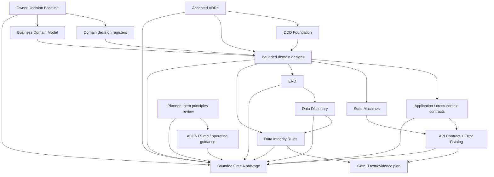

# AFTER FOUR — Comprehensive Documentation Gap Assessment

**Assessment status:** `ASSESSMENT_COMPLETE — OWNER_REVIEW_REQUIRED`

**Assessment date:** 2026-11-23

**Base branch and commit:** `main` at `ae001041ed21b919519e26b8b611e8ca48387a1b`

**Assessment branch:** `docs/after-four-comprehensive-documentation-gap-assessment`

**Authority boundary:** Assessment and reporting only. This report creates no Owner decision, technical-design approval, Gate A/B/C decision, implementation authorization, Control Acceptance, Final Operational Acceptance, Production Authorization, or production-use authority.

## 1. Executive summary

AFTER FOUR is **not ready for a project-wide Gate A request**. The repository does not define one project-wide Gate A scope, while the only completed precedent—[I1 Organization Scope Contract](../architecture/after_four_i1_organization_scope_contract_design.md#gate-a-owner-decision-record)—uses a narrowly bounded design baseline. A single review spanning every documented domain would combine mature, implemented foundations with proposed, deferred, historical, legally unverified, and still-undesigned areas. That would make approval scope ambiguous.

The project nevertheless has a strong architecture foundation:

- the Owner Decision Baseline clearly distinguishes confirmed policy from proposals and authorization;
- [ADR-0011](../architecture/adr/0011-project-wide-layered-ddd.md#decision) establishes inward Layered DDD dependencies;
- payment-before-preparation and Phase 1 recovery boundaries are coherent;
- Customer decisions `SDP-CUST-01` through `SDP-CUST-22`, `SDP-CUST-A2`, and `SDP-SCOPE-01` provide a substantial business-policy baseline;
- A1, Package B, and I1 have bounded implementation/evidence histories; and
- historical prototype documents are generally marked as historical or superseded.

The Owner has now selected Candidate E — Customer lifecycle and phone-admission semantic contract — for bounded Gate A preparation through WP-G0. Candidate E remains `NOT_READY` and not Gate A-approved. The remaining path is not “finish every document.” It is:

1. preserve the WP-G0 charter, its explicit exclusions, and deferred-operation list;
2. preserve the completed canonical decision/domain/vocabulary synchronization for `SDP-CUST-15`–`22`;
3. close only any further Owner authority decision required by an operation proposed for inclusion;
4. complete the candidate's Domain/Application contracts, failure semantics, and evidence plan;
5. synchronize dependent API/data/integrity documents at the correct abstraction level;
6. perform the separately planned `.gem` principles review after documentation/design closure; and
7. prepare an immutable Gate A evidence manifest for Owner review.

For Customer Management specifically, WP4.1 and WP4.2 are useful domain proposals, but Gate A preparation remains blocked by stale canonical propagation, missing final aggregate/application/cross-context contracts, unresolved authorization and requester-verification policy, and unselected consistency/privacy boundaries. This report does **not** start WP4.3.

### 1.1 Finding totals

| Primary category | Critical | High | Medium | Low | Total |
|---|---:|---:|---:|---:|---:|
| `GOVERNANCE_GAP` | 1 | 1 | 1 | 0 | 3 |
| `CROSS_DOCUMENT_INCONSISTENCY` | 0 | 4 | 2 | 0 | 6 |
| `DOC_GAP` | 0 | 0 | 2 | 1 | 3 |
| `OWNER_DECISION` | 0 | 6 | 0 | 0 | 6 |
| `TECHNICAL_DESIGN_GAP` | 0 | 5 | 2 | 0 | 7 |
| `NO_GAP` | 0 | 0 | 0 | 3 | 3 |
| **Total** | **1** | **16** | **7** | **4** | **28** |

### 1.2 Gate consequence summary

| Timing | Required work |
|---|---|
| Before any new Gate A request | WP-G0 selects Candidate E and fixes its charter; complete the remaining Candidate E technical-design and traceability closure before submission. |
| Before Customer Gate A | Resolve `X-001`–`X-003`, `DOC-001`, relevant parts of `OWN-001`, and `TECH-001`–`TECH-003`. |
| Before Loyalty/Promotion Gate A | Resolve relevant parts of `OWN-002`–`OWN-003` and `TECH-004`; preserve Customer/Loyalty/Promotion ownership separation. |
| Before Package C Gate A | Resolve relevant `P1-OD-01`–`P1-OD-05`, the applicable `C0-R05` design dependency, and review P1/P2/P3/Package C together. |
| Before Gate B or implementation | Produce an exact manifest, migration/API/error contracts where applicable, deterministic test plan, and bounded implementation authorization. |
| Before production | Complete security/privacy/legal/operational evidence, ADR-0006/0008 requirements, role topology, recovery, monitoring, FOA, and Production Authorization. |
| Long-term maintainability | Add canonical documentation inventory/synchronization ownership and documented branch/work-item conventions. |

### 1.3 Bounded Gate A Candidate Scope Evaluation

This section records the comparison that supported the Owner's later selection of Candidate E as the next Gate A preparation target. The [WP-G0 Scope Charter](../architecture/after_four_wp_g0_candidate_e_scope_charter.md) now controls that preparation boundary. The comparison remains decision provenance, not Gate A approval, technical-design approval, implementation evidence, or implementation authorization. No candidate currently satisfies every prerequisite for Gate submission.

#### 1.3.1 Candidate definitions and boundaries

##### Candidate A — Customer Management

**Proposed included scope**

- Customer Management responsibilities and non-responsibilities;
- Customer Profile creation and Active/Inactive/Anonymized lifecycle semantics;
- current-phone association, Organization-wide admission control, former-phone restriction, controlled phone change, manual release, and non-disclosing conflict outcomes;
- approved anonymization outcomes for Orders, Loyalty, and Promotions, without taking ownership of those contexts; and
- the required Customer Domain, Application, and cross-context contracts.

**Explicit exclusions:** physical schema/topology, public API, authentication/Session/MFA implementation, unrestricted authorization design, multi-Brand behavior deferred by `SDP-SCOPE-01`, Loyalty ledger internals, Promotion rule-engine internals, implementation, and production use.

**Canonical evidence:** [Customer Owner decisions](../architecture/after_four_customer_management_owner_decisions.md), [SDP-CUST-01](../architecture/after_four_sdp_cust_01_owner_decision.md), [SDP-CUST-02](../architecture/after_four_sdp_cust_02_owner_decision.md), [SDP-SCOPE-01](../architecture/after_four_sdp_scope_01_owner_decision.md), [WP4.1](../architecture/after_four_customer_domain_boundary_design.md), and [WP4.2](../architecture/after_four_customer_lifecycle_phone_consistency_design.md).

**Known prerequisites:** `X-001`–`X-003`, `DOC-001`, the launch-critical subset of `OWN-001`, and `TECH-001`–`TECH-003`. The exact requester-verification/capability boundary and non-disclosing Application outcomes must be reviewable even if their runtime implementation remains outside Gate A.

**Independent reviewability:** possible only after the included Customer contract is narrowed and completed. As currently written, WP4.1/WP4.2 intentionally omit final aggregates, Application contracts, consistency mechanisms, and trusted authorization integration; therefore Candidate A is not yet an independently reviewable Gate baseline.

##### Candidate B — Loyalty

**Proposed included scope**

- a minimal Loyalty ledger and balance model;
- earning, redemption, adjustment, freeze, and reversal business semantics;
- Customer anonymization preserve/freeze behavior from `SDP-CUST-01`; and
- explicit Ordering, Payment, Refund, and Customer integration contracts.

**Explicit exclusions:** Promotion rules, Customer Profile ownership, payment-provider integration, general accounting/tax policy, implementation, and production operations.

**Canonical evidence:** [Owner Baseline §5A](../architecture/after_four_owner_decision_baseline.md#5a-production-mvp-customer-loyalty-and-promotions-scope), [Business Domain Model §11](../architecture/after_four_business_domain_model.md#11-customers-loyalty-and-promotions), and [SDP-CUST-01](../architecture/after_four_sdp_cust_01_owner_decision.md).

**Known prerequisites:** `OWN-002`, the Loyalty portion of `TECH-004`, and the applicable Payment/Refund questions in `OWN-004`. The Owner must define at least the launch ledger, earning/redemption, refund/reversal, expiry, negative-balance, and adjustment-authority policies.

**Independent reviewability:** not yet. The repository has an approved anonymization outcome and broad MVP intent, but no deterministic Loyalty policy package or dedicated Domain/Application design.

##### Candidate C — Promotions

**Proposed included scope**

- a bounded, typed first Promotion rule vocabulary;
- deterministic eligibility, priority/stacking, limits, usage, and applied-outcome semantics;
- Customer-specific granted benefits and the `SDP-CUST-17` post-anonymization freeze/history behavior; and
- Pricing, Ordering, Refund, Customer, and Loyalty integration boundaries.

**Explicit exclusions:** a generic expression engine, unapproved Voucher/administration policy, broad cross-Brand behavior, Loyalty ledger ownership, implementation, and production use.

**Canonical evidence:** [Owner Baseline — proposed Promotion areas](../architecture/after_four_owner_decision_baseline.md#proposed-promotion-capability-areas), [Customer Owner decision SDP-CUST-17](../architecture/after_four_customer_management_owner_decisions.md#sdp-cust-17), and [Business Domain Model §11](../architecture/after_four_business_domain_model.md#11-customers-loyalty-and-promotions).

**Known prerequisites:** `X-001`–`X-003` where they carry `SDP-CUST-17`, `OWN-003`, the Promotion portion of `TECH-004`, and relevant total/refund inputs from `OWN-004`.

**Independent reviewability:** not yet. `SDP-CUST-17` closes one Customer-anonymization outcome, not the general Promotion rule, eligibility, administration, refund, or cross-context model.

##### Candidate D — Catalog / Package C

**Proposed included scope**

- the existing Catalog Core and Package B schema/integrity baseline;
- Category and Variant lifecycle operations defined by Package C;
- trusted authorization/revalidation through P1;
- Brand-scoped append-only atomic Catalog audit through P2; and
- least-privilege runtime database operation boundary through P3.

**Explicit exclusions:** Product lifecycle commands, Default Variant switching, Catalog create/edit/read APIs, pricing, availability, real menu data, Identity Milestone 2B as a whole, implementation, and production use.

**Canonical evidence:** [Catalog Core Technical Design](../architecture/after_four_catalog_core_technical_design.md), [Package C](../architecture/after_four_package_c_technical_design.md), [P1](../architecture/after_four_p1_trusted_identity_authorization_design.md), [P2](../architecture/after_four_p2_brand_scoped_catalog_audit_event_design.md), and [P3](../architecture/after_four_p3_runtime_database_security_design.md).

**Known prerequisites:** `X-004`, `OWN-006`, and `TECH-005`; applicable operational evidence in `TECH-006` remains later-gate work. P1 Owner inputs, the material `C0-R05` dependency, and one integrated revalidation/lock/mutation/audit/database-failure contract must be closed. `C0-R08` and `C0-R11` remain deferred unless the final bounded scope proves they are material.

**Independent reviewability:** Package B alone has strong bounded design and local evidence, but Package C cannot be reviewed as an executable lifecycle boundary by treating P1/P2/P3 as unrelated documents. The combined candidate remains blocked by security-sensitive integration and stale current-state documentation.

##### Candidate E — Customer lifecycle and phone-admission semantic contract

Repository evidence supports one narrower candidate rather than inventing an unrelated capability. Candidate E is a strict subset of Candidate A, grounded in WP4.1/WP4.2 and the confirmed Customer policies. The Owner selected it for preparation through WP-G0; it remains `NOT_READY` and not Gate A-approved.

**Proposed included scope**

- Active/Inactive/Anonymized meanings, permitted in-scope business transitions, the `SDP-CUST-15` Active postcondition after a separately authorized successful creation, and terminal ordinary anonymization; the Profile-creation operation itself remains excluded;
- canonical-phone validation as a precondition and Organization-wide admission semantics: a canonical phone may have at most one current Customer Profile association within an Organization, while either a current association or an unreleased former-phone restriction prevents a new admission under `SDP-CUST-04`;
- distinct current-association and former-phone-restriction concepts, controlled phone change while Inactive, and manual release that removes only the applicable restriction without creating a current association, transferring identity, or authorizing a new Profile;
- business-level completion/failure semantics for phone change and anonymization, without selecting a transaction, lock, queue, retry, or cross-context coordination mechanism;
- an explicit semantic authorization precondition for every included operation, obtained through an external trusted authorization contract that cannot treat denial, unavailability, invalid scope, or missing evidence as approval;
- non-disclosing typed outcomes for admission conflicts and rejected lifecycle requests; and
- conceptual Customer Domain/Application responsibilities and ports needed to obtain authoritative Organization scope and external authorization decisions without defining their implementations.

**Explicit exclusions**

- the complete `SDP-CUST-18` shared/family-phone policy and every assisted shared-phone workflow; the approved policy remains repository context but is not designed, validated, or submitted through Candidate E;
- the complete `SDP-CUST-19` anonymous/unregistered-Order policy, later Customer association, and Order-domain behavior; the approved policy remains repository context but is not designed, validated, or submitted through Candidate E;
- Customer Review Case persistence/workflow beyond the `SDP-CUST-21` business trigger;
- authentication and Session implementation, MFA implementation, verification-evidence storage and cryptographic mechanisms, a complete runtime role/capability mapping, P1 implementation, Identity Milestone 2B, and physical authorization infrastructure;
- Restricted Identity Evidence retention choice, physical topology, cryptography, legal conclusions, ordinary lookup, and the exceptional identity-evidence access/export workflow left separate by `SDP-CUST-22`;
- Loyalty and Promotion internal models; Candidate E carries only their already-approved anonymization outcomes as external postconditions;
- public API/error catalog, persistence representation, schema, indexes, isolation/locking mechanism, implementation, and production use.

**Semantic authorization boundary**

- `SDP-CUST-09` requires controlled requester verification for privacy requests and establishes that knowledge or possession of a phone number is not identity or authority proof. Exact evidence, workflow, legal duties, and technical mechanisms remain unresolved.
- `SDP-CUST-12A` permits an appropriately scoped Branch Manager to approve an ordinary verified phone change; disputed, exceptional, or cross-scope cases require Owner approval. It does not approve the exact capability representation or runtime workflow.
- `SDP-CUST-12B` requires former-phone release to be documented, authorized, and manual. It is never automatic. `SDP-CUST-13` permits a Branch Manager to investigate and propose within authorized scope, while the Owner approves consequential or disputed Profile-ownership or phone-association changes. The decisions do not clearly authorize a Branch Manager to approve an otherwise ordinary, undisputed release; if Candidate E includes such a path, its approving authority must be confirmed rather than inferred.
- Every included operation must name its authorization precondition and consume a current decision from an external trusted contract. Denied, unavailable, missing, invalid, revoked, or out-of-scope authorization fails closed and preserves non-disclosure.
- The existing Owner decisions do not fully identify the actor/capability outcome for Profile creation, ordinary Deactivate, Reactivate, controlled anonymization approval, or ordinary undisputed former-phone release. Candidate E may not infer defaults: those operations remain excluded from its submitted Gate A scope unless a later Owner decision and scope correction explicitly include them. Authentication, evidence persistence, cryptography, P1 implementation, and physical enforcement remain excluded either way.

**Phone-admission and release invariants**

- A canonical phone may have at most one current Customer Profile association in an Organization.
- A current association and an unreleased former-phone restriction are different conceptual states, but each independently blocks a new admission under `SDP-CUST-04`.
- Manual release ends only the applicable former-phone restriction. It does not create a current association, restore or transfer identity, authorize a new Profile, or transfer history or value.
- Any later association request is a new admission attempt and must independently pass the then-applicable phone validation, trusted scope, authorization, Organization-wide admission, non-disclosure, and dispute checks.
- Former-phone restriction remains an admission-control concept distinct from optional Restricted Identity Evidence under `SDP-CUST-A2`.

**Failure and concurrency semantics**

- A successfully accepted controlled phone change produces the complete intended association outcome: the new phone is current, the old phone is formerly restricted, and an Inactive Profile remains Inactive. Failure preserves the previous current association, and no partial accepted phone-change outcome is allowed. This is a business-contract invariant, not a selected transaction or locking mechanism.
- Effective anonymization preserves the approved external outcomes for Orders, Loyalty, and Promotions under `SDP-CUST-01`, `SDP-CUST-02`, `SDP-CUST-10`, `SDP-CUST-14`, `SDP-CUST-17`, and `SDP-CUST-A2`. It does not imply that Customer and every receiving context commit in one database transaction. Cross-context coordination, completion tracking, retry, recovery, reconciliation, and proof of effective completion remain technical-design questions.
- Concurrent commands must not produce two current associations for one canonical phone in an Organization, bypass an unreleased restriction, restore an Anonymized Profile through ordinary operations, or expose a partial accepted phone change. The required business outcomes are fixed; deterministic ordering, serialization, conflict resolution, and recovery mechanisms remain blockers under `TECH-002` rather than inferred design choices.
- Confirmed policy does not establish precedence among concurrent Deactivate, Reactivate, controlled phone-change, and anonymization requests. Because the unresolved-authority lifecycle operations are excluded, Candidate E must not silently define their concurrency precedence; any in-scope phone-change conflict outcome must remain bounded to approved operations, and excluded combinations remain later design blockers rather than answers inherited from database timing.

**Canonical evidence:** `SDP-CUST-03`–`SDP-CUST-22`, `SDP-CUST-A2`, `SDP-SCOPE-01`, [WP-G0 Scope Charter](../architecture/after_four_wp_g0_candidate_e_scope_charter.md), [WP4.1 responsibilities](../architecture/after_four_customer_domain_boundary_design.md#5-responsibilities-owned-by-customer-management), [WP4.2 lifecycle model](../architecture/after_four_customer_lifecycle_phone_consistency_design.md#5-customer-profile-lifecycle-model), and accepted [ADR-0011](../architecture/adr/0011-project-wide-layered-ddd.md#decision). `SDP-CUST-01`, `SDP-CUST-02`, and `SDP-CUST-17` state external anonymization outcomes; they do not approve Loyalty or Promotion internals.

**Known prerequisites:** `X-003`; the remaining deferred authority portion of `OWN-001`; and the semantic/application-contract portions of `TECH-001`–`TECH-003`. `X-001`, `X-002`, `DOC-001`, and the policy questions represented by `SDP-CUST-18`–`22` are synchronized/resolved by the WP-G0 documentation update. `SDP-CUST-18` and `SDP-CUST-19` remain approved context outside Candidate E's design and approval scope. Physical consistency mechanisms may remain for a later Gate B design only if Gate A states exact business invariants, failure outcomes, and proof obligations without implying that they are implemented.

**Independent reviewability:** this is the strongest separable candidate. The approved lifecycle and phone-admission policies form a coherent semantic contract, while Loyalty/Promotion implementation and broad Identity design can remain external. It is still not ready today because the final Customer aggregate/Application boundary, trusted-scope/authorization port semantics, failure contract, vocabulary synchronization, and canonical propagation are incomplete.

#### 1.3.2 Comparative evaluation matrix

| Criterion | Candidate A — Customer Management | Candidate B — Loyalty | Candidate C — Promotions | Candidate D — Catalog / Package C | Candidate E — narrow Customer lifecycle/phone contract |
|---|---|---|---|---|---|
| Business-policy maturity | `PARTIALLY_READY` — decisions `SDP-CUST-01`–`22` are substantial, but `OWN-001` retains operation-authority, verification, exceptional-access, multi-Brand, and legal/privacy questions. | `NOT_READY` — `SDP-CUST-01` defines anonymization treatment only; core ledger/refund/authority policy in `OWN-002` is open. | `NOT_READY` — `SDP-CUST-17` defines anonymization treatment only; rule/eligibility/stacking/refund/authority policy in `OWN-003` is open. | `PARTIALLY_READY` — lifecycle authority and invariants are confirmed, but P1 inputs and MFA evidence dependency in `OWN-006` remain unresolved/deferred. | `PARTIALLY_READY` — phone-change, release, dispute, requester-verification, lifecycle, and admission policies are substantial, but authority for creation, Deactivate, Reactivate, anonymization, and any ordinary undisputed release path remains unresolved or excluded. |
| Domain-design maturity | `PARTIALLY_READY` — WP4.1/4.2 define responsibilities and scenarios, but deliberately omit final aggregates and Application contracts (`TECH-001`). | `NOT_READY` — no dedicated aggregate, ledger invariant, or failure contract (`TECH-004`). | `NOT_READY` — no typed rule/evaluation model or dedicated Domain/Application design (`TECH-004`). | `PARTIALLY_READY` — Package B and Package C are detailed, but P1/P2/P3 lack one integrated operation/failure proof (`TECH-005`). | `PARTIALLY_READY` — WP4.2 supplies a coherent lifecycle/phone model, but final bounded aggregates, typed use cases, and failure results are absent. |
| Architecture readiness | `PARTIALLY_READY` — ADR-0011 is applicable; Customer-owned ports and cross-context boundaries remain proposals. | `PARTIALLY_READY` — ADR-0011 is clear, but ownership seams to Ordering/Payment/Refund are undesigned. | `PARTIALLY_READY` — ADR-0011 is clear, but Pricing/Ordering/Refund/Loyalty seams are undesigned. | `PARTIALLY_READY` — all four designs target ADR-0011, yet their combined authorization/audit/database boundary is unreviewed and ADR-0006 remains Proposed. | `PARTIALLY_READY` — ADR-0011 and I1's ancestry precedent support the dependency model; exact Customer consumer ports and authorization-result contract still require design. |
| Documentation consistency | `PARTIALLY_READY` — WP-G0 synchronized the Owner baseline, domain model, WP4.1/WP4.2, and glossary, while `X-003` and final Application/data traceability remain open. | `NOT_READY` — no dedicated Loyalty baseline exists and financial/refund dependencies remain unresolved. | `NOT_READY` — the anonymization outcome is synchronized, but general Promotion policy and dedicated design remain absent. | `NOT_READY` — `X-004` mixes the pre-implementation Package B baseline with later implementation/evidence state. | `PARTIALLY_READY` — WP-G0 closes the direct Customer policy/glossary drift; final Candidate E design and `X-003` traceability remain open. |
| Dependency and coupling | `PARTIALLY_READY` — Customer ownership can be bounded, but anonymization and authorization require explicit external outcomes/contracts. | `NOT_READY` — depends on Customer, Ordering, Payment, Refund, and unresolved policy. | `NOT_READY` — depends on Customer, Pricing, Ordering, Refund, Loyalty, and unresolved rule policy. | `NOT_READY` — Package C depends jointly on P1, P2, P3, C0 decisions, and Package B evidence. | `PARTIALLY_READY` — Organization scope and authorization are external contracts; Loyalty/Promotion internals and multi-Brand behavior can be excluded without obscuring the included lifecycle semantics. |
| Security, privacy, operational risk | `NOT_READY` — requester verification, capability detail, restricted evidence, retention, and consistency proof remain material. | `PARTIALLY_READY` — value integrity/refund authority is material; broad Identity/privacy can be external. | `NOT_READY` — entitlement abuse, stacking, refund, administration, and Customer privacy boundaries are undefined. | `NOT_READY` — step-up MFA, authorization revalidation, append-only audit, database roles, and production evidence are central rather than peripheral. | `PARTIALLY_READY` — privacy/non-disclosure boundaries are known; runtime authorization, evidence retention, legal conclusions, and physical controls must remain explicit later prerequisites/exclusions. |
| Evidence and reviewability | `PARTIALLY_READY` — sources can be frozen, but the proposed baseline lacks final contracts and traceability. | `NOT_READY` — no dedicated design/evidence checklist exists. | `NOT_READY` — no bounded typed design/evidence checklist exists. | `PARTIALLY_READY` — extensive design and local Package B evidence exist, but evidence is not approval and the integrated Package C contract is incomplete. | `PARTIALLY_READY` — exact Owner decisions and scenarios are traceable; one narrow design manifest and acceptance checklist can be produced after contract closure. |
| Effort and sequencing | `PARTIALLY_READY` — requires D1/D2, targeted O1 closure, WP-T1 closure of `TD-CUST-01` through `TD-CUST-04`, and downstream synchronization. | `NOT_READY` — requires O2 before a new T3 baseline. | `NOT_READY` — requires O3 before a new T4 baseline and more cross-context coordination than Loyalty. | `NOT_READY` — requires D3, O6, integrated T5, and security-sensitive review across four designs. | `PARTIALLY_READY` — smallest credible path: bounded D1/D2, explicit O1 exclusions/decisions, narrow WP-T1 closure of `TD-CUST-01` through `TD-CUST-04`, then Gate packaging. |

No rating upgrades a finding, design, ADR, or Gate status. Candidate E's overall Gate A readiness remains `NOT_READY`.

#### 1.3.3 Dependency and blocker analysis

| Candidate | Critical blockers | Non-blocking deferred/excluded matters | Upstream dependencies | Downstream synchronization | Scope/authorization risk |
|---|---|---|---|---|---|
| A — Customer Management | `GOV-001`; `X-001`–`X-003`; `DOC-001`; included `OWN-001`; `TECH-001`–`TECH-003`. | Multi-Brand behavior may remain deferred; physical topology and public API can follow Gate A if clearly excluded. | Owner verification/capability/privacy choices; I1/P1-compatible contract semantics. | Owner Baseline, Business Domain Model, WP4.1 notes, Glossary, then ERD/Dictionary/Integrity/State/API/Error as appropriate. | “Customer approved” could be misread as approving Loyalty/Promotion internals, identity controls, or implementation. |
| B — Loyalty | `GOV-001`; `OWN-002`; Loyalty portion of `TECH-004`; relevant `OWN-004`. | Promotion engine and Customer Profile implementation can remain external. | Customer pseudonymous outcome; Ordering/Payment/Refund authoritative events and policies. | Owner Baseline/BDM, Glossary, State/ERD/Dictionary/Integrity, Application/API contracts. | A ledger Gate could be misread as approving financial/refund formulas or cross-Brand value sharing. |
| C — Promotions | `GOV-001`; `X-001`–`X-003`; `OWN-003`; Promotion portion of `TECH-004`; relevant `OWN-004`. | General marketing tooling and future rule types may remain excluded. | Pricing totals, Ordering snapshots, Refund consequences, Customer-specific benefit boundary, Loyalty interaction. | Owner Baseline/BDM, Promotion vocabulary, rule/state/data/integrity/API/error documents. | “Advanced Promotions” invites an unbounded engine and could imply unapproved stacking, Voucher, or administration powers. |
| D — Catalog / Package C | `GOV-001`; `X-004`; `OWN-006`; `TECH-005`. | `C0-R08` and `C0-R11` may remain deferred if the bounded write contract states safe exclusions; `TECH-006` is later unless the Gate claims operational readiness. | Package B; P1/P2/P3; applicable C0 decisions; ADR-0006 status boundary. | Catalog current-state record, integrated transaction/failure matrix, P1/P2/P3 cross-references, evidence manifest. | Gate approval could be mistaken for Identity Milestone 2B, production role topology, Package C implementation, or CAT-TRR closure. |
| E — narrow Customer lifecycle/phone contract | `X-003`; `TECH-001`–`TECH-003`; deferred `OWN-001` authority outcomes for any operation proposed for inclusion. WP-G0 closes scope selection (`GOV-001`), `X-001`, `X-002`, `DOC-001`, and `SDP-CUST-18`–`22` policy closure. | The complete `SDP-CUST-18` shared/family-phone policy and `SDP-CUST-19` anonymous-Order policy are approved context outside Candidate E. Multi-Brand, Review Case persistence, exceptional identity-evidence access, Restricted Identity Evidence topology, Loyalty/Promotion internals, and API/persistence also remain excluded. Runtime identity/authorization mechanisms may be excluded, but semantic authorization preconditions may not. | Confirmed Customer policies; WP-G0 charter; ADR-0011; authoritative Organization ancestry and external authorization as contracts only. | Candidate E technical design/traceability, then only the materially required data/Application documents. | Approval must not imply approval of shared-phone or anonymous-Order design, identity verification design, PII retention legality, runtime authorization, implementation, or Loyalty/Promotion internals. |

#### 1.3.4 Recommended candidate

**Owner-selected preparation target: Candidate E — Customer lifecycle and phone-admission semantic contract. Do not submit it yet.** The WP-G0 charter records the selection and boundaries; Candidate E remains `NOT_READY` and not Gate A-approved.

Candidate E is preferable because:

1. most included lifecycle, phone-admission, phone-change, manual-release, dispute, and non-disclosure behavior is supported by confirmed `SDP-CUST-03`–`16`, `SDP-CUST-A2`, and `SDP-SCOPE-01` boundaries, while the remaining authority outcomes can be identified precisely instead of hidden by a broad scope;
2. WP4.1 and WP4.2 already separate Profile lifecycle, phone association, former-phone admission restriction, restricted evidence, downstream histories, and authorization;
3. it can exclude Loyalty/Promotion internals, multi-Brand semantics, public API, persistence, and broad Identity implementation without making the lifecycle/phone contract incoherent;
4. it has fewer unresolved financial/rule-engine inputs than Candidates B/C and fewer security-sensitive integrated prerequisites than Candidate D; and
5. it follows the I1 precedent: approve one narrow semantic contract without implying implementation or approval of the wider context.

The minimum viable Gate A scope should contain only:

- canonical lifecycle/phone terminology and ownership;
- permitted/rejected lifecycle and association transitions;
- Organization-wide admission and non-disclosure invariants;
- controlled phone-change, manual-release, and anonymization business outcomes;
- an explicit authorization precondition and fail-closed external trusted authorization decision for every included operation, with `SDP-CUST-09`, `SDP-CUST-12A`, `SDP-CUST-12B`, and `SDP-CUST-13` traced and unresolved authority outcomes left visible;
- the at-most-one-current-association invariant, separate former-phone restriction, release-only semantics, and independent checks for every later admission request;
- complete-or-preserve phone-change failure semantics and approved anonymization postconditions without assuming one cross-context database transaction;
- typed Domain/Application inputs and outcomes, including exceptional termination behavior;
- authoritative Organization-scope and external authorization ports as contracts, not implementations;
- explicit external postconditions for Order, Loyalty, and Promotion history without designing those contexts; and
- an exact exclusions, assumptions, threat/privacy boundary, and evidence checklist.

Before a Gate A request is submitted:

1. complete bounded `WP-D1` synchronization so no canonical source contradicts `SDP-CUST-15`–`22` or the included lifecycle rules;
2. complete the relevant `WP-D2` vocabulary synchronization;
3. close every semantic authority outcome for an included operation, or remove that operation from the submitted scope; runtime authentication, verification-evidence storage, cryptography, and enforcement mechanisms may remain excluded, but the operation's authorization precondition may not;
4. complete only the Candidate E portions of `TECH-001`–`TECH-003`: final semantic aggregate boundary, typed Application contract, authoritative scope/authorization ports, failure/non-disclosure outcomes, and later-mechanism proof obligations;
5. synchronize only the downstream conceptual documents required by this narrow baseline; do not design API or schema merely to make the manifest larger;
6. perform the separately scheduled `.gem` principles review after documentation/design closure and before final Gate A/B preparation or coding; and
7. freeze the exact commit, document manifest, exclusions, unresolved/deferred register, acceptance criteria, and Owner decision template.

Trade-offs remain explicit. Candidate E creates a useful reviewable semantic baseline sooner, but it does not finish Customer Management, prove concurrency, approve PII storage, define legal compliance, or authorize a runtime workflow. Its semantic authority gaps are smaller and more isolatable than Candidate A's broader gaps, but they are real prerequisites rather than implementation details. Candidate A will still be needed later for a complete Customer baseline; Candidates B/C need their own Owner and technical-design packages; Candidate D remains the strongest technically detailed alternative but carries the greatest integrated security/authorization dependency. Candidate E is Owner-selected for preparation but remains neither ready nor Gate A-approved.

#### 1.3.5 Owner scope selection recorded — Gate decision pending

**Owner selection recorded:** Candidate E is the next Gate A preparation target under the WP-G0 charter. The selection closes only the scope-selection part of `GOV-001`; it does not approve the design or authorize Gate submission. Candidate E and project-wide Gate A readiness remain `NOT_READY`, and no technical-design approval, implementation authorization, Gate A/B/C decision, Control Acceptance, Final Operational Acceptance, or Production Authorization is granted.

## 2. Scope, method, and evidence boundary

### 2.1 Repository baseline

Preflight established:

- local branch was `main`;
- `HEAD` and `origin/main` both referenced `ae001041ed21b919519e26b8b611e8ca48387a1b`;
- the working tree and index were clean;
- the merge commit was `Merge pull request #31 from dtvip195/docs/sdp-cust-17-promotion-anonymization`;
- WP4.1, WP4.2, and `SDP-CUST-15` through `SDP-CUST-17` existed in `HEAD`; and
- this assessment branch was created directly from that verified baseline.

No fetch, pull, reset, merge, rebase, stash, database command, application test, or implementation command was used.

### 2.2 Method

The assessment used five passes:

1. repository-wide Markdown inventory and status/header scan;
2. deep reading of canonical governance, ADR, DDD, domain, API, state, ERD, dictionary, integrity, and Customer documents;
3. targeted inspection of Identity/P1/P2/P3/Package C security and gate records;
4. cross-check against the implemented backend inventory and backend/CI operating guidance without executing code; and
5. decision-to-design-to-data-to-contract traceability analysis.

`NO_GAP` is used only where the inspected evidence is bounded and sufficient. A file's existence alone was never treated as design completeness.

### 2.3 Canonical precedence used

1. [Owner Decision Baseline](../architecture/after_four_owner_decision_baseline.md) for Owner-confirmed policy.
2. Accepted ADRs, especially [ADR-0011](../architecture/adr/0011-project-wide-layered-ddd.md), for architecture decisions.
3. [Business Domain Model](../architecture/after_four_business_domain_model.md) for canonical business/domain detail, subject to newer Owner decisions not yet propagated.
4. Domain-specific Owner registers and approved gate records for their bounded scopes.
5. Current technical designs for proposals and unresolved design.
6. Historical/workshop documents only as provenance; their superseded banners control.

## 3. Deliverable 1 — Documentation Gap Register

### 3.1 Governance and traceability

| ID | Category | Severity | Evidence | Current state and exact gap | Why it matters / dependencies | Recommended resolution | Owner approval | Technical-design approval | Timing / work package |
|---|---|---|---|---|---|---|---|---|---|
| `GOV-001` | `GOVERNANCE_GAP` | Critical | [WP-G0 Scope Charter](../architecture/after_four_wp_g0_candidate_e_scope_charter.md); [I1 Gate A record](../architecture/after_four_i1_organization_scope_contract_design.md#gate-a-owner-decision-record) | **Resolved for candidate selection:** the Owner selected Candidate E and the WP-G0 charter fixes its scope, exclusions, deferred operations, deliverables, and readiness conditions. There is intentionally no project-wide Gate A scope. | The charter prevents Candidate E review from implying approval of unrelated domains or implementation. | Preserve bounded Gate packages; complete Candidate E design/evidence prerequisites without creating a blanket approval. | Scope selection recorded; Gate A approval still required later. | Yes—for the eventual Candidate E baseline. | `WP-G0` complete; Gate A remains pending. |
| `GOV-002` | `GOVERNANCE_GAP` | High | [Owner Decision Baseline — identifier governance](../architecture/after_four_owner_decision_baseline.md#odb-category-and-identifier-governance); [Customer decisions table](../architecture/after_four_owner_decision_baseline.md#customer-management-decisions) | Customer, Loyalty, and Promotion categories exist, but all `SDP-*`/MVP references remain `ID_PENDING_OWNER_GOVERNANCE`; no approved provisional-to-canonical crosswalk exists. | Traceability is stable locally but cannot yet satisfy the repository's intended canonical ID lifecycle. Silent allocation is prohibited. | Prepare one allocation/crosswalk proposal after decision content is stable; Owner explicitly approves allocations. Keep existing local references immutable. | Yes. | No, except tooling/validation design. | Before final Gate A evidence manifest if canonical IDs are required; `WP-G1`. |
| `GOV-003` | `GOVERNANCE_GAP` | Medium | [AGENTS.md](../../AGENTS.md); absence of `docs/agents/`; empirical branch history | Operating guidance defines architecture and checks but not a canonical documentation lifecycle, synchronization owner, Gate package template, or branch/work-item naming rule. | Repeated narrow updates have produced status drift and make future agents infer conventions from branch history. | Add a concise documentation-governance guide only after the planned `.gem` review, covering source precedence, sync matrix, branch naming, Gate package metadata, and supersession rules. | No business decision; Owner review of governance is appropriate. | No. | Maintainability; `WP-G2` after `.gem` review. |

### 3.2 Cross-document inconsistencies

| ID | Category | Severity | Evidence | Current state and exact gap | Why it matters / dependencies | Recommended resolution | Owner approval | Technical-design approval | Timing / work package |
|---|---|---|---|---|---|---|---|---|---|
| `X-001` | `CROSS_DOCUMENT_INCONSISTENCY` | High | [Owner Baseline §5A](../architecture/after_four_owner_decision_baseline.md#5a-production-mvp-customer-loyalty-and-promotions-scope); [Customer register](../architecture/after_four_customer_management_owner_decisions.md#sdp-cust-22) | **Resolved by synchronization:** the baseline and register now carry `SDP-CUST-15`–`22`, including the separate Promotion-anonymization outcome, while preserving provisional canonical-ID and no-implementation status. | Future decisions must continue the same propagation discipline. | No further correction in this work package. | No new decision. | No. | `WP-D1` complete for these decisions. |
| `X-002` | `CROSS_DOCUMENT_INCONSISTENCY` | High | [Business Domain Model §11](../architecture/after_four_business_domain_model.md#11-customers-loyalty-and-promotions); [WP4.1 §14](../architecture/after_four_customer_domain_boundary_design.md#14-review-checklist-and-change-history); [WP4.2 §15](../architecture/after_four_customer_lifecycle_phone_consistency_design.md#15-approved-policies-proposals-and-technical-hypotheses) | **Resolved by synchronization:** the Business Domain Model, WP4.1, and WP4.2 now reflect `SDP-CUST-15`–`22` while preserving their proposal/history classifications. | Technical-design and data-contract gaps remain separate under `X-003` and `TECH-001`–`003`. | No further policy-summary correction in this work package. | No new decision. | No. | `WP-D1` complete. |
| `X-003` | `CROSS_DOCUMENT_INCONSISTENCY` | High | [ERD §7](../architecture/after_four_erd.md#7-customer-and-loyalty-erd); [Data Dictionary §6](../architecture/after_four_data_dictionary.md#6-customers-loyalty-and-promotions); [Data Integrity Rules §16](../architecture/after_four_data_integrity_rules.md#16-integrity-risks-and-unresolved-decisions); [API Contract §11](../architecture/after_four_api_contract.md#11-supporting-domain-contracts); [Error Catalog §5](../architecture/after_four_api_error_catalog.md#5-catalog-pricing-customer-and-promotion) | These documents correctly mark old Customer shapes/endpoints/errors as superseded or unapproved, and the ERD preserves the approved `SDP-CUST-19` anonymous-Order boundary as context only. Candidate E decision-to-Application/data/error trace for `SDP-CUST-15`–`17` and `SDP-CUST-20`–`22` remains incomplete; `SDP-CUST-18` and `SDP-CUST-19` are outside that design scope. No approved Customer Application/API contract replaces the illustrations. | A future implementer can see the policy boundary but not yet the accepted target contract or physical proof. | First complete Customer technical design; then synchronize conceptual ERD/dictionary/integrity/API/error documents without prematurely selecting physical mechanisms. | Deferred operation authority remains excluded unless separately decided. | Yes. | Partial Gate A blocker, full Gate B blocker; `WP-T1` then `WP-D5`. |
| `X-004` | `CROSS_DOCUMENT_INCONSISTENCY` | High | [Catalog Core Technical Design header/verdict](../architecture/after_four_catalog_core_technical_design.md); [DDD Foundation §3.2](../architecture/after_four_ddd_foundation.md#32-catalogpricing); [Package C §13](../architecture/after_four_package_c_technical_design.md#13-cat-trr-005-through-cat-trr-008); backend Catalog migration/spec inventory | Catalog Core still says Package B is pre-authorization and executable evidence cannot yet exist, while Package B schema/integrity and CAT-TRR-006/008 evidence are merged and acknowledged by newer documents. | The purported technical source mixes an approved pre-implementation design baseline with stale current-state claims. | Preserve the approved design baseline, add a clearly dated implementation/evidence status appendix or separate canonical implementation record, and reconcile CAT-TRR evidence without changing finding status. | No new business decision. | Technical review of status reconciliation. | Before any Package C Gate A; `WP-D3`. |
| `X-005` | `CROSS_DOCUMENT_INCONSISTENCY` | Medium | [DDD Foundation §1](../architecture/after_four_ddd_foundation.md#1-vocabulary-and-adr-boundary); [ADR amendment proposal](../architecture/adr/proposals/0001-0005-context-vocabulary-amendment-proposal.md); Accepted ADR-0001/0005 | Accepted ADRs use Sales/Billing while current DDD and implementation use Ordering/Payment/Preparation; the amendment remains proposed. | Context names influence ownership, namespaces, docs, and dependency checks. The discrepancy is explicit but unresolved. | Owner/architecture review should accept or reject the vocabulary amendment before a broad architecture baseline is frozen. | Yes if ADR text is amended. | Yes. | Before a cross-domain Gate A; `WP-G1`. |
| `X-006` | `CROSS_DOCUMENT_INCONSISTENCY` | Medium | [ERD §15](../architecture/after_four_erd.md#15-review-gate-and-next-phase); [Data Integrity Rules §17](../architecture/after_four_data_integrity_rules.md#17-acceptance-checklist-for-the-next-review); historical design banners | Several canonical review-gate sections still say “before Rails/PostgreSQL foundation,” although foundation and bounded domain infrastructure now exist. | Stale sequencing obscures which requirements remain design prerequisites versus already-completed foundation work. | Rephrase gates as scope-specific future implementation gates; retain historical provenance. | No. | No. | Before broad Gate A package; `WP-D4`. |

### 3.3 Documentation completeness and maintainability

| ID | Category | Severity | Evidence | Current state and exact gap | Why it matters / dependencies | Recommended resolution | Owner approval | Technical-design approval | Timing / work package |
|---|---|---|---|---|---|---|---|---|---|
| `DOC-001` | `DOC_GAP` | Medium | [GLOSSARY.md](../../GLOSSARY.md); [WP4.1 §8](../architecture/after_four_customer_domain_boundary_design.md#8-ubiquitous-language) | **Resolved for WP-G0 vocabulary:** the repository glossary now defines the accepted Customer/Profile/lifecycle/phone/restriction/evidence/anonymization/reference/benefit terms plus terminology arising from `SDP-CUST-18`–`22` without physical design. `SDP-CUST-18`/`19` terms are related-policy context, not Candidate E scope. | Future design must reuse these meanings rather than reintroduce implementation-shaped synonyms. | Maintain during Candidate E design review without importing excluded policy design. | Owner review of language, not a new business policy. | No. | `WP-D2` complete for Candidate E and context traceability. |
| `DOC-002` | `DOC_GAP` | Medium | Repository inventory; canonical-precedence statements spread across AGENTS, DDD Foundation, and historical banners | No current architecture index lists each canonical document, authority, status, successor, dependent documents, and synchronization triggers. | Readers must infer which of many proposal/research/history files is current. This increases drift risk. | Create a concise canonical-document map after current corrections; link rather than duplicate content. | No. | No. | Before broad Gate A; `WP-G2`. |
| `DOC-003` | `DOC_GAP` | Low | `AGENTS.md`; no `docs/agents/`; branch inventory | No separate Codex/agent guidance or documented branch/work-item convention exists. AGENTS.md is adequate for source architecture and verification but not for recurring documentation governance. | Mostly maintainability; not a design correctness blocker. | Address with `GOV-003`; do not create duplicate agent guides unless the `.gem` review identifies a concrete need. | No. | No. | Long-term; `WP-G2`. |

### 3.4 Owner-decision dependencies

| ID | Category | Severity | Evidence | Current state and exact gap | Why it matters / dependencies | Recommended resolution | Owner approval | Technical-design approval | Timing / work package |
|---|---|---|---|---|---|---|---|---|---|
| `OWN-001` | `OWNER_DECISION` | High | [Customer register §3](../architecture/after_four_customer_management_owner_decisions.md#3-continuing-unresolved-matters); [WP-G0 deferred operations](../architecture/after_four_wp_g0_candidate_e_scope_charter.md#4-deferred-operations-excluded-from-the-gate-a-approval-boundary) | **Partially resolved:** `SDP-CUST-18`–`22` close shared-phone, anonymous-Order, authority-principle, material Review Case, and re-identification/export-boundary policy. `SDP-CUST-18`/`19` remain outside Candidate E. Exact authority for Profile creation, ordinary Deactivate, Reactivate, anonymization approval, and ordinary undisputed release remains deferred, as do evidence/runtime/legal mechanisms and multi-Brand policy. | Deferred operations cannot enter Candidate E's Gate A boundary until their authority is explicit; excluded matters do not make the bounded semantic scope ambiguous. | Preserve charter exclusions; prepare later Owner briefs only when an excluded operation is proposed for inclusion. | Yes for any later authority assignment or exceptional policy. | Subsequent design approval required. | Candidate E preparation may proceed without the excluded operations. |
| `OWN-002` | `OWNER_DECISION` | High | [Owner Baseline §5A — Loyalty](../architecture/after_four_owner_decision_baseline.md#5a-production-mvp-customer-loyalty-and-promotions-scope); [Business Domain Model §17](../architecture/after_four_business_domain_model.md#17-open-decisions-and-validation-register) | Earning/redemption formulas, expiry, minimums, negative balance, refunds/reversals, cross-Branch details, and manual-adjustment authority are undecided. | Basic Loyalty is `MUST`, so no deterministic domain baseline exists without these policies. | Approve a minimal ledger policy package before Loyalty design; recommendation in §4.2. | Yes. | Yes afterward. | Before Loyalty Gate A; `WP-O2`. |
| `OWN-003` | `OWNER_DECISION` | High | [Owner Baseline — proposed Promotion areas](../architecture/after_four_owner_decision_baseline.md#proposed-promotion-capability-areas); [Unresolved MVP rules](../architecture/after_four_owner_decision_baseline.md#unresolved-production-mvp-rules) | Advanced Promotions is `MUST`, but enabled rules, eligibility, stacking, priority, Voucher, limits, allocation, refund behavior, administration, and authority are undecided. `SDP-CUST-17` resolves only anonymization treatment. | A generic “advanced engine” cannot become a reviewable Domain model without a bounded rule vocabulary. | Approve a deliberately small first rule set and explicit non-stacking/default precedence; recommendation in §4.2. | Yes. | Yes afterward. | Before Promotion Gate A; `WP-O3`. |
| `OWN-004` | `OWNER_DECISION` | High | [API Contract §14](../architecture/after_four_api_contract.md#14-open-decisions-and-implementation-impact); [Business Domain Model §17](../architecture/after_four_business_domain_model.md#17-open-decisions-and-validation-register) | Split/partial tender, partial refunds, completed-Order exception outcomes, overpayment evidence/refund, tax/service charge/rounding/free-item policy, and price overrides remain open. | These policies affect authoritative totals, snapshots, Payment/Refund allocation, Loyalty/Promotion reversals, and reporting. | Keep exact-balance/no-split as the bounded launch default unless the Owner explicitly expands it; close legal/accounting inputs before total/refund design. | Yes; qualified legal/accounting input where applicable. | Yes. | Before affected Payment/Pricing Gate A or production endpoint; `WP-O4`. |
| `OWN-005` | `OWNER_DECISION` | High | [Business Domain Model §17](../architecture/after_four_business_domain_model.md#17-open-decisions-and-validation-register); [API Contract §14](../architecture/after_four_api_contract.md#14-open-decisions-and-implementation-impact) | Operating Day/cutoff, report delivery/formulas, drawer topology, transfer valuation, procurement/approval thresholds, workforce/leave/payroll details, devices/offline behavior, and recovery objectives remain open. | The broad canonical model names these domains but cannot support a single project-wide Gate A baseline. | Split into independent domain decision packages and exclude unclosed domains from the first Gate A scope. | Yes; legal/accounting review for payroll/tax/food safety. | Yes afterward. | Later bounded Gate A packages; `WP-O5`. |
| `OWN-006` | `OWNER_DECISION` | High | [P1 §15](../architecture/after_four_p1_trusted_identity_authorization_design.md#15-open-owner-decisions-and-technical-blockers); [Owner Baseline C0](../architecture/after_four_owner_decision_baseline.md#package-c0-lifecycle-authority-and-prerequisite-decisions) | `P1-OD-01`–`05` are unresolved; `C0-R05`, `C0-R08`, and `C0-R11` are deliberately deferred. | Package C authorization/delegation, Archive/Restore MFA evidence, audit governance, and retry semantics cannot be silently inferred. | Resolve only the items required by the intended Package C baseline; preserve safe fail-closed/no-auto-retry behavior for genuinely deferred items. | Yes. | Yes. | Before Package C Gate A/B as applicable; `WP-O6`. |

### 3.5 Technical and architectural design gaps

| ID | Category | Severity | Evidence | Current state and exact gap | Why it matters / dependencies | Recommended resolution | Owner approval | Technical-design approval | Timing / work package |
|---|---|---|---|---|---|---|---|---|---|
| `TECH-001` | `TECHNICAL_DESIGN_GAP` | High | [WP4.1 §9](../architecture/after_four_customer_domain_boundary_design.md#9-provisional-aggregate-and-consistency-boundary-analysis); [WP4.2 §2.2](../architecture/after_four_customer_lifecycle_phone_consistency_design.md#22-out-of-scope) | Customer aggregate roots, Value Objects, Domain Services, use cases, commands/queries, ports, events, and final transaction boundaries remain deliberately unselected. | WP4.1/4.2 are domain discovery, not a Gate A-ready technical baseline. | A later authorized Customer technical-design work package should compare minimal aggregate/application boundaries against the approved scenarios without selecting persistence prematurely. | Only for remaining policy inputs. | Yes. | Customer Gate A prerequisite; `WP-T1`. |
| `TECH-002` | `TECHNICAL_DESIGN_GAP` | High | [WP4.2 §§7, 10–13](../architecture/after_four_customer_lifecycle_phone_consistency_design.md#7-phone-association-lifecycle); [Data Dictionary §6](../architecture/after_four_data_dictionary.md#6-customers-loyalty-and-promotions) | No representation or coordination design exists for current phone, former restriction, optional Restricted Identity Evidence, anonymization completion, non-disclosing admission, atomicity, concurrency, recovery, or reconciliation. | The Organization-wide invariant and privacy boundary cannot be proven through model-only prose. | Design competing consistency boundaries and failure schedules first; select mechanisms only after review. Keep admission restriction separate from identity evidence. | Some evidence/retention choices require Owner/legal review. | Yes. | Customer Gate A/B depending mechanism depth; `WP-T1`. |
| `TECH-003` | `TECHNICAL_DESIGN_GAP` | High | [API Contract §11](../architecture/after_four_api_contract.md#11-supporting-domain-contracts); [Error Catalog §5](../architecture/after_four_api_error_catalog.md#5-catalog-pricing-customer-and-promotion); [P1 design](../architecture/after_four_p1_trusted_identity_authorization_design.md) | No approved Customer Application contract, trusted target/scope contract, requester-verification boundary, non-disclosing result types, or replacement API/error semantics exists. | Controllers/clients cannot be designed without leaking persistence or cross-Brand facts. | Complete Domain/Application contract first, then define Presentation contract and stable errors; do not promote illustrative endpoints. | Exact capability/verification policy requires Owner decisions. | Yes. | Gate A partly, Gate B fully; `WP-T1` under `TD-CUST-01` through `TD-CUST-04`. |
| `TECH-004` | `TECHNICAL_DESIGN_GAP` | High | Owner Baseline §5A; Business Domain Model §11; Data Dictionary §6 | Loyalty and Promotion have scope statements and illustrative tables, but no dedicated Domain/Application design, aggregate boundaries, invariant/failure matrix, or cross-context contracts. | Both are Production MVP `MUST` capabilities and interact with Payment, Refund, Order snapshots, and anonymization. | Produce separate Loyalty and Promotion designs after their Owner packages; integrate through explicit Customer/Ordering/Payment contracts. | Yes for open policy. | Yes. | Before their Gate A packages; `WP-T3`/`WP-T4`. |
| `TECH-005` | `TECHNICAL_DESIGN_GAP` | High | [P1 readiness/open decisions](../architecture/after_four_p1_trusted_identity_authorization_design.md#15-open-owner-decisions-and-technical-blockers); [P2 prerequisites](../architecture/after_four_p2_brand_scoped_catalog_audit_event_design.md#12-open-decisions-and-prerequisites); [P3 open risks](../architecture/after_four_p3_runtime_database_security_design.md#13-open-decisions-prerequisites-and-risks); [Package C gates](../architecture/after_four_package_c_technical_design.md#12-dependency-and-authorization-gates) | Four individually substantial proposals have not been reviewed as one executable authorization/audit/database boundary. | Package C correctness depends on their combined lock/revalidation/audit/role/failure behavior, not isolated prose. | Close P1 Owner inputs, then perform an integrated design review with one sequence diagram and failure/transaction matrix; no implementation. | Yes for P1/C0 inputs. | Yes. | Package C Gate A prerequisite; `WP-T5`. |
| `TECH-006` | `TECHNICAL_DESIGN_GAP` | Medium | [ADR-0008](../architecture/adr/0008-deployment-environments.md); [P3 verification strategy](../architecture/after_four_p3_runtime_database_security_design.md#12-verification-strategy-and-acceptance-criteria); Identity checklist | Deployment topology, runtime/migration/break-glass roles, control-plane separation, backup/recovery objectives, monitoring, and production-like evidence remain proposed or missing. | This does not block every semantic Gate A, but blocks production-oriented Gate B/Control Acceptance/FOA. | Keep outside early semantic Gate A packages; require a separate operational design/evidence gate. | Owner decisions for deployment/service levels. | Yes. | Gate B/production; `WP-T6`. |
| `TECH-007` | `TECHNICAL_DESIGN_GAP` | Medium | Business Domain Model §§6, 9, 10, 12, 17; logical ERD/Dictionary/State Machines | Inventory/procurement, cash/finance, workforce/payroll, reporting, tables/reservations, devices, and compliance have logical inventories but no uniformly mature Layered DDD technical baselines. | They prevent a meaningful blanket project-wide Gate A but need not block a narrower slice. | Create bounded designs only when their Owner decisions and implementation priority justify them; exclude them explicitly from earlier Gate packages. | Yes for open policies. | Yes. | Later activities; `WP-T7`. |

### 3.6 Reviewed areas with sufficient bounded evidence

| ID | Category | Severity | Evidence | Assessment | Boundary / next action |
|---|---|---|---|---|---|
| `NO-001` | `NO_GAP` | Low | [ADR-0011](../architecture/adr/0011-project-wide-layered-ddd.md#decision); [DDD Foundation](../architecture/after_four_ddd_foundation.md#owner-confirmed-layered-ddd-baseline); AGENTS.md | Layer responsibilities and inward dependency direction are clear, current, and consistently stated. | Context topology and legacy migration remain separately proposed; no blanket conformance claim. |
| `NO-002` | `NO_GAP` | Low | [Payment Model](../architecture/after_four_payment_model.md); [Business Domain Model §8](../architecture/after_four_business_domain_model.md#8-sales-payment-preparation-printing-and-delivery); [Phase 1 record](../architecture/after_four_order_payment_implementation_phase1.md) | The verified-payment-before-preparation invariant, late-success hold/review boundary, and independent Order/Payment/Dispatch axes are coherent. | Refund, partial/split, overpayment, and completed exception policies remain separate gaps. |
| `NO-003` | `NO_GAP` | Low | historical banners under `docs/design/` and `docs/planning/`; [I1 Gate records](../architecture/after_four_i1_organization_scope_contract_design.md) | Historical prototype material is generally labeled as superseded, and I1 distinctly records Gate A, Gate B, Gate C, non-independent evidence, and lack of FOA/production authority. | Preserve these patterns in future status synchronization. |

## 4. Deliverable 2 — Remaining Owner Decisions Register

Planning labels remain non-allocating unless explicitly recorded otherwise. `SDP-CUST-18` through `SDP-CUST-22` are now stable local Owner-decision references with `OWNER_DECIDED` / `OWNER_CONFIRMED` status, but they are not canonical `ODB-*` allocations; exact ODB allocation and crosswalk remain governed separately.

### 4.1 Customer Management

| Candidate reference | Business question | Alternatives and recommendation | Trade-offs / consequences | Dependencies and affected domains | Gate impact |
|---|---|---|---|---|---|
| `SDP-CUST-18` — `OWNER_CONFIRMED` | May multiple Profiles use one shared/family phone? | **Approved Option A:** preserve one current Profile association per canonical phone in an Organization; sharing does not create shared identity or permit duplicate Profiles. Assisted handling requires later approval. | Preserves `SDP-CUST-04` and non-disclosure; assisted accessibility workflow remains open. | Customer, Identity verification, Loyalty, Promotions, support/disputes. | Core policy closed; the complete policy and assisted process are context only outside Candidate E. |
| `SDP-CUST-19` — `OWNER_CONFIRMED` | Are anonymous/unregistered Orders allowed, and what history can later be associated? | **Approved Option A:** Orders may complete without a Profile; association is optional, explicit, authorized, validated, and never inferred retroactively from phone equality. | Minimizes unnecessary PII; later optional association still needs policy/design. | Ordering, Customer, Loyalty, Promotions, reporting. | Policy closed; the complete policy, later association, and Order-domain design are context only outside Candidate E. |
| `SDP-CUST-20` — `OWNER_CONFIRMED` | What governs Customer operation authority and verification? | **Approved Option A principle:** operation-specific, scope-bound, least-privilege, fail-closed authority; requester verification is separate. No invented role-to-operation assignments. | Stronger control/non-disclosure; several operation authorities remain deferred. | P1, Customer, Audit, Identity, Branch scope. | Candidate E excludes creation, ordinary Deactivate, Reactivate, anonymization approval, and ordinary undisputed release until authority is confirmed. |
| `SDP-CUST-21` — `OWNER_CONFIRMED` | Which conflicts become durable business records? | **Approved Option A:** durable Review Case for material investigation/hold/manual decision; routine validation and ordinary duplicate rejection do not automatically create one. | Minimizes sensitive data while preserving actionable provenance; persistence/workflow remains technical. | Customer, Audit, Privacy, support. | Business trigger closed; case design remains open. |
| `SDP-CUST-22` — `OWNER_CONFIRMED` | What re-identification/export boundary applies after anonymization? | **Approved Option A:** ordinary Customer operations and ordinary audit, support, reporting, or export must not provide a route to reconstruct anonymized Customer identity. This is not a categorical ban on every ordinary Customer identity export; exceptional evidence access/export remains separate, explicitly authorized, limited, audited, and subject to qualified legal/privacy review. | Strong privacy boundary; no particular export, disclosure, or exceptional process is approved. | Customer, Privacy, Audit, Loyalty, Promotions, legal review. | Re-identification-route prohibition closed; exceptional workflow remains outside Candidate E. |
| `SDP-SCOPE-FUTURE` (no allocation) | When should multi-Brand Customer participation, consent, visibility, Loyalty, and Promotion sharing be decided? | **Recommend:** retain `SDP-SCOPE-01` deliberate deferral for the one-Organization/one-Brand launch; preserve evolvability without approving behavior. | Avoids speculative complexity; later expansion requires migration and UX work. | Every Customer/Loyalty/Promotion contract. | Not a launch Gate A blocker when explicitly excluded. |

### 4.2 Loyalty and Promotions

| Candidate reference | Business question | Alternatives and recommendation | Trade-offs / consequences | Dependencies and affected domains | Gate impact |
|---|---|---|---|---|---|
| `LOY-PROP-01` (planning label only) | What is the minimal Loyalty earning/redemption policy? | **Recommend:** one append-only points ledger; earn only after verified settled Payment; linked reversals on refund; no expiration/tier complexity in the first slice; Owner-authorized manual adjustment with reason/audit. Numeric earn/redeem rates require an explicit Owner choice. | Simple and reconcilable; less marketing flexibility and potential long-lived liability. | Payment, Refund, Order, Customer, Reporting. | Loyalty Gate A blocker. |
| `LOY-PROP-02` | Can balances go negative and how are partial refunds allocated? | **Recommend:** no ordinary negative available balance; reversal is linked and any insufficient-balance exception becomes an Owner-reviewed adjustment. Defer partial-refund allocation until partial refunds are approved. | Prevents silent debt; exceptions require operations. | Refund, Loyalty, Finance. | Blocks refund-integrated Loyalty, not basic accrual. |
| `PROMO-PROP-01` | Which Promotion rule types are enabled in the first implementation? | **Recommend:** a small typed set—fixed or percentage Order/Product/Variant/Category discount, effective window, explicit eligibility and usage limit—rather than a generic expression engine. | Auditable and testable; fewer campaign shapes. | Catalog/Pricing, Ordering, Customer, Reporting. | Promotion Gate A blocker. |
| `PROMO-PROP-02` | How do stacking, priority, Vouchers, refunds, and administration work? | **Recommend:** non-stacking by default, explicit priority/tie rejection, immutable application snapshot, single-use Voucher only if specifically approved, and Owner-controlled publication initially. | Lower ambiguity/fraud risk; less flexibility and more Owner workload. | Ordering totals, Refund, Audit, Customer, Pricing. | Promotion Gate A blocker for those capabilities. |

### 4.3 Ordering, pricing, finance, and operations

| Candidate reference | Business question | Alternatives and recommendation | Trade-offs / consequences | Dependencies and affected domains | Gate impact |
|---|---|---|---|---|---|
| `TBD — Payment/Refund package` | Are split/partial tenders and partial refunds in launch scope? | **Recommend:** retain exact-balance single-settlement commands and linked full refunds for the first bounded production slice; add split/partial only through a later allocation design. | Smaller safe surface; reduced operational flexibility. | Payment, Refund, Order, Loyalty, Promotions, receipts/reporting. | Blocks expanded Payment Gate A, not current Phase 1 safety baseline. |
| `TBD — Pricing/legal package` | Tax inclusion, service charge, VND rounding, zero/free items, Modifier pricing, and override authority? | **Recommend:** obtain Vietnamese legal/accounting input, use integer VND with one documented rounding point, and prohibit manual sold-price override until an approval policy exists. | Strong integrity; may delay launch pricing configuration. | Catalog/Pricing, Order, Payment, Reporting, invoices. | Pricing/production blocker. |
| `TBD — Completed Order package` | What happens when cancellation/refund/remake is requested after preparation/completion? | **Recommend:** preserve current pre-/post-start authority boundary; use linked exception outcomes without rewriting history; Owner approves completed exceptions until a bounded policy is established. | Strong accountability; operational escalation burden. | Order, Preparation, Refund, Inventory, Loyalty, Promotions. | Affected command Gate A blocker. |
| `TBD — Operating Day/reporting package` | What cutoff/timezone, report schedule/recipients/formulas, and drawer topology apply? | **Recommend:** Branch IANA timezone, one explicit configurable Operating Day cutoff, one initial physical drawer/session scope, and Owner-approved recipient/schedule matrix. | Deterministic reporting; less multi-drawer flexibility. | Cash, Expense limits, Reporting, Telegram, Branch. | Reporting/Cash Gate A blocker. |
| `TBD — Workforce/Inventory package` | What leave/overtime/payroll, transfer valuation, procurement, and remaining approval policies apply? | **Recommend:** split by domain and obtain legal/accounting input before approving calculation or valuation policy; do not combine into one blanket decision. | More review packages but clearer ownership and lower legal risk. | Workforce, Finance, Inventory, Procurement, Audit. | Later domain-specific Gate A blockers only. |

### 4.4 Identity/Package C

| Existing reference | Business question | Recommendation | Trade-offs / consequences | Gate impact |
|---|---|---|---|---|
| `P1-OD-01`–`P1-OD-05` | Brand ownership representation, delegation-management authority, mutable grant facts, maximum duration, and separate approval semantics. | Represent authority as verified ownership/capability rather than role title; direct owners control delegation-management authority; no onward management delegation by default; material grant changes create replacement grants; require a bounded duration but set the value only with operational evidence; keep self-delegation/self-approval denied and decide any separate approver explicitly. | Strong least privilege and history; more grants and administration. | Blocks P1/Package C Gate A where delegation is included. |
| `C0-R05` | Exact Archive/Restore step-up MFA evidence. | Decide before an executable Archive/Restore baseline; do not waive step-up. | Security/operational friction. | Package C Gate A/B blocker for Archive/Restore. |
| `C0-R08` | Audit retention, legal hold, readers, and export. | Keep technical schema independent of duration, but obtain legal/privacy and Owner policy before production acceptance. | Delays operational acceptance, not necessarily semantic event design. | P2 production/Control Acceptance blocker. |
| `C0-R11` | Retry/idempotency policy. | Preserve fail-safe no-automatic-retry behavior until a bounded command policy exists; do not treat a deadlock retry as approved. | Lower duplicate risk; more visible transient failures. | Gate B/operational blocker for automatic retry, not basic domain invariants. |

## 5. Deliverable 3 — Technical Design Gap Register

| Technical work ID | Technical question | Current state | Missing artifact/analysis | ADR/domain boundary | Dependencies | Recommended investigation | Gate impact |
|---|---|---|---|---|---|---|---|
| `TD-CUST-01` | What are the Customer aggregates and Application use cases? | WP4.1/WP4.2 contain provisional boundaries and scenarios. | Aggregate comparison, typed outcomes, use-case inventory, invariants per boundary, and transaction responsibility. | ADR-0011; Customer owns Profile/lifecycle/admission policy. | Owner-confirmed Candidate E inputs through `SDP-CUST-17` and `SDP-CUST-20`–`22`, subject to the operation-authority exclusions recorded by `SDP-CUST-20` and the WP-G0 charter. `SDP-CUST-18` and `SDP-CUST-19` are context only. | Scenario-driven design; compare Profile aggregate plus Organization-scoped admission coordinator/case boundary. | Customer Gate A. |
| `TD-CUST-02` | How is phone admission serialized without turning restriction data into identity evidence? | Business invariants are explicit; mechanism unselected. | Concurrency schedules, lock/constraint alternatives, failure recovery, non-disclosing lookup contract, retention/privacy analysis. | Customer Domain + Infrastructure; Organization ancestry via approved contract only. | I1, P1, legal/privacy input. | Design at least two viable enforcement models and prove direct SQL/race behavior before selection. | Gate A design depth / Gate B mechanism. |
| `TD-CUST-03` | How does effective anonymization coordinate Customer, Loyalty, Promotions, Ordering, and restricted evidence? | Outcomes are approved; cross-context completion is not. | Completion state, integration events/contracts, failure/partial completion matrix, reconciliation ownership, and provenance boundaries. | Customer owns request/lifecycle; receiving domains own their histories. | `SDP-CUST-01`, `02`, `10`, `14`, `17`, `A2`. | Define contract-first coordination without one context mutating another's Infrastructure. | Customer/Loyalty/Promotion Gate A. |
| `TD-CUST-04` | What Customer API/application/error contract is safe? | Illustrative API/errors are superseded. | Request/result DTOs, authorization target, verification evidence reference, conflict non-disclosure, optimistic/concurrency results, and redaction. | Presentation → Application → Domain. | P1/customer capability decision. | Define after TD-CUST-01; request/contract tests become Gate B evidence. | Gate B, with some Gate A contract semantics. |
| `TD-LOY-01` | What is the Loyalty aggregate/ledger and refund/anonymization contract? | Logical tables only. | Domain invariants, available-vs-ledger balance, reversal rules, idempotency boundary, Payment/Refund references, freeze state. | Loyalty context under ADR-0011. | Loyalty Owner package. | Dedicated Loyalty design. | Loyalty Gate A. |
| `TD-PROMO-01` | What typed Promotion rule/evaluation model is reviewable? | Capability list and illustrative tables only. | Rule vocabulary, eligibility, deterministic priority, snapshot, Voucher/limit semantics, Customer-specific benefit freeze, and error model. | Promotions owns eligibility/usage; Pricing owns base price; Ordering owns applied snapshot. | Promotion Owner package. | Dedicated Promotion design; avoid generic expression JSON until typed rules are approved. | Promotion Gate A. |
| `TD-IAM-01` | How do P1 identity/authorization contracts close without implementing Milestone 2B? | Detailed proposal with five Owner questions. | Approved ownership/delegation semantics and final contract review. | Identity Application public contract; no Catalog-owned port dependency inversion. | P1 Owner decisions, ADR-0006 remains Proposed. | Bounded P1 Gate A package. | P1/Package C Gate A. |
| `TD-AUD-DB-01` | How do P2 audit and P3 operation/database boundaries compose with Package C? | Separate proposals; no integrated transaction/failure proof. | One operation sequence, role/ownership matrix, grant/function boundary choice, audit failure rollback, revalidation race, migration plan. | P2/P3/Package C under ADR-0011. | P1, C0-R05/R08/R11, CAT-TRR evidence. | Integrated design review; no implementation. | Package C Gate A/B. |
| `TD-DATA-01` | Which conceptual data documents become authoritative after design closure? | ERD/dictionary/integrity include broad proposals and superseded examples. | Per-context authority tags, mapping from approved concepts to proposed physical shapes, and synchronization rules. | Infrastructure/data docs depend on Domain design. | All bounded designs. | Rebaseline only after the owning design is accepted; never let ERD create business policy. | Gate A traceability / Gate B. |
| `TD-OPS-01` | Which remaining operational domains need bounded designs now? | Broad logical model with many open decisions. | Priority/scope selection, then domain-specific aggregates/contracts/failure modes. | ADR-0011 across Inventory, Cash, Workforce, Reporting, etc. | Owner priorities and policies. | Exclude from early Gate A; design incrementally by production slice. | Later Gate A packages. |

## 6. Deliverable 4 — Documentation Dependency Map

### 6.1 Canonical dependency graph



### 6.2 Synchronization triggers

| Source changes | Documents that must be checked | Current missing link |
|---|---|---|
| Owner decision | Owner baseline, domain register, Business Domain Model, affected domain design, glossary, state/integrity/API/data docs | `SDP-CUST-15`–`22` are synchronized through the current semantic sources; final data/API/error traceability awaits the accepted Candidate E design. |
| ADR/Layered DDD | DDD Foundation, every domain design, source layout guidance, dependency tests | Context vocabulary amendment remains proposed. |
| Domain aggregate/lifecycle | State Machines, ERD, Dictionary, Integrity Rules, Application/API/Error contracts | Customer final aggregate/application contract does not exist. |
| Cross-context contract | Both contexts' Application contract docs, failure matrix, audit/data references | Customer↔Loyalty↔Promotions anonymization completion is outcome-only. |
| Physical mechanism | Data Dictionary/Integrity, migrations/evidence plan, error mapping, role design | Customer mechanisms intentionally unselected; Catalog design status is stale after implementation. |
| Gate decision | Design header, evidence/decision record, foundation/gate index | I1 is synchronized; no general Gate package index exists. |

### 6.3 Canonical versus supporting documents

| Role | Documents |
|---|---|
| Canonical policy | Owner Decision Baseline; domain-specific Owner registers; explicit Gate decisions. |
| Canonical architecture | Accepted ADRs, especially ADR-0011. |
| Canonical domain inventory | Business Domain Model, with newer Owner decisions taking precedence until synchronized. |
| Technical proposals | WP4.1/WP4.2, Catalog/Package C, P1/P2/P3, ERD/Dictionary/Integrity/API/State Machines where labeled proposal. |
| Implementation/evidence | Phase 1 record, backend README, I1 records, Package B tests/evidence references. |
| Historical/supporting | `docs/design/phase-3.5.*`, `docs/planning/phase-3.5*`, superseded workshops, research snapshots. |

## 7. Deliverable 5 — Consolidated Completion Plan

| Work package | Objective and exact scope | Artifacts | Prerequisites | Reviews | Exit criteria | Gate timing |
|---|---|---|---|---|---|---|
| `WP-G0 — Gate scope definition` | **Complete:** Owner selected Candidate E; charter records included semantics, deferred operations, exclusions, deliverables, readiness conditions, and authorization boundary. | [WP-G0 Scope Charter](../architecture/after_four_wp_g0_candidate_e_scope_charter.md); no Gate approval. | This assessment and Owner selection. | Owner governance review recorded. | Scope is unambiguous and cannot imply blanket approval. | Complete; Candidate E remains `NOT_READY`. |
| `WP-D1 — Customer canonical synchronization` | **Complete for `SDP-CUST-15`–`22`:** synchronized Owner Baseline, Business Domain Model, WP4.1/WP4.2, and directly contradictory summaries. | Documentation-only corrections. | Confirmed decisions. | Owner review for faithful wording. | No canonical policy summary calls these resolved behaviors unresolved. | Complete for this decision set. |
| `WP-G1 — Identifier/vocabulary governance closure` | Prepare provisional-to-canonical crosswalk/allocation proposal and decide ADR context-vocabulary amendment. Do not allocate without Owner approval. | Governance proposal, validation report, ADR decision if approved. | Stable decision set. | Owner + architecture review. | IDs/references and context vocabulary are stable. | Parallel with D1; broad Gate A prerequisite. |
| `WP-D2 — Customer ubiquitous-language synchronization` | **Complete for WP-G0 consistency:** added accepted Customer terms to GLOSSARY and reconciled WP4.1/WP4.2 vocabulary without implementation detail. Terms arising from `SDP-CUST-18` and `SDP-CUST-19` remain approved repository context outside Candidate E. | GLOSSARY update and traceability. | D1 and confirmed decisions. | Domain review. | One canonical term per concept; no topology/mechanism invented. | Complete for Candidate E preparation and related-policy traceability. |
| `WP-O1 — Customer launch decision closure` | **Partially complete:** `SDP-CUST-18`–`22` are Owner-confirmed; `SDP-CUST-18`/`19` remain context outside Candidate E, and remaining operation-specific authority assignments are explicitly deferred and excluded by the charter. | Customer decision register and Owner Baseline. | Scenario evidence. | Owner; security/legal for later exceptional matters. | Included Candidate E outcomes are explicit; context-only and deferred matters remain visible. | Complete for current Candidate E boundary. |
| `WP-O2/O3 — Loyalty and Promotion decision packages` | Close minimal Loyalty ledger policy and bounded Promotion rule/administration policy separately. | Two decision-ready packages. | Customer boundary and MVP scope. | Owner; accounting/privacy where needed. | Deterministic business behavior sufficient for domain design. | Parallel after D1. |
| `WP-T1 — Customer technical design closure` | Future work package (not started here): aggregates, use cases, phone consistency, anonymization coordination, failure/concurrency model, and cross-context contracts. | Customer technical design and test/evidence requirements. | D1, D2, relevant O1 decisions, I1/P1 boundary. | Technical design review, then Owner Gate A review. | All included semantics and exclusions are reviewable; mechanisms labeled correctly. | Customer Gate A prerequisite. |
| `WP-T3/T4 — Loyalty and Promotion designs` | Produce separate Layered DDD Domain/Application designs and their Customer/Order/Payment contracts. | Two technical designs. | O2/O3. | Technical design review. | Typed invariants, failures, snapshots, and ownership are explicit. | Their Gate A prerequisites; can proceed in parallel. |
| `WP-O6/T5 — P1 and Package C dependency closure` | Resolve required P1 decisions, then integrated P1/P2/P3/Package C review; preserve deferred items and CAT-TRR statuses. | Decision records and consolidated transaction/dependency design. | G1, Owner inputs. | Owner + security/technical review. | One coherent operation boundary; no unauthorized implementation. | Package C Gate A prerequisite. |
| `WP-D3 — Catalog implementation-status reconciliation` | Preserve design history while recording current Package B implementation/evidence accurately. | Catalog technical-design status appendix or canonical implementation record. | None. | Technical review. | No pre-implementation claim conflicts with merged evidence. | Before Package C Gate A. |
| `WP-D5 — Data/API/integrity synchronization` | Update ERD, Dictionary, Integrity, State, API, and Error docs only after owning designs are accepted. | Synchronized conceptual contracts; no code. | T1/T3/T4/T5 as applicable. | Cross-domain technical review. | Complete decision→design→data→contract trace for selected Gate scope. | Gate A/Gate B boundary. |
| `WP-T7 — Later operational domain baselines` | Close Cash/Reporting, Inventory/Procurement, Workforce/Payroll, Tables/Operations only in priority order. | Separate decision/design packages. | O5 decisions and legal/accounting input. | Owner/domain/legal as applicable. | Each bounded scope independently reviewable. | Later; exclude from first Gate A. |
| `WP-G2 — Planned .gem and guidance review` | After project design documentation is closed, inspect the separately identified important `.gem` artifact and selectively update project/AGENTS/Codex guidance. | Review report and narrowly approved guidance updates. | D1–D5 and relevant design closure. | Owner review. | Useful principles adopted without overriding canonical decisions. | After documentation/design closure, before final Gate A/B preparation or coding, per agreed sequence. |
| `WP-GA — Gate A evidence package` | Freeze exact commit, document manifest, decision trace, exclusions, known risks, acceptance checklist, and review decision template. | One bounded Gate A package. | All Gate prerequisites for selected scope, including G2. | Owner Gate A decision. | Evidence is reproducible; approval cannot imply Gate B/production. | Last step; no implementation authorization. |

### 7.1 Recommended execution order

```text
WP-G0
  ├─> WP-D1 ─> WP-D2 ─> WP-O1 ─> WP-T1 ─┐
  ├─> WP-G1 ─> WP-O6 ─> WP-T5 ──────────┤
  ├─> WP-D3 ──────────────────────────────┤
  └─> WP-O2/O3 ─> WP-T3/T4 ──────────────┤
                                           ├─> WP-D5 ─> WP-G2 ─> WP-GA
Later priority: WP-O5 ─> WP-T7 ───────────┘
```

With `WP-G0`, D1, D2, and the current O1 policy package complete, the next Candidate E step is bounded `WP-T1` design closure covering `TD-CUST-01` through `TD-CUST-04`; WP-T1 is the sole defined Customer technical-design work package in this plan. G1 preparation, D3, and separate O2/O3 discovery may remain independent. Data/API synchronization must wait for owning domain designs. The `.gem` review must remain after documentation/design closure and before final Gate A/B preparation or coding.

## 8. Deliverable 6 — Gate A Readiness Checklist

| Gate A criterion | Status | Evidence | Remaining action |
|---|---|---|---|
| Exact Gate A scope and exclusions | **Satisfied for preparation, not approved at Gate A** | Owner selected Candidate E and the WP-G0 charter fixes included semantics, deferred operations, exclusions, deliverables, and readiness conditions. | Preserve the charter while completing the reviewed design baseline. |
| Business scope and approved policies | **Partially satisfied** | Customer `SDP-CUST-01`–`22`, `SDP-CUST-A2`, and `SDP-SCOPE-01` are recorded; unresolved operation authorities are excluded. | Complete only policy inputs needed by the retained Candidate E operations. |
| Bounded Context and domain responsibilities | **Partially satisfied** | Business Domain Model and DDD Foundation define proposed ownership; ADR vocabulary mismatch remains. | Resolve context vocabulary for selected scope; freeze boundaries in the candidate design. |
| Core domain models and terminology | **Partially satisfied** | Candidate E vocabulary is synchronized, but Customer aggregate/Application design remains provisional; Loyalty/Promotion still lack dedicated designs. | Complete T1 for Candidate E; T3/T4 remain separate later packages. |
| Layered architecture and dependency direction | **Satisfied with evidence** | ADR-0011, DDD Foundation, AGENTS. | Preserve in every new design; no further project-wide architecture decision needed. |
| Cross-domain contracts and dependencies | **Not satisfied** for Customer/Loyalty/Promotion and Package C | Outcome boundaries exist, executable contracts do not. | TD-CUST-03, P1/P2/P3 integration, Loyalty/Promotion contracts. |
| Data and integrity documentation | **Partially satisfied** | Broad ERD/Dictionary/Integrity docs exist and label proposals. | Synchronize only after owning designs; close Customer/Promotion trace. |
| API/application contracts | **Partially satisfied** | Global conventions are documented; Customer contract is explicitly unapproved; Package C has no runtime API. | Define bounded Application contracts first; then API/error contracts. |
| Architecture/ADR consistency | **Partially satisfied** | ADR-0011 accepted; ADR-0006/0008 Proposed; ADR-0001/0005 vocabulary mismatch explicit. | Resolve only ADRs relevant to selected Gate scope. |
| Decision-to-design-to-data-to-contract traceability | **Not satisfied** | Customer propagation gap and Catalog current-state drift. | D1, D3, D5 and an explicit traceability matrix. |
| Unresolved high-risk questions | **Not satisfied** for a project-wide package | Identity security blockers, Customer authorization/privacy, Loyalty/Promotion policy, Package C dependencies. | Use bounded gates and close relevant high-risk inputs. |
| Governance and approval records | **Partially satisfied** | WP-G0 charter and I1 provide bounded precedents; canonical ODB crosswalk/allocation and final Gate evidence package remain pending. | G1/G2 and final Gate package. |
| Security/privacy/legal prerequisites | **Not satisfied** for Identity/production scopes | Identity checklist remains Open/Blocked; owner-led review is incomplete; legal review not performed. | Keep outside semantic scopes where possible; complete before Control Acceptance/production. |
| Historical/superseded document labeling | **Satisfied with evidence** | Prototype design/planning banners and canonical links are present. | Preserve; correct only stale canonical/current-state gates. |
| Verification/evidence ownership | **Partially satisfied** | Testing standards, CI, I1 evidence convention, and CAT-TRR evidence exist. | Define exact evidence owner/command/artifact for each new bounded Gate package. |
| Planned `.gem` principles review | **Not satisfied by sequence, intentionally not performed** | Task explicitly reserves it for after documentation/design work. | Execute `WP-G2` later; do not treat it as an Owner decision or implementation authority. |

### 8.1 Readiness conclusion

**Project-wide Gate A readiness: `NOT_READY`.**

**Bounded Gate A preparation: authorized only as documentation/design preparation for Owner-selected Candidate E.** I1 demonstrates that a narrow semantic contract can pass Gate A while unrelated Identity/security work remains open. Candidate E must follow that bounded pattern; its selection is not Gate A approval.

Minimum conditions before requesting the next Gate A review:

1. exact bounded scope and exclusions recorded;
2. canonical Owner decisions for that scope synchronized;
3. scope-critical Owner questions decided or explicitly excluded;
4. Domain/Application responsibilities and cross-context contracts complete enough to evaluate;
5. failures, concurrency, security/privacy boundaries, and test/evidence ownership stated;
6. dependent data/API docs synchronized at the appropriate abstraction level;
7. unresolved/deferred matters visibly preserved;
8. `.gem` review completed in the agreed sequence;
9. exact reviewed commit and document manifest frozen; and
10. explicit statement that Gate A does not grant implementation or production authority.

## 9. Documents and domains inspected

### 9.1 Deeply inspected canonical/current documents

- `AGENTS.md`, `GLOSSARY.md`, backend README, CI workflow, testing standards;
- Owner Decision Baseline, Foundation Decisions, DDD Foundation, Business Domain Model;
- ADR-0001 through ADR-0011 and the context-vocabulary amendment proposal, with emphasis on ADR-0006, 0008, and 0011;
- API Contract, API Error Catalog, ERD, Data Dictionary, Data Integrity Rules, State Machines;
- Catalog Core, Package C, Customer WP4.1/WP4.2, Customer Owner decisions, SDP-CUST-01/02, and SDP-SCOPE-01;
- I1, P1, P2, P3, Identity decision/security/technical documents;
- Payment Model and Order/Payment Phase 1 implementation record;
- Catalog readiness/research reports relevant to current-versus-historical status; and
- owner-led I1 and password/PIN evidence/status records.

### 9.2 Inventory/status/reference inspected

- all Markdown files under `docs/architecture/`, including fifteen professional review records, owner-led records, and engagement templates;
- all current `docs/design/` and `docs/planning/` files, including their historical/superseded banners;
- all `docs/research/` file titles/statuses and the Catalog/readiness reports material to current findings;
- frontend design/prototype documentation status headers and explicit mock/prototype boundaries; and
- backend Catalog/Organization/I1 file inventory, migrations/spec names, and CI/README claims, without executing them.

### 9.3 Not inspected line-by-line

- every frontend screen-design narrative and every historical workshop paragraph, because current banners explicitly classify them as prototype/history and they do not control current business policy;
- every raw command-output line in retained evidence records, because this was a documentation/design assessment rather than evidence re-execution;
- vendored gems and generated dependency caches; and
- the separately planned important `.gem` artifact, which was explicitly excluded. No project-specific review artifact was identified by filename during the inventory; cached Ruby dependency `.gem` archives are not treated as that planned governance input.

These exclusions do not hide a material canonical source used for the readiness conclusion. If the future Gate A candidate includes a frontend or historical-workflow contract, its exact supporting documents must be added to that bounded manifest and reviewed in full.

## 10. Final governance boundary

This report:

- does not change any Owner decision or status;
- does not allocate any canonical ODB ID;
- does not approve WP4.1, WP4.2, P1, P2, P3, Package C, or any other design;
- does not start WP4.3;
- does not change ADR, CAT-TRR, Identity checklist, review, Gate, Control Acceptance, FOA, or Production Authorization status;
- does not authorize code, schema, migration, API, test, database, deployment, or production work; and
- does not perform or prejudge the future `.gem` review.

The only intended repository artifact is this assessment report. Owner review is required before any remediation work begins.
